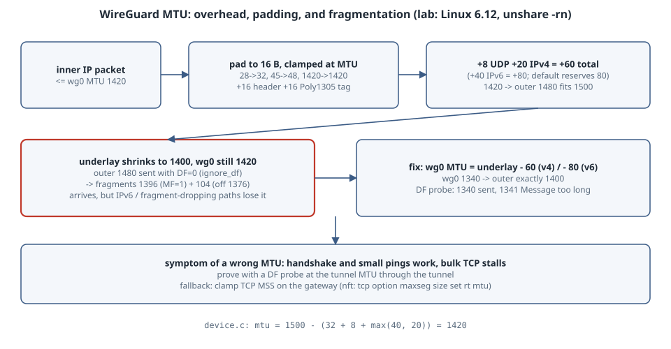

# WireGuard and MTU: Where the 1420 Comes From, Padding, and Silent Fragmentation

## Learning goals

- Derive WireGuard's default MTU of 1420 from the kernel source, and know why it is 80 bytes and not 60.
- Measure the real outer packet size for a given inner packet, including WireGuard's **16-byte padding**, on a live kernel tunnel.
- See what Linux WireGuard does when the underlay shrinks below what `wg0` assumes. It sends outer IPv4 with **DF=0**, so the packets are fragmented instead of dropped, and you need to know when that rescue stops working.
- Size `wg0` for a smaller underlay and prove the result with a DF probe.

Version note: everything below ran on Linux **6.12** (the in-tree `wireguard` module) inside an unprivileged user and network namespace (`unshare -rn`): no sudo, no `wg` tool and no `ping` on the box. Keys were set over netlink with pyroute2 0.9.7 (in a /workspace venv), packets were captured with an `AF_PACKET` socket in Python, and the underlay is a veth pair between two network namespaces. Kernel citations are to `drivers/net/wireguard/` at tag v6.12. The output is pasted from the run.

{fig-alt="An inner IP packet enters wg0, whose MTU is 1420. WireGuard pads the plaintext up to a multiple of 16 bytes, but never past the wg0 MTU, then adds a 16-byte data header and a 16-byte authentication tag. A UDP header of 8 bytes and an outer IPv4 header of 20 bytes follow, so the outer packet is 60 bytes larger than the padded inner packet: 1420 becomes 1480, which fits a 1500-byte underlay. The default MTU reserves 80 bytes, because an IPv6 outer header is 40 bytes. When the underlay shrinks to 1400 and wg0 stays at 1420, the kernel sends the 1480-byte outer IPv4 packet with DF clear, so it leaves as two fragments, 1396 and 104 bytes, and still arrives. The fix is to set wg0 to the underlay MTU minus 60 for IPv4 or minus 80 for IPv6, here 1340, after which the outer packet is exactly 1400 bytes."}

## Where 1420 comes from

From `drivers/net/wireguard/device.c` (v6.12):

```c
const int overhead = MESSAGE_MINIMUM_LENGTH + sizeof(struct udphdr) +
                     max(sizeof(struct ipv6hdr), sizeof(struct iphdr));
...
dev->mtu = ETH_DATA_LEN - overhead;
```

`MESSAGE_MINIMUM_LENGTH` is the data-message framing: a 16-byte header (type, receiver index and counter) plus the 16-byte Poly1305 tag, 32 bytes in all. Add the 8-byte UDP header and the **larger** of the two IP headers (40 for IPv6) and you get 80, so 1500 − 80 = **1420**. Over an IPv4 underlay the real overhead is 60, which leaves 20 bytes of slack. Over IPv6 it is exactly 80.

The plaintext is also padded. `send.c`'s `calculate_skb_padding()` aligns it to `MESSAGE_PADDING_MULTIPLE` (16) but clamps it to the interface MTU, so a full-size packet is never pushed over the MTU. The WireGuard paper describes the padding in §5.4.6.

## Lab: a real tunnel between two namespaces

```sh
#!/bin/sh
# Run as: unshare -rn ./lab.sh   (unprivileged: user + net namespace, no sudo)
set -e
PY=/workspace/venv-qos/bin/python
unshare -n sleep 60 >/dev/null 2>&1 & B=$!; sleep 0.2
inB() { nsenter -t $B -n --preserve-credentials "$@"; }
ip link set lo up; inB ip link set lo up
ip link add vA type veth peer name vB; ip link set vB netns /proc/$B/ns/net
ip addr add 192.0.2.1/24 dev vA; ip link set vA up
inB ip addr add 192.0.2.2/24 dev vB; inB ip link set vB up
ip link add wg0 type wireguard; inB ip link add wg0 type wireguard
$PY wgset.py wg0 a.key b.pub 51820 192.0.2.2 51820 10.9.0.2/32
inB $PY wgset.py wg0 b.key a.pub 51820 192.0.2.1 51820 10.9.0.1/32
ip addr add 10.9.0.1/24 dev wg0; ip link set wg0 up
inB ip addr add 10.9.0.2/24 dev wg0; inB ip link set wg0 up
echo "== links"; ip -o link show vA | awk '{print "   "$2, $4, $5}'; ip -o link show wg0 | awk '{print "   "$2, $4, $5}'
inB python3 cap.py vB 8 & C=$!; sleep 0.3
step() { echo "-- $1"; shift; python3 send.py 10.9.0.2 "$@"; sleep 0.3; }
step "first packet triggers the handshake" 0
step "inner sizes vs outer IPv4 packet size (underlay MTU 1500)" 0 1 15 16 17 1392
step "DF probe through wg0 (MTU 1420)" 1393
ip link set vA mtu 1400; inB ip link set vB mtu 1400
step "underlay shrinks to 1400, wg0 left at 1420: inner 1420-byte packet" 1392
ip link set wg0 mtu 1340
step "fix: wg0 MTU 1340 (= 1400 - 60)" 1312 1313
wait $C; kill $B
```

Helpers: `wgset.py` sets keys and the peer over netlink, `send.py` sends UDP datagrams with DF set, and `cap.py` prints every IPv4 frame arriving on the far end of the underlay.

```python
# wgset.py IFNAME PRIVFILE PEERPUBFILE LISTENPORT PEER_ENDPOINT_IP PEER_PORT PEER_ALLOWED
import sys
from pyroute2 import WireGuard
ifn, priv, peer, lport, eip, eport, allowed = sys.argv[1:]
WireGuard().set(ifn, private_key=open(priv).read().strip(), listen_port=int(lport),
    peer={"public_key": open(peer).read().strip(), "endpoint_addr": eip,
          "endpoint_port": int(eport), "allowed_ips": [allowed]})
```

```python
# send.py DST SIZE...: send one UDP datagram per SIZE with DF set (IP_PMTUDISC_DO)
import socket, sys
s = socket.socket(socket.AF_INET, socket.SOCK_DGRAM)
s.setsockopt(socket.IPPROTO_IP, 10, 2)  # IP_MTU_DISCOVER, IP_PMTUDISC_DO (linux/in.h)
for n in map(int, sys.argv[2:]):
    try:
        s.sendto(b"x" * n, (sys.argv[1], 9)); print(f"   payload {n:5d} (IP {n+28:5d}): sent")
    except OSError as e:
        print(f"   payload {n:5d} (IP {n+28:5d}): {e.strerror}")
```

```python
# cap.py IFACE SECONDS: print every IPv4 frame received on IFACE (AF_PACKET, no tcpdump)
import socket, struct, sys, time
s = socket.socket(socket.AF_PACKET, socket.SOCK_RAW, socket.htons(0x0800))
s.bind((sys.argv[1], 0)); s.settimeout(0.2)
end = time.time() + float(sys.argv[2])
KIND = {1: "handshake-init", 2: "handshake-resp", 3: "cookie", 4: "data"}
while time.time() < end:
    try: f, addr = s.recvfrom(65535)
    except socket.timeout: continue
    if addr[2] == socket.PACKET_OUTGOING: continue
    ip = f[14:]; tot, = struct.unpack("!H", ip[2:4]); fl, = struct.unpack("!H", ip[6:8])
    df, mf, off = fl >> 14 & 1, fl >> 13 & 1, (fl & 0x1fff) * 8
    what = ""
    if ip[9] == 17 and off == 0:
        udp = ip[20:]; what = KIND.get(udp[8], "?")
        if what == "data" and not mf: what += f" (encrypted inner packet {tot - 20 - 8 - 32} B incl. padding)"
        elif what == "data": what += " (first fragment)"
    elif off: what = "(later fragment)"
    print(f"      rx IP {tot:5d}  DF={df} MF={mf} off={off:<5d} {what}", flush=True)
```

The keys `a.key`/`b.key` and `a.pub`/`b.pub` are fresh X25519 keys, generated with Python `cryptography` and base64-encoded, which is the same format as `wg genkey`/`wg pubkey`.

```text
$ unshare -rn ./lab.sh
== links
   vA@if2: mtu 1500
   wg0: mtu 1420
-- first packet triggers the handshake
   payload     0 (IP    28): sent
      rx IP   176  DF=0 MF=0 off=0     handshake-init
      rx IP    92  DF=0 MF=0 off=0     data (encrypted inner packet 32 B incl. padding)
-- inner sizes vs outer IPv4 packet size (underlay MTU 1500)
   payload     0 (IP    28): sent
   payload     1 (IP    29): sent
   payload    15 (IP    43): sent
   payload    16 (IP    44): sent
   payload    17 (IP    45): sent
   payload  1392 (IP  1420): sent
      rx IP    92  DF=0 MF=0 off=0     data (encrypted inner packet 32 B incl. padding)
      rx IP    92  DF=0 MF=0 off=0     data (encrypted inner packet 32 B incl. padding)
      rx IP   108  DF=0 MF=0 off=0     data (encrypted inner packet 48 B incl. padding)
      rx IP   108  DF=0 MF=0 off=0     data (encrypted inner packet 48 B incl. padding)
      rx IP   108  DF=0 MF=0 off=0     data (encrypted inner packet 48 B incl. padding)
      rx IP  1480  DF=0 MF=0 off=0     data (encrypted inner packet 1420 B incl. padding)
-- DF probe through wg0 (MTU 1420)
   payload  1393 (IP  1421): Message too long
-- underlay shrinks to 1400, wg0 left at 1420: inner 1420-byte packet
   payload  1392 (IP  1420): sent
      rx IP  1396  DF=0 MF=1 off=0     data (first fragment)
      rx IP   104  DF=0 MF=0 off=1376  (later fragment)
-- fix: wg0 MTU 1340 (= 1400 - 60)
   payload  1312 (IP  1340): sent
   payload  1313 (IP  1341): Message too long
      rx IP  1400  DF=0 MF=0 off=0     data (encrypted inner packet 1340 B incl. padding)
```

The capture only shows packets arriving at B, so the handshake response (B → A) is not listed.

## Reading the numbers

| Inner IP packet | Padded plaintext | Outer IPv4 packet | Overhead |
|---|---|---|---|
| 28 | 32 | 92 | 64 |
| 29 | 32 | 92 | 63 |
| 43 / 44 / 45 | 48 | 108 | 65 / 64 / 63 |
| 1420 | 1420 (clamped, not 1424) | 1480 | 60 |

- **Fixed overhead is 60 bytes on IPv4**, plus up to 15 bytes of padding. The padding means small packets cost slightly more. At full size it costs nothing, because padding is clamped to the MTU: 1420 is not a multiple of 16, and yet the outer packet is exactly 1480.
- **The DF probe** (`IP_PMTUDISC_DO`, the socket equivalent of `ping -M do`) shows the inner limit: 1392 bytes of UDP payload (1420 IP) is sent, and 1393 gets `EMSGSIZE` locally.
- **When the underlay shrinks to 1400**, `wg0` still believes in 1420, and the encrypted 1480-byte packet leaves as **two IPv4 fragments**, 1396 + 104, with `DF=0`. It arrives. That is no accident: `socket.c` sets `skb->ignore_df = 1` and passes `df = 0` to `udp_tunnel_xmit_skb()`. A Linux WireGuard sender lets an IPv4 underlay fragment rather than drop.
- **After the fix** (`wg0` MTU 1340 = 1400 − 60), a 1340-byte inner packet becomes exactly one 1400-byte outer packet with no fragments, and anything larger fails fast at the sender.

## When fragmentation stops saving you (not run here)

The fragment rescue in the lab worked because the box doing the fragmenting was the sender, and IPv4 allows any router to fragment a DF=0 packet. It stops working when:

- **The underlay is IPv6.** IPv6 routers never fragment (RFC 8200 §5), so an oversized outer packet in the middle of the path is dropped. The sender learns about it only from ICMPv6 Packet Too Big, if that arrives.
- **Something on the path drops fragments.** Firewalls, some cloud load balancers and NAT devices do. RFC 8900 catalogues why IP fragmentation is fragile.
- **The fragments survive but cost you.** Every full-size packet becomes two, and losing either one loses both. Throughput drops and loss amplifies even though "it works".

In all three cases the symptom is the classic one: handshakes and small pings work, and bulk TCP stalls.

## The boring rule

- **Default 1420** is right when the underlay MTU is 1500, over either IP family.
- **Smaller underlay** (PPPoE 1492, another tunnel, a cloud VPC with odd MTUs): set `wg0` MTU = underlay MTU − 80. Use − 60 only if the underlay is IPv4-only and will stay that way.
- **Prove it with a DF probe** at the tunnel MTU through the tunnel, not with a default-size ping.
- **TCP clamping:** if you cannot control every host's MTU, clamp TCP MSS on the tunnel gateway (nftables `tcp option maxseg size set rt mtu`).

## Try this

1. Move the underlay to IPv6 (`2001:db8::1/64` on the veths, endpoints in IPv6) and repeat the shrink step. Does the outer packet still go out as fragments from the sender? Do the sizes change by 20 bytes?
2. Set `wg0` MTU to 1424 (a multiple of 16) and send a 1424-byte inner packet. What does the clamp do now?
3. Measure throughput with and without fragmentation using a 10-second UDP blast from `send.py` and the rx counters in `/proc/net/dev`.

## Sources

- Linux v6.12 `drivers/net/wireguard/device.c` (`overhead`, `dev->mtu`), `send.c` (`calculate_skb_padding`), `socket.c` (`ignore_df`, `df = 0`), `messages.h` (`MESSAGE_PADDING_MULTIPLE`, `MESSAGE_MINIMUM_LENGTH`): <https://git.kernel.org/pub/scm/linux/kernel/git/torvalds/linux.git/tree/drivers/net/wireguard?h=v6.12>
- J. A. Donenfeld, *WireGuard: Next Generation Kernel Network Tunnel*, §5.4.6 (transport data messages and padding): <https://www.wireguard.com/papers/wireguard.pdf>
- RFC 8200 §5 (IPv6 packet size; no fragmentation by routers): <https://www.rfc-editor.org/rfc/rfc8200>
- RFC 8900, *IP Fragmentation Considered Fragile*: <https://www.rfc-editor.org/rfc/rfc8900>
- ip(7), `IP_MTU_DISCOVER` / `IP_PMTUDISC_DO`: <https://man7.org/linux/man-pages/man7/ip.7.html>
- nft(8), TCP option `maxseg` and `rt mtu`: <https://www.netfilter.org/projects/nftables/manpage.html>
