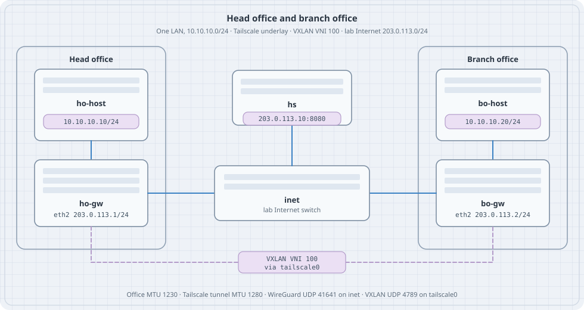

# Head Office and Branch Office

Two sites, one LAN. Each site is a small office in Containerlab. A Tailscale client on each gateway joins an in-lab tailnet, and VXLAN rides that tailnet so a workstation at the branch ARPs for a host at head office. The lab Internet only carries the encrypted underlay.

Versions this chapter is written against: Headscale **0.29.6** (Tailscale client **1.80** or newer; stable track at the time of writing is **1.104**), Debian **13** (trixie) for the gateways and the coordination node, Alpine for the switch and the workstations, Containerlab `kind: linux`. Deploy needs root, a container runtime, and `/dev/net/tun` on the host.

## Learning goals

By the end of this chapter you can:

- Place Headscale, two Tailscale gateways, and two workstations in one Containerlab topology
- Use each gateway's Tailscale address as a VXLAN VTEP
- Put both offices on `10.10.10.0/24` and prove the path with ARP, ping, and two captures
- Size the overlay MTU from Tailscale's 1280-byte tunnel plus VXLAN overhead
- Add a third site with a flood entry, and name the L3 pattern for offices that use different prefixes

## Why this shape

Tailscale already gives the two gateways addresses in `100.64.0.0/10` and encrypts what they send. That is enough when each office has its own prefix and a subnet route. This lab gives both offices the **same** prefix, `10.10.10.0/24`, and treats them as one Ethernet segment: head office holds `.10`, the branch holds `.20`, and neither host has a default route.

VXLAN is the segment. VNI **100** is that LAN. The VTEP address is the Tailscale address, and the VTEP device is `tailscale0`. The lab Internet (`203.0.113.0/24`, documentation prefix TEST-NET-3) is only how the gateways reach each other and the coordination server.

```text
ho-host 10.10.10.10 -- ho-gw == Tailscale / VXLAN VNI 100 == bo-gw -- bo-host 10.10.10.20
                         |                                      |
                         +---- inet (203.0.113.0/24) -- hs -----+
```

{fig-alt="Head office and branch office. Each has a workstation on 10.10.10.0/24 and a gateway. The gateways meet on a lab Internet switch at 203.0.113.0/24 where Headscale listens on 203.0.113.10. VXLAN VNI 100 runs between the Tailscale addresses on the two gateways."}

Containerlab can also attach a lab's **management** network to a tailnet (`mgmt.tailscale` in the topology). That feature publishes the lab so you can reach a node from a laptop. It is a different job from the data plane in this chapter.

## Roles

| Piece | Job in this lab |
|-------|-----------------|
| **Headscale** | Coordination server the two clients log in to. One tailnet, SQLite, no policy file (the default is permit). |
| **Tailscale on ho-gw / bo-gw** | Kernel `tailscale0`. WireGuard UDP **41641** toward the peer. |
| **VTEP** | `vxlan100`, VNI 100, `local` and `remote` set to the two Tailscale IPv4 addresses, underlay device `tailscale0`. |
| **Office LAN** | `eth1` and `vxlan100` in bridge `br100`. Workstations sit on `eth1`. |
| **inet** | Linux bridge. Shared lab Internet for `203.0.113.0/24`. |

Headscale's own container image is a convenience build; the project documents the binary and the `.deb` as the supported installs. This lab runs that binary in a Debian node so the node has a shell, `ip`, and an address you assign yourself.

The coordination URL is plain HTTP on the lab Internet (`http://203.0.113.10:8080`). Headscale accepts that. A tailnet you keep uses HTTPS on a name you control. This topology does not publish port 8080 on the host.

## Topology

Save the next two files in an empty directory. The bind path is relative to the topology file.

`hs/config.yaml`:

```yaml
server_url: http://203.0.113.10:8080
listen_addr: 0.0.0.0:8080
metrics_listen_addr: 127.0.0.1:9090
grpc_listen_addr: 127.0.0.1:50443
grpc_allow_insecure: false

noise:
  private_key_path: /var/lib/headscale/noise_private.key

prefixes:
  v4: 100.64.0.0/10
  v6: fd7a:115c:a1e0::/48
  allocation: sequential

derp:
  server:
    enabled: false
  urls:
    - https://controlplane.tailscale.com/derpmap/default
  paths: []
  auto_update_enabled: false

disable_check_updates: true

database:
  type: sqlite
  sqlite:
    path: /var/lib/headscale/db.sqlite
    write_ahead_log: true

policy:
  mode: file
  path: ""

dns:
  magic_dns: false
  base_domain: offices.lab
  override_local_dns: false
  nameservers:
    global: []
  search_domains: []
  extra_records: []

unix_socket: /var/run/headscale/headscale.sock
unix_socket_permission: "0770"

logtail:
  enabled: false

log:
  level: info
  format: text
```

`ts-vxlan.clab.yml`:

```yaml
name: ts-vxlan

topology:
  nodes:
    inet:
      kind: linux
      image: alpine:3.20
      exec:
        - sh -c "apk add --no-cache iproute2 && ip link add br0 type bridge && ip link set br0 up && for i in eth1 eth2 eth3; do ip link set $i up; ip link set $i master br0; done"
    hs:
      kind: linux
      image: debian:13-slim
      binds:
        - hs/config.yaml:/etc/headscale/config.yaml:ro
    ho-gw:
      kind: linux
      image: debian:13-slim
    bo-gw:
      kind: linux
      image: debian:13-slim
    ho-host:
      kind: linux
      image: alpine:3.20
      exec:
        - sh -c "apk add --no-cache iproute2 iputils"
    bo-host:
      kind: linux
      image: alpine:3.20
      exec:
        - sh -c "apk add --no-cache iproute2 iputils"

  links:
    - endpoints: ["ho-host:eth1", "ho-gw:eth1"]
    - endpoints: ["bo-host:eth1", "bo-gw:eth1"]
    - endpoints: ["ho-gw:eth2", "inet:eth1"]
    - endpoints: ["bo-gw:eth2", "inet:eth2"]
    - endpoints: ["hs:eth1", "inet:eth3"]
```

Containerlab starts nodes privileged. `tailscaled` uses that to create `tailscale0`. Check the host before deploy:

```bash
ls -l /dev/net/tun
sudo containerlab deploy -t ts-vxlan.clab.yml
```

## Addressing

| Node | Interface | Address |
|------|-----------|---------|
| ho-host | eth1 | 10.10.10.10/24, MTU 1230 |
| bo-host | eth1 | 10.10.10.20/24, MTU 1230 |
| ho-gw | eth2 | 203.0.113.1/24 |
| bo-gw | eth2 | 203.0.113.2/24 |
| hs | eth1 | 203.0.113.10/24 |
| ho-gw, bo-gw | tailscale0 | assigned from 100.64.0.0/10 |
| ho-gw, bo-gw | br100, vxlan100 | no IP; MTU 1230 |
| VNI | 100 | both offices |

Read the Tailscale addresses after login. Sequential allocation on an empty database usually yields `100.64.0.1` and `100.64.0.2`. The scripts below use whatever `tailscale ip -4` prints.

## Install and address the lab Internet

Debian nodes need packages from the network on `eth0`. Run this once after deploy.

```bash
install_gw() {
  local n="$1"
  docker exec "$n" bash -c '
    apt-get update
    apt-get install -y --no-install-recommends \
      ca-certificates curl iproute2 iptables tcpdump
    install -d -m 0755 /usr/share/keyrings
    curl -fsSL https://pkgs.tailscale.com/stable/debian/trixie.noarmor.gpg \
      -o /usr/share/keyrings/tailscale-archive-keyring.gpg
    curl -fsSL https://pkgs.tailscale.com/stable/debian/trixie.tailscale-keyring.list \
      -o /etc/apt/sources.list.d/tailscale.list
    apt-get update
    apt-get install -y tailscale
  '
}

install_gw clab-ts-vxlan-ho-gw
install_gw clab-ts-vxlan-bo-gw

docker exec clab-ts-vxlan-hs bash -c '
  apt-get update
  apt-get install -y --no-install-recommends ca-certificates curl iproute2
  arch=$(dpkg --print-architecture)
  curl -fsSL -o /usr/local/bin/headscale \
    "https://github.com/juanfont/headscale/releases/download/v0.29.6/headscale_0.29.6_linux_${arch}"
  chmod 755 /usr/local/bin/headscale
  mkdir -p /var/lib/headscale /var/run/headscale
'

docker exec clab-ts-vxlan-hs ip addr add 203.0.113.10/24 dev eth1
docker exec clab-ts-vxlan-hs ip link set eth1 up
docker exec clab-ts-vxlan-ho-gw ip addr add 203.0.113.1/24 dev eth2
docker exec clab-ts-vxlan-ho-gw ip link set eth2 up
docker exec clab-ts-vxlan-bo-gw ip addr add 203.0.113.2/24 dev eth2
docker exec clab-ts-vxlan-bo-gw ip link set eth2 up

docker exec clab-ts-vxlan-ho-gw ping -c 2 -W 1 203.0.113.10
docker exec clab-ts-vxlan-ho-gw ping -c 2 -W 1 203.0.113.2
```

`ip route` on a gateway shows `203.0.113.0/24 dev eth2`. That connected route is the lab Internet. `eth0` remains the Containerlab management network, used here only to install packages.

## Start Headscale and join both offices

```bash
docker exec -d clab-ts-vxlan-hs \
  headscale serve
# socket appears after the first migration
for _ in 1 2 3 4 5 6 7 8 9 10 11 12 13 14 15; do
  docker exec clab-ts-vxlan-hs headscale users list && break
  sleep 1
done

docker exec clab-ts-vxlan-hs headscale users create offices
docker exec clab-ts-vxlan-hs headscale users list
```

On a fresh database the user id is **1**. If the list shows another id, pass that id below.

```bash
KEY=$(docker exec clab-ts-vxlan-hs \
  headscale preauthkeys create --user 1 --reusable --expiration 24h)
KEY=$(printf '%s\n' "$KEY" | grep -oE 'hskey[^[:space:]]+' | head -n1)
printf '%s\n' "$KEY"
```

The key is a credential. It is reusable for 24 hours and it is printed into your shell history. Tear the lab down when you finish, and keep the key out of the topology file.

```bash
up_site() {
  local n="$1" host="$2"
  docker exec "$n" bash -c "
    mkdir -p /var/lib/tailscale /run/tailscale
    tailscaled --state=/var/lib/tailscale/tailscaled.state \
      >/var/log/tailscaled.log 2>&1 &
    for _ in 1 2 3 4 5 6 7 8 9 10 11 12 13 14 15; do
      [ -S /var/run/tailscale/tailscaled.sock ] && break
      sleep 1
    done
    # Management eth0 is a shortcut between every node. Drop WireGuard
    # there so the underlay you capture is the lab Internet.
    iptables -I OUTPUT -o eth0 -p udp --sport 41641 -j DROP
    iptables -I OUTPUT -o eth0 -p udp --dport 41641 -j DROP
    iptables -I INPUT  -i eth0 -p udp --dport 41641 -j DROP
    sysctl -w net.ipv4.conf.all.rp_filter=0
    sysctl -w net.ipv4.conf.eth2.rp_filter=0
    tailscale up \
      --login-server=http://203.0.113.10:8080 \
      --auth-key=${KEY} \
      --hostname=${host} \
      --accept-dns=false \
      --accept-routes=false
  "
}

up_site clab-ts-vxlan-ho-gw head-office
up_site clab-ts-vxlan-bo-gw branch-office

docker exec clab-ts-vxlan-ho-gw tailscale ip -4
docker exec clab-ts-vxlan-bo-gw tailscale ip -4
docker exec clab-ts-vxlan-ho-gw tailscale status
```

### Predict

- Each gateway has one address in `100.64.0.0/10` on `tailscale0`.
- `tailscale status` lists the other office as a peer, path `direct`.
- `tailscale ip -4` is the VTEP address you will pass to VXLAN.

Ping the peer's Tailscale address from head office before you build the overlay. That ping is the underlay.

## VXLAN on the tailnet

```bash
HO=$(docker exec clab-ts-vxlan-ho-gw tailscale ip -4 | head -n1)
BO=$(docker exec clab-ts-vxlan-bo-gw tailscale ip -4 | head -n1)

vxlan_up() {
  local n="$1" local_ip="$2" remote_ip="$3"
  docker exec "$n" bash -c "
    sysctl -w net.ipv4.conf.all.rp_filter=0
    sysctl -w net.ipv4.conf.tailscale0.rp_filter=0
    ip link add br100 type bridge
    ip link set br100 mtu 1230
    ip link set br100 up
    ip link add vxlan100 type vxlan id 100 \
      local ${local_ip} remote ${remote_ip} \
      dev tailscale0 dstport 4789
    ip link set vxlan100 mtu 1230
    ip link set vxlan100 up
    ip link set eth1 up
    ip link set eth1 master br100
    ip link set vxlan100 master br100
  "
}

vxlan_up clab-ts-vxlan-ho-gw "$HO" "$BO"
vxlan_up clab-ts-vxlan-bo-gw "$BO" "$HO"

docker exec clab-ts-vxlan-ho-host sh -c '
  ip link set eth1 mtu 1230
  ip addr add 10.10.10.10/24 dev eth1
  ip link set eth1 up
'
docker exec clab-ts-vxlan-bo-host sh -c '
  ip link set eth1 mtu 1230
  ip addr add 10.10.10.20/24 dev eth1
  ip link set eth1 up
'
```

`tailscale0` stays out of `br100`. It is the underlay port VXLAN encapsulates toward. The bridge holds the office LAN and the VTEP.

MTU, IPv4, from the outside in:

| Layer | Size |
|-------|------|
| Tailscale tunnel MTU | 1280 |
| Outer IPv4 + UDP + VXLAN + inner Ethernet | 20 + 8 + 8 + 14 = 50 |
| Office LAN MTU | 1280 − 50 = **1230** |

A 1230-byte inner IP packet is 1202 bytes of ICMP payload (`ping -s 1202`) plus 8 bytes of ICMP and 20 bytes of IPv4.

## Prove the offices share a LAN

```bash
docker exec clab-ts-vxlan-ho-gw ping -c 2 -W 2 "$BO"
docker exec clab-ts-vxlan-ho-host ping -c 3 -W 2 10.10.10.20
docker exec clab-ts-vxlan-ho-host ip neigh show dev eth1
docker exec clab-ts-vxlan-ho-gw bridge fdb show br100
```

Captures, in two windows, while the host ping runs:

```bash
docker exec clab-ts-vxlan-inet tcpdump -ni eth1 -c 8 udp port 41641
docker exec clab-ts-vxlan-ho-gw tcpdump -ni tailscale0 -c 4 udp port 4789
```

### Predict

- The workstation ping works with no route on either host.
- `ip neigh` on ho-host shows `10.10.10.20` on `eth1`.
- `bridge fdb` shows the branch MAC behind `vxlan100`.
- `inet` sees UDP/41641. It does not see UDP/4789. The VXLAN header is inside the tunnel.
- `tailscale0` on the gateway sees UDP/4789.

### Observe

```bash
docker exec clab-ts-vxlan-ho-gw ip -d link show vxlan100
docker exec clab-ts-vxlan-ho-gw tailscale status
docker exec clab-ts-vxlan-inet tcpdump -ni eth1 -c 3 udp port 4789
```

The third capture should sit until you interrupt it. Silence on 4789 at `inet` is the result you want during a host ping.

## Drill — MTU

```bash
docker exec clab-ts-vxlan-ho-host ping -c 1 -W 2 -M do -s 1202 10.10.10.20
docker exec clab-ts-vxlan-ho-host ping -c 1 -W 2 -M do -s 1203 10.10.10.20
```

### Predict

1202 passes. 1203, with don't-fragment set, fails. The office LAN is 1230 bytes, and the next byte does not fit.

## Drill — wrong VNI

```bash
docker exec clab-ts-vxlan-bo-gw ip link set vxlan100 down
docker exec clab-ts-vxlan-bo-gw ip link del vxlan100
docker exec clab-ts-vxlan-bo-gw bash -c "
  ip link add vxlan100 type vxlan id 200 \
    local ${BO} remote ${HO} dev tailscale0 dstport 4789
  ip link set vxlan100 mtu 1230 up
  ip link set vxlan100 master br100
"
docker exec clab-ts-vxlan-ho-host ping -c 2 -W 2 10.10.10.20
```

### Predict

The underlay ping between Tailscale addresses still works. The workstation ping stops. VNI 200 is a different segment.

Put VNI 100 back with the `vxlan_up` function before the next drill.

## A third office

Two VTEPs can name each other with `remote`. A third gateway is a flood list instead of a single remote. On each VTEP, for every peer:

```bash
ip link add vxlan100 type vxlan id 100 local "$LOCAL" dev tailscale0 dstport 4789
bridge fdb append 00:00:00:00:00:00 dev vxlan100 dst "$PEER_A"
bridge fdb append 00:00:00:00:00:00 dev vxlan100 dst "$PEER_B"
```

`00:00:00:00:00:00` is the head-end replication entry: broadcast, unknown unicast, and multicast are copied to each listed Tailscale address. Three offices means two copies of every ARP. That cost is why a control plane exists; this chapter stays on the static list so you can see the copies.

## Offices that should stay two networks

Give the sites different prefixes when a host at the branch should route to head office, and ARP should stop at the local gateway. The same two Tailscale nodes can advertise those prefixes:

```bash
tailscale up \
  --login-server=http://203.0.113.10:8080 \
  --auth-key="$KEY" \
  --hostname=head-office \
  --advertise-routes=10.10.0.0/24 \
  --accept-dns=false
```

Approve the route on Headscale (`headscale nodes list`, then the routes subcommand for that node) and start the peer with `--accept-routes`. Head office might be `10.10.0.0/24` and the branch `10.20.0.0/24`. Each workstation uses its gateway as the default route. There is no bridge and no VNI.

Use that pattern when the prefixes differ. Use VNI 100 when you want one `10.10.10.0/24` and working ARP across the two rooms.

## Same exercise on a tailnet you already run

The VXLAN lines do not change if Headscale is replaced by a coordination server you already use. On each gateway:

```bash
tailscale up --auth-key="$TS_AUTHKEY" --hostname=head-office \
  --accept-dns=false --accept-routes=false
```

Pass `--login-server` only when the client should use a server other than the default. Read `tailscale ip -4` and use those addresses as `local` and `remote`. Keep the preauth key in an environment variable, not in `ts-vxlan.clab.yml`.

The official `tailscale/tailscale` image runs userspace networking unless `TS_USERSPACE=false`. Userspace mode has no kernel `tailscale0`, so VXLAN has nothing to bind to. This lab uses the packaged `tailscaled` in a privileged node, which creates the interface.

## Failure table

| What you see | What to check |
|--------------|----------------|
| `headscale serve` exits at once | `docker exec clab-ts-vxlan-hs headscale serve` in the foreground. The usual causes are a missing `/var/lib/headscale` or a `dns` block the binary rejects. |
| `users list` has no socket | The server is still migrating. Wait, then read `/var/log` or the foreground log. |
| `tailscale up` never gets an address | Ping `203.0.113.10` from the gateway. The login URL has to be that address, the same string as `server_url`. |
| Peer stuck, no `direct` | `tailscale status` and `iptables -S` on the gateway. UDP/41641 has to be allowed on `eth2` and dropped on `eth0`. |
| Underlay ping works, host ping does not | `ip -d link show vxlan100` (VNI, local, remote, `dev tailscale0`), both ports in `br100`, host MTU 1230. |
| Host ping dies after a large packet | MTU 1230 on `vxlan100`, `br100`, and both workstations. |
| ARP never fills | `rp_filter` on `tailscale0` and `all`. Set both to 0. |
| `inet` shows UDP/4789 | The VTEP was bound to `eth2` or to `203.0.113.x`. `local` has to be the Tailscale address and `dev` has to be `tailscale0`. |

## Tear down

```bash
sudo containerlab destroy -t ts-vxlan.clab.yml --cleanup
```

Headscale's database and the Tailscale state files live in the container writable layer. Destroy removes them with the nodes. The preauth key dies with the database.

## Checklist

| Check | What it shows |
|-------|----------------|
| Ping `203.0.113.10` and the peer `.2` | Lab Internet is up |
| `tailscale ip -4` on both gateways | VTEP addresses exist |
| Ping the peer Tailscale address | Underlay, before any VNI |
| `tailscale0` in `ip -d link show vxlan100` | Encap device is the tailnet |
| Host ping and `ip neigh` | One LAN, VNI 100 |
| UDP/41641 on `inet`, UDP/4789 on `tailscale0` | Header order |
| `ping -M do -s 1202` and `-s 1203` | 1230-byte office MTU |

## Summary

- The two gateways log in to Headscale and become each other's underlay.
- VNI 100 bridges `10.10.10.10` and `10.10.10.20` across `tailscale0`.
- The lab Internet sees WireGuard. The Tailscale interface sees VXLAN.
- Office MTU is 1230 because the tunnel is 1280 and VXLAN adds 50 bytes of IPv4 overhead.
- A third site is another flood entry. Different prefixes are subnet routes on the same clients, with no bridge.
