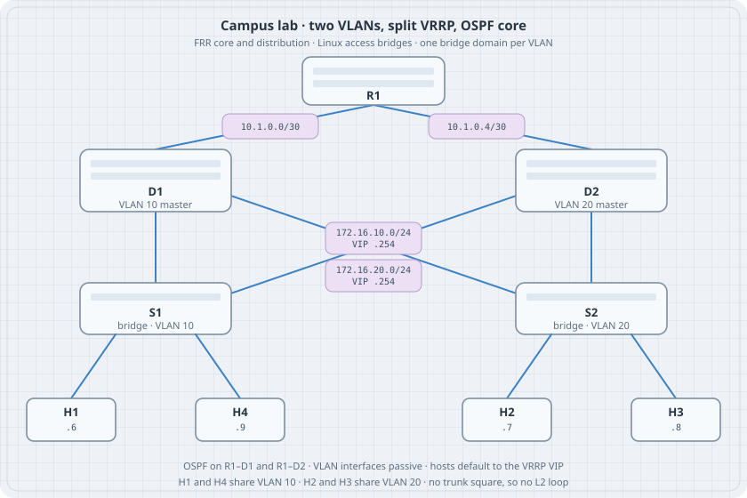

# Campus Design: Failure Domains and Verification

A redundant drawing is not yet a resilient network. A useful design identifies which traffic must survive each failure, what detects that failure, which component changes forwarding, and how the result will be measured. This project extends the [campus VLAN, VRRP and OSPF lab](03b-campus-vlan-vrrp-ospf.qmd); use its addressing and topology rather than assuming the abstract design below already has two of everything.

{fig-alt="Campus lab with two distribution routers providing virtual gateways to access networks and routing toward a core."}

## Translate requirements into tests

Assume the lab has user and server VLANs, two distribution routers D1 and D2, and one core R1. A host uses a virtual first-hop address; OSPF advertises connected VLANs toward the core. Define success for **specific source and destination pairs**, not just “the network stays up.” For example: same-VLAN traffic, inter-VLAN traffic, and traffic from each VLAN to a core-side test endpoint. Agree on an allowed interruption for each service and measure it; a routing adjacency timer is not an application recovery objective.

The design intentionally has a single R1 and single access switch per VLAN. Duplicating D1 and D2 does not eliminate those common failure points. Likewise, two uplinks in the same conduit, two power supplies on the same feed, or both controllers dependent on the same service can fail together. Inventory physical and logical dependencies: power, management, DNS, addressing, authentication, software, configuration and cabling paths. Availability math that multiplies independent probabilities is misleading when failures share a cause.

| Failure | Intended effect to verify | Evidence |
|---|---|---|
| D1 stops | D2 can take over the affected gateway and carry the specified flows | VRRP state, host neighbor entry, switch MAC table, loss interval, return route |
| D1–R1 link fails | Core-bound traffic uses an available alternate path if the design provides one | Link and OSPF state, route/FIB on D1 and R1, bidirectional traffic |
| R1 fails | Core-side service is unavailable in this single-core lab | Endpoint probes and topology inventory; do not claim core redundancy |
| One access switch fails | Its attached hosts lose that access path | Switch/port state and host reachability; a second distribution router cannot repair an absent access switch |
| VRRP advertisements are filtered but data links remain | Both routers may believe they should be active after timers expire | State and captures at both routers, duplicate ownership and MAC movement; test only in isolation |
| Client VLAN is absent from a trunk | Physical link may remain up while the affected VLAN fails | VLAN membership, STP state, counters and endpoint probes |

The exact effect of a failed uplink depends on routes and physical topology. If D1 still owns the virtual gateway and retains a usable path through another router, gateway movement may be unnecessary. If it remains active but has no usable onward path, hosts can send traffic to a black hole. VRRP by itself tracks the virtual-router election, not arbitrary remote application health. A platform may track a link, route or probe and alter priority; validate what the chosen tracking signal actually covers, how quickly it changes, and whether the backup can forward the affected destinations.

## Convergence is a chain

A fault is detected, communicated to a control process, translated into route and forwarding changes, and finally noticed by the application. These stages can overlap. VRRP advertisement timers, routing convergence, FIB programming, MAC learning, ARP/ND state and application retries all contribute to observed interruption. Faster failure detection is useful only if it measures the right path and does not cause unstable flapping. BFD reports the health of its configured session path; it is not an end-to-end application test.

On failover, inspect the virtual IP and MAC, switch forwarding table and host neighbor state rather than assuming all hosts immediately use the correct path. The resulting forward and return paths need not be symmetric. A stateful firewall or NAT device between them can have additional state-sharing requirements; a successful routing failover does not prove existing sessions survive.

## Controlled lab matrix

Deploy the linked campus lab using the versions and prerequisites in that chapter. Its `netlab create` evidence is configuration generation, not proof that the topology was deployed successfully. For each test below, run a timestamped, low-rate probe for every traffic pair and a representative application transaction if available. Capture baseline for at least a short stable interval, inject one fault, record recovery, restore the fault, and check the original baseline. Device syntax and convergence times differ; do not copy production configurations into the lab.

1. **Whole distribution failure:** stop D1. On D2 verify virtual-router state and VLAN interfaces; on R1 verify the selected routes. On the hosts check neighbor entries and both directions of traffic. Restart D1 and observe whether preemption changes the gateway again. Record both failure and restoration interruptions.
2. **Uplink failure:** disable D1's core-facing link while leaving its access-facing interface and VRRP running. Before doing so, predict whether D1 has an alternate route for the core-side destination. Compare its RIB/FIB, D2's route, VRRP state and traffic. If using a tracked priority, verify the trigger and the effective priority; do not assume it is configured by default.
3. **Core failure:** stop R1 and verify the reachability lost. Test local same-VLAN and inter-VLAN traffic separately; their survival depends on the remaining access and distribution paths, not on the core endpoint's reachability.
4. **Return path:** in the isolated lab remove or filter the route on R1 back to one VLAN. Observe whether the forward probe reaches the remote endpoint and whether replies return. Restore the route and verify the selected FIB and application traffic.
5. **Control-plane partition:** filter VRRP advertisements only between D1 and D2 in an isolated variant with packet captures. Record the possibility of simultaneous active states, MAC movement and disruption; the outcome depends on timing and topology. Remove the filter, verify a single active router and confirm traffic recovery.
6. **VLAN fault:** remove one test VLAN from the relevant lab link or bridge. Verify which traffic is affected while physical link remains up, then restore membership. If the chosen lab uses separate untagged bridges rather than trunks, alter the appropriate bridge membership instead of inventing trunk commands.

For every drill save a timeline containing fault start, detection, protocol transition, route/FIB changes, last failed and first successful probe, plus the observation point. Probe interval bounds measurement precision: one-second probes cannot prove a 100 ms outage. Packet capture or higher-frequency controlled probes can improve resolution but add overhead. The drills are a vendor-neutral test plan; they have not been executed as a complete deployment in this chapter.

## Review the design

Which components remain single points of failure? What happens if the active first hop loses only its upstream link? What does the chosen tracking probe verify, and what can it miss? Could a partial failure preserve VRRP while breaking an application? Which direction and which VLAN did each test actually cover? Record risks and proposed changes, then repeat the matrix after every material design change.

**References:** [VRRPv3, RFC 9568](https://www.rfc-editor.org/rfc/rfc9568.html), [BFD, RFC 5880](https://www.rfc-editor.org/rfc/rfc5880.html), and [loop-free convergence framework, RFC 5715](https://www.rfc-editor.org/rfc/rfc5715.html).
