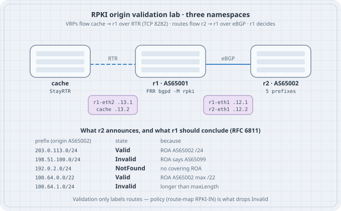

# Route Origin Validation: Design, States, and Deployment

Route origin validation is a label on a BGP route plus a policy that decides what the label may do. This chapter is the decision. The build, the five drills, and the FRR commands are in **RPKI — Route Origin Validation**. Follow them before you enforce this on a router with a full table.

{fig-alt="A StayRTR cache feeds validated ROA payloads over RTR to a router, which labels five prefixes from a neighbour as Valid, Invalid, or NotFound."}

## Learning goals

- Define Valid, Invalid, and NotFound the way RFC 6811 does
- Write the policy each state should cause on a transit session and on a customer session
- Move from monitor-only to drop-Invalid without blackholing NotFound
- Explain a coverage gap as a ROA you have not published, not as a validator failure

## ROV State Machine: Valid, Invalid, Not-Found Defined

For one received route, after the router has a VRP table:

| State | Condition | What it authorises |
|-------|-----------|--------------------|
| **Valid** | A covering VRP names this origin, and the prefix length sits inside `maxLength` | Prefer it if your policy says so. It is still subject to prefix filters and to leak checks |
| **Invalid** | At least one VRP covers the prefix, and none of them authorise this origin at this length | Drop it on sessions where you enforce. Investigate it on sessions where you are still monitoring |
| **NotFound** | No VRP covers the prefix | Accept it under your ordinary filters. Do not treat it as a failed cryptographic check |

The state is recomputed when the route changes and when the VRP table changes. A platform that only computes it on receipt will keep a stale Invalid, or a stale Valid, until the peer re-announces or you clear the session softly. That bug is Drill 4 of the ROV lab. Confirm it on every release you deploy.

NotFound is the initial state of every route if the cache has not delivered a table yet. A router that drops NotFound during cache startup blackholes the Internet at boot.

## Making Routing Decisions Based on ROV State

Labels do not move packets. Import policy does. A minimal enforced policy for a transit or peer session:

- Invalid → reject
- Valid → accept, and continue through the same prefix and AS-path policy you already had
- NotFound → accept, same filters

A customer session can be stricter because you already know the prefix list. ROV is a backstop for the day the list is stale, not a replacement for the list. Reject Invalid. Reject anything outside the customer's allocation even if a ROA says Valid, because a Valid ROA might be for a different customer of yours, or a too-wide `maxLength` inside space you did not intend to accept from this neighbour.

Do not raise local preference on Valid by default. It sounds tidy and it changes traffic engineering for the entire table. RFC 7115's conservative deployment is drop Invalid, leave everything else alone. Add a preference only where you have a measured reason.

Never export a route you rejected. Never announce a prefix of your own that you know is Invalid. Other networks will drop it, and you will have filtered yourself.

## ROV Migration Strategies: From Passive Validation to Enforcement

Do this in order. Skipping a row is how ROV becomes an outage you caused.

1. Publish tight ROAs for every prefix you originate, and confirm a looking glass sees them as Valid, before you depend on anyone else's enforcement.
2. Stand up two caches and confirm the routers hold a stable VRP count.
3. Turn on validation in monitor-only mode. Count Invalids. Open tickets with customers whose ROAs disagree with their announcements. Fix your own first.
4. Drop Invalid toward transit and peers once the Invalid count is understood and small.
5. Drop Invalid toward customers after the conversations in step 3, or you will blackhole a customer who typo'd a ROA and then page you.
6. Re-check that VRP updates re-run policy on the release you run.
7. Leave NotFound accepted. Revisit that only if the global NotFound share has collapsed and you have an explicit exception process. That is not the 2026 situation.

Rollback is a policy change, not a validator uninstall. Keep the previous route-map one commit away. Chapter 17 treats that as a normal deploy.

## Handling Not-Found: Policy Choices and Operational Realities

NotFound is a mixture of networks that have not created ROAs, networks whose ROAs are stuck in a failed publication, and prefixes that are too new for your cache. Dropping all of it is a reachability outage measured in hundreds of thousands of prefixes. Tagging it for visibility is useful. De-preferencing it slightly is a local choice that will steer you toward Valid paths when you have two routes to the same prefix, and it will do nothing when the only route is NotFound.

Some operators drop NotFound inside their own allocation and for customers, where silence is a mistake rather than the state of the wider Internet. That is a sound local policy. Apply it on the sessions where you are the one who knows the space, not on the full table.

A sudden jump in NotFound, correlated with one trust anchor's VRP count falling, is a validator or repository incident. A sudden jump in Invalid on your own prefixes is a ROA incident. They look similar on a single "RPKI bad" dashboard and they are different pages.

## ROA Coverage Gaps and Their Practical Implications

Coverage is uneven by region, by address family, and by whether the holder is a network that feels the pain of hijacks. Late October 2026 public snapshots put roughly three quarters of announced prefixes in the Valid state and roughly a quarter NotFound, with Invalid under about one percent. IPv6 is generally better covered than the long tail of legacy IPv4. Those ratios are a planning input. They say enforcement of Invalid is affordable, and enforcement of NotFound is not.

Gaps that hurt even when the percentage looks good:

- Your own unannounced-but-held space has no ROA and no AS0 ROA, so a hijack of it is NotFound
- A ROA exists for the aggregate and you announce a more-specific for traffic engineering, so your more-specific is Invalid everywhere that enforces
- A customer moved to a new origin AS and left the old ROA in place
- A DDoS scrubber originates your prefix from a different AS and you never added that origin to a ROA

Each of these is a lifecycle miss. Chapter 20 owns the process. ROV cannot paper over a ROA you did not write.

## Multi-Validator Architectures for ROV Resilience

One cache is a silent fail-open waiting to happen. Two caches of the same binary share parser bugs. A resilient layout:

- Two hosts, different racks or sites
- Routinator on one, rpki-client plus an RTR front end on the other
- Both RTR sessions configured on every border router, with explicit preference
- The same SLURM exceptions on both, generated from the same reviewed file, or you will enforce two different Internets
- An alert if the two VRP counts diverge beyond a threshold you set after a week of baseline

Divergence is a signal, not an automatic failover to "accept everything." When the caches disagree, keep enforcing the preferred cache, page a human, and do not hot-edit a SLURM at 03:00 to silence the page. Disagreement is how you find a strictness bug before it drops a route the other cache still considers Valid.

Routers inside an AS can share the same pair of caches. They do not each need a validator process. They do each need a reachability path to the caches that does not itself depend on the BGP table the caches are validating. Management addresses and an IGP, or a static route, belong under the RTR sessions.

## Summary

- Valid, Invalid, and NotFound are origin results. Policy decides the forwarding
- Drop Invalid. Keep NotFound. Do not prefer Valid unless you meant to re-engineer traffic
- Migrate from publish, to monitor, to enforce, per neighbour class
- Coverage gaps are missing or loose ROAs, including your own
- Two implementations, same exceptions, alarmed divergence

## Sources

- RFC 6811 — BGP Prefix Origin Validation: <https://www.rfc-editor.org/rfc/rfc6811>
- RFC 7115 — Origin Validation Operation Based on the Resource Public Key Infrastructure: <https://www.rfc-editor.org/rfc/rfc7115>
- RFC 8481 — Clarifications to BGP Origin Validation: <https://www.rfc-editor.org/rfc/rfc8481>
- RFC 9319 — The Use of maxLength in the RPKI: <https://www.rfc-editor.org/rfc/rfc9319>
