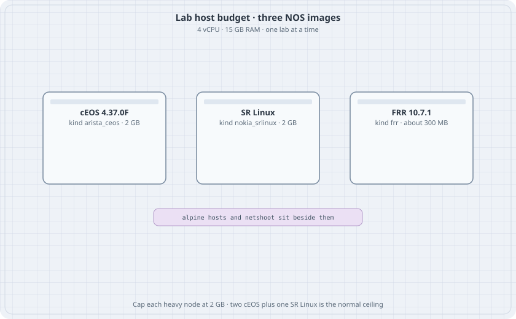

# Lab Host and the Image Set

This part is the hands-on track for the lab machine that already has Arista cEOS, Nokia SR Linux, and FRR loaded. The earlier chapters teach the same protocols on free images. Here the point is to see one behaviour in three command languages, on hardware you can actually start.

{fig-alt="Three cards for cEOS at 2 GB, SR Linux at 2 GB, and FRR at about 300 MB, with a note that two cEOS nodes plus one SR Linux node is the normal ceiling"}

## Learning goals

By the end of this chapter you can:

- Reach the lab host and see which images are loaded
- Stay inside the memory budget of a 4-vCPU, 15 GB machine
- Deploy and destroy a Containerlab topology without leaving it running
- Push a config into cEOS, SR Linux, and FRR after the node is actually ready

## What is on the machine

Inventory taken on 2026-11-12. Re-check with `docker images` before you trust a tag.

| Role | Tag on the host | Kind | Notes |
|------|-----------------|------|--------|
| Switching and EOS CLI | `ceos:4.37.0F` | `arista_ceos` | Also tagged `ceos:latest`. Image id `cb0f822d3229`. |
| Model-driven NOS | `ghcr.io/nokia/srlinux:latest` | `nokia_srlinux` | Also tagged `srlinux:latest`. Created 2026-08-19. Image id `0096fe3ebcaf`. Pin this id before a later pull of `latest`. |
| Open routing suite | `quay.io/frrouting/frr:containerlab-10.7.1` | `frr` | Also tagged `frr:containerlab`. Image id `f7d98e4faa24`. |
| Host | `alpine:latest` | `linux` | Busybox `ip` and `ping` are enough for these labs. |
| Capture and tools | `nicolaka/netshoot:latest`, `ghcr.io/srl-labs/network-multitool:latest` | `linux` | Optional. Use one when you want `tcpdump` or `mtr` without installing on Alpine. |
| gNMI client | `ghcr.io/openconfig/gnmic:latest` | run with `docker run` | Used in the gNMI chapter. Not a topology node by default. |
| Drawings | `ghcr.io/srl-labs/clab-io-draw:latest` | tool | `clab graph` can render a topology after it deploys. |

Containerlab on the host is **0.83.0**. Short kind names `ceos`, `srl`, and `frr` still parse. The long names above are the ones these labs use.

The host has **4 vCPUs** and **15 GB** of RAM, with a large data disk. Labs live under `/data/labs`. A Python virtualenv at `/data/labs/venv` already has Ansible, Netmiko, and Scrapli. These labs do not need that venv. They are Containerlab files plus CLI.

cEOS is not a free image. This book does not tell you how to download it and does not ship the image. The labs assume the tag is already present, which it is on this host.

## How big a lab can be

| Node | Cap used in these labs | Practical count |
|------|------------------------|-----------------|
| cEOS | `memory: 2G` | 2, or 3 if nothing else heavy is up |
| SR Linux | `memory: 2G` | 1 beside the cEOS pair |
| FRR | a few hundred MB | several |
| Alpine | tens of MB | several |

Two cEOS nodes plus one SR Linux node is about 6 GB before the host's own services. That fits. Four cEOS nodes, or a cEOS pair plus two SR Linux nodes, does not leave a safe margin. Destroy a lab before you deploy the next one.

```bash
containerlab destroy -t topology.clab.yml --cleanup
```

`--cleanup` removes the lab directory, including saved configs. Copy anything you want to keep first.

## Reach the host

From the workstation that already has the SSH alias:

```bash
ssh ubutail
cd /data/labs
mkdir -p 02-forwarding && cd 02-forwarding
```

Do not publish the host's addresses or key paths. The alias is enough.

## Credentials the labs use

| NOS | How you get a CLI | Default login |
|-----|-------------------|---------------|
| cEOS | `docker exec -it clab-<lab>-<node> Cli` | `admin` / `admin` |
| FRR containerlab image | `ssh admin@clab-<lab>-<node>` opens vtysh, or `docker exec -it ... vtysh` | `admin` / `admin` for SSH. Keys on the host also work. |
| SR Linux | `docker exec -it clab-<lab>-<node> sr_cli` | `admin` / `NokiaSrl1!` |

cEOS takes one to two minutes after `deploy` before `Cli` answers. SR Linux is similar. FRR is ready when `vtysh` connects.

## Push a config

Wait, then send the CLI. Example for a lab named `forward`:

```bash
until docker exec clab-forward-r-ceos Cli -c "show hostname" >/dev/null 2>&1
do sleep 5; done

docker exec clab-forward-r-ceos Cli -p 15 -c "
enable
configure terminal
interface Ethernet1
   no switchport
   ip address 10.1.12.2/30
end
write memory
"
```

SR Linux, one candidate commit:

```bash
docker exec -i clab-forward-r-srl sr_cli <<'EOF'
enter candidate
set interface ethernet-1/1 admin-state enable
set interface ethernet-1/1 subinterface 0 admin-state enable
set interface ethernet-1/1 subinterface 0 ipv4 admin-state enable
set interface ethernet-1/1 subinterface 0 ipv4 address 10.1.13.2/30
commit now
quit
EOF
```

If a `set` path is rejected, stop and tab-complete that leaf on this image. The SR Linux tag is `latest`. The command shape is stable. A leaf name can move.

FRR takes a `startup-config` file. The `frr` kind writes it to `frr.conf` and starts the daemons you list. `zebra` always starts.

```yaml
r-frr:
  kind: frr
  image: quay.io/frrouting/frr:containerlab-10.7.1
  startup-config: r-frr.frr.conf
  daemons: [ospfd]
```

## Kind defaults used in every lab

```yaml
topology:
  kinds:
    arista_ceos:
      image: ceos:4.37.0F
      memory: 2G
    nokia_srlinux:
      image: ghcr.io/nokia/srlinux:latest
      memory: 2G
    frr:
      image: quay.io/frrouting/frr:containerlab-10.7.1
```

Data interfaces are `eth1`, `eth2`, and so on in the topology file for cEOS and FRR. Inside EOS those are `Ethernet1`, `Ethernet2`. Inside SR Linux the topology name `ethernet-1/1` is the port. `eth0` is management on all three. Do not put a lab prefix on `eth0`.

Link addresses on a cEOS `ipv4:` field make Containerlab configure `no switchport` and the address after boot. Use that only on routed labs. A VLAN lab must not set `ipv4` on a switchport.

## What this track covers

The spread matches the work of an associate-level track and a professional-level track: switching, IPv4 and IPv6, first hop, OSPF, IS-IS, BGP, policy, ACLs, NAT, DHCP, VXLAN, EVPN, and a management API. Later chapters add path MTU, STP edge guards, DHCP snooping, MLAG, VRF-lite, stub areas, redistribution, MED, policy routing, uRPF, SPAN, GRE, a control-plane ACL, SLAAC, NTP, and delay. It is not an exam blueprint, and it does not use exam question banks.

| You will build | Chapter |
|----------------|---------|
| Image budget and CLI push | this chapter |
| IPv4 forwarding across three NOSes | Three-Router Forwarding |
| Interfaces and LLDP | cEOS Interfaces and LLDP |
| Access, trunk, STP, LACP | the switching chapters |
| SVI, DHCP, VRRP, VARP | the first-hop chapters |
| Statics, OSPF, IS-IS | the IGP chapters |
| eBGP, reflection, policy | the BGP chapters |
| ACL and NAT | ACLs and Edge NAT |
| IPv6 on the triangle | IPv6 on the Same Triangle |
| VXLAN and EVPN | the overlay chapters |
| gNMI | Reading SR Linux with gNMI |
| Break the design on purpose | Production Failure Drills |
| Path MTU and TCP MSS | Path MTU and TCP MSS |
| Portfast, BPDU guard, root guard | STP Edge Guards |
| DHCP snooping and DAI | DHCP Snooping and ARP Inspection |
| MLAG | MLAG on cEOS |
| Overlapping VRFs | VRF-Lite |
| Stub areas and summaries | OSPF Stub, NSSA, and Summary |
| Redistribution tags | Redistribution and Route Tags |
| MED, prepend, ECMP | BGP MED, Prepend, and ECMP |
| Policy routing | Policy-Based Routing |
| Strict uRPF | Unicast RPF |
| A copied port | SPAN |
| GRE between loopbacks | GRE over the Underlay |
| For-us versus transit | Control-Plane ACL |
| Router advertisements | IPv6 SLAAC |
| NTP and syslog | NTP and Syslog |
| A delay you can measure | DSCP Trust and Measured Delay |
| OSPF MD5 | OSPF Authentication |

These images do not give you a wireless LAN, a voice gateway, an SD-WAN controller, or a service-provider MPLS VPN lab. Those stay out of this part rather than being faked.

## Rule for every later chapter

1. One lab directory under `/data/labs`.
2. `containerlab deploy -t topology.clab.yml` from that directory.
3. Wait until the CLI answers.
4. Check the table in the chapter before you call the lab done.
5. `containerlab destroy -t topology.clab.yml --cleanup` before the next lab.

None of the labs in this part were left running on the host. The topologies match Containerlab 0.83 and the image tags above. Boot them yourself and keep the show output.
