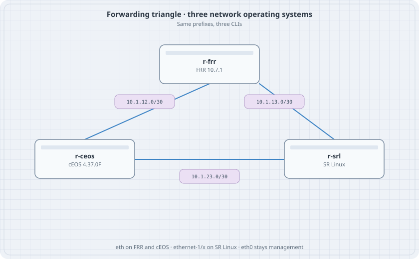

# Three-Router Forwarding

One IPv4 triangle, three operating systems. Each router has a loopback. OSPF is not in this lab. Static routes are, so a missing route is your fault and not a protocol's.

{fig-alt="Triangle linking an FRR router, a cEOS router, and an SR Linux router with three /30 networks"}

## Learning goals

By the end of this chapter you can:

- Wire FRR, cEOS, and SR Linux in one Containerlab file
- Put an IPv4 address on the data interface in each CLI
- Install the one static route each router needs for the far loopback
- Prove the path with ping sourced from the loopback

## Addressing

| Node | Loopback | eth1 | eth2 |
|------|----------|------|------|
| r-frr | 10.0.0.1/32 | 10.1.12.1/30 to r-ceos | 10.1.13.1/30 to r-srl |
| r-ceos | 10.0.0.2/32 | 10.1.12.2/30 to r-frr | 10.1.23.1/30 to r-srl |
| r-srl | 10.0.0.3/32 | 10.1.13.2/30 to r-frr | 10.1.23.2/30 to r-ceos |

## Topology

```yaml
name: forward
topology:
  kinds:
    arista_ceos:
      image: ceos:4.37.0F
      memory: 2G
    nokia_srlinux:
      image: ghcr.io/nokia/srlinux:latest
      memory: 2G
    frr:
      image: quay.io/frrouting/frr:containerlab-10.7.1
  nodes:
    r-frr:
      kind: frr
      startup-config: r-frr.frr.conf
      daemons: [staticd]
    r-ceos:
      kind: arista_ceos
    r-srl:
      kind: nokia_srlinux
  links:
    - endpoints: ["r-frr:eth1", "r-ceos:eth1"]
    - endpoints: ["r-frr:eth2", "r-srl:ethernet-1/1"]
    - endpoints: ["r-ceos:eth2", "r-srl:ethernet-1/2"]
```

`r-frr.frr.conf`:

```text
frr defaults traditional
service integrated-vtysh-config
!
interface lo
 ip address 10.0.0.1/32
!
interface eth1
 ip address 10.1.12.1/30
!
interface eth2
 ip address 10.1.13.1/30
!
ip route 10.0.0.2/32 10.1.12.2
ip route 10.0.0.3/32 10.1.13.2
!
```

## cEOS

```text
interface Loopback0
   ip address 10.0.0.2/32
interface Ethernet1
   no switchport
   ip address 10.1.12.2/30
interface Ethernet2
   no switchport
   ip address 10.1.23.1/30
ip route 10.0.0.1/32 10.1.12.1
ip route 10.0.0.3/32 10.1.23.2
```

## SR Linux

```text
enter candidate
set interface ethernet-1/1 admin-state enable
set interface ethernet-1/1 subinterface 0 admin-state enable
set interface ethernet-1/1 subinterface 0 ipv4 admin-state enable
set interface ethernet-1/1 subinterface 0 ipv4 address 10.1.13.2/30
set interface ethernet-1/2 admin-state enable
set interface ethernet-1/2 subinterface 0 admin-state enable
set interface ethernet-1/2 subinterface 0 ipv4 admin-state enable
set interface ethernet-1/2 subinterface 0 ipv4 address 10.1.23.2/30
set interface lo0 admin-state enable
set interface lo0 subinterface 0 admin-state enable
set interface lo0 subinterface 0 ipv4 admin-state enable
set interface lo0 subinterface 0 ipv4 address 10.0.0.3/32
set network-instance default type default
set network-instance default admin-state enable
set network-instance default interface ethernet-1/1.0
set network-instance default interface ethernet-1/2.0
set network-instance default interface lo0.0
set network-instance default static-routes route 10.0.0.1/32 admin-state enable
set network-instance default static-routes route 10.0.0.1/32 next-hop-group to-frr
set network-instance default next-hop-groups group to-frr admin-state enable
set network-instance default next-hop-groups group to-frr nexthop 1 ip-address 10.1.13.1
set network-instance default next-hop-groups group to-frr nexthop 1 admin-state enable
set network-instance default static-routes route 10.0.0.2/32 admin-state enable
set network-instance default static-routes route 10.0.0.2/32 next-hop-group to-ceos
set network-instance default next-hop-groups group to-ceos admin-state enable
set network-instance default next-hop-groups group to-ceos nexthop 1 ip-address 10.1.23.1
set network-instance default next-hop-groups group to-ceos nexthop 1 admin-state enable
commit now
```

## Verify

```bash
docker exec clab-forward-r-frr vtysh -c "ping 10.0.0.2 source 10.0.0.1"
docker exec clab-forward-r-frr vtysh -c "ping 10.0.0.3 source 10.0.0.1"
docker exec clab-forward-r-ceos Cli -c "ping 10.0.0.1 source 10.0.0.2"
docker exec clab-forward-r-srl sr_cli "ping 10.0.0.1 network-instance default -I 10.0.0.3"
```

The SR Linux ping flag may be `-I` or a `source` leaf. Read the help on the node if the flag is refused.

### Predict

- Each loopback answers only after the static route exists. Connected pings succeed first.
- A ping from r-frr to 10.0.0.2 leaves via 10.1.12.2. It does not hairpin through r-srl.
- Shutting r-ceos Ethernet2 does not break r-frr to r-ceos. It does break r-srl to 10.0.0.2.

## Drill

Delete the static route for 10.0.0.3 on r-frr. Ping 10.0.0.3 and confirm the failure. Put the route back. Then shut r-ceos Ethernet2 and confirm which pings die.
