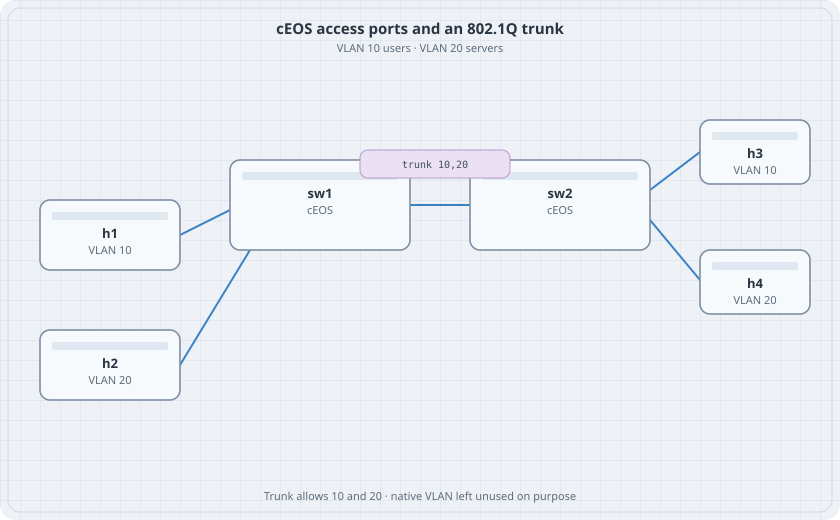

# VLANs and Trunks on cEOS

Two switches, two VLANs, one trunk. Hosts in the same VLAN ping. Hosts in different VLANs do not, because nothing here routes.

{fig-alt="h1 and h2 on sw1 in VLAN 10 and VLAN 20, a trunk to sw2, and h3 and h4 on sw2 in those same VLANs"}

## Learning goals

By the end of this chapter you can:

- Create VLAN 10 and VLAN 20 on cEOS
- Set an access port and a trunk
- See a tag with tcpdump on the trunk
- Show that a missing allowed VLAN is a blackhole, not a routing problem

## Addressing

| Host | Switch port | VLAN | Address |
|------|-------------|------|---------|
| h1 | sw1 Ethernet1 | 10 | 172.16.10.11/24 |
| h2 | sw1 Ethernet2 | 20 | 172.16.20.11/24 |
| h3 | sw2 Ethernet1 | 10 | 172.16.10.12/24 |
| h4 | sw2 Ethernet2 | 20 | 172.16.20.12/24 |

The trunk is sw1 Ethernet3 to sw2 Ethernet3. No IP on the switches.

## Topology

```yaml
name: vlan
topology:
  kinds:
    arista_ceos:
      image: ceos:4.37.0F
      memory: 2G
  nodes:
    sw1:
      kind: arista_ceos
    sw2:
      kind: arista_ceos
    h1:
      kind: linux
      image: alpine:latest
      exec:
        - ip addr add 172.16.10.11/24 dev eth1
        - ip link set eth1 up
    h2:
      kind: linux
      image: alpine:latest
      exec:
        - ip addr add 172.16.20.11/24 dev eth1
        - ip link set eth1 up
    h3:
      kind: linux
      image: alpine:latest
      exec:
        - ip addr add 172.16.10.12/24 dev eth1
        - ip link set eth1 up
    h4:
      kind: linux
      image: alpine:latest
      exec:
        - ip addr add 172.16.20.12/24 dev eth1
        - ip link set eth1 up
  links:
    - endpoints: ["h1:eth1", "sw1:eth1"]
    - endpoints: ["h2:eth1", "sw1:eth2"]
    - endpoints: ["h3:eth1", "sw2:eth1"]
    - endpoints: ["h4:eth1", "sw2:eth2"]
    - endpoints: ["sw1:eth3", "sw2:eth3"]
```

Do not put `ipv4` on these links. That would turn the ports into routed ports.

## Both switches

```text
vlan 10
   name users
vlan 20
   name servers
interface Ethernet1
   switchport mode access
   switchport access vlan 10
interface Ethernet2
   switchport mode access
   switchport access vlan 20
interface Ethernet3
   switchport mode trunk
   switchport trunk allowed vlan 10,20
```

On sw2, Ethernet1 is still VLAN 10 and Ethernet2 is still VLAN 20. The trunk is the same list on both ends.

## Verify

```bash
docker exec clab-vlan-h1 ping -c 2 172.16.10.12
docker exec clab-vlan-h1 ping -c 2 172.16.20.11
docker exec clab-vlan-sw1 Cli -c "show vlan"
docker exec clab-vlan-sw1 Cli -c "show interfaces trunk"
```

Capture on the trunk from the host namespace if you want the tag:

```bash
containerlab inspect interfaces -t topology.clab.yml
```

Find the veth for sw1 Ethernet3 and run `tcpdump -eni <veth> vlan` on the lab host. VLAN 10 frames between h1 and h3 carry tag 10.

### Predict

- h1 reaches h3. h2 reaches h4.
- h1 does not reach h2. There is no SVI and no router.
- Remove VLAN 20 from sw2's allowed list. h2 stops reaching h4. h1 still reaches h3.

## Drill

Change sw2 Ethernet2 to VLAN 10 by mistake. h2 and h4 stop talking, and h2 starts seeing h1's subnet. Put it back. Then remove VLAN 10 from the trunk and write down which pings fail.
