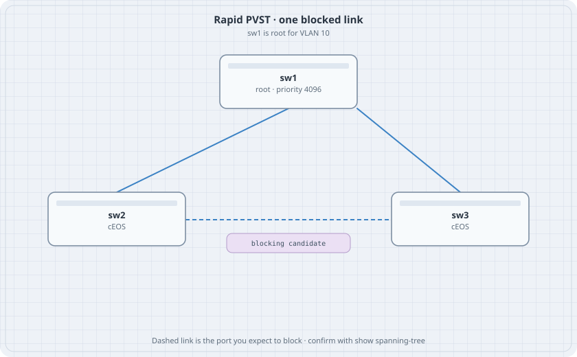

# Spanning Tree on cEOS

Three switches and three links are a loop. Rapid PVST picks a root and blocks one port. This lab makes that choice obvious, then moves the root on purpose.

{fig-alt="Triangle of sw1, sw2, and sw3. sw1 is root. The link between sw2 and sw3 is marked as the blocking candidate."}

## Learning goals

By the end of this chapter you can:

- Turn on rapid PVST and set a root
- Read root, designated, and alternate ports
- Predict which link blocks when all costs are equal
- Move the root and watch the blocked port move

## Topology

```yaml
name: stp
topology:
  kinds:
    arista_ceos:
      image: ceos:4.37.0F
      memory: 2G
  nodes:
    sw1:
      kind: arista_ceos
    sw2:
      kind: arista_ceos
    sw3:
      kind: arista_ceos
  links:
    - endpoints: ["sw1:eth1", "sw2:eth1"]
    - endpoints: ["sw1:eth2", "sw3:eth1"]
    - endpoints: ["sw2:eth2", "sw3:eth2"]
```

Three cEOS nodes is the heavy lab on this host. Destroy anything else first.

## All three switches

```text
spanning-tree mode rapid-pvst
vlan 10
   name users
interface Ethernet1
   switchport mode access
   switchport access vlan 10
interface Ethernet2
   switchport mode access
   switchport access vlan 10
```

Access mode is enough. The VLAN is the same on every port, so the triangle is one broadcast domain. On sw1 only:

```text
spanning-tree vlan 10 priority 4096
```

## Verify

```bash
docker exec clab-stp-sw1 Cli -c "show spanning-tree vlan 10"
docker exec clab-stp-sw2 Cli -c "show spanning-tree vlan 10"
docker exec clab-stp-sw3 Cli -c "show spanning-tree vlan 10"
```

### Predict

- sw1 is root. Its bridge id contains priority 4096.
- sw1's Ethernet1 and Ethernet2 are designated forwarding.
- Either sw2 Ethernet2 or sw3 Ethernet2 is alternate discarding. The other is designated or a root port. Write down which one blocked. With equal costs the tie break is the bridge id, so it is stable across reboots of this topology.

## Drill

Set sw2's VLAN 10 priority to 0 and sw1 back to the default 32768. The root moves to sw2. The blocked port is no longer the same link. Put sw1 back at 4096 before you destroy the lab, so the next run matches this chapter.

Do not add a fourth switch on this host.
