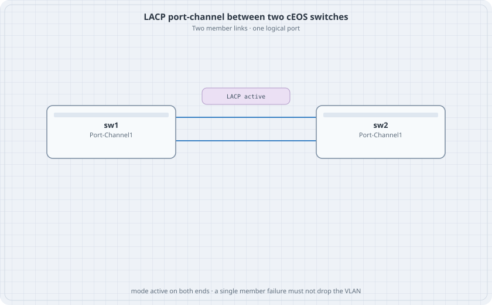

# Link Aggregation on cEOS

Two physical links, one port-channel, LACP on both ends. The host still has one VLAN. Pulling one member must not move that VLAN to down.

{fig-alt="sw1 and sw2 with two parallel links labeled LACP active and Port-Channel1 on each switch"}

## Learning goals

By the end of this chapter you can:

- Build a port-channel with LACP active mode
- Put the port-channel in a VLAN and leave the members out of VLAN config
- Read which members are collecting and distributing
- Shut one member and keep the VLAN up

## Topology

```yaml
name: lag
topology:
  kinds:
    arista_ceos:
      image: ceos:4.37.0F
      memory: 2G
  nodes:
    sw1:
      kind: arista_ceos
    sw2:
      kind: arista_ceos
    h1:
      kind: linux
      image: alpine:latest
      exec:
        - ip addr add 172.16.10.11/24 dev eth1
        - ip link set eth1 up
    h2:
      kind: linux
      image: alpine:latest
      exec:
        - ip addr add 172.16.10.12/24 dev eth1
        - ip link set eth1 up
  links:
    - endpoints: ["h1:eth1", "sw1:eth1"]
    - endpoints: ["h2:eth1", "sw2:eth1"]
    - endpoints: ["sw1:eth2", "sw2:eth2"]
    - endpoints: ["sw1:eth3", "sw2:eth3"]
```

## Both switches

```text
vlan 10
   name users
interface Ethernet1
   switchport mode access
   switchport access vlan 10
interface Ethernet2
   channel-group 1 mode active
interface Ethernet3
   channel-group 1 mode active
interface Port-Channel1
   switchport mode access
   switchport access vlan 10
```

`mode active` sends LACP. `mode on` would bundle without negotiation and is the wrong default for this lab. Do not also set a VLAN on Ethernet2. The port-channel owns the switchport config.

## Verify

```bash
docker exec clab-lag-sw1 Cli -c "show port-channel"
docker exec clab-lag-sw1 Cli -c "show lacp neighbor"
docker exec clab-lag-h1 ping -c 2 172.16.10.12
```

### Predict

- Port-Channel1 is up with two members.
- h1 pings h2.
- `interface Ethernet2` then `shutdown` on sw1. The port-channel stays up on one member. The ping still works.
- Shut Ethernet3 as well. The ping stops.

## Drill

Change sw2 Ethernet3 to `mode passive`. The bundle still forms, because active plus passive negotiates. Change both ends of Ethernet3 to `mode on` while Ethernet2 stays `active`. That member will not join. Put both ends back to `active` and confirm two members again.
