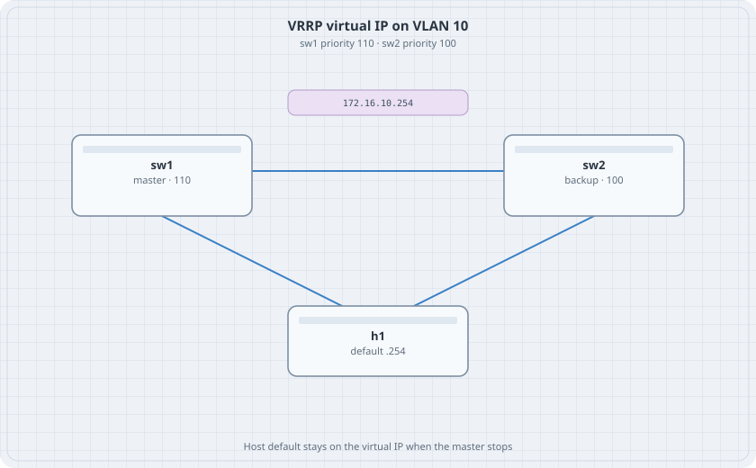

# First Hop: VRRP and VARP

Two distribution switches, one virtual IP. VRRP elects a master. VARP does not elect anyone. Both are on cEOS. This lab runs VRRP first, because that is the protocol the earlier first-hop chapter used, then shows VARP as the anycast form you will see on an EOS leaf.

{fig-alt="sw1 master priority 110 and sw2 backup priority 100, both linked to host h1, virtual IP 172.16.10.254"}

## Learning goals

By the end of this chapter you can:

- Build one VLAN across two cEOS switches with a host attached
- Configure VRRP so sw1 is master
- Fail the master and watch the virtual IP move
- Replace the election with VARP and explain what you gave up

## Topology

```yaml
name: fhrp
topology:
  kinds:
    arista_ceos:
      image: ceos:4.37.0F
      memory: 2G
  nodes:
    sw1:
      kind: arista_ceos
    sw2:
      kind: arista_ceos
    h1:
      kind: linux
      image: alpine:latest
      exec:
        - ip link add br0 type bridge
        - ip link set eth1 master br0
        - ip link set eth2 master br0
        - ip link set br0 up
        - ip addr add 172.16.10.11/24 dev br0
        - ip route add default via 172.16.10.254
  links:
    - endpoints: ["sw1:eth1", "sw2:eth1"]
    - endpoints: ["h1:eth1", "sw1:eth2"]
    - endpoints: ["h1:eth2", "sw2:eth2"]
```

h1 has two links. A bridge on the host makes both ports one LAN, so the virtual IP is reachable whichever switch is answering.

## VRRP

On both switches:

```text
vlan 10
   name users
interface Ethernet1
   switchport mode trunk
   switchport trunk allowed vlan 10
interface Ethernet2
   switchport access vlan 10
interface Vlan10
   ip address 172.16.10.2/24
ip routing
```

sw2 uses `172.16.10.3/24` on Vlan10. Then sw1:

```text
interface Vlan10
   vrrp 10 ipv4 172.16.10.254
   vrrp 10 priority-level 110
```

sw2, same virtual address, `priority-level 100`.

## Verify

```bash
docker exec clab-fhrp-sw1 Cli -c "show vrrp"
docker exec clab-fhrp-sw2 Cli -c "show vrrp"
docker exec clab-fhrp-h1 ping -c 2 172.16.10.254
```

### Predict

- sw1 is master. sw2 is backup.
- Shut Vlan10 on sw1. sw2 becomes master. The ping to .254 returns after a short gap. h1's route does not change.
- No shut on Vlan10. sw1 preempts because its priority is higher.

## VARP, after VRRP works

Remove the `vrrp` lines. On both switches:

```text
ip virtual-router mac-address 00:1c:73:00:00:0a
interface Vlan10
   ip virtual-router address 172.16.10.254
```

There is no master. Both switches answer for .254 using the shared MAC. Shutting one SVI still leaves .254 on the other, without an election. You lose the single-owner property. You gain a gateway that does not wait for hellos. Write down which behaviour you want on a campus distribution pair and which you want on a leaf pair that already has ECMP underneath.
