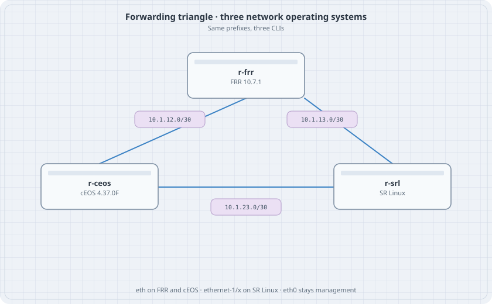

# OSPF in One Area

Take the triangle from Three-Router Forwarding and delete the static routes. OSPF area 0 replaces them. Loopbacks are the prefixes you want to see in every table.

{fig-alt="FRR, cEOS, and SR Linux linked in a triangle for a single OSPF area"}

## Learning goals

By the end of this chapter you can:

- Start OSPF on FRR, cEOS, and SR Linux on the same links
- Recognize a Full adjacency on each CLI
- See the remote loopback as an OSPF route
- Tell a dead adjacency from a missing `network` statement

## FRR

`daemons: [ospfd]` on the node. In `frr.conf`, keep the interface addresses and replace the static routes with:

```text
router ospf
 ospf router-id 10.0.0.1
 network 10.1.12.0/30 area 0
 network 10.1.13.0/30 area 0
 network 10.0.0.1/32 area 0
```

## cEOS

```text
interface Loopback0
   ip address 10.0.0.2/32
   ip ospf area 0.0.0.0
interface Ethernet1
   no switchport
   ip address 10.1.12.2/30
   ip ospf area 0.0.0.0
   ip ospf network point-to-point
interface Ethernet2
   no switchport
   ip address 10.1.23.1/30
   ip ospf area 0.0.0.0
   ip ospf network point-to-point
router ospf 1
   router-id 10.0.0.2
```

## SR Linux

Put the interface addresses in as in the forwarding chapter, including `lo0` `10.0.0.3/32`. Then:

```text
set network-instance default protocols ospf admin-state enable
set network-instance default protocols ospf instance 1 admin-state enable
set network-instance default protocols ospf instance 1 version ospf-v2
set network-instance default protocols ospf instance 1 router-id 10.0.0.3
set network-instance default protocols ospf instance 1 area 0.0.0.0 admin-state enable
set network-instance default protocols ospf instance 1 area 0.0.0.0 interface ethernet-1/1.0 admin-state enable
set network-instance default protocols ospf instance 1 area 0.0.0.0 interface ethernet-1/1.0 interface-type point-to-point
set network-instance default protocols ospf instance 1 area 0.0.0.0 interface ethernet-1/2.0 admin-state enable
set network-instance default protocols ospf instance 1 area 0.0.0.0 interface ethernet-1/2.0 interface-type point-to-point
set network-instance default protocols ospf instance 1 area 0.0.0.0 interface lo0.0 admin-state enable
set network-instance default protocols ospf instance 1 area 0.0.0.0 interface lo0.0 passive true
```

## Verify

```bash
docker exec clab-ospf-r-frr vtysh -c "show ip ospf neighbor"
docker exec clab-ospf-r-ceos Cli -c "show ip ospf neighbor"
docker exec clab-ospf-r-srl sr_cli "show network-instance default protocols ospf neighbor"
docker exec clab-ospf-r-frr vtysh -c "show ip route ospf"
```

### Predict

- Two Full neighbours on every router.
- `10.0.0.2/32` and `10.0.0.3/32` are OSPF routes on r-frr.
- A missing `ip ospf area` on one cEOS interface leaves that link with no adjacency and the rest of the triangle up.

## Drill

Set `ip ospf cost 50` on r-ceos Ethernet1. The path from r-frr to 10.0.0.2 may stay direct because the other way is two links. The path from r-frr to a prefix that can use either side will prefer the cheaper side. Record the route before and after.
