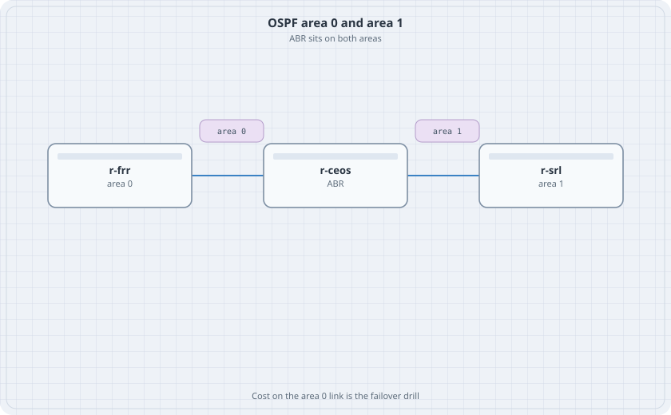

# OSPF Areas, Cost, and BFD

Area 0 is the triangle's left link. Area 1 is the right link. The cEOS router is the ABR. BFD on the area 0 link is the failure detector. You are not trying to build a large OSPF domain. You are trying to see an ABR and a fast hello in the table.

{fig-alt="r-frr in area 0 linked to r-ceos, the area border router, linked onward to r-srl in area 1"}

## Learning goals

By the end of this chapter you can:

- Put two areas on one cEOS router
- See a type-3 inter-area route on FRR
- Raise a cost and watch the route stay, because there is no alternate area 0 path
- Turn on BFD and read the session

## Links

| Link | Prefix | Area |
|------|--------|------|
| r-frr eth1 — r-ceos Ethernet1 | 10.1.12.0/30 | 0 |
| r-ceos Ethernet2 — r-srl ethernet-1/1 | 10.1.23.0/30 | 1 |

Loopbacks: 10.0.0.1 on FRR in area 0, 10.0.0.2 on cEOS in area 0, 10.0.0.3 on SR Linux in area 1.

There is no r-frr to r-srl link in this lab. One path is the point.

## cEOS ABR

```text
interface Loopback0
   ip address 10.0.0.2/32
   ip ospf area 0.0.0.0
interface Ethernet1
   no switchport
   ip address 10.1.12.2/30
   ip ospf area 0.0.0.0
   ip ospf network point-to-point
   ip ospf cost 10
   bfd interval 300 min-rx 300 multiplier 3
interface Ethernet2
   no switchport
   ip address 10.1.23.1/30
   ip ospf area 0.0.0.1
   ip ospf network point-to-point
router ospf 1
   router-id 10.0.0.2
   bfd all-interfaces
```

If `bfd all-interfaces` is refused, set BFD under the Ethernet1 OSPF interface only. Check `show bfd peers`.

FRR side of the same link, in `frr.conf`, with `daemons: [ospfd, bfdd]`:

```text
interface eth1
 ip address 10.1.12.1/30
 ip ospf area 0
 ip ospf network point-to-point
 ip ospf bfd
```

SR Linux stays in area `0.0.0.1` on `ethernet-1/1.0`. Copy the single-area OSPF block and change the area id. Do not enable BFD on SR Linux until the EOS and FRR session is up. Add it only if `info from state bfd` on this image shows a peer. The lab is done when EOS and FRR show a BFD up session. SR Linux in area 1 without BFD is still a valid ABR lab.

## Verify

```bash
docker exec clab-areas-r-frr vtysh -c "show ip ospf neighbor"
docker exec clab-areas-r-frr vtysh -c "show ip route ospf"
docker exec clab-areas-r-ceos Cli -c "show ip ospf neighbor"
docker exec clab-areas-r-ceos Cli -c "show bfd peers"
```

### Predict

- r-frr has one neighbour, the ABR.
- `10.0.0.3/32` on r-frr is an inter-area route, not intra-area.
- Changing the area 0 cost changes the metric of every area 1 prefix on r-frr. There is no other path to switch to.

## Drill

Put SR Linux's loopback in area 0 by mistake (advertise it from cEOS Loopback0's area, or set the SR Linux interface to area 0 while the ABR interface stays in area 1). The adjacency on that link drops or never forms. Put the area ids back until both neighbours are Full.
