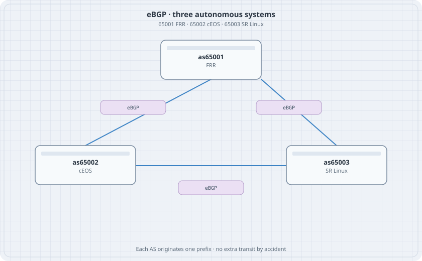

# eBGP between Three Autonomous Systems

Each corner of the triangle is its own autonomous system and originates one LAN. No router is allowed to become transit for a prefix it does not own unless you decide it should. That decision is the next chapter. This one is reachability only.

{fig-alt="AS 65001 on FRR, AS 65002 on cEOS, and AS 65003 on SR Linux, with eBGP on every side of the triangle"}

## Learning goals

By the end of this chapter you can:

- Number three private ASNs and three LANs
- Bring up eBGP on FRR, cEOS, and SR Linux
- See a prefix with a two-AS path
- Spot a session stuck in Active because the neighbour address is wrong

## Plan

| Node | ASN | LAN | Router-id |
|------|-----|-----|-----------|
| r-frr | 65001 | 172.16.1.0/24 on lo as 172.16.1.1/32 | 10.0.0.1 |
| r-ceos | 65002 | 172.16.2.1/32 | 10.0.0.2 |
| r-srl | 65003 | 172.16.3.1/32 | 10.0.0.3 |

Transit links are the same /30s as the forwarding triangle. Use loopbacks as the originated prefixes so you do not need hosts yet.

## FRR

`daemons: [bgpd]`

```text
router bgp 65001
 bgp router-id 10.0.0.1
 neighbor 10.1.12.2 remote-as 65002
 neighbor 10.1.13.2 remote-as 65003
 address-family ipv4 unicast
  network 172.16.1.1/32
```

The loopback must exist or `network` will not advertise it.

## cEOS

```text
interface Loopback0
   ip address 172.16.2.1/32
router bgp 65002
   router-id 10.0.0.2
   neighbor 10.1.12.1 remote-as 65001
   neighbor 10.1.23.2 remote-as 65003
   network 172.16.2.1/32
```

Ethernet addresses stay `no switchport` as in the forwarding lab. BGP does not turn a switchport into a routed port for you.

## SR Linux

After the interfaces and `network-instance default` exist:

```text
set routing-policy policy accept-all default-action policy-result accept
set network-instance default protocols bgp admin-state enable
set network-instance default protocols bgp autonomous-system 65003
set network-instance default protocols bgp router-id 10.0.0.3
set network-instance default protocols bgp afi-safi ipv4-unicast admin-state enable
set network-instance default protocols bgp group ebgp admin-state enable
set network-instance default protocols bgp group ebgp export-policy [ accept-all ]
set network-instance default protocols bgp group ebgp import-policy [ accept-all ]
set network-instance default protocols bgp neighbor 10.1.13.1 peer-as 65001
set network-instance default protocols bgp neighbor 10.1.13.1 peer-group ebgp
set network-instance default protocols bgp neighbor 10.1.13.1 admin-state enable
set network-instance default protocols bgp neighbor 10.1.23.1 peer-as 65002
set network-instance default protocols bgp neighbor 10.1.23.1 peer-group ebgp
set network-instance default protocols bgp neighbor 10.1.23.1 admin-state enable
set network-instance default protocols bgp afi-safi ipv4-unicast ipv4-unicast admin-state enable
```

Originate `172.16.3.1/32` from the loopback. On this image the leaf may be under the ipv4-unicast family as a route or under a `local-rib` export. If `network` is not a leaf, add a static route to the loopback prefix and an export policy that matches it. The session itself is the part that must be Established before you fight origination.

## Verify

```bash
docker exec clab-ebgp-r-frr vtysh -c "show bgp summary"
docker exec clab-ebgp-r-frr vtysh -c "show ip bgp"
docker exec clab-ebgp-r-ceos Cli -c "show ip bgp summary"
docker exec clab-ebgp-r-srl sr_cli "show network-instance default protocols bgp neighbor"
```

### Predict

- Two Established sessions on each router.
- `172.16.2.1/32` on r-frr has AS path `65002`.
- `172.16.2.1/32` on r-srl may arrive via 65001 65002 and via 65002. Two paths means the triangle is transitive. That is normal eBGP. The policy chapter is where you stop one of them.

## Drill

Set r-ceos's neighbour toward r-frr to remote-as 65009. The session goes Active or Idle. The other session stays up. Fix the ASN.
