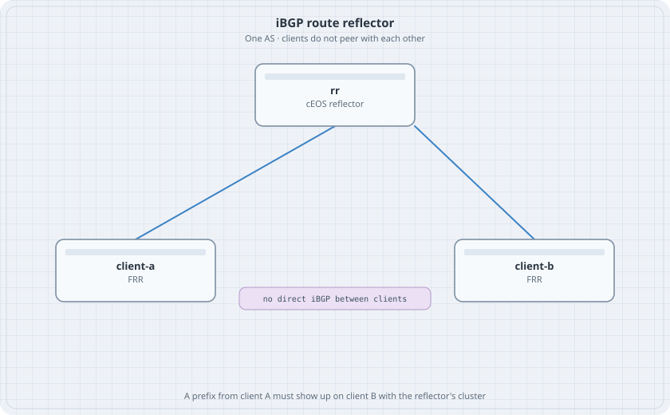

# iBGP and a Route Reflector

One autonomous system. Two FRR clients. One cEOS reflector. The clients do not peer with each other. A prefix learned by the reflector from client A must reach client B, which is the rule a full mesh would have covered and a reflector covers with less sessions.

{fig-alt="A cEOS route reflector linked to client A and client B. There is no session drawn between the clients."}

## Learning goals

By the end of this chapter you can:

- Build two iBGP sessions to a reflector and none between clients
- Advertise a distinct loopback from each client
- See the reflector's cluster list on the far client
- Break the lab by forgetting `next-hop-self`, and fix it

## Topology

```yaml
name: rr
topology:
  kinds:
    arista_ceos:
      image: ceos:4.37.0F
      memory: 2G
    frr:
      image: quay.io/frrouting/frr:containerlab-10.7.1
  nodes:
    rr:
      kind: arista_ceos
    client-a:
      kind: frr
      startup-config: client-a.frr.conf
      daemons: [bgpd]
    client-b:
      kind: frr
      startup-config: client-b.frr.conf
      daemons: [bgpd]
  links:
    - endpoints: ["rr:eth1", "client-a:eth1"]
    - endpoints: ["rr:eth2", "client-b:eth1"]
```

| Node | Link address | Loopback | BGP |
|------|--------------|----------|-----|
| rr | 10.1.1.1/30 and 10.1.2.1/30 | 10.0.0.1/32 | AS 65000, route-reflector-client on both neighbours |
| client-a | 10.1.1.2/30 | 10.0.0.2/32 and prefix 172.16.10.1/32 | AS 65000 |
| client-b | 10.1.2.2/30 | 10.0.0.3/32 and prefix 172.16.20.1/32 | AS 65000 |

The sessions peer on the physical /30. A missing IGP does not take the session down. Each client originates a loopback that is connected on `lo`. `next-hop-self` on the reflector rewrites the next hop to the reflector's interface address, which both clients already have as a connected route.

## cEOS reflector

```text
interface Ethernet1
   no switchport
   ip address 10.1.1.1/30
interface Ethernet2
   no switchport
   ip address 10.1.2.1/30
router bgp 65000
   router-id 10.0.0.1
   neighbor 10.1.1.2 remote-as 65000
   neighbor 10.1.1.2 route-reflector-client
   neighbor 10.1.1.2 next-hop-self
   neighbor 10.1.2.2 remote-as 65000
   neighbor 10.1.2.2 route-reflector-client
   neighbor 10.1.2.2 next-hop-self
```

## FRR client A

`client-a.frr.conf`:

```text
frr defaults traditional
service integrated-vtysh-config
!
interface lo
 ip address 10.0.0.2/32
 ip address 172.16.10.1/32
!
interface eth1
 ip address 10.1.1.2/30
!
router bgp 65000
 bgp router-id 10.0.0.2
 neighbor 10.1.1.1 remote-as 65000
 address-family ipv4 unicast
  network 172.16.10.1/32
 exit-address-family
!
```

`client-b.frr.conf` is the same shape: `lo` is `10.0.0.3/32` and `172.16.20.1/32`, `eth1` is `10.1.2.2/30`, the neighbour is `10.1.2.1`, and the `network` statement is `172.16.20.1/32`. The address you `network` has to exist on `lo` or BGP will not originate it.

## Verify

```bash
docker exec clab-rr-client-b vtysh -c "show ip bgp 172.16.10.1/32"
docker exec clab-rr-rr Cli -c "show ip bgp summary"
```

### Predict

- client-b has `172.16.10.1/32`. The next hop is 10.1.2.1 because of `next-hop-self`.
- The path shows the reflector as the point it was reflected. `show ip bgp` on FRR includes the cluster list.
- Remove `route-reflector-client` on both neighbours. client-b loses the prefix. The sessions stay Established. Put the knob back.

## Drill

Peer a third FRR client the same way and originate `172.16.30.1/32`. You add one session, not a new mesh. That is the operational reason the reflector exists. Remove it before you leave the lab so the host is not holding three FRR nodes plus cEOS overnight.
