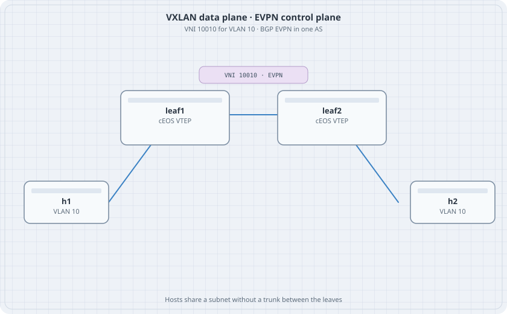

# VXLAN Bridging

Two leaves, one VLAN, one VNI. The underlay is a routed link with OSPF so the loopbacks can reach each other. The hosts think they are on one LAN. There is no trunk between the leaves.

{fig-alt="leaf1 and leaf2 linked by an underlay, each with a VLAN 10 host, VNI 10010 above the link"}

This chapter is the data plane with static flood lists. The next chapter replaces the flood list with EVPN. Do the static lab first so a broken BGP session is not your only theory.

## Learning goals

By the end of this chapter you can:

- Number an underlay and a loopback per leaf
- Bind VLAN 10 to VNI 10010
- Flood to the other VTEP with a static list
- Show that the host MAC is learned on the VXLAN interface

## Topology

```yaml
name: vxlan
topology:
  kinds:
    arista_ceos:
      image: ceos:4.37.0F
      memory: 2G
  nodes:
    leaf1:
      kind: arista_ceos
    leaf2:
      kind: arista_ceos
    h1:
      kind: linux
      image: alpine:latest
      exec:
        - ip addr add 172.16.10.11/24 dev eth1
        - ip link set eth1 up
    h2:
      kind: linux
      image: alpine:latest
      exec:
        - ip addr add 172.16.10.12/24 dev eth1
        - ip link set eth1 up
  links:
    - endpoints: ["h1:eth1", "leaf1:eth1"]
    - endpoints: ["h2:eth1", "leaf2:eth1"]
    - endpoints: ["leaf1:eth2", "leaf2:eth2"]
```

## Both leaves

leaf1 is shown. leaf2 swaps the /30 ends and uses loopback `10.0.0.2/32`. The flood target on leaf2 is `10.0.0.1`.

```text
vlan 10
   name users
interface Ethernet1
   switchport access vlan 10
interface Ethernet2
   no switchport
   ip address 10.1.0.1/30
   ip ospf area 0.0.0.0
   ip ospf network point-to-point
interface Loopback0
   ip address 10.0.0.1/32
   ip ospf area 0.0.0.0
interface Vxlan1
   vxlan source-interface Loopback0
   vxlan udp-port 4789
   vxlan vlan 10 vni 10010
   vxlan vlan 10 flood vtep 10.0.0.2
router ospf 1
   router-id 10.0.0.1
```

leaf2 Ethernet2 is `10.1.0.2/30`.

## Verify

```bash
docker exec clab-vxlan-h1 ping -c 2 172.16.10.12
docker exec clab-vxlan-leaf1 Cli -c "show interface Vxlan1"
docker exec clab-vxlan-leaf1 Cli -c "show vxlan vtep"
docker exec clab-vxlan-leaf1 Cli -c "show mac address-table"
```

### Predict

- h1 reaches h2.
- The MAC of h2 is learned on Vxlan1, not on Ethernet2.
- OSPF is Full on the underlay. If OSPF is down, the flood VTEP is unreachable and the ping fails even though VLAN 10 is up locally.

## Drill

Remove the flood line on leaf1 only. h1's ARP for h2 fails. h2 can still ARP for h1 if leaf2 still floods. One-way flood lists are a classic broken overlay. Put the line back.
