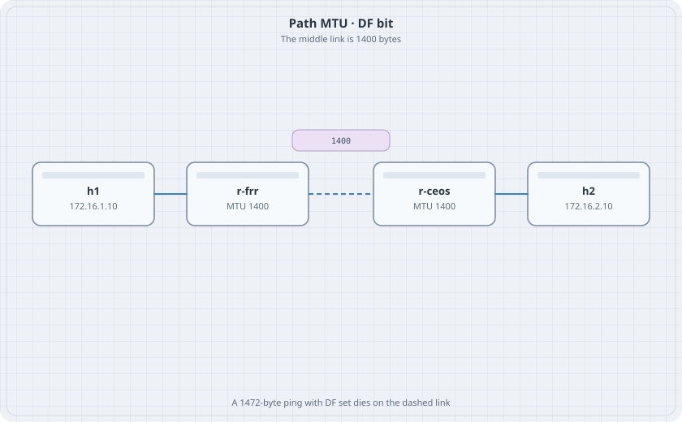

# Path MTU and TCP MSS

A link in the middle of the path is smaller than the links at the edges. A ping that sets the Don't Fragment bit dies there. A TCP session can survive the same path when the SYN carries a smaller maximum segment size.

{fig-alt="h1, r-frr, r-ceos, and h2 in a line. The link between the two routers is marked 1400 bytes."}

## Learning goals

By the end of this chapter you can:

- Build a path whose middle hop is smaller than the edges
- Show that a large ICMP echo with DF set fails, and a smaller one passes
- Clamp TCP MSS on the router that owns the small link
- Explain why a black hole remains when ICMP "fragmentation needed" is filtered

## Topology

```yaml
name: mtu
topology:
  kinds:
    arista_ceos:
      image: ceos:4.37.0F
      memory: 2G
    frr:
      image: quay.io/frrouting/frr:containerlab-10.7.1
  nodes:
    r-frr:
      kind: frr
      startup-config: r-frr.frr.conf
    r-ceos:
      kind: arista_ceos
    h1:
      kind: linux
      image: alpine:latest
      exec:
        - ip addr add 172.16.1.10/24 dev eth1
        - ip link set eth1 up
        - ip route add default via 172.16.1.1
    h2:
      kind: linux
      image: alpine:latest
      exec:
        - ip addr add 172.16.2.10/24 dev eth1
        - ip link set eth1 up
        - ip route add default via 172.16.2.1
  links:
    - endpoints: ["h1:eth1", "r-frr:eth1"]
    - endpoints: ["r-frr:eth2", "r-ceos:eth1"]
    - endpoints: ["r-ceos:eth2", "h2:eth1"]
```

`r-frr.frr.conf` carries the addresses and the routes. Leave `daemons` unset so only zebra starts. No dynamic protocol.

```text
frr defaults traditional
service integrated-vtysh-config
!
interface eth1
 ip address 172.16.1.1/24
!
interface eth2
 ip address 10.1.0.1/30
!
ip route 172.16.2.0/24 10.1.0.2
!
```

On r-ceos:

```text
interface Ethernet1
   no switchport
   ip address 10.1.0.2/30
   mtu 1400
interface Ethernet2
   no switchport
   ip address 172.16.2.1/24
ip route 172.16.1.0/24 10.1.0.1
ip routing
```

Shrink the FRR side of the same link from the host, after the lab is up:

```bash
docker exec clab-mtu-r-frr ip link set eth2 mtu 1400
```

## Verify

ICMP payload plus 28 bytes of IP and ICMP header is the packet size. A 1372-byte payload is a 1400-byte packet. A 1472-byte payload is a 1500-byte packet.

```bash
docker exec clab-mtu-h1 ping -c 2 -M do -s 1372 172.16.2.10
docker exec clab-mtu-h1 ping -c 2 -M do -s 1472 172.16.2.10
```

Busybox `ping` on Alpine may spell the DF flag differently. If `-M do` is rejected, run `ping --help` inside the container and use the option that forbids fragmentation. Record the spelling you used.

### Predict

- The 1372-byte echo returns.
- The 1472-byte echo does not. The interfaces on h1 and h2 are still up.
- `ip link show eth2` inside r-frr reports 1400.

## TCP MSS

On r-ceos Ethernet1:

```text
interface Ethernet1
   tcp mss ceiling ipv4 1360 egress
```

From h1, open a TCP session to a listener on h2:

```bash
docker exec -d clab-mtu-h2 nc -lk -p 8080
docker exec clab-mtu-h1 sh -c "echo hi | nc -w 2 172.16.2.10 8080"
```

Capture on h2:

```bash
docker exec clab-mtu-h2 tcpdump -ni eth1 -c 4 'tcp port 8080'
```

The SYN from h1, after it has crossed the router, should advertise an MSS no larger than 1360. If `nc` is missing, `apk add busybox-extras` on that Alpine node. Stop the chapter there if `apk` cannot reach a mirror. Do not invent a second path around the missing package.

## Drill

Put an ACL on r-ceos that denies ICMP unreachable and still permits everything else, inbound on Ethernet1. Repeat the 1472-byte ping. The failure is now silent: no "fragmentation needed" comes back. Remove the ACL when you are done. That silent failure is the production black hole people chase for a day. `containerlab destroy -t topology.clab.yml --cleanup` before the next chapter.
