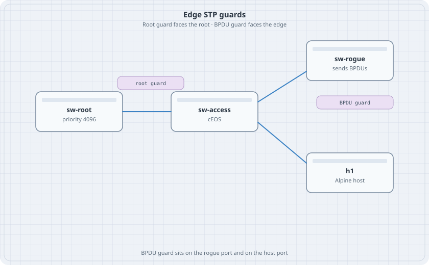

# STP Edge Guards

Rapid PVST already picked a root in the spanning-tree chapter. This lab adds the two guards that keep an edge port from joining the topology by accident. Root guard refuses a better root. BPDU guard shuts a port that was supposed to face a host.

{fig-alt="sw-root linked to sw-access. sw-access also links to sw-rogue and to host h1. The rogue link is marked BPDU guard and the root link is marked root guard."}

Destroy every other lab first. Three cEOS nodes at 2 GB each need the host to themselves.

## Learning goals

By the end of this chapter you can:

- Mark an access port edge and turn on BPDU guard
- Watch that port go errdisabled when a switch is attached
- Put root guard on the port that faces the current root
- Recover an errdisabled port without reloading the switch

## Topology

```yaml
name: guards
topology:
  kinds:
    arista_ceos:
      image: ceos:4.37.0F
      memory: 2G
  nodes:
    sw-root:
      kind: arista_ceos
    sw-access:
      kind: arista_ceos
    sw-rogue:
      kind: arista_ceos
    h1:
      kind: linux
      image: alpine:latest
      exec:
        - ip addr add 172.16.10.11/24 dev eth1
        - ip link set eth1 up
  links:
    - endpoints: ["sw-root:eth1", "sw-access:eth1"]
    - endpoints: ["sw-access:eth2", "h1:eth1"]
    - endpoints: ["sw-access:eth3", "sw-rogue:eth1"]
```

Leave sw-rogue unconfigured until the BPDU-guard test. An unconfigured cEOS still speaks spanning tree on its ports.

## Base STP

On sw-root and sw-access:

```text
spanning-tree mode rapid-pvst
vlan 10
   name users
interface Ethernet1
   switchport mode trunk
   switchport trunk allowed vlan 10
```

On sw-root only:

```text
spanning-tree vlan 10 priority 4096
```

On sw-access Ethernet2, the host port:

```text
interface Ethernet2
   switchport access vlan 10
   spanning-tree portfast
   spanning-tree bpduguard enable
```

Ethernet3 on sw-access stays default until the drill. Do not put the host and the rogue on the same port.

## Verify root guard

On sw-access Ethernet1:

```text
interface Ethernet1
   spanning-tree guard root
```

Then on sw-root, make it a worse root:

```text
spanning-tree vlan 10 priority 61440
```

```bash
docker exec clab-guards-sw-access Cli -c "show spanning-tree vlan 10"
```

### Predict

- Ethernet1 on sw-access moves to a root-inconsistent state. It stops forwarding VLAN 10.
- sw-access does not accept sw-root as root while the guard is on, and it also does not become a stable root through that port.
- Remove the guard, or put sw-root's priority back to 4096. The port forwards again. Put the priority back before the next test.

## Verify BPDU guard

Shut Ethernet3 is not required. Configure it as an access port in VLAN 10 with the same edge commands as Ethernet2, then watch it die because sw-rogue sends BPDUs:

```text
interface Ethernet3
   switchport access vlan 10
   spanning-tree portfast
   spanning-tree bpduguard enable
```

```bash
docker exec clab-guards-sw-access Cli -c "show spanning-tree bpduguard"
docker exec clab-guards-sw-access Cli -c "show interfaces Ethernet3 status"
```

### Predict

- Ethernet3 is errdisabled. Ethernet2, where h1 sits, stays up. h1 can still ARP if you give the switch an SVI, but you do not need the SVI for this test.
- `shutdown` then `no shutdown` on Ethernet3 clears the errdisable only until the next BPDU. The rogue is still there.
- Remove BPDU guard from Ethernet3 and the port forwards. That is the wrong fix on a real access port. The right fix is to disconnect the rogue. Shut sw-rogue Ethernet1 and then recover Ethernet3.

## Drill

Enable `errdisable recovery cause bpduguard` and `errdisable recovery interval 30` on sw-access. The port returns by itself and falls over again. Write down why a 30-second recovery on a host port is a loop you do not want in production. Destroy the lab before you leave.
