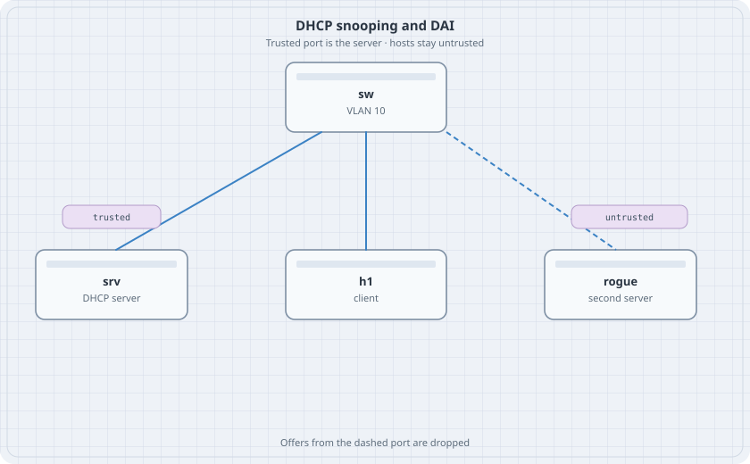

# DHCP Snooping and ARP Inspection

The switch already hands out addresses in the DHCP chapter. This lab changes the question. Which port is allowed to answer, and which ARP messages are allowed to stick. Snooping builds a binding table. Dynamic ARP inspection drops ARP that is not in that table.

{fig-alt="A switch in VLAN 10. The server link is marked trusted. The client is untrusted. The rogue server link is dashed."}

## Learning goals

By the end of this chapter you can:

- Turn on DHCP snooping for one VLAN and trust only the server port
- Read a binding learned from a real lease
- Drop ARP from a static host until you add a source binding
- Point at the port a rogue DHCP server used

## Topology

```yaml
name: snoop
topology:
  kinds:
    arista_ceos:
      image: ceos:4.37.0F
      memory: 2G
  nodes:
    sw:
      kind: arista_ceos
    srv:
      kind: linux
      image: alpine:latest
      exec:
        - ip addr add 172.16.10.10/24 dev eth1
        - ip link set eth1 up
    h1:
      kind: linux
      image: alpine:latest
    rogue:
      kind: linux
      image: alpine:latest
      exec:
        - ip addr add 172.16.10.9/24 dev eth1
        - ip link set eth1 up
  links:
    - endpoints: ["srv:eth1", "sw:eth1"]
    - endpoints: ["h1:eth1", "sw:eth2"]
    - endpoints: ["rogue:eth1", "sw:eth3"]
```

h1 starts with no address. It will ask.

## Switch

```text
vlan 10
   name users
interface Ethernet1
   switchport access vlan 10
   ip dhcp snooping trust
interface Ethernet2
   switchport access vlan 10
interface Ethernet3
   switchport access vlan 10
ip dhcp snooping
ip dhcp snooping information option
ip dhcp snooping vlan 10
ip dhcp snooping bridging
```

Bridging mode is what makes snooping work when the server is in the same VLAN as the client. The trust command belongs on Ethernet1 only.

## Server

`apk` has to work for this chapter. If it does not, stop and destroy the lab.

```bash
docker exec clab-snoop-srv apk add dnsmasq
docker exec clab-snoop-srv sh -c 'printf "%s\n" \
  "interface=eth1" \
  "bind-interfaces" \
  "dhcp-range=172.16.10.50,172.16.10.80,255.255.255.0,2m" \
  > /etc/dnsmasq.conf'
docker exec clab-snoop-srv dnsmasq
```

Do not start dnsmasq on rogue yet.

## Verify snooping

```bash
docker exec clab-snoop-h1 udhcpc -i eth1 -n -q
docker exec clab-snoop-sw Cli -c "show ip dhcp snooping"
docker exec clab-snoop-sw Cli -c "show ip dhcp snooping binding"
```

### Predict

- h1 has an address in 172.16.10.50–80.
- The binding names Ethernet2, VLAN 10, and h1's MAC.
- Start dnsmasq on rogue with a different range, `172.16.10.200,172.16.10.210`, then release and renew on h1. The new lease still comes from 172.16.10.10. Offers that enter Ethernet3 are dropped.

## ARP inspection

Add a second host address by hand on h1 after the lease test, or use rogue as the static host. This example uses rogue, which already has 172.16.10.9.

```text
ip arp inspection vlan 10
interface Ethernet1
   ip arp inspection trust
```

Ethernet2 and Ethernet3 stay untrusted. Read rogue's MAC:

```bash
docker exec clab-snoop-rogue cat /sys/class/net/eth1/address
```

EOS wants that MAC as dotted groups of four hex digits. `aa:bb:cc:dd:ee:ff` becomes `aabb.ccdd.eeff`. Then:

```text
ip source binding 172.16.10.9 aabb.ccdd.eeff vlan 10 interface Ethernet3
```

Use the MAC you read, not the placeholder.

```bash
docker exec clab-snoop-rogue ping -c 2 172.16.10.10
docker exec clab-snoop-sw Cli -c "show ip arp inspection statistics"
docker exec clab-snoop-sw Cli -c "show ip source binding"
```

### Predict

- Before the binding, the ping fails and the drop counter moves.
- After the binding, the ping to the server works.
- Ethernet1 did not need a binding. It is trusted.

## Drill

Delete the source binding and watch the ping fail again. A binding on the wrong interface is the same failure. Destroy the lab when the counters make sense.
