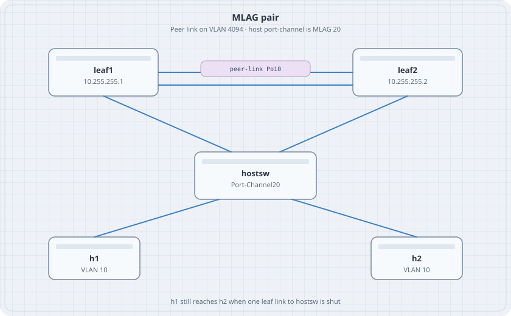

# MLAG on cEOS

Two switches, one port-channel from the downstream switch's point of view. MLAG keeps that bundle up when one upstream member fails. The peer link is not the host path. It is how the two leaves agree.

{fig-alt="leaf1 and leaf2 with two peer-link lines between them, both connected down to hostsw, which connects to h1 and h2."}

Destroy every other lab first. This topology is three cEOS nodes.

## Learning goals

By the end of this chapter you can:

- Build a peer link in its own VLAN and keep spanning tree off that VLAN
- Form an MLAG domain and read active state
- Attach a downstream port-channel as MLAG 20
- Shut one member and keep the two hosts in the same VLAN talking

## Topology

```yaml
name: mlag
topology:
  kinds:
    arista_ceos:
      image: ceos:4.37.0F
      memory: 2G
  nodes:
    leaf1:
      kind: arista_ceos
    leaf2:
      kind: arista_ceos
    hostsw:
      kind: arista_ceos
    h1:
      kind: linux
      image: alpine:latest
      exec:
        - ip addr add 172.16.10.11/24 dev eth1
        - ip link set eth1 up
    h2:
      kind: linux
      image: alpine:latest
      exec:
        - ip addr add 172.16.10.12/24 dev eth1
        - ip link set eth1 up
  links:
    - endpoints: ["leaf1:eth1", "leaf2:eth1"]
    - endpoints: ["leaf1:eth2", "leaf2:eth2"]
    - endpoints: ["leaf1:eth3", "hostsw:eth1"]
    - endpoints: ["leaf2:eth3", "hostsw:eth2"]
    - endpoints: ["h1:eth1", "hostsw:eth3"]
    - endpoints: ["h2:eth1", "hostsw:eth4"]
```

## Leaves

leaf1 is shown. leaf2 uses `10.255.255.2/30` and peer-address `10.255.255.1`. Everything else matches.

```text
vlan 10
   name users
vlan 4094
   name mlag-peer
   trunk group mlagpeer
spanning-tree mode rapid-pvst
no spanning-tree vlan 4094
interface Port-Channel10
   switchport mode trunk
   switchport trunk group mlagpeer
interface Ethernet1
   channel-group 10 mode active
interface Ethernet2
   channel-group 10 mode active
interface Port-Channel20
   switchport mode trunk
   switchport trunk allowed vlan 10
   mlag 20
interface Ethernet3
   channel-group 20 mode active
interface Vlan4094
   ip address 10.255.255.1/30
   no autostate
mlag configuration
   domain-id lab-mlag
   local-interface Vlan4094
   peer-address 10.255.255.2
   peer-link Port-Channel10
```

If `mlag configuration` is rejected, the mode command on this image is `mlag`. The subcommands are the same. The prompt you want is `(config-mlag)`.

## Downstream switch

```text
vlan 10
   name users
interface Port-Channel20
   switchport mode trunk
   switchport trunk allowed vlan 10
interface Ethernet1
   channel-group 20 mode active
interface Ethernet2
   channel-group 20 mode active
interface Ethernet3
   switchport access vlan 10
interface Ethernet4
   switchport access vlan 10
```

## Verify

```bash
docker exec clab-mlag-leaf1 Cli -c "show mlag"
docker exec clab-mlag-leaf1 Cli -c "show port-channel dense"
docker exec clab-mlag-h1 ping -c 2 172.16.10.12
```

### Predict

- `show mlag` reports the domain `lab-mlag`, local-interface Vlan4094, and a peer that is active.
- Port-Channel20 on leaf1 has one member, Ethernet3. The other member lives on leaf2. hostsw sees both members in Port-Channel20.
- The ping between h1 and h2 works.
- Shut leaf1 Ethernet3. The ping still works. It now uses leaf2 only. `no shutdown` brings the member back.

## Drill

Shut Port-Channel10 on leaf1. That is the peer link, not a host link. Record what `show mlag` says and whether the ping survives. A split peer with both host members still up is the failure MLAG is specifically bad at. Restore the peer link, confirm active, then destroy the lab.
