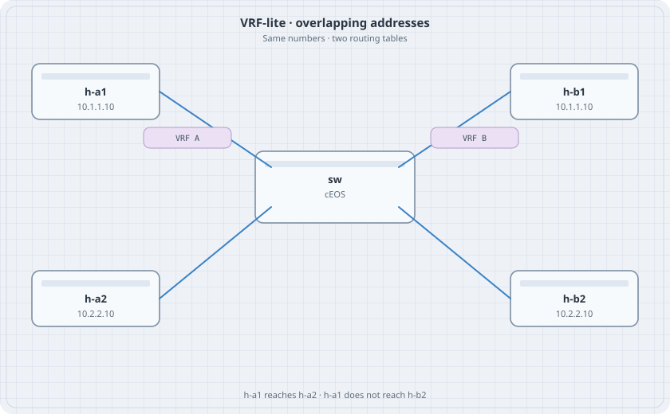

# VRF-Lite

One switch, two routing tables, the same addresses in both. VRF-lite is how a campus or a lab router keeps two customers apart without a second chassis. Nothing here is an MPLS VPN. The routes never leave the box.

{fig-alt="A cEOS switch in the center. VRF A on the left has h-a1 at 10.1.1.10 and h-a2 at 10.2.2.10. VRF B on the right repeats those addresses."}

## Learning goals

By the end of this chapter you can:

- Create two VRFs and put routed ports in them
- Use the same subnet in both VRFs on purpose
- Prove that each host reaches only its own VRF
- Read a route in one VRF and see that the other VRF does not have it

## Topology

```yaml
name: vrf
topology:
  kinds:
    arista_ceos:
      image: ceos:4.37.0F
      memory: 2G
  nodes:
    sw:
      kind: arista_ceos
    h-a1:
      kind: linux
      image: alpine:latest
      exec:
        - ip addr add 10.1.1.10/24 dev eth1
        - ip link set eth1 up
        - ip route add default via 10.1.1.1
    h-a2:
      kind: linux
      image: alpine:latest
      exec:
        - ip addr add 10.2.2.10/24 dev eth1
        - ip link set eth1 up
        - ip route add default via 10.2.2.1
    h-b1:
      kind: linux
      image: alpine:latest
      exec:
        - ip addr add 10.1.1.10/24 dev eth1
        - ip link set eth1 up
        - ip route add default via 10.1.1.1
    h-b2:
      kind: linux
      image: alpine:latest
      exec:
        - ip addr add 10.2.2.10/24 dev eth1
        - ip link set eth1 up
        - ip route add default via 10.2.2.1
  links:
    - endpoints: ["h-a1:eth1", "sw:eth1"]
    - endpoints: ["h-a2:eth1", "sw:eth2"]
    - endpoints: ["h-b1:eth1", "sw:eth3"]
    - endpoints: ["h-b2:eth1", "sw:eth4"]
```

The hosts share addresses. They do not share a link, so ARP is not confused. The switch is what keeps the tables apart.

## Switch

`vrf` on an interface clears addresses already configured there. Set the VRF first, then the address.

```text
vrf instance CUSTA
vrf instance CUSTB
ip routing
ip routing vrf CUSTA
ip routing vrf CUSTB
interface Ethernet1
   no switchport
   vrf CUSTA
   ip address 10.1.1.1/24
interface Ethernet2
   no switchport
   vrf CUSTA
   ip address 10.2.2.1/24
interface Ethernet3
   no switchport
   vrf CUSTB
   ip address 10.1.1.1/24
interface Ethernet4
   no switchport
   vrf CUSTB
   ip address 10.2.2.1/24
```

There is no static route and no leak. Each VRF only knows the two connected subnets you just typed.

## Verify

```bash
docker exec clab-vrf-h-a1 ping -c 2 10.2.2.10
docker exec clab-vrf-h-b1 ping -c 2 10.2.2.10
docker exec clab-vrf-sw Cli -c "show ip route vrf CUSTA"
docker exec clab-vrf-sw Cli -c "show ip route vrf CUSTB"
docker exec clab-vrf-sw Cli -c "show vrf"
```

### Predict

- h-a1 reaches 10.2.2.10. That answer is h-a2.
- h-b1 reaches 10.2.2.10. That answer is h-b2, not h-a2.
- Each VRF table shows 10.1.1.0/24 and 10.2.2.0/24 as connected. The default VRF table does not.
- A ping from h-a1 to h-b1's address is a ping to the local gateway's other customer, and it stays inside CUSTA. You cannot aim it at CUSTB from the host.

## Drill

Leak one prefix on purpose:

```text
ip route vrf CUSTA 10.9.9.9/32 egress-vrf CUSTB 10.2.2.10
```

If `egress-vrf` is rejected, check `ip route ?` and use the inter-VRF form it prints. Then ping 10.9.9.9 from h-a1. The return path does not exist until CUSTB has a route back, so the ping fails in one direction. Add the opposite static, confirm one echo, then delete both statics. An accidental leak is how two customers become one. Destroy the lab after the routes are gone.
