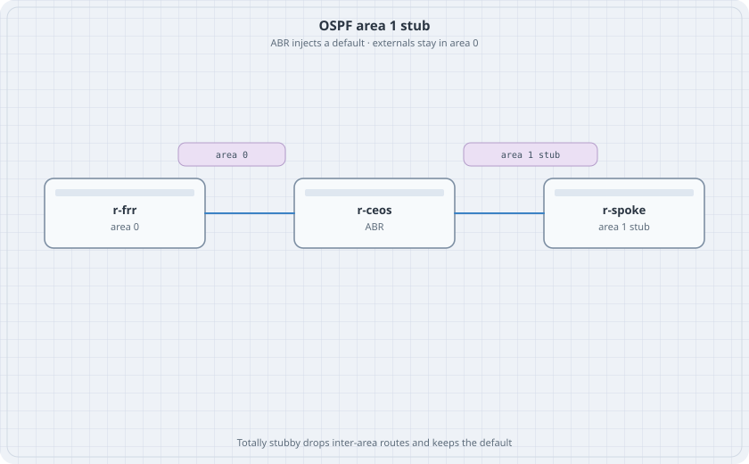

# OSPF Stub, NSSA, and Summary

Area 0 and one other area were enough to see an inter-area route. A stub area is the next decision. The spoke does not need every external prefix in the network. It needs a default, and it needs the summaries you meant to send.

{fig-alt="r-frr in area 0 linked to r-ceos, the ABR, linked to r-spoke in area 1 stub."}

## Learning goals

By the end of this chapter you can:

- Make area 1 a stub and watch external routes disappear on the spoke
- Make it totally stubby and watch inter-area routes disappear too
- Turn the same area into an NSSA and originate one external from the spoke
- Replace two spoke prefixes with one summary on the ABR

## Topology

```yaml
name: stub
topology:
  kinds:
    arista_ceos:
      image: ceos:4.37.0F
      memory: 2G
    frr:
      image: quay.io/frrouting/frr:containerlab-10.7.1
  nodes:
    r-frr:
      kind: frr
      startup-config: r-frr.frr.conf
      daemons: [ospfd]
    r-ceos:
      kind: arista_ceos
    r-spoke:
      kind: frr
      startup-config: r-spoke.frr.conf
      daemons: [ospfd]
  links:
    - endpoints: ["r-frr:eth1", "r-ceos:eth1"]
    - endpoints: ["r-ceos:eth2", "r-spoke:eth1"]
```

There is no link between r-frr and r-spoke. The ABR is the only way through.

## Area 0 and a normal area 1

`r-frr.frr.conf`:

```text
frr defaults traditional
service integrated-vtysh-config
!
interface lo
 ip address 10.0.0.1/32
 ip address 172.16.1.1/32
!
interface eth1
 ip address 10.1.0.1/30
 ip ospf area 0
 ip ospf network point-to-point
!
router ospf
 ospf router-id 10.0.0.1
 network 10.0.0.1/32 area 0
 network 172.16.1.1/32 area 0
!
```

Leave `redistribute connected` and `redistribute static` off until the stub test. Area 1 should start with inter-area routes only.

`r-spoke.frr.conf`:

```text
frr defaults traditional
service integrated-vtysh-config
!
interface lo
 ip address 10.0.0.3/32
 ip address 172.16.30.1/32
 ip address 172.16.30.2/32
!
interface eth1
 ip address 10.2.0.2/30
 ip ospf area 1
 ip ospf network point-to-point
!
router ospf
 ospf router-id 10.0.0.3
 network 10.0.0.3/32 area 1
 network 172.16.30.1/32 area 1
 network 172.16.30.2/32 area 1
!
```

r-ceos:

```text
interface Loopback0
   ip address 10.0.0.2/32
interface Ethernet1
   no switchport
   ip address 10.1.0.2/30
   ip ospf network point-to-point
   ip ospf area 0
interface Ethernet2
   no switchport
   ip address 10.2.0.1/30
   ip ospf network point-to-point
   ip ospf area 1
router ospf 1
   router-id 10.0.0.2
   network 10.0.0.2/32 area 0
ip routing
```

```bash
docker exec clab-stub-r-spoke vtysh -c "show ip ospf neighbor"
docker exec clab-stub-r-spoke vtysh -c "show ip route ospf"
```

### Predict

- r-spoke has inter-area routes for 10.0.0.1/32 and 172.16.1.1/32.
- No external routes exist yet.

## Stub, then totally stubby

On r-ceos and on r-spoke, area 1 becomes a stub. Both sides must agree or the adjacency drops.

r-ceos:

```text
router ospf 1
   area 1 stub
```

r-spoke, inside `router ospf`:

```text
area 1 stub
```

### Predict

- The adjacency returns after both sides match.
- r-spoke gains a default route from the ABR.
- Add `redistribute connected` on r-frr only if those loopbacks were not already in OSPF. Then add a static on r-frr, `ip route 198.51.100.0/24 Null0`, and `redistribute static`. r-spoke does not learn 198.51.100.0/24. r-ceos does, as an external, on the area 0 side.

Totally stubby is an ABR setting. On r-ceos only:

```text
router ospf 1
   area 1 stub no-summary
```

r-spoke stays `area 1 stub` without `no-summary`.

### Predict

- 172.16.1.1/32 disappears from r-spoke.
- The default route remains. A ping from r-spoke to 172.16.1.1 still works if the ABR has the route.

## NSSA

Remove the stub commands on both sides. Replace them with NSSA.

r-ceos:

```text
router ospf 1
   no area 1 stub
   area 1 nssa
```

r-spoke:

```text
no area 1 stub
area 1 nssa
ip route 203.0.113.0/24 Null0
router ospf
 redistribute static
```

### Predict

- r-ceos learns 203.0.113.0/24 as an NSSA external.
- r-frr learns it as an external only after the ABR translates it. If r-frr stays empty, set `area 1 nssa translate type7 always` on r-ceos and check again.

## Summary

On the ABR, while area 1 is a normal area or an NSSA (a stub will not flood the components you are summarizing into the stub):

```text
router ospf 1
   area 1 range 172.16.30.0/24
```

### Predict

- r-frr sees 172.16.30.0/24 and does not see both /32s.
- Shut the command and both /32s return.

Destroy the lab. The spoke should not be left redistributing a static into area 0 by accident.
