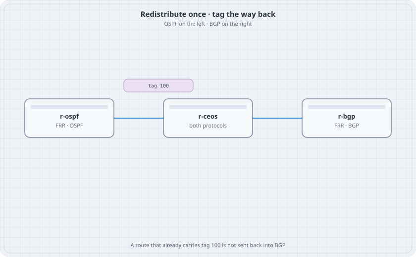

# Redistribution and Route Tags

A prefix may cross from OSPF into BGP once. If it crosses back, the two protocols advertise each other's copies and the preference flips. A tag is a mark the route carries so the return trip can refuse it.

{fig-alt="r-ospf linked to r-ceos linked to r-bgp. A chip on the cEOS says tag 100."}

## Learning goals

By the end of this chapter you can:

- Redistribute an OSPF prefix into BGP and see it on the far router
- Redistribute a BGP prefix into OSPF and see it on the near router
- Tag the BGP-into-OSPF copy
- Refuse that tag when OSPF is redistributed back into BGP

## Topology

```yaml
name: redist
topology:
  kinds:
    arista_ceos:
      image: ceos:4.37.0F
      memory: 2G
    frr:
      image: quay.io/frrouting/frr:containerlab-10.7.1
  nodes:
    r-ospf:
      kind: frr
      startup-config: r-ospf.frr.conf
      daemons: [ospfd]
    r-ceos:
      kind: arista_ceos
    r-bgp:
      kind: frr
      startup-config: r-bgp.frr.conf
      daemons: [bgpd]
  links:
    - endpoints: ["r-ospf:eth1", "r-ceos:eth1"]
    - endpoints: ["r-ceos:eth2", "r-bgp:eth1"]
```

## Starting configs

`r-ospf.frr.conf`:

```text
frr defaults traditional
service integrated-vtysh-config
!
interface lo
 ip address 10.0.0.1/32
 ip address 172.16.10.1/32
!
interface eth1
 ip address 10.1.0.1/30
 ip ospf area 0
 ip ospf network point-to-point
!
router ospf
 ospf router-id 10.0.0.1
 network 10.0.0.1/32 area 0
 network 172.16.10.1/32 area 0
!
```

`r-bgp.frr.conf`:

```text
frr defaults traditional
service integrated-vtysh-config
!
interface lo
 ip address 10.0.0.3/32
!
interface eth1
 ip address 10.2.0.2/30
!
ip route 198.51.100.0/24 Null0
!
router bgp 65001
 bgp router-id 10.0.0.3
 neighbor 10.2.0.1 remote-as 65000
 address-family ipv4 unicast
  network 198.51.100.0/24
 exit-address-family
!
```

r-ceos, before any redistribute:

```text
interface Loopback0
   ip address 10.0.0.2/32
interface Ethernet1
   no switchport
   ip address 10.1.0.2/30
   ip ospf network point-to-point
   ip ospf area 0
interface Ethernet2
   no switchport
   ip address 10.2.0.1/30
router ospf 1
   router-id 10.0.0.2
   network 10.0.0.2/32 area 0
router bgp 65000
   router-id 10.0.0.2
   neighbor 10.2.0.2 remote-as 65001
ip routing
```

Confirm OSPF is Full and BGP is Established before you redistribute anything.

## One direction, then the other

```text
router bgp 65000
   redistribute ospf
```

```bash
docker exec clab-redist-r-bgp vtysh -c "show ip bgp 172.16.10.1/32"
```

### Predict

- r-bgp has 172.16.10.1/32 from AS 65000.

Now the other direction, still with no tag:

```text
router ospf 1
   redistribute bgp
```

```bash
docker exec clab-redist-r-ospf vtysh -c "show ip route 198.51.100.0/24"
docker exec clab-redist-r-ceos Cli -c "show ip bgp 198.51.100.0/24"
```

### Predict

- r-ospf has 198.51.100.0/24 as an OSPF external.
- On r-ceos the BGP table may also grow a local path for that prefix, learned from OSPF and fed back. If you see two paths, you are looking at the loop this chapter exists to stop. If you see one path, the feedback is still one redistribute command away. Either way, put the tag on before you call it done.

## Tag and deny

```text
route-map FROM-BGP permit 10
   set tag 100
route-map BACK-TO-BGP deny 10
   match tag 100
route-map BACK-TO-BGP permit 20
router ospf 1
   redistribute bgp route-map FROM-BGP
router bgp 65000
   redistribute ospf route-map BACK-TO-BGP
```

If OSPF external routes stop being eligible, the BGP line needs `match internal external` on the same `redistribute` command. Add those two words only if `show ip ospf database external` has the prefix and BGP does not consider it.

```bash
docker exec clab-redist-r-ospf vtysh -c "show ip ospf database external 198.51.100.0"
docker exec clab-redist-r-ceos Cli -c "show ip bgp 198.51.100.0/24"
```

### Predict

- The external LSA on r-ospf carries tag 100.
- r-ceos still has the eBGP path from r-bgp for 198.51.100.0/24.
- It does not install a second path that came from OSPF. 172.16.10.1/32 is still on r-bgp, because that prefix was never tagged.

## Drill

Remove `BACK-TO-BGP` from the BGP redistribute line. Watch the second path appear. Put the route-map back. Destroy the lab after a single path remains.
