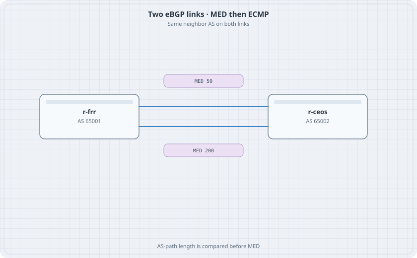

# BGP MED, Prepend, and ECMP

Two links to the same neighbor AS. MED can prefer one of them. AS-path length is compared earlier, so a prepend beats a better MED. When the two paths are equal, `maximum-paths` installs both.

{fig-alt="r-frr in AS 65001 and r-ceos in AS 65002 with two parallel links, one marked MED 50 and one marked MED 200."}

## Learning goals

By the end of this chapter you can:

- Prefer the low-MED link when both paths come from the same AS
- Overturn that choice with AS-path prepending
- Install both links as ECMP once the metrics match

## Topology

```yaml
name: med
topology:
  kinds:
    arista_ceos:
      image: ceos:4.37.0F
      memory: 2G
    frr:
      image: quay.io/frrouting/frr:containerlab-10.7.1
  nodes:
    r-frr:
      kind: frr
      startup-config: r-frr.frr.conf
      daemons: [bgpd]
    r-ceos:
      kind: arista_ceos
  links:
    - endpoints: ["r-frr:eth1", "r-ceos:eth1"]
    - endpoints: ["r-frr:eth2", "r-ceos:eth2"]
```

`r-frr.frr.conf`:

```text
frr defaults traditional
service integrated-vtysh-config
!
interface lo
 ip address 172.16.1.1/32
!
interface eth1
 ip address 10.1.12.1/30
!
interface eth2
 ip address 10.1.13.1/30
!
router bgp 65001
 bgp router-id 10.0.0.1
 neighbor 10.1.12.2 remote-as 65002
 neighbor 10.1.13.2 remote-as 65002
 address-family ipv4 unicast
  network 172.16.1.1/32
  neighbor 10.1.12.2 route-map MED-LOW out
  neighbor 10.1.13.2 route-map MED-HIGH out
 exit-address-family
!
route-map MED-LOW permit 10
 set metric 50
!
route-map MED-HIGH permit 10
 set metric 200
!
```

r-ceos:

```text
interface Ethernet1
   no switchport
   ip address 10.1.12.2/30
interface Ethernet2
   no switchport
   ip address 10.1.13.2/30
router bgp 65002
   router-id 10.0.0.2
   neighbor 10.1.12.1 remote-as 65001
   neighbor 10.1.13.1 remote-as 65001
ip routing
```

## Verify MED

```bash
docker exec clab-med-r-ceos Cli -c "show ip bgp 172.16.1.1/32"
```

### Predict

- Both neighbors are Established.
- The best path is 10.1.12.1, metric 50.
- 10.1.13.1 is valid and not best, metric 200.
- MED is only compared here because both paths are from AS 65001. A path from a third AS would not lose on MED alone.

## Prepend beats MED

Change `MED-LOW` on r-frr. Edit the file or `vtysh`:

```text
route-map MED-LOW permit 10
 set metric 50
 set as-path prepend 65001 65001 65001
```

`clear ip bgp * soft out` on r-frr, or the EOS side `clear ip bgp 65001 soft`.

### Predict

- The best path flips to 10.1.13.1 even though its MED is worse.
- The AS path via 10.1.12.1 is longer. Length is compared before MED.

Take the prepend off before the next step. Soft-clear again. The low MED must be best again.

## ECMP

On r-frr set both route-maps to metric 50. On r-ceos:

```text
router bgp 65002
   maximum-paths 2
```

Soft-clear.

### Predict

- `show ip route 172.16.1.1/32` on r-ceos lists two next hops.
- Shut Ethernet2. One next hop remains and the prefix stays. `no shutdown` restores both.

Destroy the lab.
