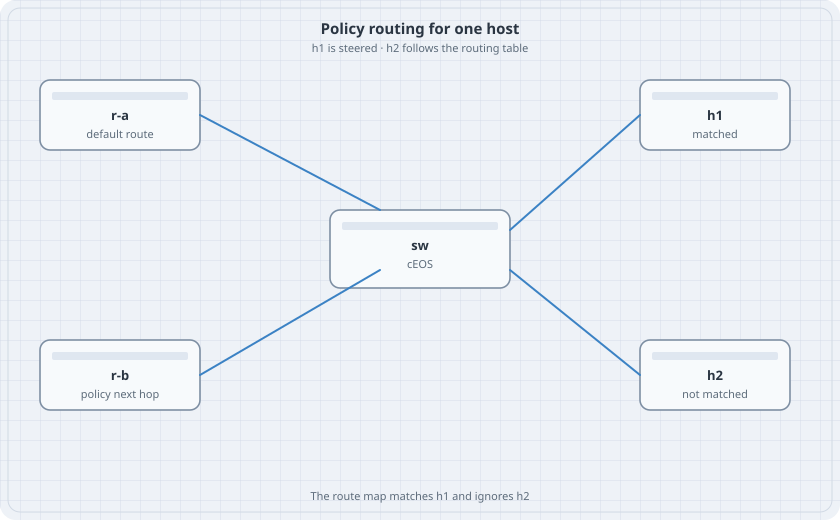

# Policy-Based Routing

The routing table has one best path for a prefix. Policy routing picks a next hop from the packet that arrived, before that lookup. Here only h1 is steered. h2 uses the default route. Both hosts share a subnet, so the difference is the match, not the destination.

{fig-alt="A cEOS switch connected to r-a, r-b, h1, and h2. h1 is marked matched and h2 is marked not matched."}

## Learning goals

By the end of this chapter you can:

- Match one source address in a PBR class
- Send that traffic to a next hop that is not the default route
- Show that a second host in the same subnet is unaffected
- Remove the policy and watch h1 follow the table again

## Topology

```yaml
name: pbr
topology:
  kinds:
    arista_ceos:
      image: ceos:4.37.0F
      memory: 2G
    frr:
      image: quay.io/frrouting/frr:containerlab-10.7.1
  nodes:
    sw:
      kind: arista_ceos
    r-a:
      kind: frr
      startup-config: r-a.frr.conf
    r-b:
      kind: frr
      startup-config: r-b.frr.conf
    h1:
      kind: linux
      image: alpine:latest
      exec:
        - ip addr add 172.16.10.11/24 dev eth1
        - ip link set eth1 up
        - ip route add default via 172.16.10.1
    h2:
      kind: linux
      image: alpine:latest
      exec:
        - ip addr add 172.16.10.12/24 dev eth1
        - ip link set eth1 up
        - ip route add default via 172.16.10.1
  links:
    - endpoints: ["sw:eth1", "r-a:eth1"]
    - endpoints: ["sw:eth2", "r-b:eth1"]
    - endpoints: ["h1:eth1", "sw:eth3"]
    - endpoints: ["h2:eth1", "sw:eth4"]
```

`r-a.frr.conf`:

```text
frr defaults traditional
service integrated-vtysh-config
!
interface lo
 ip address 10.9.0.1/32
!
interface eth1
 ip address 10.1.1.2/30
!
ip route 172.16.10.0/24 10.1.1.1
!
```

`r-b.frr.conf` is the same shape with `lo` `10.9.0.2/32`, `eth1` `10.1.2.2/30`, and the same return route via `10.1.2.1`.

## Switch

```text
vlan 10
   name users
interface Ethernet3
   switchport access vlan 10
interface Ethernet4
   switchport access vlan 10
interface Vlan10
   ip address 172.16.10.1/24
interface Ethernet1
   no switchport
   ip address 10.1.1.1/30
interface Ethernet2
   no switchport
   ip address 10.1.2.1/30
ip routing
ip route 10.9.0.1/32 10.1.1.2
ip route 10.9.0.2/32 10.1.2.2
```

Both loopbacks are reachable before you add a policy. h1 and h2 both use r-a for 10.9.0.1 and r-b for 10.9.0.2. That is the table. Remember it.

EOS applies PBR with a class and a policy, not with `ip policy route-map`.

```text
ip access-list PBR-H1
   10 permit ip host 172.16.10.11 any
class-map type pbr match-any CM-H1
   match ip access-group PBR-H1
policy-map type pbr PM-H1
   class CM-H1
      set nexthop 10.1.2.2
interface Vlan10
   service-policy type pbr input PM-H1
```

If `set nexthop` is rejected, stop and read `class CM-H1 ?`. Use the set form the help prints. Do not fall back to a routing-table static that would move h2 as well.

## Verify

```bash
docker exec clab-pbr-h1 traceroute -n 10.9.0.1
docker exec clab-pbr-h2 traceroute -n 10.9.0.1
docker exec clab-pbr-sw Cli -c "show policy-map type pbr interface Vlan10"
```

Alpine may need `apk add traceroute`. If `apk` fails, use `ping` and `tcpdump -ni eth1` on r-a and r-b instead. h1's echo request should arrive on r-b. h2's echo request for the same destination should arrive on r-a.

### Predict

- h1 reaches 10.9.0.1 via 10.1.2.2 even though the routing table says 10.1.1.2.
- h2 still uses 10.1.1.2.
- The policy counters increment only for h1.

## Drill

Remove the service-policy from Vlan10. h1's next hop returns to 10.1.1.2. Put the policy back, then shut Ethernet2. h1's ping to 10.9.0.1 fails or falls back, depending on whether this image drops the set next hop when it is unreachable. Record which one you saw. A policy whose next hop is down is a black hole unless the platform falls back. Destroy the lab after you know which it did.
