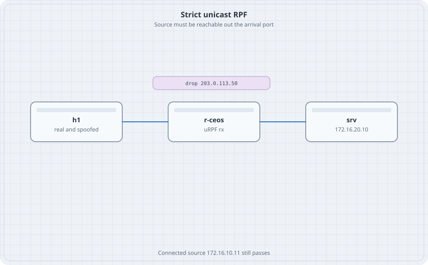

# Unicast RPF

An ACL names the sources you typed. Unicast reverse-path forwarding asks a different question: is the source reachable out the interface the packet arrived on. Strict mode says the interface must be the best path back to that source. A spoofed address fails that test. The real host address does not.

{fig-alt="h1 linked to r-ceos linked to srv. A chip says drop 203.0.113.50."}

## Learning goals

By the end of this chapter you can:

- Turn on strict uRPF on the port that faces the hosts
- Pass a packet whose source is in the connected subnet
- Drop a packet whose source is not reachable back out that port
- Tell a uRPF drop from an ACL drop

## Topology

```yaml
name: urpf
topology:
  kinds:
    arista_ceos:
      image: ceos:4.37.0F
      memory: 2G
  nodes:
    r-ceos:
      kind: arista_ceos
    h1:
      kind: linux
      image: alpine:latest
      exec:
        - ip addr add 172.16.10.11/24 dev eth1
        - ip link set eth1 up
        - ip route add default via 172.16.10.1
    srv:
      kind: linux
      image: alpine:latest
      exec:
        - ip addr add 172.16.20.10/24 dev eth1
        - ip link set eth1 up
        - ip route add default via 172.16.20.1
  links:
    - endpoints: ["h1:eth1", "r-ceos:eth1"]
    - endpoints: ["srv:eth1", "r-ceos:eth2"]
```

## Router

```text
interface Ethernet1
   no switchport
   ip address 172.16.10.1/24
   ip verify unicast source reachable-via rx
interface Ethernet2
   no switchport
   ip address 172.16.20.1/24
ip routing
```

Strict mode is `rx`. Loose mode would be `any`, which only asks whether the source exists somewhere in the table. This lab uses strict.

## Verify

```bash
docker exec clab-urpf-h1 ping -c 2 172.16.20.10
docker exec clab-urpf-h1 ip addr add 203.0.113.50/32 dev eth1
docker exec clab-urpf-h1 ping -c 2 -I 203.0.113.50 172.16.20.10
docker exec clab-urpf-r-ceos Cli -c "show ip interface Ethernet1"
```

If busybox `ping` rejects `-I`, install nothing yet. Add the address and run `ping` from a network namespace, or use `nping` only if you already added it. The check that matters is on the server:

```bash
docker exec clab-urpf-srv tcpdump -ni eth1 -c 4 icmp
```

Run the spoofed ping again while tcpdump listens.

### Predict

- The ping from 172.16.10.11 is captured on srv and returns.
- The ping from 203.0.113.50 is not captured on srv. The source is not reachable out Ethernet1. The best route for 203.0.113.50 does not exist, so strict mode drops it.
- `show ip interface Ethernet1` shows unicast reverse-path verification.

## Drill

Add a static on r-ceos:

```text
ip route 203.0.113.50/32 Ethernet1 172.16.10.11
```

The spoofed source is now reachable out the arrival port, so strict mode passes it. That is why uRPF is not a substitute for an ACL on a network that has loose routes back to the edge. Delete the static and confirm the spoof is dropped again. Then delete the extra address on h1 and destroy the lab.
