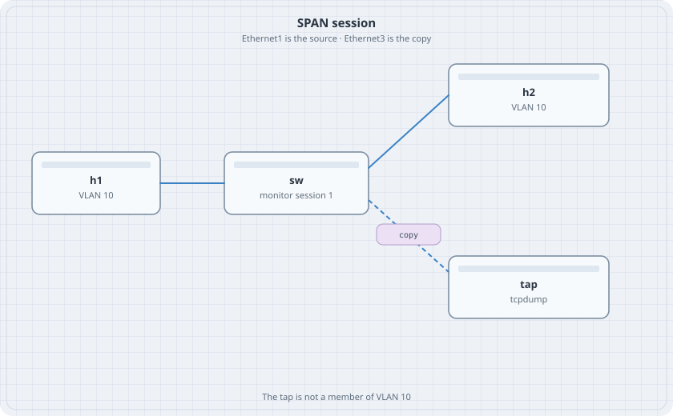

# SPAN

A troubleshooting port should see a copy of traffic without being in the forwarding path. SPAN does that. The source is the host port. The destination is a tap that is not a member of the VLAN.

{fig-alt="h1 linked to a switch. The switch links to h2 with a solid line and to a tap with a dashed line marked copy."}

## Learning goals

By the end of this chapter you can:

- Mirror one access port to a destination port
- See the host's frames on a tap that has no address in the VLAN
- Confirm the tap does not answer ARP for the hosts
- Remove the session and watch the copies stop

## Topology

```yaml
name: span
topology:
  kinds:
    arista_ceos:
      image: ceos:4.37.0F
      memory: 2G
  nodes:
    sw:
      kind: arista_ceos
    h1:
      kind: linux
      image: alpine:latest
      exec:
        - ip addr add 172.16.10.11/24 dev eth1
        - ip link set eth1 up
    h2:
      kind: linux
      image: alpine:latest
      exec:
        - ip addr add 172.16.10.12/24 dev eth1
        - ip link set eth1 up
    tap:
      kind: linux
      image: alpine:latest
  links:
    - endpoints: ["h1:eth1", "sw:eth1"]
    - endpoints: ["h2:eth1", "sw:eth2"]
    - endpoints: ["tap:eth1", "sw:eth3"]
```

The tap has no address. Give it a link that is up:

```bash
docker exec clab-span-tap ip link set eth1 up
```

## Switch

```text
vlan 10
   name users
interface Ethernet1
   switchport access vlan 10
interface Ethernet2
   switchport access vlan 10
monitor session 1 source Ethernet1 both
monitor session 1 destination Ethernet3
```

Do not put Ethernet3 in VLAN 10. Do not give it an IP address.

```bash
docker exec clab-span-sw Cli -c "show monitor session"
```

If the session is refused, read the reason and stop. cEOS accepts this configuration in the 4.37 manual's command set. A platform note in the error is the result. Do not invent a second mirror syntax.

## Verify

In one terminal:

```bash
docker exec clab-span-tap tcpdump -ni eth1 -c 6 icmp
```

In another:

```bash
docker exec clab-span-h1 ping -c 2 172.16.10.12
```

### Predict

- The ping works. h1 and h2 are in VLAN 10.
- tcpdump on the tap prints the ICMP echo and the echo reply, or at least the echo if the direction came up as rx only. `both` should show both.
- The tap does not appear in the switch MAC table as a normal host of VLAN 10. `show mac address-table vlan 10` lists h1 and h2.
- `no monitor session 1` stops the copies. The ping still works.

## Drill

Change the source to Ethernet2. The tap now sees h2's port and goes quiet when only h1 is idle and h2 is the one pinging. Put the source back to Ethernet1 before you destroy the lab so the last `show monitor session` matches the figure.
