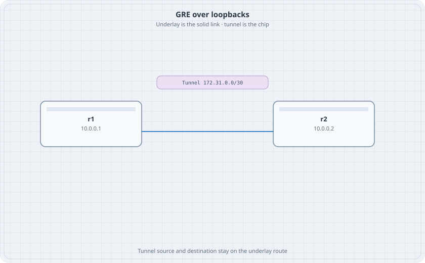

# GRE over the Underlay

The tunnel is an interface. The underlay is how the tunnel endpoints reach each other. If the route to the tunnel destination points back into the tunnel, the tunnel never comes up. This lab keeps those two tables apart on purpose.

{fig-alt="r1 at 10.0.0.1 and r2 at 10.0.0.2 with a solid underlay link and a chip for tunnel 172.31.0.0/30."}

## Learning goals

By the end of this chapter you can:

- Number a GRE tunnel between two loopbacks
- Keep the loopback route on the physical link
- Ping a far LAN through the tunnel
- Break the tunnel by pointing the underlay route at the tunnel, then fix it

## Topology

```yaml
name: gre
topology:
  kinds:
    arista_ceos:
      image: ceos:4.37.0F
      memory: 2G
  nodes:
    r1:
      kind: arista_ceos
    r2:
      kind: arista_ceos
    h1:
      kind: linux
      image: alpine:latest
      exec:
        - ip addr add 172.16.1.10/24 dev eth1
        - ip link set eth1 up
        - ip route add default via 172.16.1.1
    h2:
      kind: linux
      image: alpine:latest
      exec:
        - ip addr add 172.16.2.10/24 dev eth1
        - ip link set eth1 up
        - ip route add default via 172.16.2.1
  links:
    - endpoints: ["r1:eth1", "r2:eth1"]
    - endpoints: ["h1:eth1", "r1:eth2"]
    - endpoints: ["h2:eth1", "r2:eth2"]
```

Two cEOS nodes. Destroy anything else heavy first.

## Routers

r1:

```text
interface Ethernet1
   no switchport
   ip address 10.1.0.1/30
   mtu 1500
interface Ethernet2
   no switchport
   ip address 172.16.1.1/24
interface Loopback0
   ip address 10.0.0.1/32
interface Tunnel0
   mtu 1476
   ip address 172.31.0.1/30
   tunnel mode gre
   tunnel source Loopback0
   tunnel destination 10.0.0.2
ip route 10.0.0.2/32 10.1.0.2
ip route 172.16.2.0/24 172.31.0.2
ip routing
```

r2 swaps the ends. Ethernet1 is `10.1.0.2/30`. Loopback0 is `10.0.0.2/32`. Tunnel0 is `172.31.0.2/30`, destination `10.0.0.1`. The underlay static is `ip route 10.0.0.1/32 10.1.0.1`. The LAN route is `ip route 172.16.1.0/24 172.31.0.1`. Ethernet2 is `172.16.2.1/24`.

The underlay static points at the physical next hop. The LAN static points at the tunnel. Those are different routes. Do not summarize them into one default that recurses.

GRE adds 24 bytes. The tunnel MTU is 1476 so a 1500-byte host packet is not asked to fit inside a 1500-byte underlay packet.

## Verify

```bash
docker exec clab-gre-r1 Cli -c "show interface Tunnel0"
docker exec clab-gre-h1 ping -c 2 172.16.2.10
docker exec clab-gre-r1 Cli -c "ping 10.0.0.2 source 10.0.0.1"
```

### Predict

- Tunnel0 is up.
- The host ping works. The path for 172.16.2.0/24 is the tunnel address, not Ethernet1's peer.
- A ping from loopback to loopback uses the underlay static and does not need the tunnel. If that ping fails, fix it before you debug the tunnel. The tunnel cannot find its destination otherwise.

Capture on r2 Ethernet1 while h1 pings h2:

```bash
docker exec clab-gre-r2 tcpdump -ni eth1 -c 2 proto 47
```

cEOS may not have tcpdump. If the command is missing, skip the capture. Protocol 47 is GRE. The host ping is still the test that matters.

## Drill

Replace the underlay static on r1 with `ip route 10.0.0.2/32 172.31.0.2`. The tunnel destination is now reached through the tunnel. Tunnel0 drops or the host ping dies. Put the physical next hop back. Confirm Tunnel0 and the host ping. Destroy the lab.
