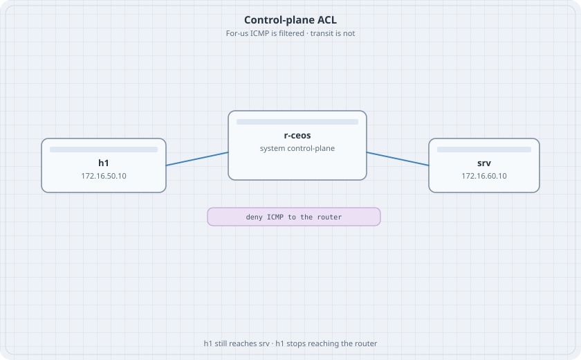

# Control-Plane ACL

A transit packet is forwarded. A packet addressed to the router is punted. The control-plane ACL sees the second kind. This lab denies ICMP to the router from one host and leaves forwarding to a server alone.

{fig-alt="h1 linked to r-ceos linked to srv. A chip says deny ICMP to the router."}

## Learning goals

By the end of this chapter you can:

- See the read-only default control-plane ACL
- Replace it with a lab ACL that denies one ICMP flow
- Prove transit traffic still flows
- Put the default ACL back

## Topology

```yaml
name: cp
topology:
  kinds:
    arista_ceos:
      image: ceos:4.37.0F
      memory: 2G
  nodes:
    r-ceos:
      kind: arista_ceos
    h1:
      kind: linux
      image: alpine:latest
      exec:
        - ip addr add 172.16.50.10/24 dev eth1
        - ip link set eth1 up
        - ip route add default via 172.16.50.1
    srv:
      kind: linux
      image: alpine:latest
      exec:
        - ip addr add 172.16.60.10/24 dev eth1
        - ip link set eth1 up
        - ip route add default via 172.16.60.1
  links:
    - endpoints: ["h1:eth1", "r-ceos:eth1"]
    - endpoints: ["srv:eth1", "r-ceos:eth2"]
```

You configure this switch with `docker exec` and `Cli`. That path does not cross the control-plane ACL. A real SSH session from h1 would. Do not lock a management port you still need.

## Router, before the ACL

```text
interface Ethernet1
   no switchport
   ip address 172.16.50.1/24
interface Ethernet2
   no switchport
   ip address 172.16.60.1/24
ip routing
```

```bash
docker exec clab-cp-h1 ping -c 2 172.16.50.1
docker exec clab-cp-h1 ping -c 2 172.16.60.10
docker exec clab-cp-r-ceos Cli -c "show ip access-lists default-control-plane-acl"
```

### Predict

- Both pings work.
- The default ACL is present and marked readonly. It permits ICMP and the routing protocols. You cannot edit it in place.

## Lab ACL

This list is a lab stand-in. It is not a production control-plane policy. A production list starts as a copy of `default-control-plane-acl` and then tightens the management sources. The short list below is safe here because the CLI arrives through `docker exec`, and because the last line still permits transit-facing protocols you might add later.

```text
ip access-list CP-LAB
   10 deny icmp host 172.16.50.10 host 172.16.50.1
   20 permit ip any any
system control-plane
   ip access-group CP-LAB in
```

```bash
docker exec clab-cp-h1 ping -c 2 172.16.50.1
docker exec clab-cp-h1 ping -c 2 172.16.60.10
docker exec clab-cp-r-ceos Cli -c "show ip access-lists CP-LAB"
```

### Predict

- The ping to 172.16.50.1 fails. The deny counter moves.
- The ping to 172.16.60.10 works. That packet is forwarded, not punted.
- A ping from srv to 172.16.50.1 still works. The deny names h1 only.

## Drill

Change line 10 to `deny icmp any any`. Both the for-us ping from h1 and the for-us ping from srv fail. The host-to-server ping still works. Put line 10 back to the host-specific deny.

When you are finished, remove the lab ACL so the default one returns:

```text
system control-plane
   no ip access-group CP-LAB in
```

Confirm `show ip access-lists` lists the default ACL on the control plane again. Then destroy the lab.
