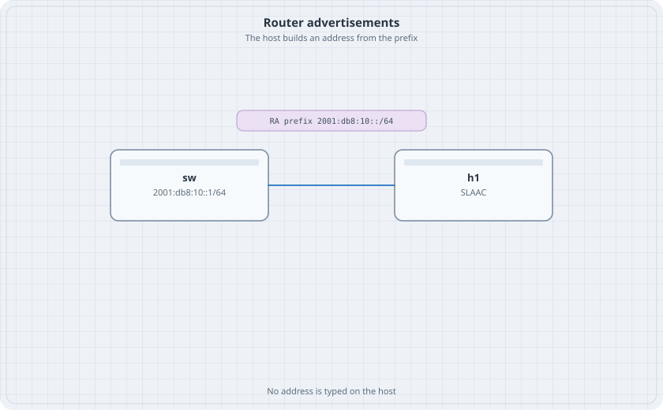

# IPv6 SLAAC

The IPv6 chapter put addresses on both ends by hand. SLAAC is the other way. The router advertises a prefix. The host builds an address and a default route from that advertisement. You do not type an address on the host.

{fig-alt="A switch addressed 2001:db8:10::1/64 linked to h1. A chip says RA prefix 2001:db8:10::/64."}

## Learning goals

By the end of this chapter you can:

- Send router advertisements on one VLAN
- Watch an Alpine host address itself from the prefix
- Ping the router's link-local and global addresses
- Stop the advertisements and watch the host keep the address until it expires

## Topology

```yaml
name: slaac
topology:
  kinds:
    arista_ceos:
      image: ceos:4.37.0F
      memory: 2G
  nodes:
    sw:
      kind: arista_ceos
    h1:
      kind: linux
      image: alpine:latest
  links:
    - endpoints: ["h1:eth1", "sw:eth1"]
```

Bring the host link up and allow router advertisements even if the container has forwarding on:

```bash
docker exec clab-slaac-h1 ip link set eth1 up
docker exec clab-slaac-h1 sysctl -w net.ipv6.conf.eth1.accept_ra=2
docker exec clab-slaac-h1 sysctl -w net.ipv6.conf.eth1.autoconf=1
```

Do not add an address.

## Switch

```text
ipv6 unicast-routing
vlan 10
   name users
interface Ethernet1
   switchport access vlan 10
interface Vlan10
   ipv6 enable
   ipv6 address 2001:db8:10::1/64
   ipv6 nd ra interval 4
```

`ipv6 nd ra disabled` is the off switch, used in the drill. If that command is rejected, `ipv6 nd ?` prints the disable form. Use that form and no other.

## Verify

```bash
docker exec clab-slaac-sw Cli -c "show ipv6 interface Vlan10"
docker exec clab-slaac-h1 ip -6 addr show dev eth1
docker exec clab-slaac-h1 ip -6 route
```

### Predict

- Vlan10 has 2001:db8:10::1/64 and a link-local in fe80::/10.
- eth1 on h1 grows a global address inside 2001:db8:10::/64. It also has a link-local. You did not type either one.
- The host has a default route via the router's link-local.
- `docker exec clab-slaac-h1 ping -c 2 2001:db8:10::1` returns.

## Drill

On Vlan10, disable router advertisements with the command from the help. Delete the global address on h1 (`ip -6 addr flush scope global dev eth1`) and wait. It should not come back. Enable advertisements again. The address returns without a reboot. Destroy the lab.
