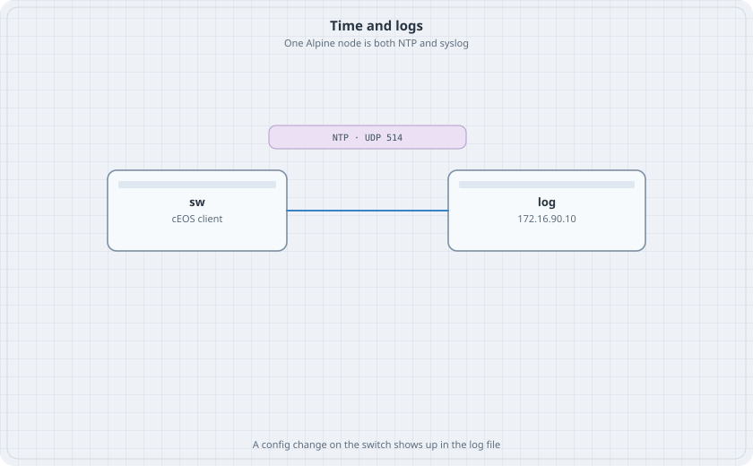

# NTP and Syslog

Logs without a clock are hard to line up with a packet capture. This lab makes one Alpine node the NTP server and the syslog server. The switch is the client of both. `apk` has to work. If it does not, stop and destroy the lab.

{fig-alt="A cEOS switch linked to a node at 172.16.90.10. A chip says NTP and UDP 514."}

## Learning goals

By the end of this chapter you can:

- Serve NTP from Alpine with a local stratum
- Point cEOS at that server and read the association
- Send switch logs to UDP 514 and read one message you caused
- Stop both services and see the switch report the loss

## Topology

```yaml
name: obs
topology:
  kinds:
    arista_ceos:
      image: ceos:4.37.0F
      memory: 2G
  nodes:
    sw:
      kind: arista_ceos
    log:
      kind: linux
      image: alpine:latest
      exec:
        - ip addr add 172.16.90.10/24 dev eth1
        - ip link set eth1 up
  links:
    - endpoints: ["sw:eth1", "log:eth1"]
```

## Alpine

```bash
docker exec clab-obs-log apk add chrony rsyslog
docker exec clab-obs-log sh -c 'printf "%s\n" "allow 172.16.90.0/24" "local stratum 8" >> /etc/chrony/chrony.conf'
docker exec clab-obs-log chronyd
docker exec clab-obs-log sh -c 'printf "%s\n" \
  "module(load=\"imudp\")" \
  "input(type=\"imudp\" port=\"514\")" \
  >> /etc/rsyslog.conf'
docker exec clab-obs-log rsyslogd
```

Chrony on Alpine reads `/etc/chrony/chrony.conf`. If that path is missing, `chronyd -h` or the package's sample file names the real one. Append the two lines there.

## Switch

```text
interface Ethernet1
   no switchport
   ip address 172.16.90.1/24
ntp server 172.16.90.10
logging host 172.16.90.10
logging trap informational
ip routing
```

## Verify

```bash
docker exec clab-obs-sw Cli -c "show ntp status"
docker exec clab-obs-sw Cli -c "show logging"
docker exec clab-obs-log sh -c "grep -n . /var/log/messages | tail -n 20"
```

Make a message you can find:

```bash
docker exec clab-obs-sw Cli -c "configure
interface Ethernet1
   description lab-log-test"
```

### Predict

- NTP reports the server 172.16.90.10. The stratum follows the server. The clock does not have to be a real reference. It has to move, and it has to match between the two nodes closely enough that new log lines are not minutes off.
- `/var/log/messages` on the Alpine node gains a line that mentions `lab-log-test` or Ethernet1. If rsyslog wrote somewhere else, `find /var/log -type f` shows the file that just grew.

## Drill

`kill` rsyslogd inside the log node. Change the description again. The switch still accepts the command. The file on the log node does not grow. Start rsyslogd again and change the description a third time. The line appears. A logging host that is down does not block configuration. It drops the history. Destroy the lab.
