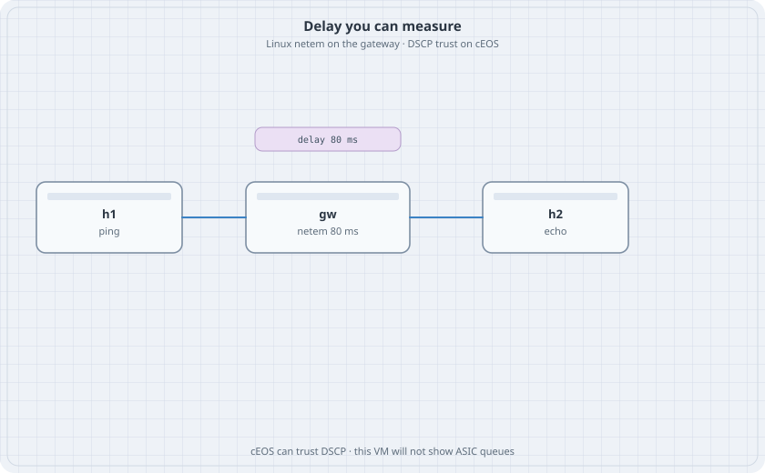

# DSCP Trust and Measured Delay

cEOS will take a QoS configuration. It will not show you the queues of a hardware switch. This chapter keeps those two facts apart. The EOS half is the trust command you would keep on a real box. The Linux half is a delay you can measure with ping.

{fig-alt="h1 linked to a gateway marked netem 80 ms, linked to h2. A chip says delay 80 ms."}

## Learning goals

By the end of this chapter you can:

- Trust DSCP on a cEOS ingress port and read it back
- Add a fixed delay with `tc netem` on Linux
- Measure that delay with ping before and after
- Remove the qdisc and watch the RTT fall

## Lab A — trust on cEOS

One switch, one host. This lab does not share a topology with Lab B.

```yaml
name: trust
topology:
  kinds:
    arista_ceos:
      image: ceos:4.37.0F
      memory: 2G
  nodes:
    sw:
      kind: arista_ceos
    h1:
      kind: linux
      image: alpine:latest
      exec:
        - ip addr add 172.16.10.11/24 dev eth1
        - ip link set eth1 up
  links:
    - endpoints: ["h1:eth1", "sw:eth1"]
```

```text
interface Ethernet1
   no switchport
   ip address 172.16.10.1/24
   qos trust dscp
ip routing
```

```bash
docker exec clab-trust-sw Cli -c "show qos interface Ethernet1"
```

### Predict

- The interface reports DSCP trust.
- A ping still works. Nothing in this lab drops or reorders. cEOS in a container has no forwarding ASIC queues to starve. Do not treat a successful ping as proof of a hardware scheduler.

Destroy `trust` before Lab B.

## Lab B — delay you can measure

```yaml
name: delay
topology:
  nodes:
    gw:
      kind: linux
      image: alpine:latest
      exec:
        - ip addr add 172.16.1.1/24 dev eth1
        - ip addr add 172.16.2.1/24 dev eth2
        - ip link set eth1 up
        - ip link set eth2 up
        - sysctl -w net.ipv4.ip_forward=1
    h1:
      kind: linux
      image: alpine:latest
      exec:
        - ip addr add 172.16.1.10/24 dev eth1
        - ip link set eth1 up
        - ip route add default via 172.16.1.1
    h2:
      kind: linux
      image: alpine:latest
      exec:
        - ip addr add 172.16.2.10/24 dev eth1
        - ip link set eth1 up
        - ip route add default via 172.16.2.1
  links:
    - endpoints: ["h1:eth1", "gw:eth1"]
    - endpoints: ["h2:eth1", "gw:eth2"]
```

```bash
docker exec clab-delay-h1 ping -c 5 172.16.2.10
docker exec clab-delay-gw tc qdisc add dev eth2 root netem delay 80ms
docker exec clab-delay-h1 ping -c 5 172.16.2.10
docker exec clab-delay-gw tc qdisc del dev eth2 root
docker exec clab-delay-h1 ping -c 5 172.16.2.10
```

### Predict

- The first five echoes are well under 80 ms. Container scheduling adds a little. It does not add 80.
- The middle five sit near 80 ms one way, so the RTT sits near 80 ms or a bit over. netem on one interface delays one direction.
- After `tc qdisc del`, the RTT falls again.

## Drill

Add `loss 10%` to the same netem line (`tc qdisc change dev eth2 root netem delay 80ms loss 10%`). Some echoes vanish. That is the difference between a policy that marks packets and a path that actually drops them. Delete the qdisc and destroy the lab.
