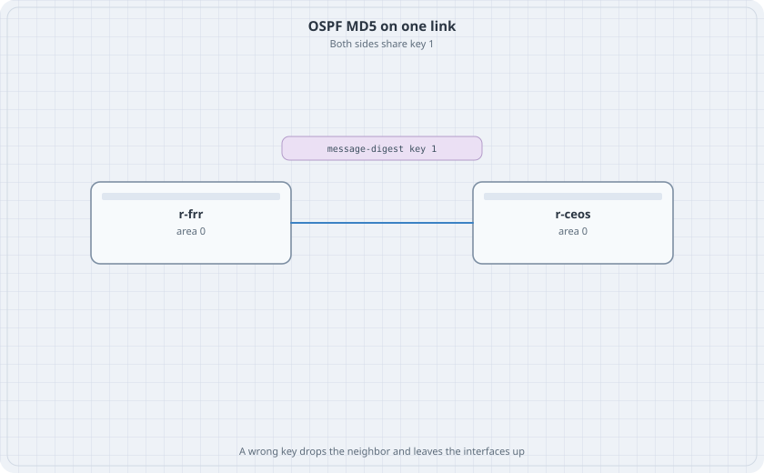

# OSPF Authentication

A neighbor that forms with anyone on the link will form with the wrong router. Message-digest authentication requires the same key id and the same key on both ends. The lab key below is the string `lab-md5-key`. It is a classroom value. Do not reuse it on a network you care about.

{fig-alt="r-frr and r-ceos in area 0 with a chip that says message-digest key 1."}

## Learning goals

By the end of this chapter you can:

- Bring up OSPF with no authentication and record the neighbor
- Require MD5 on both ends and watch the neighbor return
- Change one key and watch the adjacency drop while the interfaces stay up
- Put the key back without restarting the containers

## Topology

```yaml
name: ospfauth
topology:
  kinds:
    arista_ceos:
      image: ceos:4.37.0F
      memory: 2G
    frr:
      image: quay.io/frrouting/frr:containerlab-10.7.1
  nodes:
    r-frr:
      kind: frr
      startup-config: r-frr.frr.conf
      daemons: [ospfd]
    r-ceos:
      kind: arista_ceos
  links:
    - endpoints: ["r-frr:eth1", "r-ceos:eth1"]
```

`r-frr.frr.conf` starts with no authentication:

```text
frr defaults traditional
service integrated-vtysh-config
!
interface lo
 ip address 10.0.0.1/32
!
interface eth1
 ip address 10.1.0.1/30
 ip ospf area 0
 ip ospf network point-to-point
!
router ospf
 ospf router-id 10.0.0.1
 network 10.0.0.1/32 area 0
!
```

r-ceos:

```text
interface Loopback0
   ip address 10.0.0.2/32
interface Ethernet1
   no switchport
   ip address 10.1.0.2/30
   ip ospf network point-to-point
   ip ospf area 0
router ospf 1
   router-id 10.0.0.2
   network 10.0.0.2/32 area 0
ip routing
```

```bash
docker exec clab-ospfauth-r-frr vtysh -c "show ip ospf neighbor"
```

The neighbor reaches Full. Interfaces are up. That is the baseline.

## Matching keys

On r-frr interface eth1:

```text
interface eth1
 ip ospf authentication message-digest
 ip ospf message-digest-key 1 md5 lab-md5-key
```

On r-ceos Ethernet1:

```text
interface Ethernet1
   ip ospf authentication message-digest
   ip ospf message-digest-key 1 md5 lab-md5-key
```

Apply both sides before you decide the lab is broken. A one-sided key looks the same as a wrong key.

```bash
docker exec clab-ospfauth-r-ceos Cli -c "show ip ospf neighbor"
docker exec clab-ospfauth-r-frr vtysh -c "show ip ospf interface eth1"
```

### Predict

- The neighbor returns to Full.
- The interface still shows 10.1.0.1/30 and 10.1.0.2/30. Authentication did not change the subnet.
- The FRR interface output names message-digest.

## A wrong key

On r-ceos only, replace the key:

```text
interface Ethernet1
   no ip ospf message-digest-key 1 md5 lab-md5-key
   ip ospf message-digest-key 1 md5 lab-md5-WRONG
```

```bash
docker exec clab-ospfauth-r-ceos Cli -c "show ip ospf neighbor"
docker exec clab-ospfauth-r-ceos Cli -c "show ip interface Ethernet1 brief"
```

### Predict

- The neighbor is gone or stuck below Full.
- Ethernet1 is still up and still has 10.1.0.2/30. A routing-protocol failure is not a link failure.
- Ping from r-ceos to 10.1.0.1 still works. OSPF is not required for a connected ping.

Put `lab-md5-key` back on r-ceos. Remove the WRONG key. The neighbor returns without a reboot.

## Drill

Change the key id on one side to 2 and leave the other side on id 1, with the same string. The adjacency drops. Key id is part of the match. Restore id 1 on both sides, confirm Full, and destroy the lab.
