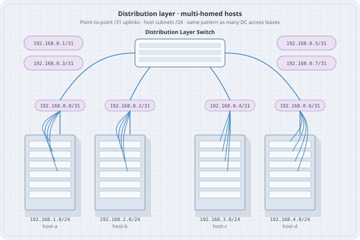

# Networking {.unnumbered}

Learn networking from first principles to NetOps by designing, building, breaking, and verifying networks. Containerlab and netlab support labs using freely available images, including FRR, Arista cEOS, and Nokia SR Linux.

{fig-alt="Distribution switch and four multi-homed server racks"}

## Learning path

1. Lab platform and a first topology.
2. Networking foundations and packet capture.
3. Layer 2 switching, VLANs, loops, and aggregation.
4. IP routing and services: static routes, DNS, DHCP, NAT, redundancy, and MTU.
5. Dynamic routing: OSPF, BGP, policy, and convergence.
6. Security, operations, and automation.
7. Tunnels, overlays, and fabrics.
8. Optional advanced tracks: routing security, transport and applications, and forensics.
9. Projects and the multi-NOS lab workbook.
10. Command references.

Use each diagram to predict the path, build the lab, verify the control and data planes, then introduce a failure and explain what changed. The workbook includes optional cEOS exercises that require an independently obtained image; consult the image provider for access and licensing. The workbook complements the core chapters: choose labs that match your topic and available images. Cisco and Juniper labs may be added as optional tracks later.

Every serious lab should include a topology and addressing plan, verification, and a failure scenario. Topology diagrams follow the shared illustrated light and dark SVG standard; conceptual diagrams explain the behavior being tested.
