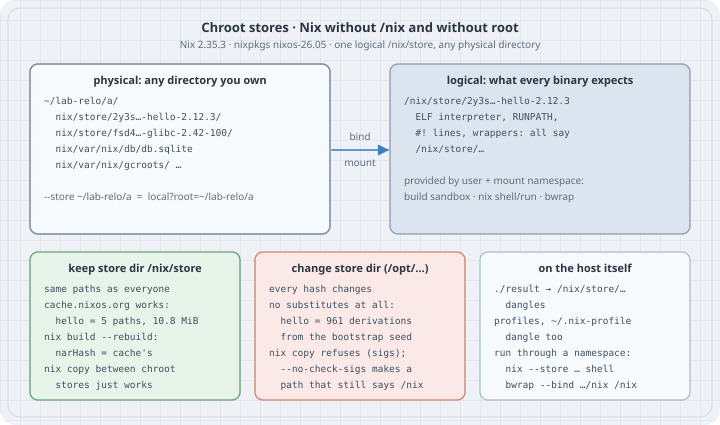

# Nix without `/nix`: chroot stores, `--store`, and why paths bake in `/nix/store`

Sooner or later you meet a Linux machine where you cannot create `/nix`: a shared HPC login node, a locked-down CI runner, a container without root, a colleague's laptop. The tempting fix is "put the store somewhere else", and Nix lets you say exactly that in two very different ways. One keeps every store path identical to the rest of the world and only moves the bytes (a **chroot store**). The other changes the store's *name* and quietly throws away the binary cache. This chapter runs both on a host with no `/nix`, no root and no daemon, measures the difference, and shows the traps that appear when the host itself tries to use paths that only exist inside a namespace.

Everything below ran on this book's lab box: Debian 13, Linux 6.12, user `uid=1000`, **no `/nix` directory**, and the statically linked **Nix 2.35.3** binary on `PATH` as `nix`. nixpkgs is pinned to the `nixos-26.05` tip of 2026-10-18 (`8ce73368d1ef…`). Versions for this book: **Nix 2.35.3** (upstream tag; the nix.dev "latest" manual is 2.35.2), **NixOS 26.05**.

## Learning goals

- Explain the difference between the **logical** store directory (`/nix/store`, inside every path and binary) and the **physical** location of the bytes
- Create and use a chroot store with `--store DIR` (`local?root=DIR`): build, substitute, run, copy and garbage-collect without root
- Run programs from a chroot store on the host with `nix shell --store` or `bwrap`, and know why `./result` and profiles dangle
- Predict what changing the logical store directory (`local?store=/opt/nix/store`) costs, and why `nix copy` between such stores is wrong
- Check whether a host can run chroot stores at all (unprivileged user and mount namespaces)

## Thesis

> Move the bytes, never the name. A chroot store keeps `/nix/store` as the logical path and puts the files anywhere you own; a user namespace makes them appear at `/nix/store` whenever something runs. Change the name instead and every hash changes, the binary cache is gone, and you are bootstrapping a compiler from a hex seed.

## Mental model

{fig-alt="Top left: the physical directory you own, for example ~/lab-relo/a, holding nix/store with hello and glibc, nix/var/nix/db/db.sqlite and gcroots; --store ~/lab-relo/a is short for local?root=~/lab-relo/a. Top right: the logical path every binary expects, /nix/store, because the ELF interpreter, RUNPATH, shebang lines and wrappers all contain it; it is provided by a user plus mount namespace: the build sandbox, nix shell or nix run, or bwrap. A bind-mount arrow joins them. Bottom left, keep the store directory /nix/store: same paths as everyone, cache.nixos.org works, hello is 5 paths and 10.8 MiB, nix build --rebuild gives the cache's NAR hash, nix copy between chroot stores just works. Bottom middle, change the store directory to /opt: every hash changes, no substitutes, hello becomes 961 derivations from the bootstrap seed, nix copy refuses for lack of signatures, and with --no-check-sigs creates a path that still references /nix. Bottom right, on the host: ./result and profiles point at /nix/store paths that do not exist there, so run through nix --store shell or bwrap --bind."}

```text
  logical path (in hashes, ELF headers, scripts)      physical bytes
  ──────────────────────────────────────────────      ─────────────────────────────────
  /nix/store/2y3s…-hello-2.12.3          ◄── bind ──  ~/lab-relo/a/nix/store/2y3s…-hello-2.12.3
                                          mount in    ~/lab-relo/a/nix/var/nix/db/db.sqlite
                                          a user +
                                          mount ns
  chroot store :  --store ~/lab-relo/a   =  local?root=~/lab-relo/a       (store dir stays /nix/store)
  relabelled   :  local?store=/opt/nix/store&real=…&state=…&log=…        (store dir changes: new hashes)
```

Three facts carry the chapter:

1. **The store directory is part of every store path's hash** (see [How Nix computes a store path](../08-internals/03d-store-path-computation.qmd)). It is also written into the binaries themselves: the ELF interpreter, `RUNPATH`, `#!` lines and wrapper scripts all contain `/nix/store/…`. Moving files does not move those strings.
2. **A chroot store changes only where the bytes live.** The store directory stays `/nix/store`, so paths, hashes and signatures are the ones `cache.nixos.org` serves. To *use* the files, something must make them appear at `/nix/store`: Nix's own build sandbox, `nix shell`/`nix run` with `--store`, or any tool that can bind-mount in a user namespace.
3. **"Auto" already does this.** With the default `store = auto`, Nix uses `/nix/store` if `/nix/var/nix` is writable, else the daemon socket if it exists, else (Linux only) the chroot store `~/.local/share/nix/root`. A rootless Nix that "just works" on a machine with no `/nix` is a chroot store.

## Case 1 — Can this host do it?

Chroot stores need unprivileged **user** and **mount** namespaces. Check before anything else.

```bash
nix --version
ls -d /nix
nix config show store
cat /proc/sys/user/max_user_namespaces
unshare --user --mount true && echo "unprivileged user+mount namespaces: ok"
```

```text
nix (Nix) 2.35.3
ls: cannot access '/nix': No such file or directory
auto
63991
unprivileged user+mount namespaces: ok
```

No `/nix`, the store setting is `auto`, and an unprivileged process may create user and mount namespaces. Places where this fails, all checked from documentation rather than run here: `user.max_user_namespaces = 0`; Debian/Ubuntu kernels with `kernel.unprivileged_userns_clone = 0`; Ubuntu 23.10 and later, where `kernel.apparmor_restrict_unprivileged_userns = 1` lets only AppArmor-profiled programs create user namespaces with full capabilities; and container runtimes whose seccomp profile blocks `unshare`/`clone` with `CLONE_NEWUSER`. On those hosts a chroot store cannot build or run anything; ask for a real `/nix` (or a bind mount at `/nix`) instead of relabelling the store (Case 5).

## Case 2 — A chroot store: physical layout, logical paths

```bash
P=github:NixOS/nixpkgs/8ce73368d1efd4d657e9064d29b144a52046b4e8
H=/nix/store/2y3s86m1yj9xnypd44vivfz3mwybzlki-hello-2.12.3
nix --store ~/lab-relo/a build --no-link --print-out-paths "$P#hello"
ls ~/lab-relo/a ~/lab-relo/a/nix ~/lab-relo/a/nix/var/nix
nix --store ~/lab-relo/a path-info -r "$H"
readelf -l ~/lab-relo/a$H/bin/hello | grep -o 'interpreter: [^]]*'
~/lab-relo/a$H/bin/hello; echo "exit=$?"
```

```text
/nix/store/2y3s86m1yj9xnypd44vivfz3mwybzlki-hello-2.12.3
/home/box/lab-relo/a:
nix

/home/box/lab-relo/a/nix:
store
var

/home/box/lab-relo/a/nix/var/nix:
db
gc.lock
gcroots
profiles
temproots
/nix/store/l1n6wi2lyzglvgzbwzw9n9w2pzkcj41i-xgcc-15.3.0-libgcc
/nix/store/g6mvl9ns7k52zfv9pcfw3dbh65z3j7id-libunistring-1.4.2
/nix/store/l5y42bimjvvn8h3v5y40w13vv7y2p3k5-libidn2-2.3.8
/nix/store/fsd4vbp9zjd9iaicq2fb9lpc1h5j973y-glibc-2.42-100
/nix/store/2y3s86m1yj9xnypd44vivfz3mwybzlki-hello-2.12.3
interpreter: /nix/store/fsd4vbp9zjd9iaicq2fb9lpc1h5j973y-glibc-2.42-100/lib/ld-linux-x86-64.so.2
/tmp/relo2/runall.sh: line 19: /home/box/lab-relo/a/nix/store/2y3s86m1yj9xnypd44vivfz3mwybzlki-hello-2.12.3/bin/hello: cannot execute: required file not found
exit=127
```

`--store ~/lab-relo/a` is shorthand for `local?root=/home/box/lab-relo/a`: an ordinary local store whose every directory (`store`, `state`, `log`) is prefixed with that root. The printed path is the logical one, `/nix/store/2y3s…`, byte for byte what a NixOS machine prints. The bytes are at `~/lab-relo/a/nix/store/2y3s…`, with the SQLite database and GC roots under `~/lab-relo/a/nix/var/nix`.

The last two lines are the whole problem in one error (the `runall.sh` prefix is bash naming the lab script that ran the command). The binary exists, but its ELF interpreter is `/nix/store/…-glibc-2.42-100/lib/ld-linux-x86-64.so.2`, which does not exist on this host. The kernel cannot start it ("required file not found" is `ENOENT` for the interpreter, not for `hello`).

## Case 3 — Running programs from a chroot store

Two ways to make the logical path real, both unprivileged:

```bash
nix --store ~/lab-relo/a shell "$H" --command sh -c \
  'hello; command -v hello; grep " /nix/store " /proc/self/mountinfo | cut -d" " -f4,5; id -u'
bwrap --bind ~/lab-relo/a/nix /nix "$H/bin/hello" --greeting="hello via bwrap"
```

```text
Hello, world!
/nix/store/2y3s86m1yj9xnypd44vivfz3mwybzlki-hello-2.12.3/bin/hello
/home/box/lab-relo/a/nix/store /nix/store
1000
hello via bwrap
```

`nix shell --store …` creates a user and mount namespace, bind-mounts `~/lab-relo/a/nix/store` at `/nix/store` (the `mountinfo` line shows source root and mount point) and runs the command there as the same uid. `nix run --store …` uses the same mechanism (not run here). Outside Nix, `bwrap` (bubblewrap) does it with one bind mount; because bubblewrap starts from an empty root, `hello`'s closure is all the program sees, which is exactly what a Nix closure promises it needs. `nix-user-chroot` and `nix-portable` are community tools built on the same idea (nix-portable falls back to `proot`, which uses `ptrace` and is much slower, when user namespaces are unavailable); neither was run here.

## Case 4 — Builds in a chroot store are the same builds

The build sandbox already runs every builder in its own namespaces with inputs bind-mounted at `/nix/store/…`. A chroot store only changes the source of those bind mounts. To prove it, rebuild `hello` from source in the chroot store and compare with the binary cache:

```bash
nix --store ~/lab-relo/a build --rebuild --no-link "$P#hello" 2>&1 | grep -v '^copying path'
echo "exit=${PIPESTATUS[0]}"
for s in ~/lab-relo/a https://cache.nixos.org; do
  printf '%-28s %s\n' "$s" "$(nix path-info --store "$s" --json --json-format 1 "$H" | jq -r '.[].narHash')"
done
```

```text
checking outputs of '/nix/store/v4c5h94di88ccdd9isyzhivdw84k81nh-hello-2.12.3.drv'...
exit=0
/home/box/lab-relo/a         sha256-OuTV3GyEZLx2+V1V4xaqEYxdvzrsMuymxdvL4WWaWyE=
https://cache.nixos.org      sha256-OuTV3GyEZLx2+V1V4xaqEYxdvzrsMuymxdvL4WWaWyE=
```

`--rebuild` substituted the build inputs (43 paths, filtered out above), compiled GNU hello again under `~/lab-relo/a`, and compared the result with the copy already in the store. Exit 0 and no "may not be deterministic" error: bit-identical. The NAR hash matches what `cache.nixos.org` serves for the same path. A user on a cluster with no `/nix` produces the same bits as Hydra.

The sandbox hides the physical location from *paths*, not from a builder that goes looking. This deliberately nosy derivation records its mounts:

```nix
# where.nix — a derivation that records where it thinks it is being built
let
  sh = "${builtins.storePath /nix/store/fl6zyj3yfpa973icc6ca3zbm55izmm9r-busybox-1.37.0}/bin/sh";
in
derivation {
  name = "where-am-i";
  system = "x86_64-linux";
  builder = sh;
  args = [ "-c" ''
    echo "out   = $out" > $out
    echo "shell = ${sh}" >> $out
    while read -r id parent dev root mnt rest; do
      case $mnt in /nix/store/*) echo "mount = $root -> $mnt" >> $out ;; esac
    done < /proc/self/mountinfo
  '' ];
}
```

```bash
BB=/nix/store/fl6zyj3yfpa973icc6ca3zbm55izmm9r-busybox-1.37.0
nix --store ~/lab-relo/a build --no-link "$P#busybox-sandbox-shell"
mkdir -p ~/lab-relo/elsewhere
nix copy --from ~/lab-relo/a --to ~/lab-relo/elsewhere/b "$BB"
for s in ~/lab-relo/a ~/lab-relo/elsewhere/b; do
  o=$(nix --store "$s" build -f where.nix --no-link --print-out-paths)
  echo "== $s"; cat "$s$o"
  nix --store "$s" path-info --json --json-format 1 "$o" | jq -r '.[].narHash'
done
```

```text
== /home/box/lab-relo/a
out   = /nix/store/95p76pxpqgy0n1pkyrghvcrnq0zwy6kq-where-am-i
shell = /nix/store/fl6zyj3yfpa973icc6ca3zbm55izmm9r-busybox-1.37.0/bin/sh
mount = /home/box/lab-relo/a/nix/store/fl6zyj3yfpa973icc6ca3zbm55izmm9r-busybox-1.37.0 -> /nix/store/fl6zyj3yfpa973icc6ca3zbm55izmm9r-busybox-1.37.0
sha256-kAo3I6hwz5QYxc8ij4medwDO2Rr8H99Xg2Ez23/kaa0=
== /home/box/lab-relo/elsewhere/b
out   = /nix/store/95p76pxpqgy0n1pkyrghvcrnq0zwy6kq-where-am-i
shell = /nix/store/fl6zyj3yfpa973icc6ca3zbm55izmm9r-busybox-1.37.0/bin/sh
mount = /home/box/lab-relo/elsewhere/b/nix/store/fl6zyj3yfpa973icc6ca3zbm55izmm9r-busybox-1.37.0 -> /nix/store/fl6zyj3yfpa973icc6ca3zbm55izmm9r-busybox-1.37.0
sha256-82ArCXEVkU/AH39Xy7f5tNRYN0ObKzSP9vj2FAPoek8=
```

Same derivation, same output path (input-addressed: the path depends on the recipe, not on the result), two different NAR hashes. `/proc/self/mountinfo` inside the sandbox names the real source of each bind mount, and this builder wrote it into `$out`. Nothing in Nix flags this: each store built and registered its own bytes. Real packages do not read `mountinfo`, which is why `hello` matched above; but it is the reason "same path" never *proves* "same bytes". Use `nix build --rebuild` (or `--check`) and compare NAR hashes when it matters.

## Case 5 — Relabelling the store: the expensive mistake

Now the other way: keep the files in a home directory and also *call* the store `/opt/nix/store`.

```bash
S='local?store=/opt/nix/store&state=/home/box/lab-relo/c/state&log=/home/box/lab-relo/c/log&real=/home/box/lab-relo/c/store'
nix --store "$S" eval --no-eval-cache --raw "$P#hello.outPath"; echo
nix --store "$S" build --no-eval-cache --dry-run "$P#hello" 2>&1 | grep 'will be'
nix --store ~/lab-relo/d build --no-eval-cache --dry-run "$P#hello" 2>&1 | grep 'will be'
```

```text
/opt/nix/store/qj1hpmrfji1r7lfv1pby3lizgbx856mx-hello-2.12.3
these 961 derivations will be built:
these 5 paths will be fetched (10.8 MiB download, 36.2 MiB unpacked):
```

Same nixpkgs commit, same `hello`, new hash (`qj1h…` instead of `2y3s…`), because the store directory is inside the fingerprint. Nothing under `/opt/nix/store` exists in any public cache, so the relabelled store must build **961 derivations**, starting from nixpkgs 26.05's minimal bootstrap (a `hex0` seed, then `stage0-posix`, the Mes C library and up to GCC). The chroot store `d`, with the store directory left alone, needs **5 downloads, 10.8 MiB**. `--no-eval-cache` matters here: the flake evaluation cache is keyed by the flake, not by the store directory, and without it the second store can get a cached `/nix/store` answer.

And you cannot convert between the two by copying:

```bash
nix copy --from ~/lab-relo/a --to "$S" "$H" 2>&1 | grep '^error:'
nix copy --no-check-sigs --from ~/lab-relo/a --to "$S" "$H" && echo "copy with --no-check-sigs: exit 0"
ls ~/lab-relo/c/store | grep 'hello-2.12.3$'
readelf -l ~/lab-relo/c/store/${H#/nix/store/}/bin/hello | grep -o 'interpreter: [^]]*'
```

```text
error: cannot add path '/opt/nix/store/g6mvl9ns7k52zfv9pcfw3dbh65z3j7id-libunistring-1.4.2' because it lacks a signature by a trusted key
copy with --no-check-sigs: exit 0
2y3s86m1yj9xnypd44vivfz3mwybzlki-hello-2.12.3
interpreter: /nix/store/fsd4vbp9zjd9iaicq2fb9lpc1h5j973y-glibc-2.42-100/lib/ld-linux-x86-64.so.2
```

The first copy is refused: the signatures from `cache.nixos.org` are for `/nix/store/…` names. Forcing it with `--no-check-sigs` "works", and produces `/opt/nix/store/2y3s…-hello-2.12.3`: a path whose hash belongs to a *different* store directory and whose binary still asks for an interpreter in `/nix/store`. The manual is explicit that paths can only be copied between stores with the same `store` setting; the tool does not stop you once you disable the check.

## Case 6 — The host's view: results, profiles and GC roots

Anything Nix leaves on the host side (`./result`, profile links, `~/.nix-profile`) is a symlink to a logical path.

```bash
nix --store ~/lab-relo/a profile add --profile ~/lab-relo/prof-new "$H" 2>&1 | tail -1
nix-env --store ~/lab-relo/a -p ~/lab-relo/prof -i "$H" 2>&1
find ~/lab-relo -maxdepth 1 -name 'prof*' -printf '%f -> %l\n' | sort
test -x ~/lab-relo/prof/bin/hello && echo "prof/bin/hello runs on the host" || echo "prof/bin/hello: dangling on the host"
bwrap --bind ~/lab-relo/a/nix /nix --ro-bind ~/lab-relo ~/lab-relo ~/lab-relo/prof/bin/hello
nix-store --store ~/lab-relo/a --gc --print-roots 2>/dev/null
nix --store ~/lab-relo/a store gc 2>&1 | tail -1
nix --store ~/lab-relo/a path-info "$H" && echo "hello survived: the profile is a GC root"
```

```text
error: cannot read directory "/nix/store/2y3s86m1yj9xnypd44vivfz3mwybzlki-hello-2.12.3": No such file or directory
installing 'hello-2.12.3'
building '/nix/store/a9m9hffbk96vi1inwnrvx9c3l247r408-user-environment.drv'...
prof -> prof-1-link
prof-1-link -> /nix/store/cxa0nmp5aa22rnxjpn0gibqm7q10yn6a-user-environment
prof/bin/hello: dangling on the host
Hello, world!
"/home/box/lab-relo/prof-1-link" -> /nix/store/cxa0nmp5aa22rnxjpn0gibqm7q10yn6a-user-environment
116 store paths deleted, 358.7 MiB freed
/nix/store/2y3s86m1yj9xnypd44vivfz3mwybzlki-hello-2.12.3
hello survived: the profile is a GC root
```

What happened:

- **`nix profile add` failed** with Nix 2.35.3 and a chroot store: it assembles the profile by reading package directories at their logical path on the host, which does not exist. Observed here; treat it as a current limitation, not a rule.
- **`nix-env -i` worked**, because classic `nix-env` builds the profile as a derivation (`user-environment`, using the built-in `buildenv` builder) inside the sandbox, where `/nix/store` exists.
- The profile link points at `/nix/store/…-user-environment`, so `~/lab-relo/prof/bin/hello` **dangles on the host**. Putting it on `PATH` does nothing. It runs once the store is mounted (`bwrap`), and the profile directory is bind-mounted read-only so the link can be followed.
- The profile is registered as an indirect **GC root** in the chroot store's `gcroots/auto`, so `nix store gc` (which removed 116 paths, mostly the build inputs from Case 4) kept `hello`.

## The trap

**Trap: "set `store = /opt/nix/store` and keep using the cache."** The store directory is in every hash. A relabelled store gets no substitutes and rebuilds the world from the bootstrap seed (Case 5). If `/nix` cannot exist, use a chroot store; if `/nix` can exist but the disk is elsewhere, bind-mount or mount that storage *at* `/nix`.

**Trap: "`./result` works, so I can put the chroot store's bins on `PATH`."** Every link Nix creates points at the logical `/nix/store/…`. On a host without `/nix` they dangle (Cases 2 and 6). Run things through `nix shell --store …`, `nix run --store …` or a bind-mounting wrapper, or wrap your shell session in one.

**Trap: "same store path means same bytes."** Input-addressed paths are a promise about the *recipe*. A builder that reads `/proc/self/mountinfo`, the host name or the time produces different bytes at the same path in different stores, and nothing complains (Case 4). Check with `--rebuild` and NAR hashes.

**Trap: "`rm -rf` the lab when done."** Store paths are read-only (`0555` directories), so a plain `rm -rf ~/lab-relo` fails with "Permission denied" on every file (it did, on the first run of this lab). Use `nix store gc` on the store, or `chmod -R u+w` the directory first.

**Trap: "it worked on my laptop, so it works on the cluster."** Chroot stores live or die by unprivileged user namespaces. Check `unshare --user --mount true` on the target before promising anyone a rootless Nix (Case 1).

## The boring rule

1. Never change the logical store directory. Keep `/nix/store`.
2. Without root and without `/nix`, use a chroot store: `--store ~/some/dir` (or let `store = auto` pick `~/.local/share/nix/root`), and run programs through `nix shell`/`nix run --store` or `bwrap`.
3. With root once, prefer a real `/nix` (a dedicated filesystem or bind mount at `/nix`) and the daemon; the chroot store is the fallback, not the goal.
4. Treat everything Nix writes on the host side of a chroot store (results, profiles) as meaningful only inside the namespace.

## Try this

1. Run `nix --store ~/lab-relo/a run "$P#cowsay" -- moo` and find, in `~/lab-relo/a/nix/var/nix/gcroots`, whether anything now keeps `cowsay` alive.
2. Point `--store` at a directory on an NFS or Lustre home on a cluster you use. Does SQLite locking under `nix/var/nix/db` behave? (The manual's `read-only` store setting exists for read-only database filesystems.)
3. Make a binary cache from the chroot store with `nix copy --to file:///tmp/cache "$H"`, read `nix-cache-info`, and substitute from it into a fresh chroot store with `--substituters file:///tmp/cache --no-require-sigs`.
4. Change `where.nix` to stop reading `mountinfo`, rebuild it in both stores and compare NAR hashes again.
5. On a test VM where you are root, set `kernel.apparmor_restrict_unprivileged_userns=1` (Ubuntu) or `user.max_user_namespaces=0`, and watch Case 3 fail. Revert afterwards.

## Next

- [Store, profiles, and GC on Linux](03-store-profiles-and-gc.qmd) for the normal, daemon-backed store.
- [How Nix computes a store path](../08-internals/03d-store-path-computation.qmd) for why the store directory is inside every hash.

## Verification

- **Run here, unprivileged:** Debian 13, Linux 6.12.94+, `uid=1000`, no `/nix`, no daemon, no root. `nix` is the statically linked **Nix 2.35.3** binary already on the box (nothing installed). `bwrap` 0.12.0 and `jq` were already present. nixpkgs pinned to `nixos-26.05` at `8ce73368d1efd4d657e9064d29b144a52046b4e8` (branch tip 2026-10-18, GitHub API).
- One script recreated the lab from an empty `~/lab-relo` and captured every output block above; only the 43 `copying path` lines of Case 4 and the stderr of `nix-store --print-roots` (stale temp-root notices) are filtered, as the listed commands show. The first run also produced the `rm -rf` "Permission denied" flood described in the trap; the script now does `chmod -R u+w` first.
- Versions checked 2026-10-19: Nix upstream tag **2.35.3**; nix.dev "latest" manual **2.35.2**; NixOS **26.05** current stable.
- `store = auto` semantics quoted from `nix help-stores` (Nix 2.35.3). The `local` store settings (`root`, `store`, `real`, `state`, `log`, `read-only`) and the "same `store` setting" rule for copying come from the Local Store page of the manual.
- **Not run:** hosts where user namespaces are disabled or restricted (sysctls need root; written from kernel and Ubuntu documentation), `nix-user-chroot` and `nix-portable` (not installed), and Try-this item 2 (no NFS/Lustre here).

## Sources

- Nix manual — [Local Store](https://nix.dev/manual/nix/latest/store/types/local-store) (chroot stores, `root`, `store`, `real`, `state`, `log`, `read-only`; "you can only copy store paths between stores if they have the same `store` setting"), [`store` setting and the `auto` store](https://nix.dev/manual/nix/latest/store/types/), [`nix store gc`](https://nix.dev/manual/nix/latest/command-ref/new-cli/nix3-store-gc), [`nix build --rebuild`](https://nix.dev/manual/nix/latest/command-ref/new-cli/nix3-build), [`nix copy`](https://nix.dev/manual/nix/latest/command-ref/new-cli/nix3-copy), [Store path specification](https://nix.dev/manual/nix/latest/protocols/store-path)
- Linux — [`user_namespaces(7)`](https://man7.org/linux/man-pages/man7/user_namespaces.7.html), [`mount_namespaces(7)`](https://man7.org/linux/man-pages/man7/mount_namespaces.7.html), [`/proc/sys/user/max_user_namespaces`](https://docs.kernel.org/admin-guide/sysctl/user.html)
- Ubuntu — [Restricted unprivileged user namespaces](https://ubuntu.com/blog/ubuntu-23-10-restricted-unprivileged-user-namespaces) (`kernel.apparmor_restrict_unprivileged_userns`)
- bubblewrap — <https://github.com/containers/bubblewrap>
- nixpkgs minimal bootstrap — `pkgs/os-specific/linux/minimal-bootstrap` in <https://github.com/NixOS/nixpkgs/tree/nixos-26.05>
- Community tools (not run): [nix-user-chroot](https://github.com/nix-community/nix-user-chroot), [nix-portable](https://github.com/DavHau/nix-portable)

## Inspiration

X post by @bereknyei (2026-08-07): https://x.com/bereknyei/status/2085834505126879588 — topic signal only (a pointer to the Nix Vegas / DEF CON talk on relocatable Nix stores). The chapter cites only the primary docs above.
