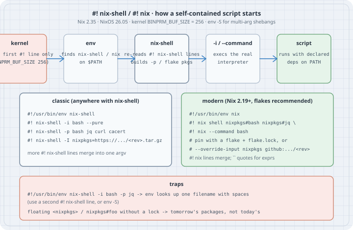

# Self-contained scripts with `#! nix-shell` / `#! nix`

A script that starts `curl | xml2json | jq` works on your laptop and fails on a colleague's, on CI, and on the server that has only `curl`. The usual fixes are "install the deps", a container, or a Go/Rust rewrite. **Nix shebang scripts** keep the script as a script and declare the interpreter and every tool it needs in the file itself. Anyone with Nix can run it; without Nix they cannot, which is the honesty the shebang encodes. This chapter covers both forms still in use: classic `nix-shell -i … -p …` and the modern `nix shell … --command` shebang, how the kernel and `env` actually start them, how to pin so tomorrow's run is the same as today's, and the traps that make a shebang silently wrong.

Nix is **not installed on this box**. Every shebang script below is written from the Nix 2.35 and nix.dev manuals and is marked **not run here**. What *was* run is the kernel/`env` behaviour that decides whether Nix ever gets a chance: how a multi-line shebang is handed off, what `env` does with spaces, and how `BINPRM_BUF_SIZE` truncates a long first line. Versions for this book: **Nix 2.35.3** (upstream tags), **NixOS 26.05** (stable "Yarara").

## Learning goals

- Write a classic `#!/usr/bin/env nix-shell` script with `-i`, `-p` / `--packages`, `--pure` and a pinned `-I nixpkgs=…`
- Write the modern `#!/usr/bin/env nix` form with `nix shell` and `--command`
- Explain why options must live on extra `#! nix-shell` / `#! nix` lines, and when `env -S` is an alternative
- Pin a revision (tarball, flake lock, or `--override-input`) so the script is reproducible
- Say when a shebang script is the right tool versus a `devShell`, a flake app (`nix run`) or a packaged derivation

## Thesis

> A shebang script is a tiny, portable derivation of *one* run. Pin the inputs, declare the packages, and the script carries its own toolchain. Leave the pin floating and you have reinvented "works on my machine" with extra steps.

## Mental model

{fig-alt="Five steps: the kernel reads only the first shebang line, up to BINPRM_BUF_SIZE 256 bytes, and hands the script path to /usr/bin/env. env finds nix-shell or nix on PATH. nix-shell re-reads every #! nix-shell line as options, builds the declared packages, and with -i or --command execs the real interpreter. The script then runs with those dependencies on PATH. Two forms are shown. Classic: env nix-shell, then #! nix-shell -i bash --pure, -p packages, and -I nixpkgs equals a pinned tarball URL. Modern: env nix, then #! nix shell flake installables and --command bash, pinned with a flake.lock or --override-input. Traps: putting -i and -p on the first line makes env look up one filename with spaces; floating nixpkgs without a lock means tomorrow's packages."}

```text
  script file
  ┌──────────────────────────────────────────────────────────┐
  │  #!/usr/bin/env nix-shell     ← only this line is a      │
  │  #! nix-shell -i bash --pure     kernel shebang          │
  │  #! nix-shell -p bash jq …    ← Nix re-reads these       │
  │  #! nix-shell -I nixpkgs=…/<rev>.tar.gz                  │
  │  … body …                                                │
  └──────────────────────────────────────────────────────────┘
           │
           ▼  kernel: execve("/usr/bin/env", ["nix-shell", script, args…])
           ▼  env:     find "nix-shell" on $PATH
           ▼  nix-shell: parse #! nix-shell lines, realise packages, exec -i
```

Two facts matter before any Nix option:

1. **The kernel sees only the first `#!` line**, and at most `BINPRM_BUF_SIZE` (256) bytes of it. Everything after the first space on that line is one argument to the interpreter (unless you use `env -S`). Extra `#! nix-shell` / `#! nix` lines are ordinary text to the kernel; Nix opens the file and parses them itself.
2. **`/usr/bin/env` looks up a *name***. `#!/usr/bin/env nix-shell -i bash` makes `env` search for a file literally called `nix-shell -i bash`. That is why the options go on subsequent lines, or why you write `#!/usr/bin/env -S nix-shell -i bash …` (`env -S` splits).

## Case 1 — What the kernel and `env` actually pass (run here)

A stand-in `nix-shell` that only prints its argv shows the hand-off. Nothing below needs Nix.

```bash
# fakebin/nix-shell — a STAND-IN, not Nix: print exactly what env hands over
#!/bin/sh
printf '$0 = %s\n' "$0"
i=1
for a in "$@"; do printf '$%d = %s\n' "$i" "$a"; i=$((i + 1)); done
```

```bash
# report.sh — what a real script looks like to the stand-in
#!/usr/bin/env nix-shell
#! nix-shell -i bash --pure
#! nix-shell -p bash jq
echo "this line is for bash, not for the stand-in"
```

```bash
chmod +x fakebin/nix-shell report.sh
PATH="$PWD/fakebin:$PATH" ./report.sh --since 2026-10-01 "two words"
```

```text
$0 = /workspace/lab-1018am-shebang/fakebin/nix-shell
$1 = ./report.sh
$2 = --since
$3 = 2026-10-01
$4 = two words
```

`env` found `nix-shell` on `PATH` and gave it the **script path** and then the user arguments. The `#! nix-shell …` lines never appear in argv: a real `nix-shell` reopens `$1` and reads them. That is also why you must not put options on the first line:

```bash
# wrong.sh — options on the first line
#!/usr/bin/env nix-shell -i bash -p jq
echo unreachable
```

```bash
PATH="$PWD/fakebin:$PATH" ./wrong.sh; echo exit:$?
```

```text
env: ‘nix-shell -i bash -p jq’: No such file or directory
env: use -[v]S to pass options in shebang lines
exit:127
```

GNU `env` even tells you the fix. With `env -S` the first line *can* carry options, and the stand-in then sees them as separate argv entries before the script path:

```bash
# split.sh
#!/usr/bin/env -S nix-shell -i bash -p jq
echo unreachable with the stand-in
```

```bash
PATH="$PWD/fakebin:$PATH" ./split.sh
```

```text
$0 = /workspace/lab-1018am-shebang/fakebin/nix-shell
$1 = -i
$2 = bash
$3 = -p
$4 = jq
$5 = ./split.sh
```

Prefer the multi-line `#! nix-shell` form: it is what the Nix manuals show, it works on `env` without `-S`, and it keeps the first line short.

The first line also has a hard length limit. On Linux the kernel copies at most `BINPRM_BUF_SIZE` (256) bytes of the shebang, including the `#!`:

```bash
# long.py — how much of a long #! line survives?
python3 - <<'PY'
import os, subprocess
for n in (200, 240, 300):
    path = f"/tmp/long-shebang-{n}.sh"
    with open(path, "w") as f:
        f.write("#!/usr/bin/env -S printf %s\\n " + "x" * n + "\necho never\n")
    os.chmod(path, 0o755)
    r = subprocess.run([path], capture_output=True, text=True)
    got = len(r.stdout.splitlines()[0]) if r.stdout else 0
    print(f"argument of {n:3} x's -> printf received {got:3} x's"
          f"  (shebang line {len('#!/usr/bin/env -S printf %s\\n ') + n} bytes)")
    os.unlink(path)
PY
```

```text
argument of 200 x's -> printf received 200 x's  (shebang line 230 bytes)
argument of 240 x's -> printf received 225 x's  (shebang line 270 bytes)
argument of 300 x's -> printf received 225 x's  (shebang line 330 bytes)
```

Past 256 bytes the argument is silently truncated. A long `-I nixpkgs=https://…/<64-char-sha>.tar.gz` on the first line is how people hit this; put pins on later `#!` lines, which Nix reads from the file and which are not limited by `BINPRM_BUF_SIZE`.

## Case 2 — Classic form: `nix-shell -i` / `-p` / `--pure` / `-I` (not run here)

This is the form in the Nix 2.35 `nix-shell` manual and the nix.dev tutorial *Reproducible interpreted scripts*. It works with any Nix that provides `nix-shell`, including non-flake installs.

```bash
# nixpkgs-releases.sh — declare bash, curl, jq, xml2json; pin nixpkgs
#!/usr/bin/env nix-shell
#! nix-shell -i bash --pure
#! nix-shell -p bash cacert curl jq python3Packages.xmljson
#! nix-shell -I nixpkgs=https://github.com/NixOS/nixpkgs/archive/26f4107e47e3ad0ffd0db220469ba83b6f6d96e8.tar.gz
curl -fsSL https://github.com/NixOS/nixpkgs/releases.atom | xml2json | jq .
```

```bash
# not run here — Nix is not installed on this box
# chmod +x nixpkgs-releases.sh && ./nixpkgs-releases.sh
```

What each line does:

| Piece | Meaning |
|---|---|
| `#!/usr/bin/env nix-shell` | Kernel shebang. `env` finds `nix-shell` on `PATH` (so Nix must be on `PATH` for the user who runs it). |
| `-i bash` | After the environment is ready, exec `bash` as the real interpreter; the script path is passed as `$1` to it. |
| `--pure` | Clear almost all of the ambient environment before starting. Retains a few variables (`HOME`, `USER`, `DISPLAY`, …). Forces the script to use only the packages you listed. |
| `-p` / `--packages` | Attribute paths in nixpkgs that should be on `PATH` (and in `buildInputs` for the temporary derivation). Multiple `-p` lines merge. |
| `-I nixpkgs=https://…/<rev>.tar.gz` | Pin. Without this, `nix-shell` uses whatever `<nixpkgs>` resolves to in `NIX_PATH` / the flake registry today. |
| `cacert` | Needed under `--pure` so TLS trusts work (`curl` https). |

A language other than bash is the same pattern: `-i python3` with `python3` and the libraries on `-p`, `-i runghc` with a GHC-with-packages expression, and so on. For languages where `#` is not a comment (JavaScript, Ruby, PHP, Erlang), wrap the `#! nix-shell` lines in a block comment; Nix still finds them, the real interpreter ignores them.

**Relative paths in the shebang (Nix 2.24+).** A `#! nix-shell --expr 'import ./shell.nix'` or `#! nix-shell ./deps.nix -i python3` resolves `./` **relative to the script's directory**, not the caller's cwd. That is what makes `~/bin/say-hi` that imports `~/bin/shell.nix` work when you run it from `$HOME`. Opt out with `nix-shell-shebang-arguments-relative-to-script = false` in `nix.conf` if you must keep the old behaviour; that option is scheduled to go away.

## Case 3 — Modern form: `#!/usr/bin/env nix` + `nix shell` (not run here)

Nix 2.19 made the `nix` CLI itself a shebang interpreter. Subsequent `#! nix …` lines are concatenated into one `nix` invocation. The usual shape puts `nix shell` installables on those lines and ends with `--command real-interpreter`:

```bash
# hello-cowsay.sh — flake installables, no -I tarball
#!/usr/bin/env nix
#! nix shell nixpkgs#bash nixpkgs#hello nixpkgs#cowsay --command bash
hello | cowsay
```

```bash
# pinned-with-override.sh — pin the nixpkgs input without a local flake
#!/usr/bin/env nix
#! nix shell --override-input nixpkgs github:NixOS/nixpkgs/26f4107e47e3ad0ffd0db220469ba83b6f6d96e8
#! nix      nixpkgs#bash nixpkgs#jq --command bash
jq --version
```

```bash
# not run here — Nix is not installed on this box
# chmod +x hello-cowsay.sh pinned-with-override.sh
# ./hello-cowsay.sh
# ./pinned-with-override.sh
```

Notes that bite in practice:

- **Double backticks** (two `` characters, as in the Nix manual's shebang section) quote a multi-line or special Nix expression inside a `#! nix` line. Single or double quotes are what the classic `nix-shell` shebang uses for `-p` expressions; do not mix the two styles up.
- **`--command bash` replaces `-i bash`.** There is no `-i` in the new CLI.
- **`nixpkgs#foo` without a pin** follows the flake registry. On a machine whose registry tracks `nixpkgs-unstable`, tomorrow's `jq` may not be today's. Prefer a project flake that the script references (`#! nix shell path:.#jq --command bash` next to a `flake.lock`), or `--override-input` / a locked `github:NixOS/nixpkgs/<rev>` as above.
- The new form needs a Nix with the `nix-command` (and for flakes, `flakes`) experimental feature, which Fedora 44's packaged Nix and current Determinate installs enable by default. Classic `nix-shell` remains the lowest-common-denominator for mixed fleets.

## Case 4 — Pinning so "reproducible" means something

| Pin style | Example | Pros | Cons |
|---|---|---|---|
| Floating channel / registry | `-p jq` or `nixpkgs#jq` alone | Short | Changes under you |
| nixpkgs tarball URL | `-I nixpkgs=https://github.com/NixOS/nixpkgs/archive/<rev>.tar.gz` | One line, works with classic `nix-shell` | URL length; first hit downloads the tree |
| Flake + `flake.lock` next to the script | `#! nix shell path:.#tools --command bash` | Best UX, updates via `nix flake update` | Needs flakes; the lock must be committed |
| `--override-input nixpkgs github:…/<rev>` | See Case 3 | No local flake required | Verbose; easy to leave floating by mistake |
| `fetchTarball` inside a `deps.nix` | `#! nix-shell deps.nix -i python3` with a fixed `sha256` | Classic, auditable | Two files to ship |

The commit used in the examples above, `26f4107e47e3ad0ffd0db220469ba83b6f6d96e8`, was the tip of `nixos-26.05` on 2026-10-15. For a script you ship, pick a revision on purpose and record why (a release, a CVE fix, a known-good CI pin). Do not paste "whatever `nix flake metadata` said this morning" into a shebang and call it pinned.

## Case 5 — When *not* to use a shebang

| Need | Prefer |
|---|---|
| An interactive project toolchain (compilers, linters, formatters) | A flake `devShell` + `nix develop` / direnv (the previous chapter) |
| A command other people run as `nix run github:org/repo#cmd` | A flake `apps` / `packages` output |
| Something installed on a system or in a profile | A real derivation (`writeShellApplication`, `stdenv.mkDerivation`) so GC and signatures apply |
| A dependency graph shared by many scripts | One flake, many apps; not twenty shebangs each pinning nixpkgs |
| Running on hosts without Nix | A container image or a static binary; a shebang cannot help |

A shebang shines for **glue**: a one-file report, a webhook receiver, a bootstrap that must not assume the host's `jq`. Once the file grows a test suite or a second entry point, promote it to a flake app.

## The trap

**Trap: "options on the first line."** Case 1. `env` looks up one filename. Use a second `#!` line, or `env -S`.

**Trap: "floating `<nixpkgs>` is fine for a demo."** It is fine for a demo you throw away. It is how last quarter's "reproducible" script started needing a different Python. Pin.

**Trap: "`--pure` and then call `git`/`ssh`/`docker`."** They are gone from `PATH`. Either add them to `-p`, or drop `--pure` and accept host tooling (and document that). `--keep VAR` retains named ambient variables under `--pure` when you need a token or a socket.

**Trap: "the shebang is a sandbox."** It is an environment. Network, home directory, and (without a user namespace) the rest of the machine are still there. `--pure` only cleans the environment block.

**Trap: "`writeShellApplication` in nixpkgs already does this."** For packages, yes: it rewrites the shebang to a store bash and puts deps on `PATH`. That is the right end state for something you *install*. A `#! nix-shell` script is the right form for something you *copy as a file* to a machine that has Nix but not your package set.

**Trap: "long `-I` on the first line."** Case 1: silent truncation at 256 bytes. Put pins on later lines.

## The boring rule

Put `#!/usr/bin/env nix-shell` (or `nix`) on line one, every option on the following `#!` lines, and a **pinned** nixpkgs (tarball revision, flake lock, or `--override-input`). Use `--pure` unless you have a named reason not to. When the script grows up, promote it to a flake app.

## Try this

1. On a machine with Nix 2.35+, save Case 2's script, `chmod +x` it, and run it. Then change the pinned revision to another `nixos-26.05` commit and confirm `jq --version` (add a `jq --version` line) is unchanged or moves, depending on what that commit changed.
2. Convert Case 2 to Case 3 with `nixpkgs#…` installables and `--override-input`. Which form's first run downloaded more?
3. Drop `--pure` and see whether a host `curl` that is *not* the nixpkgs one still runs. Then put `--pure` back and add `cacert`.
4. Write a Python script that imports `requests` with `#! nix-shell -i python3 -p python3Packages.requests` and a pin. Run it from a different directory than the one you wrote it in.
5. On Nix ≥ 2.24, put `deps.nix` next to a script that does `#! nix-shell ./deps.nix -i bash` and run the script from `$HOME`. Confirm it still finds `./deps.nix`.

## Next

- Back to [Daily CLI, flakes, and devShells](04-daily-cli-and-devshells.qmd)
- [Home Manager standalone](05-home-manager-standalone.qmd)

## Verification

- **Run here (no Nix):** Case 1. Debian 13, Linux **6.12.94+**, GNU coreutils **env 9.7**, `BINPRM_BUF_SIZE` 256 from `/usr/include/linux/binfmts.h`. The stand-in `nix-shell`, the `env` error with spaces, `env -S` splitting, and the truncation probe were all executed; outputs above are pasted from those runs.
- **Not run here:** Cases 2–3 and every real `nix-shell` / `nix shell` invocation. `/nix` does not exist on this box, and installing Nix is out of bounds for this run. Those listings follow the Nix 2.35 `nix-shell` manual, the `nix` shebang documentation, the 2.19 / 2.24 release notes, and the nix.dev *Reproducible interpreted scripts* tutorial.
- Versions checked 2026-10-18: Nix **2.35.3** (upstream tag), NixOS **26.05** current on nixos.org, `nixos-26.05` tip `26f4107e47e…` dated 2026-10-15.
- No packages installed, no root, no `sudo`, no AI/coding CLIs.

## Sources

- Nix 2.35 manual — [`nix-shell`](https://nix.dev/manual/nix/2.35/command-ref/nix-shell.html) (including *Use as a `#!`-interpreter*)
- Nix 2.35 manual — [`nix` shebang interpreter](https://nix.dev/manual/nix/2.35/command-ref/new-cli/nix.html#shebang-interpreter) and [`nix shell`](https://nix.dev/manual/nix/2.35/command-ref/new-cli/nix3-shell.html)
- Nix release notes — [2.19 (shebang via `nix`)](https://nix.dev/manual/nix/2.35/release-notes/rl-2.19.html), [2.24 (`nix-shell` shebang paths relative to the script)](https://nix.dev/manual/nix/2.35/release-notes/rl-2.24.html)
- nix.dev tutorial — [Reproducible interpreted scripts](https://nix.dev/tutorials/first-steps/reproducible-scripts)
- Linux `BINPRM_BUF_SIZE` — `include/uapi/linux/binfmts.h` (256); GNU coreutils `env --help` (`-S` / `--split-str`)
- nixos.org download page (Nix 2.35.x, NixOS 26.05) and the `nixos-26.05` branch tip used as the example pin

## Inspiration

X post by @wereness (2026-06-20): https://x.com/wereness/status/2068459592216920440 — topic signal only ("force throwaway scripts onto `#! nix-shell` so they never crash on missing tools"). The chapter cites only the primary docs above.
