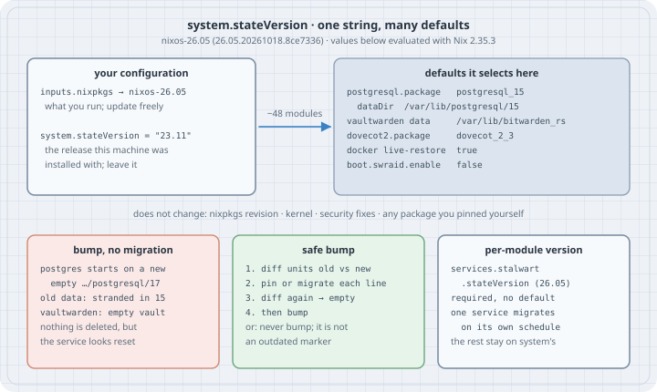

# `system.stateVersion`: What It Changes, and How to Bump It Without Losing Data

**Goal:** Know exactly what the one line `system.stateVersion = "…";` does on a NixOS host and what it does not do. See which defaults it selects on *your* configuration, and why changing it "to match the release" can start a database server on an empty data directory. Learn the safe way to move a host to newer defaults: diff, pin or migrate, diff again. Recognise the newer per-module `stateVersion` that lets one service migrate on its own schedule.

Version note: everything below was evaluated against **nixos-26.05** (`26.05.20261018.8ce7336`) with **Nix 2.35.3**. All evaluation output is pasted from those runs. Evaluation does not need a NixOS machine, so nothing was booted. The data-migration steps in Case 6 and *The trap* (`pg_upgrade`, moving a data folder) need a running host with real data. They are written from the NixOS manual and marked as not run.

{fig-alt="system.stateVersion: one string that many module defaults read. Top left, your configuration: nixpkgs follows nixos-26.05, which is what you run and update; system.stateVersion stays 23.11, the release the machine was installed with. An arrow labelled about 48 modules points right to the defaults it selects on this host: PostgreSQL 15 with data in /var/lib/postgresql/15, Vaultwarden data in /var/lib/bitwarden_rs, Dovecot 2.3, Docker live-restore true, software RAID off. Below them, what it does not change: the nixpkgs revision, the kernel, security fixes and every package you did not leave to a stateVersion default. Bottom row, three cards. Bumping without migrating: PostgreSQL starts on a new, empty /var/lib/postgresql/17 and the old data is stranded. A safe bump: diff the generated units for the old and new value, then pin or migrate each difference, then bump, or simply never bump. Per-module stateVersion: services.stalwart.stateVersion since 26.05 lets one service migrate on its own schedule."}

## Mental model

A NixOS host has two different "versions", and people mix them up:

```text
what you RUN                                   what your DATA was created with
──────────────                                 ───────────────────────────────
inputs.nixpkgs → nixos-26.05 (rev 8ce7336)      system.stateVersion = "23.11"
  · packages, kernel, systemd, security fixes     · set once, by nixos-generate-config,
  · you update it every week, freely                to the release you INSTALLED
  · nixos-version prints it                       · read by module DEFAULTS only:
                                                    if versionAtLeast stateVersion "25.11"
                                                    then pkgs.postgresql_17 else …
```

Modules use `stateVersion` only where a newer default would break **existing state**: a database major version whose on-disk format needs a manual upgrade, a data directory that was renamed, a daemon setting whose default flipped. Code that can migrate its own data does not need it, and the option description says so. Everything else follows nixpkgs, whatever `stateVersion` says.

The consequences are simple:

- A low `stateVersion` is **not** outdated, unsupported or insecure. A host installed on 23.11 and updated to nixos-26.05 runs 26.05's PostgreSQL 15 build, with 26.05's patches. It just has not been moved to PostgreSQL 17.
- Changing `stateVersion` changes **defaults**, and nothing else. Options you set explicitly are not affected. Defaults that depend on it switch to the new value on the next `switch`, and the data on disk stays where it is.
- If you leave it unset, it defaults to the current release and evaluation prints a warning (Case 3). The next release upgrade then moves your defaults, with only that warning as notice. That is the one way to get the dangerous behaviour without editing anything.

`nixos-generate-config` writes the line for you, with a warning comment (`nixos/modules/installer/tools/tools.nix`):

```nix
system.stateVersion = "${config.system.nixos.release}"; # Did you read the comment?
```

## Worked examples

No host is booted. Each case evaluates a minimal NixOS configuration with `nixpkgs.lib`'s `eval-config.nix` and reads back option values or the generated systemd units. Everything runs as an ordinary user. The `nixpkgs` revision is the locked nixos-26.05 commit from the version note.

```console
$ nix --version; nix eval --raw github:NixOS/nixpkgs/8ce73368d1efd4d657e9064d29b144a52046b4e8#lib.version; echo
nix (Nix) 2.35.3
26.05.20261018.8ce7336
```

### Case 1: How many modules care?

A census of the module tree at that revision:

```bash
# census.sh — which NixOS modules read system.stateVersion, and at which release thresholds
cd "$1/nixos/modules"
echo "modules mentioning system.stateVersion: $(rg -l -g '*.nix' 'system\.stateVersion|inherit \(config\.system\) stateVersion' . | wc -l)"
echo "comparisons per threshold, code + defaultText:"
rg -o --no-filename -g '*.nix' 'version(Older|AtLeast) (config\.system\.|cfg\.)?stateVersion "[0-9]+\.[0-9]+"' . \
  | grep -o '"[0-9.]*"' | tr -d '"' | sort -V | uniq -c | awk '{printf "  %s:%s", $2, $1} END {print ""}'
echo "thresholds 26.05 and later:"
rg -l -g '*.nix' 'stateVersion "26\.(05|11)"' . | sed 's|^\./|  |' | sort
```

```console
$ bash census.sh ./nixpkgs     # an unpacked checkout of rev 8ce7336
modules mentioning system.stateVersion: 48
comparisons per threshold, code + defaultText:
  17.09:5  18.03:2  19.03:1  19.09:2  20.03:2  20.09:4  21.03:1  21.11:1  22.05:6  23.05:1  23.11:6  24.05:5  24.11:6  25.05:11  25.11:8  26.05:14  26.11:3
thresholds 26.05 and later:
  services/databases/mysql.nix
  services/mail/dovecot.nix
  services/mail/stalwart.nix
  services/misc/seerr.nix
  services/misc/tandoor-recipes.nix
  services/misc/taskchampion-sync-server.nix
  services/networking/sabnzbd/default.nix
  services/web-apps/lauti.nix
  services/web-apps/netbox.nix
  services/web-apps/nextcloud.nix
  services/web-apps/olivetin.nix
  tasks/filesystems/zfs.nix
```

48 of the 2,421 `.nix` files under `nixos/modules` mention the option. A few only *set* it (the installer's generated configuration, test and builder-VM profiles), and the rest read it. Most of the readers are services that own a data directory: databases, mail, web apps, media servers. Thresholds as old as 17.09 stay in the code. When the package an old branch would select is removed from nixpkgs, that branch turns into an evaluation error (PostgreSQL 13 and older, Case 4). Note the three `26.11` comparisons that are already on the 26.05 branch, for example `boot.zfs.forceImportRoot` and a MySQL first-start change. A host installed with the coming 26.11 release will get the new default, and every host installed earlier keeps the old one.

### Case 2: The same configuration under five stateVersions

```nix
# probe.nix — evaluate one minimal NixOS configuration per stateVersion and read back defaults
let
  nixpkgs = builtins.getFlake "github:NixOS/nixpkgs/8ce73368d1efd4d657e9064d29b144a52046b4e8";
  host = stateVersion: (import "${nixpkgs}/nixos/lib/eval-config.nix" {
    system = "x86_64-linux";
    modules = [{
      boot.isContainer = true;                 # no bootloader / fileSystems needed for evaluation
      system.stateVersion = stateVersion;
      services.postgresql.enable = true;       # enabled, but nothing pinned
      services.vaultwarden.enable = true;
      services.dovecot2.enable = true;
    }];
  }).config;
  probe = sv: let c = host sv; in {
    "postgresql.package"          = c.services.postgresql.package.name;
    "postgresql.dataDir"          = c.services.postgresql.dataDir;
    "vaultwarden StateDirectory"  = c.systemd.services.vaultwarden.serviceConfig.StateDirectory;
    "dovecot2.package"            = c.services.dovecot2.package.name;
    "oci-containers.backend"      = c.virtualisation.oci-containers.backend;
    "docker live-restore"         = c.virtualisation.docker.daemon.settings.live-restore;
    "boot.swraid.enable"          = c.boot.swraid.enable;
    "zfs.forceImportRoot"         = c.boot.zfs.forceImportRoot;
  };
in builtins.listToAttrs (map (sv: { name = sv; value = probe sv; }) [ "22.11" "23.11" "24.11" "25.11" "26.05" ])
```

```console
$ nix eval --impure --json -f probe.nix > probe.json && python3 table.py probe.json
stateVersion →              22.11                   23.11                   24.11                   25.11                   26.05
boot.swraid.enable          true                    false                   false                   false                   false
docker live-restore         true                    true                    false                   false                   false
dovecot2.package            dovecot-2.3.21.1        dovecot-2.3.21.1        dovecot-2.3.21.1        dovecot-2.3.21.1        dovecot-2.4.5
oci-containers.backend      podman                  podman                  podman                  podman                  podman
postgresql.dataDir          /var/lib/postgresql/14  /var/lib/postgresql/15  /var/lib/postgresql/16  /var/lib/postgresql/17  /var/lib/postgresql/17
postgresql.package          postgresql-14.24        postgresql-15.19        postgresql-16.15        postgresql-17.11        postgresql-17.11
vaultwarden StateDirectory  bitwarden_rs            bitwarden_rs            vaultwarden             vaultwarden             vaultwarden
zfs.forceImportRoot         true                    true                    true                    true                    true
```

`table.py` only turns the JSON into rows:

```python
# table.py — print probe.json as rows = options, columns = stateVersions
import json, sys
d = json.load(open(sys.argv[1]))
svs = sorted(d, key=lambda v: tuple(map(int, v.split("."))))
opts = list(d[svs[0]])
cell = lambda v: str(v).lower() if isinstance(v, bool) else str(v)
rows = [["stateVersion →"] + svs] + [[o] + [cell(d[s][o]) for s in svs] for o in opts]
w = [max(len(r[i]) for r in rows) for i in range(len(rows[0]))]
for r in rows:
    print("  ".join(c.ljust(w[i]) for i, c in enumerate(r)).rstrip())
```

Read it column by column: these are the defaults *one* nixpkgs revision gives each host. Every column runs the same 26.05 packages. What differs is which *variant* the module chooses for state it cannot migrate itself:

- **PostgreSQL** follows a staircase: 14 → 15 → 16 → 17. The data directory has the major version in its name (`/var/lib/postgresql/${psqlSchema}`). That detail decides what happens on a bump (Case 5).
- **Vaultwarden** keeps the pre-rename data folder `bitwarden_rs` for hosts older than 24.11.
- **Dovecot 2.4** changed its configuration format, so only hosts installed with 26.05 get it by default.
- **Docker `live-restore`** was a NixOS-specific `true` until 24.11. Newer hosts follow upstream (`false`).
- **`boot.swraid.enable`** was implicitly on before 23.11. Newer hosts must enable it, as `nixos-generate-config` does when it finds MD arrays.
- **`oci-containers.backend`** and **`zfs.forceImportRoot`** do not change within these columns. Their thresholds are 22.05 (Podman) and 26.11 (not yet released).

### Case 3: `stateVersion` left unset

```nix
# edge.nix — edge cases: stateVersion unset, very old, and a module with its own stateVersion
let
  nixpkgs = builtins.getFlake "github:NixOS/nixpkgs/8ce73368d1efd4d657e9064d29b144a52046b4e8";
  eval = m: (import "${nixpkgs}/nixos/lib/eval-config.nix" {
    system = "x86_64-linux";
    modules = [ { boot.isContainer = true; } m ];
  }).config;
in {
  unset = (eval { }).system.stateVersion;
  old-pg = (eval { system.stateVersion = "21.11"; services.postgresql.enable = true; })
    .services.postgresql.package.name;
  stalwart = (eval { system.stateVersion = "26.05"; services.stalwart.enable = true; })
    .services.stalwart.dataDir;
  stalwart-own = builtins.mapAttrs (_: sv: (eval {
    system.stateVersion = "26.05";                    # the host was installed on 26.05 …
    services.stalwart = { enable = true; stateVersion = sv; };   # … the mail server earlier
  }).services.stalwart.dataDir) { "25.11" = "25.11"; "26.05" = "26.05"; };
}
```

```console
$ nix eval --impure --raw -f edge.nix unset; echo
evaluation warning: system.stateVersion is not set, defaulting to 26.05. Read why this matters on https://nixos.org/manual/nixos/stable/options.html#opt-system.stateVersion.
26.05
```

The default is `config.system.nixos.release`, the release of the nixpkgs you evaluate. Today that is harmless, because the host gets today's defaults. On the day you move the flake input to nixos-26.11, the default becomes `26.11` and every module from Case 1 that has a 26.11 threshold switches over at once. The warning is the only notice you get. Treat it as an error. Copy the value it prints into the configuration and commit it.

### Case 4: The floor: stateVersions older than the oldest supported default

```console
$ nix eval --impure --raw -f edge.nix old-pg 2>&1 | grep -E '^\s*error: [a-zA-Z]'
       error: postgresql_13 was removed, please upgrade your postgresql version.
```

A 21.11 host that left PostgreSQL unpinned would get `postgresql_13`, which nixpkgs no longer ships. Rather than silently starting a newer major version on old data, the module **refuses to evaluate**. The same will happen to `postgresql_14` once it is removed. Upstream support for PostgreSQL 14 ends in November 2026, and the module already carries a warning helper for "the oldest version available and thus the next that will be removed". If your host's `stateVersion` is between 22.05 and 23.05, pin the package and plan the `pg_upgrade` now, while you choose the time.

### Case 5: What a bump from 23.11 to 26.05 would actually change

The useful question is not "what is the newest stateVersion?" but "what would change on *my* host?". Generate the units for both values and diff them:

```nix
# host.nix — a small server installed on 23.11 and upgraded release by release since
{ ... }: {
  boot.isContainer = true;
  services.postgresql.enable = true;
  services.vaultwarden.enable = true;
  services.dovecot2.enable = true;
  virtualisation.docker.enable = true;
}
```

```nix
# units.nix — the systemd units host.nix generates under a given stateVersion
{ stateVersion, hostModule ? ./host.nix }:
let
  nixpkgs = builtins.getFlake "github:NixOS/nixpkgs/8ce73368d1efd4d657e9064d29b144a52046b4e8";
  cfg = (import "${nixpkgs}/nixos/lib/eval-config.nix" {
    system = "x86_64-linux";
    modules = [ hostModule { system.stateVersion = stateVersion; } ];
  }).config;
  wanted = [ "postgresql" "vaultwarden" "dovecot" "docker" ];
  pick = s: { inherit (s) environment serviceConfig; preStart = s.preStart; };
in builtins.listToAttrs (map (n: { name = n; value = pick cfg.systemd.services.${n}; })
  (builtins.filter (n: cfg.systemd.services ? ${n}) wanted))
// { "docker daemon.json" = cfg.virtualisation.docker.daemon.settings; }
```

```python
# diff.py — flatten two JSON documents and print every leaf that differs
import json, sys

def flat(x, p=""):
    if isinstance(x, dict):
        for k, v in x.items():
            yield from flat(v, f"{p}.{k}" if p else k)
    elif isinstance(x, list):
        for i, v in enumerate(x):
            yield from flat(v, f"{p}[{i}]")
    else:
        yield p, x

def short(v, n=96):
    s = json.dumps(v) if not isinstance(v, str) else v
    s = " ⏎ ".join(l.strip() for l in s.splitlines() if l.strip())
    return s if len(s) <= n else s[: n - 1] + "…"

def window(x, y, n=88):
    """Show both strings from a little before the first character where they differ."""
    x, y = short(x, 10**6), short(y, 10**6)
    i = next((i for i, (p, q) in enumerate(zip(x, y)) if p != q), min(len(x), len(y)))
    start = max(0, i - 24)
    cut = lambda s: ("…" if start else "") + (s[start:start + n] + ("…" if len(s) > start + n else ""))
    return cut(x), cut(y)

a, b = (dict(flat(json.load(open(f)))) for f in sys.argv[1:3])
for k in sorted(a.keys() | b.keys()):
    if a.get(k) != b.get(k):
        print(k)
        old, new = window(a.get(k, "(absent)"), b.get(k, "(absent)"))
        print("  -", old)
        print("  +", new)
```

```console
$ for v in 23.11 26.05; do nix eval --impure --json --expr "import ./units.nix { stateVersion = \"$v\"; }" > units-$v.json; done
$ python3 diff.py units-23.11.json units-26.05.json
docker daemon.json.live-restore
  - true
  + false
docker.serviceConfig.ExecStart[1]
  - …-config-file=/nix/store/84qkcv0j9v7vj8f9wymbx0s26mc7pz0b-daemon.json \
  + …-config-file=/nix/store/r1c783pjbja7as7qyjzqf6r62vbkv0ai-daemon.json \
dovecot.serviceConfig.ExecReload
  - /nix/store/0jf59pcd4sqbgrx6swq356ynzad7lk53-dovecot-2.3.21.1/bin/doveadm reload
  + /nix/store/4n0shh682cd47yb71sjkhx6vr22l328m-dovecot-2.4.5/bin/doveadm reload
dovecot.serviceConfig.ExecStart
  - /nix/store/0jf59pcd4sqbgrx6swq356ynzad7lk53-dovecot-2.3.21.1/bin/dovecot -F
  + /nix/store/4n0shh682cd47yb71sjkhx6vr22l328m-dovecot-2.4.5/bin/dovecot -F
postgresql.environment.PATH
  - /nix/store/fhwggl31v8v7yxlkg1fvq5c2m89h0jsv-postgresql-and-plugins-15.19/bin:/nix/store/…
  + /nix/store/apxhlnhqwj588xzrhrm2bqi6jw8h25xk-postgresql-and-plugins-17.11/bin:/nix/store/…
postgresql.environment.PGDATA
  - /var/lib/postgresql/15
  + /var/lib/postgresql/17
postgresql.preStart
  - …-e /var/lib/postgresql/15/PG_VERSION; then ⏎ # Cleanup the data directory. ⏎ rm -f /var/…
  + …-e /var/lib/postgresql/17/PG_VERSION; then ⏎ # Cleanup the data directory. ⏎ rm -f /var/…
postgresql.serviceConfig.ExecStart
  - /nix/store/fhwggl31v8v7yxlkg1fvq5c2m89h0jsv-postgresql-and-plugins-15.19/bin/postgres
  + /nix/store/apxhlnhqwj588xzrhrm2bqi6jw8h25xk-postgresql-and-plugins-17.11/bin/postgres
postgresql.serviceConfig.ExecStartPre[0]
  - /nix/store/px983wkhz9vlc9ss8ksc0b0a12flpgyg-unit-script-postgresql-pre-start/bin/postgre…
  + /nix/store/v3c2ba8kssw9l803c93kzzk76b105b39-unit-script-postgresql-pre-start/bin/postgre…
postgresql.serviceConfig.StateDirectory
  - postgresql postgresql/15
  + postgresql postgresql/17
vaultwarden.serviceConfig.EnvironmentFile[0]
  - /nix/store/7vc2iqrapfga7jic8wmcyay6z5wwb932-vaultwarden.env
  + /nix/store/lq210axv4v22lk56zp1fj41nqrqikab1-vaultwarden.env
vaultwarden.serviceConfig.StateDirectory
  - bitwarden_rs
  + vaultwarden
```

That list is the real meaning of the one-line change for this host:

- **PostgreSQL:** new binaries (`17.11` instead of `15.19`), and `PGDATA`, `StateDirectory` and the `preStart` check all move to `/var/lib/postgresql/17`. `preStart` runs `initdb` when `PG_VERSION` is missing, and there is no `PG_VERSION` in a directory that has never existed. So the first start after the bump creates a **new, empty cluster**, and the service comes up "healthy" with no databases. The old cluster is still in `/var/lib/postgresql/15`. Nothing was deleted, but every application now sees an empty database.
- **Vaultwarden:** `StateDirectory` (and `DATA_FOLDER` in the environment file) move from `bitwarden_rs` to `vaultwarden`. It starts with an empty data folder: no users, no vault.
- **Dovecot:** 2.3 → 2.4, a major version whose configuration syntax changed. A hand-written `extraConfig` from the 2.3 days may no longer parse.
- **Docker:** `live-restore` flips to `false`. Restarting `dockerd` (for example during the next `switch` that updates Docker) now stops the running containers.

A diff of the units catches what changes in services. It does not catch defaults outside `systemd.services`, such as `boot.swraid.enable` in Case 2. For a complete answer, build both system closures and compare them with `nix store diff-closures`, or `nvd diff`, before switching. That needs both systems built and was not run here.

### Case 6: The safe bump: pin first, then diff again

Write down every default you rely on, then bump:

```nix
# host-pinned.nix — host.nix with every stateVersion-dependent default it relies on written down
{ pkgs, ... }: {
  imports = [ ./host.nix ];
  services.postgresql.package = pkgs.postgresql_15;            # was the 23.11 default
  services.dovecot2.package = pkgs.dovecot_2_3;               # was the default before 26.05
  virtualisation.docker.daemon.settings.live-restore = true;  # was the default before 24.11
}
```

```console
$ nix eval --impure --json --expr 'import ./units.nix { stateVersion = "26.05"; hostModule = ./host-pinned.nix; }' > units-26.05-pinned.json
$ python3 diff.py units-23.11.json units-26.05-pinned.json
vaultwarden.serviceConfig.EnvironmentFile[0]
  - /nix/store/7vc2iqrapfga7jic8wmcyay6z5wwb932-vaultwarden.env
  + /nix/store/lq210axv4v22lk56zp1fj41nqrqikab1-vaultwarden.env
vaultwarden.serviceConfig.StateDirectory
  - bitwarden_rs
  + vaultwarden
```

Three of the four services are now identical to the 23.11 host. Vaultwarden has **no option** for its data folder: it is a `let` binding inside the module. You either keep `stateVersion` below 24.11 or migrate the data yourself: stop the service, move `/var/lib/bitwarden_rs` to `/var/lib/vaultwarden`, bump and start. That was **not run** here. Repeat the diff until it is empty or every remaining line is one you have migrated. At that point the bump is a no-op for this host, which is the only kind of bump worth making. After that, upgrading PostgreSQL is a separate, deliberate change: follow the NixOS manual's `upgrade-pg-cluster`/`pg_upgrade` procedure, then raise `services.postgresql.package` (not run here).

### Case 7: A `stateVersion` per module

Stalwart (mail and collaboration server) got its own `services.stalwart.stateVersion` in 26.05. It has **no default**, and the 26.05 release notes say existing installations must set it to their `system.stateVersion`:

```console
$ nix eval --impure --raw -f edge.nix stalwart 2>&1 | grep -E '^\s*error: [a-zA-Z]'
       error: The option `services.stalwart.stateVersion' was accessed but has no value defined. Try setting the option.
```

With it set, the host and the service move independently. The host below was installed with 26.05, but its mail data came from 25.11:

```console
$ nix eval --impure --json -f edge.nix stalwart-own; echo
{"25.11":"/var/lib/stalwart-mail","26.05":"/var/lib/stalwart"}
```

At this revision Stalwart's option is the only module-level `stateVersion` in the module tree (`rg 'stateVersion = (lib\.)?mkOption' nixos/modules` finds it and `version.nix`, nothing else). It shows the alternative to one global switch: each service carries its own migration state. Until more modules adopt it, `system.stateVersion` remains the default that every other module reads.

## The trap

**"My stateVersion is three releases old, so I should update it."** That is exactly what the option description tells you not to do:

> Most users should **never** change this value after the initial install, for any reason, even if you've upgraded your system to a new NixOS release.
>
> This value does **not** affect the Nixpkgs version your packages and OS are pulled from, so changing it will **not** upgrade your system.

The failure looks harmless: evaluation succeeds, `switch` succeeds and the services report active. What is lost is the connection between services and their data (Case 5): PostgreSQL on an empty cluster, Vaultwarden with an empty vault. If you have already done it, **do not write new data**. Set `system.stateVersion` back (or pin the old defaults as in Case 6) and `switch`. The old directories are still there and are used again. Anything written to the new, empty directories in the meantime has to be merged by hand.

The mirror-image trap is copying a configuration to a **new** machine together with its old `stateVersion`. The new host then starts with the oldest defaults (PostgreSQL 15 instead of 17, a legacy data folder) and walks into Case 4 one release earlier. A fresh install gets the release it was installed with, even when the rest of the configuration is shared. In a fleet, set `stateVersion` per host, not in a shared module.

## The boring rule

Set `system.stateVersion` once, to the release you installed. Commit it per host, and never move it as part of a release upgrade. Upgrade services by setting their package or option explicitly (`services.postgresql.package`), using the service's own migration procedure. If you ever want newer defaults, diff the generated units (or closures) for the old and new value, pin or migrate every difference, and bump only when the diff is empty. For modules with their own `stateVersion`, set it the same way and move it per service.

## Try this

1. Add your own host's enabled services to `host.nix` (or point `units.nix` at your real host module). Run the 23.11 → 26.05 diff. Which lines are package changes, and which are path changes?
2. Extend `probe.nix` with `services.nextcloud.package` and `services.mattermost.dataDir` (both need `enable = true` and, for Nextcloud, a `hostName`). At which thresholds do they move?
3. Find the `stateVersion` comparisons on the `nixos-unstable` branch and compare the 26.11 list with Case 1. Which defaults will a host installed on 26.11 get that yours never will?
4. Build two toplevels that differ only in `stateVersion` with `nix build .#nixosConfigurations.<a>.config.system.build.toplevel` (and `<b>`), then run `nix store diff-closures ./result-a ./result-b`. What does the closure diff show that the unit diff missed?
5. Set `system.stateVersion` to `"26.11"` while still on nixos-26.05. Does anything check the value against the release? Which defaults from Case 1 change?

Lab files, all shown above: `census.sh`, `probe.nix`, `table.py`, `edge.nix`, `host.nix`, `host-pinned.nix`, `units.nix`, `diff.py`.

## Sources

- nixpkgs `nixos/modules/misc/version.nix` on branch `nixos-26.05` (rev `8ce7336`): the `system.stateVersion` option, its default, the "not set" warning and the full description quoted above: <https://github.com/NixOS/nixpkgs/blob/nixos-26.05/nixos/modules/misc/version.nix>
- NixOS options search, `system.stateVersion` (26.05): <https://search.nixos.org/options?channel=26.05&show=system.stateVersion>
- nixpkgs modules read in this chapter (same revision): `services/databases/postgresql.nix` and `postgresql.md` (version staircase, `dataDir`, upgrade procedure), `services/security/vaultwarden/default.nix`, `services/mail/dovecot.nix`, `virtualisation/docker.nix`, `tasks/swraid.nix`, `tasks/filesystems/zfs.nix`, `services/mail/stalwart.nix`, `installer/tools/tools.nix`: <https://github.com/NixOS/nixpkgs/tree/nixos-26.05/nixos/modules>
- NixOS 26.05 release notes (`nixos/doc/manual/release-notes/rl-2605.section.md`): Stalwart's module-level `stateVersion`, Dovecot 2.4 and Nextcloud defaults: <https://nixos.org/manual/nixos/stable/release-notes>
- NixOS manual, PostgreSQL, "Upgrading": <https://nixos.org/manual/nixos/stable/#module-services-postgres-upgrading>
- PostgreSQL versioning policy (14 EOL November 2026): <https://www.postgresql.org/support/versioning/>
- Nix manual, `nix store diff-closures`: <https://nix.dev/manual/nix/latest/command-ref/new-cli/nix3-store-diff-closures>
