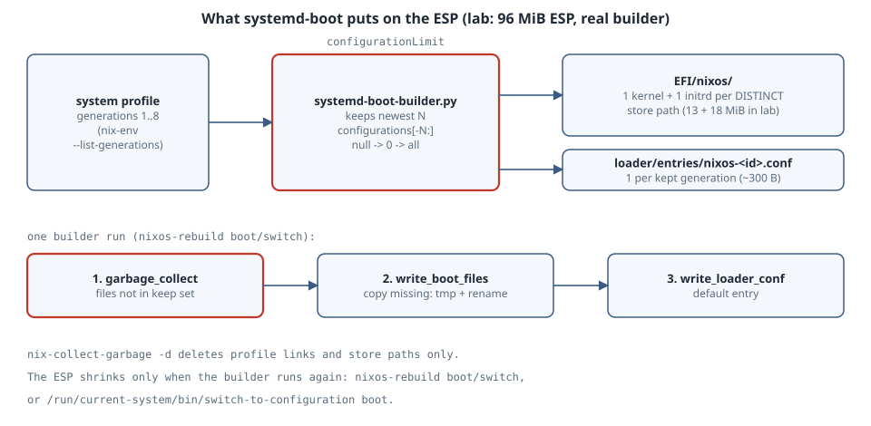

# `/boot` Is Full: How systemd-boot Fills the ESP, and How to Empty It

**Goal:** Understand what NixOS copies onto the EFI system partition (ESP) for every generation and why a 512 MiB partition can fill up. Learn why `nix-collect-garbage -d` frees nothing on `/boot` until the boot loader is installed again, and how `boot.loader.systemd-boot.configurationLimit` caps the menu. Get a host whose `nixos-rebuild` stops with *No space left on device* booting new generations again.

Version note: everything below comes from the nixpkgs systemd-boot module and its installer script, `systemd-boot-builder.py`, at nixpkgs commit [`1c89083`](https://github.com/NixOS/nixpkgs/tree/1c89083e451e891152365b799595cf7790a43325/nixos/modules/system/boot/loader/systemd-boot) (nixos-unstable, October 2026). The lab runs that **real script**, unchanged apart from its build-time placeholders, against a fake store and a 96 MiB tmpfs standing in for the ESP. Two calls are replaced: the `nix-env --list-generations` call and the path of the system profile. Nothing was booted, and no firmware variables were touched. The host commands in *Try this* are marked as not run.

{fig-alt="How NixOS fills the ESP. Left, the system profile lists generations 1 to 8. An arrow labelled configurationLimit, where null means 0 means all, leads to the builder, which keeps only the newest N. Right, the ESP: EFI/nixos holds one kernel and one initrd per distinct store path, each about 13 and 18 MiB in the lab, and loader/entries holds one small .conf file per kept generation. Generations that share a kernel share the files. Along the bottom, the order of one builder run: first garbage-collect the ESP files that are not in the keep set, then copy the missing files through a temporary file and a rename, then write loader.conf. A side note says nix-collect-garbage -d only deletes store paths and profile links; the ESP only shrinks when the builder runs again, through nixos-rebuild boot or switch, or switch-to-configuration boot."}

## Mental model

The kernel and initrd of every NixOS generation live in `/nix/store`. Firmware cannot read `/nix/store`, because it is usually on ext4, btrfs or ZFS, and sometimes encrypted. So on each `nixos-rebuild boot` or `switch`, the systemd-boot installer **copies** them onto the FAT-formatted ESP:

```text
/boot                                       (the ESP, FAT32, often 512 MiB)
├── EFI/nixos/<store-hash>-linux-6.12.58-bzImage.efi        ← one per DISTINCT kernel
├── EFI/nixos/<store-hash>-initrd-linux-6.12.58-initrd.efi  ← one per DISTINCT initrd
└── loader/entries/nixos-<id>.conf                          ← one per generation, ~300 bytes
```

Three facts follow from the builder's code:

1. **The cost is the distinct kernels and initrds, not the generations.** `boot_path()` names each copy after its store path. Ten generations that share one kernel and one initrd cost one copy of each, but each kernel update or initrd change adds another 30 MiB or so.
2. **Which generations get files is decided by the profile, filtered by `configurationLimit`.** The builder lists `/nix/var/nix/profiles/system` and keeps the newest N.
3. **The ESP is only cleaned when the builder runs.** It deletes ESP files that are not in the keep set *before* copying new ones. Deleting generations, by hand or with `nix-collect-garbage -d`, changes the profile. It does not touch `/boot`.

## The code that decides

`get_generations()` ends like this ([source](https://github.com/NixOS/nixpkgs/blob/1c89083e451e891152365b799595cf7790a43325/nixos/modules/system/boot/loader/systemd-boot/systemd-boot-builder.py)):

```python
    configurationLimit = CONFIGURATION_LIMIT
    ...
    return configurations[-configurationLimit:]
```

The module passes the option through with `configurationLimit = if cfg.configurationLimit == null then 0 else cfg.configurationLimit;`. With the default `null`, the builder computes `configurations[-0:]`, and since `-0 == 0` in Python, that is the **whole list**. The option's own description says it is "Useful to prevent boot partition running out of disk space", and its default is no limit at all:

| Boot loader | Option | Default |
|---|---|---|
| systemd-boot | `boot.loader.systemd-boot.configurationLimit` | `null` (all generations) |
| GRUB | `boot.loader.grub.configurationLimit` | `100` |
| extlinux (`generic-extlinux-compatible`) | `boot.loader.generic-extlinux-compatible.configurationLimit` | `20` |

In `install_bootloader()` the order is:

```python
    garbage_collect(boot_files)
    ...
    write_boot_files(boot_files, critical_paths)
    ...
    write_loader_conf(default_entry_id)
    ...
    remove_extra_files()
```

`garbage_collect` removes every file in `EFI/nixos/` and every `loader/entries/nixos-*.conf` that the current list of generations does not need. `write_boot_files` deduplicates by destination path, and its `CopyWriter` skips any file that already exists. Otherwise it copies into a temporary file in the same directory, `fsync`s it and `rename`s it into place. Before any of this, the script refuses to run when the profile lists no generations at all (`error: no system generations found ..., refusing to remove all boot loader entries`).

## Lab: the real builder against a 96 MiB ESP

The [NixOS manual's install guide](https://github.com/NixOS/nixpkgs/blob/1c89083e451e891152365b799595cf7790a43325/nixos/doc/manual/installation/installing.chapter.md) creates a 512 MiB ESP (`mkpart ESP fat32 1MB 512MB`). To keep the lab fast, everything is scaled down: a 96 MiB tmpfs ESP, a 13 MiB "kernel" and an 18 MiB "initrd" of random bytes. That gives the same ratio: about three kernel and initrd pairs fit, and a fourth does not.

The driver loads `systemd-boot-builder.py` with its `@placeholders@` filled in. It replaces two things: `run()`, so that `nix-env --list-generations` prints the lab's generation numbers, and `generation_dir()`, so that profiles live under `/tmp/bootlab`. Then it calls the builder's own `get_generations`, `boot_file`, `garbage_collect` and `write_boot_files` in the same order as `install_bootloader()`. It leaves out bootctl and `loader.conf`.

```python
# esp_lab.py (excerpt) — the rest builds the fake store and prints the ESP state
src = Path("builder.py").read_text()
for k, v in {"@efiSysMountPoint@": str(ESP), "@bootMountPoint@": str(ESP), "@nixosDir@": "/EFI/nixos",
             "@configurationLimit@": "0", "@storeDir@": str(STORE), "@distroName@": "NixOS",
             "@timeout@": "5", "@bootCountingTries@": "3", "@bootCounting@": "False"}.items():
    src = src.replace(k, v)
b = types.ModuleType("builder"); exec(compile(src, "systemd-boot-builder.py", "exec"), b.__dict__)

b.run = fake_run                                   # prints GENS like nix-env --list-generations
b.generation_dir = lambda profile, gen: PROFILES / f"system-{gen}-link"

def install(limit):
    """The core of install_bootloader(), minus bootctl and loader.conf."""
    b.CONFIGURATION_LIMIT = limit
    gens = b.get_generations()
    files = []
    for g in gens:
        files.extend(b.boot_file(*g, None, b.get_bootspec(g.profile, g.generation))[0])
    b.garbage_collect(files)
    b.write_boot_files(files, set())
    return [g.generation for g in gens]

# Eight generations; the kernel changes three times, the initrd once more on its own.
plan = [(1, "6.12.50", 1), (2, "6.12.50", 1), (3, "6.12.50", 1), (4, "6.12.54", 1),
        (5, "6.12.54", 2), (6, "6.12.54", 2), (7, "6.12.58", 1), (8, "6.12.58", 1)]
```

It runs as an unprivileged user inside a private mount namespace:

```bash
unshare -rm sh -c 'mkdir -p /tmp/bootlab/esp &&
  mount -t tmpfs -o size=96m lab-esp /tmp/bootlab/esp && python3 esp_lab.py'
```

```text
1) configurationLimit = null (the builder sees 0), generations [1, 2, 3, 4]
  ESP  62.0 of 96 MiB used, 2 kernels, 2 initrds, 4 entries
2) four more generations, still no limit: OSError: [Errno 28] No space left on device
  ESP  96.0 of 96 MiB used, 3 kernels, 3 initrds, 6 entries, leftover ['iiiiiiii61258r1-initrd-linux-6.12.58-initrd.efidh8j2wzz.tmp']
3) no generation deleted, configurationLimit = 3: [6, 7, 8]
  ESP  62.0 of 96 MiB used, 2 kernels, 2 initrds, 3 entries
   profile still lists [1, 2, 3, 4, 5, 6, 7, 8] -- the store keeps all of them until GC
4) what is on the ESP now:
   EFI/nixos/iiiiiiii61254r2-initrd-linux-6.12.54-initrd.efi  18 MiB
   EFI/nixos/iiiiiiii61258r1-initrd-linux-6.12.58-initrd.efi  18 MiB
   EFI/nixos/kkkkkkkk61254-linux-6.12.54-bzImage.efi  13 MiB
   EFI/nixos/kkkkkkkk61258-linux-6.12.58-bzImage.efi  13 MiB
   loader/entries/nixos-352e28cdc428c9072ddc293e607a848b9ae72319ad54a966a9d45cc4fef4f95f.conf  288 bytes
   loader/entries/nixos-b1572c14203fc5ede08d627cc292ce38c8ea27b39d77136c20fb24affdbd32be.conf  288 bytes
   loader/entries/nixos-c3a35b9bc97e0cc4c3e51138b42086d607308cdba91b07d59fd44ecbaf4e0114.conf  288 bytes
5) one entry (nixos-c3a35b9bc97e...):
   title NixOS
   version Generation 6 26.05 (Linux 6.12.54), built on 2026-10-31
   linux /EFI/nixos/kkkkkkkk61254-linux-6.12.54-bzImage.efi
   initrd /EFI/nixos/iiiiiiii61254r2-initrd-linux-6.12.54-initrd.efi
   options init=/tmp/bootlab/store/00000006-nixos-system-lab-26.05/init quiet
   sort-key nixos
```

The store paths in the lab are fake (`kkkkkkkk…`, `iiiiiiii…`), so the file names are short. On a real host they start with the 32-character store hash. Reading the run:

- **Step 1.** Four generations cost two kernels and two initrds (62 MiB), not four of each. Generations 1 to 3 share one pair, and generation 4 brought kernel 6.12.54.
- **Step 2.** Generation 5 changed only the initrd, which is another 18 MiB. Generation 7 brought kernel 6.12.58. The builder copied that kernel, then ran out of space part-way through the matching initrd. It raised `ENOSPC` and left a partial `….tmp` file behind. Entries for generations 7 and 8 were never written, because a generation's entry comes after its files in the builder's list. A real `nixos-rebuild` stops at this point with the same Python `OSError`.
- **Step 3.** With `configurationLimit = 3` and the **same** profile, the next builder run succeeded. Its garbage collection runs first, so it removed the 6.12.50 pair, the generation-4 initrd and the leftover `.tmp` before copying the 6.12.58 initrd. That ordering is why lowering the limit can fix a full ESP without any manual deletion, as long as the generations you keep fit.
- **Step 5.** The entry's `options` line points `init=` into `/nix/store`. The ESP holds only the kernel and initrd. Everything after the initrd comes from the store.

## The trap: garbage collection that forgets the ESP

`nix-collect-garbage -d` deletes old profile generations and then the store paths that nothing refers to any more ([Nix manual](https://nix.dev/manual/nix/latest/command-ref/nix-collect-garbage)). It does not run the boot loader installer, so the ESP keeps:

- the kernels and initrds of the deleted generations, which wastes space that the next rebuild may need;
- menu entries for the deleted generations. Their `init=` points at a store path that no longer exists, so picking one in the menu loads the kernel and initrd and then fails to find `init`.

The ESP catches up the next time the builder runs: `nixos-rebuild boot` or `switch`, or, with no rebuild at all, `/run/current-system/bin/switch-to-configuration boot`. `nix.gc.automatic` has the same gap. It frees the store on a timer, and `/boot` waits for your next rebuild.

## The boring rule

Set `boot.loader.systemd-boot.configurationLimit` to the number of generations you would actually roll back to. Ten is plenty for most hosts, and it caps the ESP at ten distinct kernel and initrd pairs. After pruning generations, run `switch-to-configuration boot` so `/boot` matches the profile. If the ESP is still too small for the kernels you keep, put the copies on a larger partition with `boot.loader.systemd-boot.xbootldrMountPoint`. Its description says it stores "boot loader entries and extra files instead of the EFI partition".

## Try this (not run here)

On a systemd-boot NixOS host:

```bash
df -h /boot                                               # how full is the ESP?
ls /boot/EFI/nixos | wc -l; du -sh /boot/EFI/nixos         # copies currently held
ls /boot/loader/entries | wc -l                            # menu entries
nix-env --list-generations -p /nix/var/nix/profiles/system # what the builder will see
```

To recover a host whose rebuild failed with *No space left on device*:

```nix
boot.loader.systemd-boot.configurationLimit = 10;
```

```bash
sudo nix-collect-garbage --delete-older-than 14d   # optional: free the store as well
sudo nixos-rebuild boot                            # builder GCs the ESP first, then copies
df -h /boot
```

If even the kept generations do not fit, delete more generations first (`sudo nix-env --delete-generations +3 -p /nix/var/nix/profiles/system`), then run `sudo /run/current-system/bin/switch-to-configuration boot`. Deleting `*.efi` files from `/boot/EFI/nixos` by hand also works, but leave the files that belong to the running generation and the default entry alone. The builder will copy anything that is missing on its next run.

## Sources

- nixpkgs, `systemd-boot-builder.py` at `1c89083`: <https://github.com/NixOS/nixpkgs/blob/1c89083e451e891152365b799595cf7790a43325/nixos/modules/system/boot/loader/systemd-boot/systemd-boot-builder.py>
- nixpkgs, `systemd-boot.nix` (options `configurationLimit`, `xbootldrMountPoint`) at `1c89083`: <https://github.com/NixOS/nixpkgs/blob/1c89083e451e891152365b799595cf7790a43325/nixos/modules/system/boot/loader/systemd-boot/systemd-boot.nix>
- NixOS options, `boot.loader.systemd-boot.configurationLimit`: <https://nixos.org/manual/nixos/stable/options#opt-boot.loader.systemd-boot.configurationLimit>
- nixpkgs, GRUB and extlinux `configurationLimit` defaults: `nixos/modules/system/boot/loader/grub/grub.nix`, `nixos/modules/system/boot/loader/generic-extlinux-compatible/default.nix` at `1c89083`
- NixOS manual, installation (512 MiB ESP): <https://github.com/NixOS/nixpkgs/blob/1c89083e451e891152365b799595cf7790a43325/nixos/doc/manual/installation/installing.chapter.md>
- Nix manual, `nix-collect-garbage`: <https://nix.dev/manual/nix/latest/command-ref/nix-collect-garbage>
- UAPI Group, Boot Loader Specification (type #1 entries): <https://uapi-group.org/specifications/specs/boot_loader_specification/>
