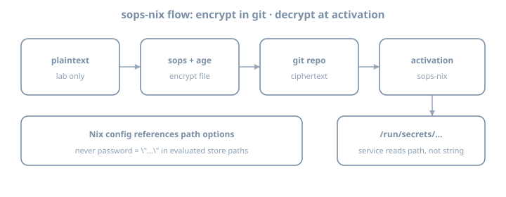

# sops-nix

**Goal:** Wire **sops-nix** end-to-end: encrypt a secret in-repo, decrypt at activation, consume it from a NixOS service or timed script—**without** plaintext secrets in the Nix store evaluation graph.

::: {.callout-note}
**House primary:** sops-nix. The agenix chapter compares agenix; do not run both as permanent dual systems unless you have a reason.
:::

::: {.callout-important}
Use **placeholder values** and lab-only credentials. Never paste production tokens into examples or commits.
:::

## Why this chapter exists

The secrets problem chapter established the threat model. This chapter installs the **default tooling** for this book:

| Property | sops-nix approach |
|----------|-------------------|
| At rest in git | Encrypted YAML/JSON/ENV (SOPS) |
| Encryption keys | Age and/or GPG; **age recommended** |
| On host | Decrypted at activation to a path like `/run/secrets/...` |
| Nix modules | Reference secret **paths**, not secret **strings** |

{fig-alt="sops-nix flow from encrypt in git to activation secret path"}

---

## Theory 1 — Components

| Piece | Role |
|-------|------|
| **SOPS** | Encrypts **values** in YAML, JSON, or dotenv. **Keys stay cleartext**, so `git diff` shows which secret changed and never the value |
| **age** | Recipients (public) and identities (private). Prefer age over GPG for a new lab |
| **ssh-to-age** | Turns an Ed25519 SSH public key into an age recipient, and an Ed25519 private key into an age identity |
| **sops-nix** | NixOS and Home Manager modules: decrypt during activation to a runtime path |
| **`.sops.yaml`** | Creation rules: which recipients encrypt which files |

Whole-file tools such as `git-crypt` hide the diff and still do nothing about store permissions once something reads the cleartext into a Nix string. SOPS plus a runtime path closes both.

### Flow

```text
edit plaintext locally (editor via `sops file`)
    → encrypted file committed
    → nixos-rebuild
    → sops-nix activation decrypts with host/user age key
    → secret file on tmpfs/run with tight perms
    → service reads path
```

---

## Theory 2 — SSH keys you already have

The lab default does **not** invent a second keyring. `ssh-to-age` derives age material from the Ed25519 keys already on disk. Two identities, two jobs:

| Who | Existing key | Job |
|-----|----------------|-----|
| Workstation user `alice` | `~/.ssh/id_ed25519` | Edit secrets with the `sops` CLI |
| Host `lab` | `/etc/ssh/ssh_host_ed25519_key` | Decrypt at activation with no human present |

Public recipients (safe to paste into `.sops.yaml`):

```bash
nix shell nixpkgs#ssh-to-age -c ssh-to-age -i ~/.ssh/id_ed25519.pub
nix shell nixpkgs#ssh-to-age -c ssh-to-age -i /etc/ssh/ssh_host_ed25519_key.pub
```

Each prints one `age1…` line. The host command needs the **public** host key. On a machine you can SSH to, `ssh-keyscan` plus `ssh-to-age` is the same recipient without copying the private key off the box.

The `sops` CLI does not read an SSH private key by itself. Derive an age identity **once** on the workstation and keep it out of git:

```bash
mkdir -p ~/.config/sops/age
nix shell nixpkgs#ssh-to-age -c \
  ssh-to-age -private-key -i ~/.ssh/id_ed25519 \
  > ~/.config/sops/age/keys.txt
chmod 600 ~/.config/sops/age/keys.txt
```

The host does **not** get a copy of that file. Activation points sops-nix at the host private key and converts it in memory:

```nix
sops.age.sshKeyPaths = [ "/etc/ssh/ssh_host_ed25519_key" ];
```

The matching `age1…` **public** string must be a recipient in `.sops.yaml`, or activation has nothing it can decrypt to.

### What the conversion does not do

- A derived age identity **cannot** log in over SSH. Signing needs the Ed25519 seed, and age does not keep it. A leaked `keys.txt` is a decrypt problem, not a stolen login key.
- A passphrase on `id_ed25519` does **not** move to `keys.txt`. The file on disk is an unprotected age secret; `0600` is the control. If the secret must stay behind a passphrase, a YubiKey, or a TPM, generate a dedicated age identity and do not derive it from the SSH key.
- Only **Ed25519** SSH keys convert. An RSA host key is invisible to this path.

### Dedicated age identity (when SSH is the wrong handle)

Use this when the host has no stable Ed25519 host key, or when you refuse to let the SSH host key decrypt the vault:

```bash
install -d -m 700 ~/.config/sops/age
nix shell nixpkgs#age -c age-keygen -o "$HOME/.config/sops/age/keys.txt"
# prints the age1… recipient; the file is the identity — never commit it
```

Point activation at that file and clear the SSH list so sops-nix does not also hunt for a host key that is not a recipient:

```nix
sops.age.keyFile = "/var/lib/sops-nix/key.txt"; # root-only, not in git
sops.age.sshKeyPaths = [ ];
```

Install the host copy of the identity before the first rebuild that must decrypt. `sops.age.generateKey = true` will create a new key at `keyFile` when the file is missing — then you still have to add the printed recipient and re-encrypt, so it does not skip the bootstrap.

### One file, one audience

SOPS encrypts every value in a file to every recipient in that file's key group. A host key that can open `secrets/host.yaml` can read **every** value in it, including a token you meant only for `alice`. Split files:

| File | Recipients | Who decrypts |
|------|------------|--------------|
| `secrets/host.yaml` | alice + host `lab` | activation on `lab`, and alice when editing |
| `secrets/alice.yaml` | alice only | Home Manager, on login |

### Key backup

Losing every private key that is a recipient means the ciphertext stays ciphertext. Keep alice's identity backed up offline. A host key that changes on every boot (impermanence that forgets `/etc/ssh/ssh_host_ed25519_key`) cannot open `secrets/host.yaml`. Persist that key with the rest of the host identity.

---

## Theory 3 — Flake input

```nix
inputs = {
  nixpkgs.url = "github:NixOS/nixpkgs/nixos-26.05";
  sops-nix.url = "github:Mic92/sops-nix";
  sops-nix.inputs.nixpkgs.follows = "nixpkgs";
};

# modules list includes:
# inputs.sops-nix.nixosModules.sops
```

```nix
# flake.nix sketch
outputs = { self, nixpkgs, sops-nix, ... }@inputs: {
  nixosConfigurations.lab = nixpkgs.lib.nixosSystem {
    system = "x86_64-linux";
    specialArgs = { inherit inputs; };
    modules = [
      ./hosts/lab
      sops-nix.nixosModules.sops
      # or import modules/common/sops.nix that uses inputs
    ];
  };
};
```

Update only this input when bumping:

```bash
nix flake update sops-nix
```

---

## Theory 4 — Minimal NixOS sops config

```nix
# modules/common/sops.nix
{ config, ... }:
{
  # A path relative to this file is copied into the store as ciphertext.
  # That is fine. Cleartext in the store is the failure mode.
  sops.defaultSopsFile = ../../secrets/host.yaml;
  sops.age.sshKeyPaths = [ "/etc/ssh/ssh_host_ed25519_key" ];

  sops.secrets."lab/demo_token" = {
    mode = "0400";
    owner = "root";
    # restartUnits = [ "some-service.service" ];
  };
}
```

Consume **path**:

```nix
systemd.services.sops-demo-check = {
  wantedBy = [ "multi-user.target" ];
  serviceConfig = {
    Type = "oneshot";
    RemainAfterExit = true;
    ExecStart = "/bin/sh -c 'test -f /run/secrets/lab/demo_token && echo ok > /var/lib/sops-demo-ok'";
  };
};
```

Exact secret path layout depends on sops-nix version and naming—inspect after activation:

```bash
sudo ls -la /run/secrets
```

**Never** do `builtins.readFile config.sops.secrets."lab/demo_token".path` into another world-readable derivation if that re-embeds content. Prefer systemd `LoadCredential`, `EnvironmentFile` pointing at the secret path, or scripts that read at runtime.

---

## Theory 5 — Creating encrypted files

`.sops.yaml` at the repo root. Anchors are the public `age1…` lines from Theory 2, not the private keys:

```yaml
keys:
  - &alice age1aaaaaaaaaaaaaaaaaaaaaaaaaaaaaaaaaaaaaaaaaaaaaaaaaaaaaaaa
  - &host_lab age1bbbbbbbbbbbbbbbbbbbbbbbbbbbbbbbbbbbbbbbbbbbbbbbbbbbbbbbb
creation_rules:
  - path_regex: secrets/host\.yaml$
    key_groups:
      - age:
          - *alice
          - *host_lab
  - path_regex: secrets/alice\.yaml$
    key_groups:
      - age:
          - *alice
```

Edit (the CLI uses `~/.config/sops/age/keys.txt`):

```bash
nix shell nixpkgs#sops -c sops secrets/host.yaml
```

Editor buffer only — this text must not be what `git diff` shows after you save:

```yaml
lab:
  demo_token: PLACEHOLDER_LAB_TOKEN_ROTATE_ME
```

On save, SOPS rewrites the file. Keys stay readable; values become `ENC[AES256_GCM,data:…]`. Commit that file.

### Adding a secret later

1. `sops secrets/host.yaml` (or `secrets/alice.yaml`)
2. Add a key in the cleartext buffer; save so only ciphertext is on disk
3. Declare `sops.secrets."…"` in Nix
4. Rebuild, or let the user service pick it up
5. Point the consumer at `.path`

### Adding a machine

Put the new host's `age1…` recipient in `.sops.yaml`, then re-wrap the data key. This does not require the old cleartext in your editor:

```bash
nix shell nixpkgs#sops -c sops updatekeys secrets/host.yaml
```

A host that is not in the creation rule for that file cannot decrypt it, even if `sshKeyPaths` is set.

---

## Theory 6 — Home Manager (user secrets)

Host services use the NixOS module and the host SSH key. A token that belongs to `alice` (a CLI, a user unit) uses the Home Manager module and **alice's** identity. It never needs root, and it must not be a value inside `home.file` — that path is a store symlink.

Pass the module in from the same flake input. Sketch for `homes/alice.nix` when Home Manager is already a NixOS module:

```nix
{ config, inputs, ... }:
{
  imports = [ inputs.sops-nix.homeManagerModules.sops ];

  sops.defaultSopsFile = ../secrets/alice.yaml;
  sops.age.keyFile = "${config.home.homeDirectory}/.config/sops/age/keys.txt";
  sops.age.generateKey = false;

  sops.secrets."lab/github_token" = {
    mode = "0400";
    # Omit path to land on tmpfs under $XDG_RUNTIME_DIR/secrets/.
    # Set path only when a program demands a fixed location outside the store.
  };
}
```

`generateKey = false` matters. Left on, the module may create a new age identity that is not a recipient of `alice.yaml`, and decrypt fails closed.

On login, the user unit `sops-nix.service` decrypts into `$XDG_RUNTIME_DIR/secrets/` (tmpfs, gone at logout) unless `path` says otherwise. `keys.txt` has to exist **before** that unit runs — derive it in Theory 2 first, then switch.

Read the file from the one program that needs it. Do not `export` the token from `.zshrc`: every child of that shell inherits it, and a debug trace prints it.

```nix
# A user unit that is the only consumer. The shell stays clean.
systemd.user.services.lab-token-present = {
  Unit.Description = "Prove the user secret path exists";
  Service = {
    Type = "oneshot";
    ExecStart = "/bin/sh -c 'test -r ${config.sops.secrets."lab/github_token".path}'";
  };
};
```

`alice.yaml` is encrypted only to alice, so the host SSH key cannot open the GitHub token. A backup token the host must read at boot stays in `host.yaml`.

---

## Theory 7 — Bootstrap

SSH-derived recipients, in order:

1. OpenSSH has generated `/etc/ssh/ssh_host_ed25519_key` (a first boot, or a persisted key after impermanence).
2. `ssh-to-age` the **public** user key and the **public** host key.
3. Write `.sops.yaml` with those recipients and the file split from Theory 2.
4. Derive `~/.config/sops/age/keys.txt` from the user private key; `chmod 600`; confirm it is gitignored.
5. `sops secrets/host.yaml` and `sops secrets/alice.yaml` with placeholders.
6. Set `sops.age.sshKeyPaths` on the host module. Do not copy `keys.txt` onto the host for this path.
7. `nixos-rebuild switch`. Then check `/run/secrets`.

Document that list in `docs/secrets.md`, including where the offline copy of alice's identity lives.

Dedicated `age-keygen` hosts swap steps 2 and 6 for "install `/var/lib/sops-nix/key.txt` and set `sshKeyPaths` to `[]`". Write down which one this repo uses. Mixing them without clearing `sshKeyPaths` makes activation look for a host SSH key that was never a recipient.

---

## Theory 8 — systemd integration patterns

| Pattern | Use |
|---------|-----|
| `config.sops.secrets.*.path` in `ExecStart` script | Read file at runtime |
| `LoadCredential=` | systemd credentials API |
| `EnvironmentFile=` | If file is `KEY=value` format |
| `restartUnits` | Restart service when secret changes |

```nix
sops.secrets."lab/demo_token" = {
  mode = "0400";
  restartUnits = [ "lab-token-touch.service" ];
};
```

---

## Theory 9 — Multi-host recipients

```yaml
creation_rules:
  - path_regex: secrets/host\.yaml$
    key_groups:
      - age: [*alice, *host_lab]
  - path_regex: secrets/prod\.yaml$
    key_groups:
      - age: [*alice, *host_prod]
```

`alice` can edit both. `host_prod` cannot open the lab file, and a laptop-only recipient cannot boot the server. User-only files stay on the `secrets/alice.yaml` rule from Theory 5.

---

## Worked example — Secret for a custom script service

```nix
{ config, pkgs, ... }:
{
  sops.secrets."lab/demo_token" = {
    mode = "0400";
    owner = "root";
  };

  systemd.services.lab-token-touch = {
    description = "Demonstrate runtime read of sops secret path";
    wantedBy = [ "multi-user.target" ];
    serviceConfig = {
      Type = "oneshot";
      RemainAfterExit = true;
      ExecStart = pkgs.writeShellScript "lab-token-touch" ''
        set -euo pipefail
        token_path="${config.sops.secrets."lab/demo_token".path}"
        test -r "$token_path"
        # Do NOT echo the token to logs
        wc -c < "$token_path" > /var/lib/lab-token-bytes
      '';
    };
  };
}
```

Note: `writeShellScript` embeds the **path string**, not the secret content—good.

---

## Exercises

### Exercise 1 — Add input and module

```bash
# edit flake inputs; nix flake update sops-nix
# import sops-nix.nixosModules.sops
nix flake metadata
```

### Exercise 2 — Recipients from SSH keys

1. `ssh-to-age` on `~/.ssh/id_ed25519.pub` and on the host `ssh_host_ed25519_key.pub`
2. Write `.sops.yaml` with `secrets/host.yaml` (alice + host) and `secrets/alice.yaml` (alice only)
3. Derive `~/.config/sops/age/keys.txt`; `chmod 600`
4. Confirm `keys.txt` and `*.agekey` are gitignored

Use `age-keygen` instead only if you wrote down why the host SSH key must not be a recipient.

```gitignore
keys.txt
*.agekey
```

### Exercise 3 — First encrypted secret file

```bash
mkdir -p secrets
# sops secrets/host.yaml and sops secrets/alice.yaml
git add secrets/host.yaml secrets/alice.yaml .sops.yaml
# ensure plaintext never staged; git diff should show ENC[AES256_GCM,...] values and clear keys
```

### Exercise 4 — Declare `sops.secrets` and rebuild

```bash
sudo nixos-rebuild switch --flake .#lab
sudo ls -la /run/secrets
sudo wc -c /run/secrets/...   # do not cat into scrollback you paste publicly
```

### Exercise 5 — Runtime consumer

Add the oneshot that **reads path** without logging secret contents. Prove `/var/lib/lab-token-bytes` or similar.

### Exercise 6 — Failure drill

1. Break key access (rename key file temporarily)
2. Rebuild or restart activation path
3. Observe failure mode
4. Restore key

Journal: how the host fails closed.

### Exercise 7 — Docs

`docs/secrets.md`:

- Key locations
- How to add a secret
- How to add a recipient
- Rotation sketch

### Exercise 8 — Selective lock update

```bash
nix flake update sops-nix
git diff flake.lock | head -80
```

### Exercise 9 — Permission check

```bash
sudo ls -la /run/secrets
# confirm mode 0400 (or intended) and owner
```

### Exercise 10 — Second secret

Add another key in the YAML; declare second `sops.secrets` entry; rebuild; list paths.

### Exercise 11 — No readFile audit

```bash
rg -n 'builtins.readFile.*sops|sops\.secrets' .
```

Ensure no anti-pattern re-embedding.

### Exercise 12 — Journal hygiene

```bash
journalctl -u lab-token-touch.service -b --no-pager | tail
```

Confirm secret values never appear.

### Exercise 13 — Recipient add rehearsal

On a copy of `secrets/host.yaml`, add a second `age1…` anchor and run `sops updatekeys`. Confirm the new recipient is inside the `sops:` metadata and that you did not need to retype the placeholder. Do not practice this on a file whose loss matters.

### Exercise 14 — Bootstrap checklist in git

Commit `docs/secrets.md` with bootstrap steps a future you can follow on a blank host.

---

## Common gotchas

| Symptom / mistake | What to do |
|-------------------|------------|
| Cannot decrypt on host | Host `age1…` missing from that file's creation rule, or `sshKeyPaths` points at a different key than the one you converted |
| Cannot edit on laptop | `~/.config/sops/age/keys.txt` missing, mode not `0600`, or alice's recipient was never in `.sops.yaml` |
| Host can read a user-only token | Both values live in one file encrypted to the host key; split `alice.yaml` |
| New host key after a reinstall | Persist `ssh_host_ed25519_key`, or update the recipient and `sops updatekeys` |
| `generateKey` created a stranger identity | Set `generateKey = false` and use the identity that is actually a recipient |
| RSA host key, empty age output | `ssh-to-age` only accepts Ed25519 |
| Secret path empty | Activation order; sops config; check journal |
| Plaintext committed | Rotate; purge if needed; fix |
| `readFile` secret into store | Use runtime path only |
| Logged secret via `echo $TOKEN` | Never log secrets |
| GPG-only complexity | Prefer age for new labs |
| Private key in git | Rotate immediately; purge |
| Wrong defaultSopsFile path | Fix relative path from module file |
| Dual sops+agenix forever | Pick default after comparison chapter |
| follows missing on sops-nix | Align nixpkgs |

---

## Checkpoint

- [ ] sops-nix input pinned with follows
- [ ] `.sops.yaml` splits host recipients from user-only recipients
- [ ] Encrypted secret files in git; keys visible, values `ENC[AES256_GCM,…]`
- [ ] Private keys not in git
- [ ] `sops.secrets` declared; appears under `/run/secrets`
- [ ] Service/script consumes **path** only
- [ ] Bootstrap docs written
- [ ] Failure-closed drill done once

### Journal (optional)

Write three personal gotchas before continuing.
