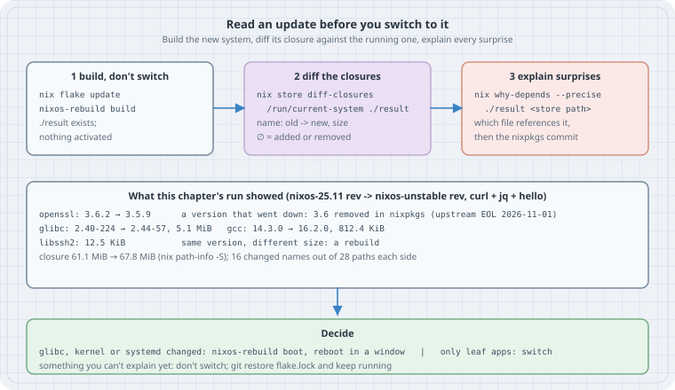

# Read an Update Before You Switch: diff-closures, path-info and why-depends

**Goal:** Turn `nix flake update` from a leap of faith into a change you have read. Build the new system without activating it, list exactly which packages changed version or size, explain any surprise down to the file that holds the reference and the nixpkgs line that caused it, and only then pick `switch`, `boot`, or "not today".

Other chapters touch `nix store diff-closures` in passing: after an unattended upgrade, or when chasing reproducibility. This one makes it the main tool, and runs it on a real update between two pinned nixpkgs revisions.

## Thesis

A NixOS system is a store path, and so is the next one. Two store paths can be compared *before* either is running. Everything `nixos-rebuild switch` is about to do to your machine is already written in the difference between `/run/current-system` and `./result`. Read that difference and the update stops being a surprise.

## Mental model

{fig-alt="Three steps in a row. One, build, don't switch: nix flake update, nixos-rebuild build, ./result exists and nothing is activated. Two, diff the closures: nix store diff-closures /run/current-system ./result prints name: old to new, size, and an empty-set sign for added or removed. Three, explain surprises: nix why-depends --precise ./result on a store path shows which file references it, then read the nixpkgs commit. Below, what this chapter's run showed going from a nixos-25.11 revision to a nixos-unstable revision for curl, jq and hello: openssl 3.6.2 to 3.5.9, a version that went down because 3.6 was removed from nixpkgs ahead of its upstream end of life on 2026-11-01; glibc 2.40-224 to 2.44-57 adding 5.1 MiB; gcc 14.3.0 to 16.2.0; libssh2 with the same version but 12.5 KiB larger, a rebuild; closure 61.1 to 67.8 MiB; 16 changed names out of 28 paths each side. Decide: if the kernel, glibc or systemd changed, nixos-rebuild boot and reboot in a window; if only leaf apps changed, switch; if something can't be explained yet, don't switch, restore flake.lock and keep running."}

Three commands, each answering one question:

| Question | Command | Answer looks like |
|---|---|---|
| What changed? | `nix store diff-closures A B` | `glibc: 2.40-224 → 2.44-57, 5.1 MiB` |
| How big is it now? | `nix path-info -Sh A B` | closure size per path |
| Why is *this* in there? | `nix why-depends --precise B <path>` | the chain of references, down to the file and the bytes |

`A` and `B` are any two store paths: two system toplevels, two home-manager generations, two dev shells, or two `nix build` results.

## Concepts

### What diff-closures prints

`nix store diff-closures` takes the full closure (every path reachable by reference) of each side and **groups store paths by package name**, so `glibc-2.40-224` and `glibc-2.44-57` line up as one entry. For each name it prints:

- `old → new` when the set of versions differs. `∅` means "none": `∅ → 15.2.0` is a package added, `2.12.3 → ∅` a package removed.
- a size delta (red for growth when the terminal has colour), but **only when it is at least 8 KiB**. The rule is `std::abs(sizeDelta) >= 8 * 1024` in `src/nix/diff-closures.cc`. Smaller changes are noise and get dropped.
- a name with a size and **no version change**, like `libssh2: 12.5 KiB`. That's a rebuild: same version, different inputs (a new compiler, a new dependency), so a different path and different bytes.

A name appears only if its versions changed or its size moved by 8 KiB or more. A quiet `diff-closures` means a quiet update.

### Reading it for risk

Sort the lines into three groups:

1. **Platform**: `linux`, `systemd`, `glibc`, `gcc` (its `-lib` output is in almost every closure), `openssl`, `nix` itself. Every service links against these. A kernel or initrd change needs a reboot to take effect anyway, so prefer `nixos-rebuild boot` and a reboot in a window.
2. **Your services**: `postgresql`, `nginx`, `openssh`, and so on. Check the release notes, especially for a major version jump (on-disk formats, config syntax).
3. **Surprises**: a version that went *down*, a package you didn't know you had (`∅ → …`), a big size jump on a rebuild. Each needs a `why-depends` and a look at nixpkgs before you switch.

### why-depends --precise

`nix why-depends A B` prints the shortest reference chain from `A` to `B`. With `--precise`, it also prints **which file** in each path contains the reference, and a snippet of the bytes around the hash. Store references are just hashes inside files, so this is a literal answer: "curl's binary has openssl's path in its RPATH".

## Worked example: a real update (run here)

To keep the run small, the "system" is a three-package `buildEnv`. The commands are the same for a full NixOS toplevel, which is just a bigger store path. Both nixpkgs revisions are channel heads, so everything comes from cache.nixos.org and nothing needs compiling.

`toolbox.nix`:

```nix
# A tiny stand-in for a system closure: three tools from one nixpkgs revision.
{ rev }:
let
  pkgs = import (builtins.fetchTarball
    "https://github.com/NixOS/nixpkgs/archive/${rev}.tar.gz") { };
in
pkgs.buildEnv {
  name = "toolbox";
  paths = [ pkgs.curl pkgs.jq pkgs.hello ];
}
```

`toolbox2.nix` is the same with `[ pkgs.curl pkgs.jq pkgs.ripgrep ]`: a configuration change instead of a nixpkgs change.

`read-update.sh`:

```sh
#!/bin/sh
# Build the same toolbox from two pinned nixpkgs revisions, then read the difference.
set -e
OLD=b6018f87da91d19d0ab4cf979885689b469cdd41   # nixos-25.11 channel
NEW=1c89083e451e891152365b799595cf7790a43325   # nixos-unstable channel
nix build --impure -f toolbox.nix --argstr rev "$OLD" -o old
nix build --impure -f toolbox.nix --argstr rev "$NEW" -o new
echo "== what changed";      nix store diff-closures ./old ./new
echo "== closure sizes";     nix path-info -Sh ./old ./new
echo "== paths in each";     nix path-info -r ./old | wc -l; nix path-info -r ./new | wc -l
OSSL=$(nix path-info -r ./new | grep -- '-openssl-3[.0-9]*$')
echo "== why openssl";       nix why-depends --precise ./new "$OSSL"
echo "== why did openssl go down?"
SRC=$(nix eval --impure --raw --expr \
  "builtins.fetchTarball \"https://github.com/NixOS/nixpkgs/archive/$NEW.tar.gz\"")
nix store cat "$SRC/pkgs/top-level/all-packages.nix" | grep -n '^  openssl = '
nix store cat "$SRC/pkgs/top-level/aliases.nix"      | grep -n '^  openssl_3_6 = '
echo "== a configuration change on the same revision"
nix build --impure -f toolbox2.nix --argstr rev "$NEW" -o new2
nix store diff-closures ./new ./new2
```

```console
$ sh read-update.sh
== what changed
bash: 5.3p3 → 5.3p20, 36.1 KiB
brotli: 1.1.0 → 1.2.0, 40.4 KiB
curl: 8.20.0 → 8.22.0, 285.2 KiB
gcc: 14.3.0 → 16.2.0, 812.4 KiB
glibc: 2.40-224 → 2.44-57, 5.1 MiB
hello: 2.12.2 → 2.12.3
jq: 1.8.1 → 1.8.2, 25.8 KiB
krb5: 1.22.1 → 1.22.2, 80.3 KiB
libssh2: 12.5 KiB
libunistring: 1.4.1 → 1.4.2
nghttp2: 1.68.1 → 1.70.0, 16.1 KiB
nghttp3: 1.15.0 → 1.18.0, 20.3 KiB
ngtcp2: 1.22.1 → 1.23.0, 77.2 KiB
openssl: 3.6.2 → 3.5.9, 166.5 KiB
publicsuffix-list: 0-unstable-2026-01-25 → 0-unstable-2026-09-02
xgcc: 14.3.0 → 16.2.0
== closure sizes
/nix/store/9ylain3a520r6i57303lh3za99rqpzs8-toolbox	  61.1 MiB
/nix/store/xqs9h77yj2abhbv2994g9hlw6pdk9zlj-toolbox	  67.8 MiB
== paths in each
28
28
== why openssl
/nix/store/xqs9h77yj2abhbv2994g9hlw6pdk9zlj-toolbox
└───bin/curl -> /nix/store/5lpg7j8y8lf8c4zv318yi4rmgyn5yhip-curl-8.22.0-bin/bin/curl
    → /nix/store/5lpg7j8y8lf8c4zv318yi4rmgyn5yhip-curl-8.22.0-bin
    └───bin/curl: …f4xh2-zstd-1.5.7/lib:/nix/store/lazac5vw20j0pyahzbaxz8z8hyf7m9zf-openssl-3.5.9/lib:/nix/store/2b…
        → /nix/store/lazac5vw20j0pyahzbaxz8z8hyf7m9zf-openssl-3.5.9
== why did openssl go down?
6136:  openssl = openssl_3_5;
2064:  openssl_3_6 = throw "'openssl_3_6' has been removed, due to upstream end of life on 2026-11-01"; # Added 2026-10-25
== a configuration change on the same revision
hello: 2.12.3 → ∅, -273.0 KiB
pcre2: ∅ → 10.49, 2.0 MiB
ripgrep: ∅ → 15.2.0, 6.7 MiB
```

### Reading this output

- **Sixteen names changed, out of 28 paths on each side.** The three packages we asked for (curl, jq, hello) all moved, but so did glibc, gcc, bash and the HTTP/2 and HTTP/3 libraries curl links against. This is normal: a channel bump moves the whole dependency graph, not just the leaves.
- **glibc 2.40 → 2.44 is the biggest item** at 5.1 MiB, and it's a platform change. On a real host it is the line that says "plan a reboot window", together with any `linux` line.
- **`openssl: 3.6.2 → 3.5.9` went down.** That is the surprise to explain. `why-depends --precise` shows the reference sits in the RPATH of `bin/curl`, so curl picked it up from nixpkgs' default `openssl`. The two `grep` lines show why: on the new revision `openssl = openssl_3_5;`, and `openssl_3_6` is now an alias that throws, because the 3.6 branch reaches upstream end of life on 2026-11-01. So the default moved to the 3.5 long-term-support branch. That's a deliberate choice, not a bug, but you only know that because you read it.
- **`libssh2: 12.5 KiB`** has no version arrow: the same libssh2 version, rebuilt against new inputs.
- **hello changed version but shows no size.** Its delta was 5,024 bytes (274,568 → 279,592), under the 8 KiB threshold.
- **The configuration change** (`toolbox2.nix`) shows the `∅` forms: hello removed (−273.0 KiB), ripgrep added (6.7 MiB), plus pcre2 (2.0 MiB), which nobody asked for by name. `nix why-depends ./new2 <pcre2 path>` shows it comes in with ripgrep (Try this #1).

## On a NixOS host (from the manuals, not run here)

The build box for this book isn't a NixOS machine, so this part follows the `nixos-rebuild(8)` and Nix reference manuals and was not run. The steps are the ones above with real system paths:

```sh
cd /etc/nixos                                   # your flake
nix flake update                                # or: nix flake update nixpkgs
nixos-rebuild build --flake .#$(hostname)       # writes ./result; activates nothing, needs no root
nix store diff-closures /run/current-system ./result
nix path-info -Sh /run/current-system ./result
nix why-depends --precise ./result /nix/store/<hash>-openssl-3.5.9   # for each surprise
```

Then decide:

```sh
# Only leaf applications changed:
sudo nixos-rebuild switch --flake .#$(hostname)
# Kernel, initrd, systemd or glibc changed: stage it and reboot in a window
sudo nixos-rebuild boot --flake .#$(hostname)
# Something you can't explain yet: don't switch at all
git restore flake.lock
```

Two more forms from the Nix manual are worth knowing:

- `nix profile diff-closures --profile /nix/var/nix/profiles/system` prints the diff between **every pair of consecutive system generations**: your upgrade history as a changelog.
- `nix store diff-closures /run/booted-system /run/current-system` shows what you've switched to since the last boot. If `linux` or `systemd` is in that list, the running kernel or PID 1 is older than the configuration says.

`nixos-rebuild dry-activate` complements this. It doesn't diff packages: it reports which systemd units an activation *would* start, stop, restart or reload. One tells you *what* changes, the other what *happens* when it does.

## The trap

**Reading the diff after `switch`.** Once you've switched, the diff is just history. Run `build` first. It needs no root, can't break the running system, and the result is the exact path `switch` would activate: same inputs, same hash.

**Second trap: trusting that a quiet diff means a safe update.** `diff-closures` only sees *packages*. A change to NixOS *module* logic (a new default for an option, a renamed systemd unit setting) can land in `etc`, unit files or the activation script without any package version moving. In the diff, that usually shows up not at all, because those generated paths are tiny and their changes fall under the 8 KiB threshold. Read the NixOS release notes when you cross a release boundary, and use `dry-activate` to see which units would restart.

## The boring rule

`nix flake update && nixos-rebuild build && nix store diff-closures /run/current-system ./result`, every time. Explain every version that goes down and every `∅ →` you didn't ask for. Then `boot` if the platform moved, `switch` if it didn't, and restore `flake.lock` if you can't explain it.

## Try this

1. Run `nix why-depends --precise ./new2 <pcre2 path>` and confirm it comes in with ripgrep. Which file in ripgrep holds the reference?
2. Pin `NEW` to an older nixos-unstable revision and re-run. Find the revision range where `openssl` switched from 3.6 to 3.5 (`git log -S 'openssl = openssl_3_5' -- pkgs/top-level/all-packages.nix` in a nixpkgs checkout).
3. Add `pkgs.git` to `toolbox.nix`. How many new names does `diff-closures` show for one package, and which is the biggest?
4. On a NixOS machine, run `nix profile diff-closures --profile /nix/var/nix/profiles/system | less` and find the generation where the kernel last changed.

## Verification

- `read-update.sh` was run with Nix 2.35.3 as an unprivileged single-user install with a chroot store, on a Linux box that is not NixOS. Store paths and output are the same as on NixOS, because the store paths depend only on the inputs. Every line of output above is genuine. ANSI colour codes were stripped for print.
- Both nixpkgs revisions are the channel heads at the time of writing: `b6018f87…` (nixos-25.11) and `1c89083e…` (nixos-unstable). Everything was substituted from cache.nixos.org, except the two `buildEnv` derivations, which build locally in a second.
- The 8 KiB threshold was read in `src/nix/diff-closures.cc` on Nix master. The hello sizes (274,568 and 279,592 bytes) come from `nix path-info -s`.
- The NixOS-host section (`nixos-rebuild build/switch/boot`, `nix profile diff-closures`, `dry-activate`) was **not run**. It is written from the manuals linked below.

## Sources

- Nix reference manual, `nix store diff-closures`: <https://nix.dev/manual/nix/latest/command-ref/new-cli/nix3-store-diff-closures>
- Nix reference manual, `nix why-depends`: <https://nix.dev/manual/nix/latest/command-ref/new-cli/nix3-why-depends>
- Nix reference manual, `nix path-info`: <https://nix.dev/manual/nix/latest/command-ref/new-cli/nix3-path-info>
- Nix reference manual, `nix profile diff-closures`: <https://nix.dev/manual/nix/latest/command-ref/new-cli/nix3-profile-diff-closures>
- Nix source, `src/nix/diff-closures.cc`: <https://github.com/NixOS/nix/blob/master/src/nix/diff-closures.cc>
- NixOS manual, upgrading NixOS and `nixos-rebuild`: <https://nixos.org/manual/nixos/stable/#sec-upgrading>
- nixpkgs `pkgs/top-level/aliases.nix` and `all-packages.nix` at `1c89083e451e891152365b799595cf7790a43325`: <https://github.com/NixOS/nixpkgs/tree/1c89083e451e891152365b799595cf7790a43325/pkgs/top-level>
