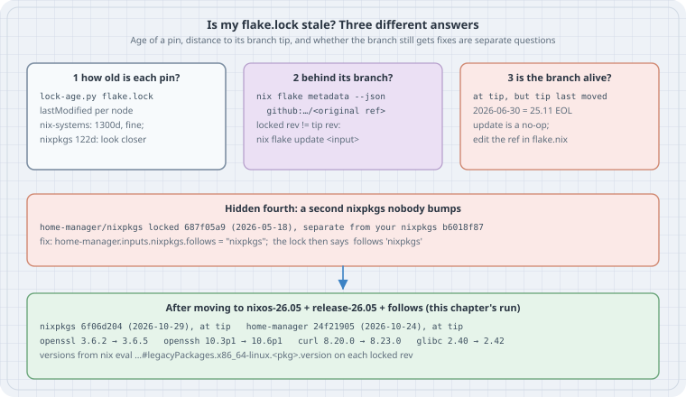
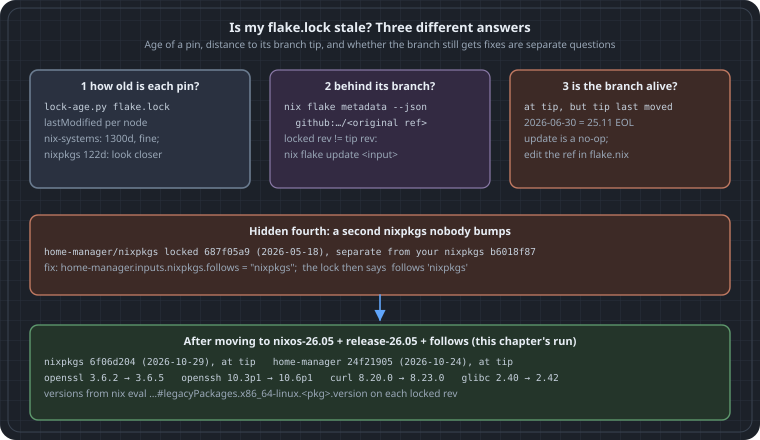

# Is My flake.lock Stale? Lock Age, Branch Distance and End-of-Life Branches

**Goal:** After a wave of CVEs, answer "is this host actually getting fixes?" from the repository alone, before you build anything. Read every pin in `flake.lock` with its date. Check whether each pin is behind the branch it tracks. Notice the case that `nix flake update` can never fix: a branch that has stopped moving. Find the second copy of nixpkgs that another input brought along.

The chapter before this one (`15-read-an-update-before-switching`, if your copy has it) covers what to do *after* you update: diff the closures and explain each change. This chapter covers the step before that: deciding whether there is anything to update, and which line to change.

All output below is genuine. It comes from Nix **2.35.3** on 2026-10-31, run against a small host flake. Nothing was built or activated; the commands only read lock files, resolve refs and evaluate package versions.

{.light-only}
{.dark-only}

## Thesis

"Stale" means three different things, and each has a different fix:

1. **The pin is old.** Read `lastModified` in `flake.lock`. Age is only a hint. Some inputs, such as `nix-systems/default`, never move, so a three-year-old pin is still correct.
2. **The pin is behind its branch.** The branch has newer commits than the lock. `nix flake update <input>` fixes this.
3. **The branch itself is dead.** The lock sits exactly at the tip of `nixos-25.11`, but that branch stopped receiving security fixes on 2026-06-30. `nix flake update` succeeds, prints nothing, and leaves you unpatched. The only fix is to edit the ref in `flake.nix`.

There is also a fourth problem that is easy to miss. If another input carries its own nixpkgs and you never added `follows`, then the lock holds a **second nixpkgs** that your updates do not touch.

## The flake under test

This is a typical host flake as it looks four months after someone last edited it:

```nix
{
  inputs = {
    nixpkgs.url = "github:NixOS/nixpkgs/nixos-25.11";
    home-manager.url = "github:nix-community/home-manager/release-25.11";
    flake-utils.url = "github:numtide/flake-utils";
  };
  outputs = { self, ... }: { };
}
```

`nix flake lock` wrote this lock (`narHash` query strings trimmed):

```text
warning: creating lock file "/tmp/fl/host/flake.lock":
• Added input 'flake-utils':
    'github:numtide/flake-utils/b7a79d3fea1e214f6d668d521cecec0c01e26544 (2026-10-13)
• Added input 'flake-utils/systems':
    'github:nix-systems/default/da67096a3b9bf56a91d16901293e51ba5b49a27e (2023-04-09)
• Added input 'home-manager':
    'github:nix-community/home-manager/3ee51fbdac8c8bdfe1e7e1fcaba6520a563f394f (2026-05-23)
• Added input 'home-manager/nixpkgs':
    'github:NixOS/nixpkgs/687f05a9184cad4eaf905c48b63649e3a86f5433 (2026-05-18)
• Added input 'nixpkgs':
    'github:NixOS/nixpkgs/b6018f87da91d19d0ab4cf979885689b469cdd41 (2026-06-30)
```

There are already two nixpkgs revisions in that list.

## Check 1: how old is each pin?

Every node in `flake.lock` has a `locked` attribute set holding `rev` and `lastModified` (Unix seconds). It also has an `original` set, which is what you wrote in `flake.nix`. An entry in a node's `inputs` is either a node name or, for `follows`, a list path. This short script walks that graph from `root`, so nested inputs print as `parent/child`:

```python
#!/usr/bin/env python3
"""lock-age.py: list every locked input in flake.lock with its commit date and age."""
import json, sys, time
from datetime import datetime, timezone

lock = json.load(open(sys.argv[1] if len(sys.argv) > 1 else "flake.lock"))
nodes, now = lock["nodes"], time.time()

def paths(node="root", prefix=""):
    """Walk the input graph so nested inputs print as parent/child."""
    for name, ref in nodes[node].get("inputs", {}).items():
        if isinstance(ref, list):                      # a 'follows': it reuses another node
            yield prefix + name, None, "/".join(ref)
            continue
        yield prefix + name, ref, None
        yield from paths(ref, prefix + name + "/")

print(f"{'input':28} {'source':28} {'rev':9} {'commit date':11} {'age':>5}")
for path, key, follows in paths():
    if follows:
        print(f"{path:28} follows {follows}"); continue
    l = nodes[key]["locked"]
    src = f"{l.get('owner', '')}/{l.get('repo', '')}" if l["type"] == "github" else l["type"]
    when = datetime.fromtimestamp(l["lastModified"], timezone.utc)
    age = int((now - l["lastModified"]) // 86400)
    print(f"{path:28} {src:28} {l.get('rev', '')[:8]:9} {when:%Y-%m-%d} {age:>4}d")
```

```text
$ python3 lock-age.py
input                        source                       rev       commit date   age
flake-utils                  numtide/flake-utils          b7a79d3f  2026-10-13   17d
flake-utils/systems          nix-systems/default          da67096a  2023-04-09 1300d
home-manager                 nix-community/home-manager   3ee51fbd  2026-05-23  160d
home-manager/nixpkgs         NixOS/nixpkgs                687f05a9  2026-05-18  165d
nixpkgs                      NixOS/nixpkgs                b6018f87  2026-06-30  122d
```

How to read it:

- `flake-utils/systems` at 1300 days is fine. That repository is a list of system names and has not needed a commit since 2023.
- `nixpkgs` at 122 days is worth a closer look. On a supported NixOS branch, the channel normally advances every few days.
- `home-manager/nixpkgs` is the fourth problem from the thesis. It is a separate nixpkgs, older than yours.

`nix flake metadata` prints the same tree with dates. The script is useful because its output is plain columns you can sort, diff, or run in CI across many repositories.

## Check 2: is each pin behind its branch?

To know whether a newer commit exists, resolve each input's `original` ref the way `nix flake update` would, and compare revisions. `nix flake metadata --json <flakeref>` does that resolution and changes nothing:

```python
#!/usr/bin/env python3
"""lock-behind.py: for each direct input, compare the locked rev with what its
original ref (branch) resolves to today. Needs network; changes nothing."""
import json, subprocess, sys
from datetime import datetime, timezone

lock = json.load(open("flake.lock"))
nodes = lock["nodes"]
day = lambda t: datetime.fromtimestamp(t, timezone.utc).strftime("%Y-%m-%d")

for name, key in nodes["root"]["inputs"].items():
    if isinstance(key, list):
        continue                                          # 'follows': nothing locked here
    n = nodes[key]
    o, l = n["original"], n["locked"]
    if o["type"] != "github":
        continue
    url = f"github:{o['owner']}/{o['repo']}" + (f"/{o['ref']}" if "ref" in o else "")
    tip = json.loads(subprocess.run(["nix", "flake", "metadata", "--json", url],
                     capture_output=True, text=True, check=True).stdout)
    tip_rev, tip_t = tip["locked"]["rev"], tip["locked"]["lastModified"]
    if tip_rev == l["rev"]:
        verdict = f"at branch tip; branch last moved {day(tip_t)}"
    else:
        verdict = f"behind: tip {tip_rev[:8]} from {day(tip_t)}, {(tip_t - l['lastModified']) // 86400}d newer"
    print(f"{name:13} {url:45} locked {l['rev'][:8]} ({day(l['lastModified'])})  {verdict}")
```

To see the "behind" case, the lab rolled `flake-utils` back to an older commit with `nix flake lock --override-input flake-utils github:numtide/flake-utils/c1dfcf08…`. That command keeps `original` as the plain `github:numtide/flake-utils`, so the lock looks like one that simply has not been updated for two years:

```text
$ python3 lock-behind.py
flake-utils   github:numtide/flake-utils                    locked c1dfcf08 (2024-09-17)  behind: tip b7a79d3f from 2026-10-13, 756d newer
home-manager  github:nix-community/home-manager/release-25.11 locked 3ee51fbd (2026-05-23)  at branch tip; branch last moved 2026-05-23
nixpkgs       github:NixOS/nixpkgs/nixos-25.11              locked b6018f87 (2026-06-30)  at branch tip; branch last moved 2026-06-30
```

Updating only the input that is behind leaves every other pin alone. That keeps the change small and easy to review:

```text
$ nix flake update flake-utils
warning: updating lock file "/tmp/fl/ovr/flake.lock":
• Updated input 'flake-utils':
    'github:numtide/flake-utils/c1dfcf08411b08f6b8615f7d8971a2bfa81d5e8a (2024-09-17)
  → 'github:numtide/flake-utils/b7a79d3fea1e214f6d668d521cecec0c01e26544 (2026-10-13)
```

One caveat: Nix caches branch resolution for `tarball-ttl` seconds (3600 by default). A check run straight after a lock can report "at tip" from the cache. Pass `--refresh` to `nix flake metadata` when the answer has to be current.

## Check 3: is the branch still alive?

Look again at the `nixpkgs` line: **at branch tip; branch last moved 2026-06-30**. Nothing is behind, so the full update has nothing to do:

```text
$ nix flake update
$ echo $?
0
```

It exited 0, printed no lock changes and changed nothing. (In the lab's uncommitted Git tree, Nix also printed its usual `Git tree ... is dirty` warning.) The date explains why. The NixOS 25.11 release announcement says the release gets fixes "for seven months (up until 2026-06-30)". The 26.05 announcement says 25.11 "will reach its end-of-life and stop receiving security updates after 2026-06-30". The lock is not out of date. It points at a branch that was retired.

The same is true of `home-manager/release-25.11`, which last moved on 2026-05-23.

A simple rule for CI: if an input's ref is a NixOS release branch (`nixos-YY.MM`, `nixpkgs-YY.MM`, `release-YY.MM`) and the branch tip is more than about two weeks old, fail with "branch may be end-of-life". Then check the release schedule. Two releases a year (May and November), each supported for seven months, leaves only about a month of overlap to move.

## The fourth problem: a second nixpkgs

`home-manager` declares its own `nixpkgs` input. Without `follows`, the lock gives it a separate node, `687f05a9` from 2026-05-18. Anything home-manager builds from that copy keeps the older openssl, openssh and curl, however often you bump your top-level `nixpkgs`. `follows` makes it reuse yours.

## The fix, and what it changes

Edit the refs, add `follows`, and lock again:

```nix
{
  inputs = {
    nixpkgs.url = "github:NixOS/nixpkgs/nixos-26.05";
    home-manager.url = "github:nix-community/home-manager/release-26.05";
    home-manager.inputs.nixpkgs.follows = "nixpkgs";
    flake-utils.url = "github:numtide/flake-utils";
  };
  outputs = { self, ... }: { };
}
```

```text
$ nix flake lock
warning: updating lock file "/tmp/fl/host/flake.lock":
• Updated input 'home-manager':
    'github:nix-community/home-manager/3ee51fbdac8c8bdfe1e7e1fcaba6520a563f394f (2026-05-23)
  → 'github:nix-community/home-manager/24f2190587513b9c2f73db112a17844ae912d965 (2026-10-24)
• Updated input 'home-manager/nixpkgs':
    'github:NixOS/nixpkgs/687f05a9184cad4eaf905c48b63649e3a86f5433 (2026-05-18)
  → follows 'nixpkgs'
• Updated input 'nixpkgs':
    'github:NixOS/nixpkgs/b6018f87da91d19d0ab4cf979885689b469cdd41 (2026-06-30)
  → 'github:NixOS/nixpkgs/6f06d204d8f2d8761d9da78778745974a3216381 (2026-10-29)

$ python3 lock-age.py
input                        source                       rev       commit date   age
flake-utils                  numtide/flake-utils          b7a79d3f  2026-10-13   17d
flake-utils/systems          nix-systems/default          da67096a  2023-04-09 1300d
home-manager                 nix-community/home-manager   24f21905  2026-10-24    6d
home-manager/nixpkgs         follows nixpkgs
nixpkgs                      NixOS/nixpkgs                6f06d204  2026-10-29    1d

$ python3 lock-behind.py
flake-utils   github:numtide/flake-utils                    locked b7a79d3f (2026-10-13)  at branch tip; branch last moved 2026-10-13
home-manager  github:nix-community/home-manager/release-26.05 locked 24f21905 (2026-10-24)  at branch tip; branch last moved 2026-10-24
nixpkgs       github:NixOS/nixpkgs/nixos-26.05              locked 6f06d204 (2026-10-29)  at branch tip; branch last moved 2026-10-29
```

### Does the new lock carry the fix?

An advisory names a fixed version. Evaluating one attribute on each locked revision answers "does this lock have it?" without building anything:

```bash
for r in 687f05a9184cad4eaf905c48b63649e3a86f5433 \
         b6018f87da91d19d0ab4cf979885689b469cdd41 \
         6f06d204d8f2d8761d9da78778745974a3216381; do
  printf '%s ' ${r:0:8}
  for p in openssl openssh glibc curl; do
    printf '%s=%s ' $p "$(nix eval --raw github:NixOS/nixpkgs/$r#legacyPackages.x86_64-linux.$p.version)"
  done; echo
done
```

```text
687f05a9 openssl=3.6.2 openssh=10.3p1 glibc=2.40 curl=8.19.0
b6018f87 openssl=3.6.2 openssh=10.3p1 glibc=2.40 curl=8.20.0
6f06d204 openssl=3.6.5 openssh=10.6p1 glibc=2.42 curl=8.23.0
```

The first row is home-manager's private nixpkgs, the second is the end-of-life 25.11 tip, and the third is 26.05 today. The private copy was a curl release behind even the dead branch.

A version string is a first check, not proof. nixpkgs often backports a fix as a patch without changing the version. For a specific CVE, check `pkgs.<name>.patches` or the package's `meta`, or search the nixpkgs pull requests for the CVE id against the target branch.

Moving from 25.11 to 26.05 is a **release upgrade**, not a routine bump: the glibc version changes, and module options can be renamed. Read the 26.05 release notes. Then build and diff the closure before you switch, as in `15-read-an-update-before-switching`.

## Put it in CI

Both scripts only need `python3`, plus `nix` for the second one. They make no changes. A weekly job that runs them and fails on any of the following catches all four problems before a CVE wave does:

- any input reported `behind` by more than N days;
- any release-branch input whose tip has not moved in 14 days;
- more than one `NixOS/nixpkgs` source in `lock-age.py` output, unless it is intentional (for example `nixpkgs-unstable` for a few packages).

Treat an intentional second nixpkgs like any other input: it needs the same checks, and its own bump.

## Pitfalls

- **Ages from `lastModified` are commit times, not lock times.** A lock written today against a dead branch still shows the branch's last commit date. That is exactly what makes check 1 useful.
- **Pinned revisions have no branch.** If `flake.nix` says `github:NixOS/nixpkgs/<sha>`, `original` holds the sha. Check 2 will always say "at tip", and only check 1 can flag it.
- **`--override-input` is not an update.** It changes the lock while `original` keeps the branch. That is handy for a lab or for rolling back, but a later `nix flake update` moves the input forward again.
- **`follows` can break an input** that needs a different nixpkgs than yours, for example a home-manager release that does not match your NixOS release. Keep the two on the same release: `nixos-26.05` with `release-26.05`.

## Sources

- Nix manual, `nix flake`: the lock file format (`locked`, `original`, `inputs`, `follows`), <https://nix.dev/manual/nix/stable/command-ref/new-cli/nix3-flake.html>
- Nix manual, `nix flake update`, including updating a single input: <https://nix.dev/manual/nix/stable/command-ref/new-cli/nix3-flake-update.html>
- Nix manual, `nix flake metadata`: <https://nix.dev/manual/nix/stable/command-ref/new-cli/nix3-flake-metadata.html>
- Nix manual, the `tarball-ttl` setting: <https://nix.dev/manual/nix/stable/command-ref/conf-file.html#conf-tarball-ttl>
- NixOS 25.11 release announcement (supported until 2026-06-30): <https://nixos.org/blog/announcements/2025/nixos-2511/>
- NixOS 26.05 release announcement (25.11 end of life, 26.05 supported until 2026-12-31): <https://nixos.org/blog/announcements/2026/nixos-2605/>
