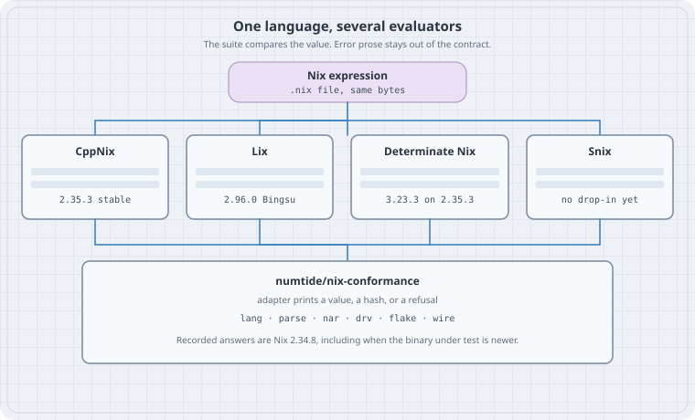

# One language, several evaluators

**Goal:** Name the Nix implementations you can actually pin in 2026, see where they diverge (builtins, string context, float printing, error text, flakes), and test a portable expression against more than one of them with a shared conformance suite.

::: {.callout-important}
This writing box has **no `nix` binary** and this chapter installs nothing. Every expected value below is copied from a file that was read: upstream `tests/functional/lang/` at Nix tags **2.34.8** and **2.35.3**, or `lang/` / `flake/` in [numtide/nix-conformance](https://github.com/numtide/nix-conformance). The command line is the one those repositories' runners use. Re-run the files on a host before you treat a diff as yours.
:::

Version note, re-checked **2026-10-17**:

| Implementation | What it is | Version you can cite today |
|----------------|------------|----------------------------|
| **CppNix** (upstream Nix, `NixOS/nix`) | The C++ evaluator the language still follows | Tag **2.35.3**, annotated 2026-10-13. The file `.version` at that tag is the string `2.35.3`. |
| **Lix** | Community fork of Nix (C++ with a growing Rust portion) | **2.96.0 "Bingsu"**, announced 2026-10-13. The same day's security fixes are also in **2.94.3** and **2.95.4**. |
| **Determinate Nix** | A distribution of upstream Nix with extra product surface | **3.23.3** (2026-10-16), release notes: "Based on upstream Nix 2.35.3." |
| **Snix** (formerly Tvix) | Rust reimplementation, library-first | No stable release tag on [snix.dev](https://snix.dev/about/). The project says it is early and not a drop-in `nix` binary. |

Two package-set aliases are easy to misread. On nixpkgs branch `nixos-26.05`, `pkgs/tools/package-management/nix/default.nix` sets `nixVersions.nix_2_35` to **2.35.3** and `nixVersions.latest` to that package, while `nixVersions.stable` is still `nix_2_34` at **2.34.9**. The same branch's `lix/default.nix` sets `lixPackageSets.lix_2_94` to **2.94.3**, `lix_2_95` to **2.95.4**, `stable` to 2.94, and `latest` to 2.95. On nixpkgs `master` (read the same day) `lixPackageSets.lix_2_96` is **2.96.0**, and `latest` / `stable` still alias `lix_2_95` at **2.95.4**. Pin the numbered attribute.

Partial cousins, so they stay out of the table: [hnix](https://github.com/haskell-nix/hnix) is a Haskell parser and evaluator (repository pushed 2026-03-17) whose own README still shells out to `nix-shell` and `nix-store`. [nix-community/go-nix](https://github.com/nix-community/go-nix) is Go libraries for NAR and store paths (pushed 2026-03-02), not an evaluator. A different language that happens to be declarative is a different chapter.

## Thesis

> There is one Nix language in the files you commit, and several programs that claim to evaluate them. A shared suite matters because the language is still "what one C++ binary prints," and that binary is no longer the only one your CI might install.

## Mental model



Snix's own eval notes say the quiet part: in the absence of a language standard, what the language *is* is prescribed by the behaviour of the C++ implementation. CppNix, Lix, and Determinate Nix are three builds of that lineage (Lix forked; Determinate tracks upstream and adds features). Snix is a bytecode interpreter written to agree with nixpkgs, and it documents the C++ corners it does not want to copy.

The practical standard, as of October 2026, is a test suite rather than an RFC. [numtide/nix-conformance](https://github.com/numtide/nix-conformance) (created 2026-10-08, last push 2026-10-12, LGPL-2.1-or-later) records answers from **Nix 2.34.8**. Its README and `flake.nix` description both say so. Current stable CppNix is **2.35.3**. The suite is the contract for "same as 2.34.8," and a newer binary is something you run *through* the suite to see drift. It is not, by itself, a proof that 2.35.3 and 2.34.8 agree.

An implementation joins by shipping one adapter program. The runner calls `ADAPTER OP FILE` with `NIX_PATH=lang/dir3:lang/dir4`, `NIX_CONFIG="experimental-features = nix-command flakes"`, `HOME=/fake-home`, and `TEST_VAR=foo`. Exit code 3 means "this implementation does not do that op," and the case is skipped. The reference adapter (`adapters/nix`) is bash: `parse`, `nar`, `drv`, and `wire` exec oracles linked against that Nix, and a missing oracle is a skip; `eval` is `nix-instantiate --eval --strict --read-write-mode` inside a throwaway `local?root=` store. The dummy store is refused for evaluation on purpose (`nix-bugs/dummy-store` in the suite): a drvPath's string context would not carry the real closure.

| Op | Pass condition, from `SPEC.md` |
|----|--------------------------------|
| `eval` on `eval-okay-*` | Strict printout equals the `.exp` file |
| `eval` on `eval-fail-*` | Non-zero exit. The `.err.exp` text is Nix's and is **not** compared |
| `parse` | `ok TREE` or `error LINE:COL`. The message is not part of the answer |
| `flake` | JSON of output `result`, or failure for `fail-*`. The message is not compared |
| `nar`, `drv`, `wire` | A hash line, a store path, or `error` — facts, not sentences |

Upstream's own runner is stricter about prose. `tests/functional/lang.sh` at tag 2.35.3 diffs stderr of every `eval-fail-*.nix` against `lang/<name>.err.exp`. That file is a characterisation of **CppNix's** wording. Copying it into a cross-implementation CI tests the sentence, which Lix and Snix are free to change and which the shared suite deliberately ignores (`COVERAGE.md`: "A case tests what is specified, not how Nix words it").

Counts from a full git tree listing on 2026-10-17 (`truncated: false`):

| Tree | `eval-okay-*.nix` | `eval-fail-*.nix` | all `*.nix` under the lang tests |
|------|-------------------|-------------------|----------------------------------|
| `NixOS/nix` tag 2.34.8, `tests/functional/lang` | 143 | 109 | 322 |
| `NixOS/nix` tag 2.35.3, same path | 144 | 269 | 483 |
| `numtide/nix-conformance` `lang/` | 532 | 274 | 893 |

The suite is larger than the 2.34.8 tree because it adds cases (string context, derivation output paths, regex and `fromTOML` corpora, float-range). Tag 2.35.3 grew a large pile of `eval-fail` files that a suite pinned to 2.34.8 does not automatically absorb. `lib.adapterFor` exists so a newer Nix can be run as one more implementation before those answers are promoted.

## Worked examples

### Case 1 — Addition, and the float that prints like an int

Upstream file `tests/functional/lang/eval-okay-builtins-add.nix`. The blob is identical at tags 2.34.8 and 2.35.3 (git blob `f678f640f129d966dc308fece3fe622882dcc667`) and the suite carries the same `.exp` (blob `0350b518a7ec2e41eb48e82bfd99b34685a10d95`).

```nix
# eval-okay-builtins-add.nix
# Source: NixOS/nix tests/functional/lang/eval-okay-builtins-add.nix
# tags 2.34.8 and 2.35.3, and numtide/nix-conformance lang/
# Not run here (no nix). Upstream command, from tests/functional/lang.sh:
#   nix-instantiate --eval --strict lang/eval-okay-builtins-add.nix
[
  (builtins.add 2 3)
  (builtins.add 2 2)
  (builtins.typeOf (builtins.add 2 2))
  ("t" + "t")
  (builtins.typeOf (builtins.add 2.0 2))
  (builtins.add 2.0 2)
]
```

Expected stdout, from `eval-okay-builtins-add.exp` (same blob at both tags and in the suite):

```text
[ 5 4 "int" "tt" "float" 4 ]
```

`builtins.add 2.0 2` has type `"float"` and prints as `4`. That is the printer, not a cast back to int. In tag 2.35.3, `using NixFloat = double` (`src/libexpr/include/nix/expr/value.hh`) and `printFloat` does `output << v.fpoint()` with no precision set (`src/libexpr/print.cc`). Default iostream formatting of a double is what `.exp` locks.

The same printer shows up in assertion text, which the shared suite does **not** lock. `assertEqValues` formats a mismatch as `"%s with value '%s'"` through `ValuePrinter` (`src/libexpr/eval.cc`). `showType` of a float is `"a float"`. So CppNix's own `eval-fail-assert-equal-floats.err.exp` at tag 2.35.3 ends with:

```text
error: a float with value '1' is not equal to a float with value '1.01'
```

for the expression `assert { b = 1.0; } == { b = 1.01; };`. The left-hand `1.0` is rendered as `1`. A second evaluator that prints `1.0` or `1.000000` still implements `==` if the assertion fails. It fails the upstream characterisation diff, and it passes `nix-conformance`.

### Case 2 — Ordinary float arithmetic, then the extreme range

`tests/functional/lang/eval-okay-float.nix`, same `.exp` blob at 2.34.8 and 2.35.3 (`3c50a8adce861f615611328de1c01fdd6e6680ae`).

```nix
# eval-okay-float.nix
# Source: NixOS/nix tests/functional/lang/eval-okay-float.nix (tags 2.34.8 and 2.35.3)
# Not run here. Command:
#   nix-instantiate --eval --strict lang/eval-okay-float.nix
[
  (1.1 + 2.3)
  (builtins.add (0.5 + 0.5) (2.0 + 0.5))
  ((0.5 + 0.5) * (2.0 + 0.5))
  ((1.5 + 1.5) / (0.5 * 4.0))
]
```

Expected stdout, from `eval-okay-float.exp`:

```text
[ 3.4 3.5 2.5 1.5 ]
```

The suite adds a case upstream 2.35.3 does not have (`lang/eval-okay-float-range.nix` is absent from that tag). The `.exp` is Nix 2.34.8's printout, per the suite README:

```nix
# eval-okay-float-range.nix
# Source: numtide/nix-conformance lang/eval-okay-float-range.nix
# Not in NixOS/nix tests/functional/lang at tag 2.35.3.
# Not run here. The suite's eval op is:
#   nix-instantiate --eval --strict --read-write-mode lang/eval-okay-float-range.nix
[ 2.2250738585072014e-308 0.0 0.0e-400 0.0e5 1.7976931348623157e308 1.5 ]
```

Expected stdout, from `lang/eval-okay-float-range.exp`:

```text
[ 2.22507e-308 0 0 0 1.79769e+308 1.5 ]
```

The recorded line keeps six digits (`2.22507e-308`, `1.79769e+308`), prints `0.0` as `0`, and underflows `0.0e-400` to `0`. `printFloat` sets no precision, so this spelling is the stream default, not a format string in Nix. Rust's default `Display` for `f64`, Python `repr`, and a `printf("%.16g")` dump of the same IEEE bits do not match this line. Parse trees in the suite are stricter than this printer: `SPEC.md` records a float literal as IEEE-754 bits, so `1.5` is `(float 3ff8000000000000)`. Evaluation output and parse output are different contracts. A portable expression does not put the rendered form of a float into a derivation name, a lock, or a golden file unless that file was produced by the evaluator you pin.

### Case 3 — `eval-fail` means "refuse", and `|>` is still experimental

```nix
# eval-fail-abort.nix
# Source: NixOS/nix tests/functional/lang/eval-fail-abort.nix
# same file at tags 2.34.8 and 2.35.3. Not run here.
# Upstream: nix-instantiate --eval --strict --show-trace lang/eval-fail-abort.nix
# must exit non-zero. Conformance compares the exit status only.
if true then abort "this should fail" else 1
```

CppNix's characterised stderr (`eval-fail-abort.err.exp`, same blob at both tags) begins `error:` and contains `evaluation aborted with the following error message: 'this should fail'`. Quote it when you are debugging CppNix. Do not paste it into a test that Lix or Snix must satisfy.

Pipe operators are the syntax trap. Tag 2.35.3 still ships this as a failing test, and `src/libutil/experimental-features.cc` describes the feature `pipe-operators` as "Add `|>` and `<|` operators to the Nix language."

```nix
# eval-fail-pipe-operators.nix
# Source: NixOS/nix tests/functional/lang/eval-fail-pipe-operators.nix at tag 2.35.3
# Not run here.
#   nix-instantiate --eval --strict --show-trace lang/eval-fail-pipe-operators.nix
1 |> 2
```

The characterised CppNix message at that tag is:

```text
error: experimental Nix feature 'pipe-operators' is disabled; add '--extra-experimental-features pipe-operators' to enable it
```

Lix's stable manual still marks `|>` and `<|` experimental, and the flag it documents is `--extra-experimental-features pipe-operator` (the feature id on that page is `pipe-operator`). CppNix 2.35.3's table and its error text use the plural id `pipe-operators`. The conformance runner's `NIX_CONFIG` turns on `nix-command` and `flakes` only, so `1 |> 2` stays an `eval-fail` for the reference. The portable spelling is function application, or `lib.pipe` from nixpkgs, which is a function and needs no language flag.

### Case 4 — String context is part of the value

A Nix string can carry a context: store paths that must exist when the string is interpolated into a derivation. Drop the context and the build sandbox, or a later garbage collection, sees a missing input. The suite's `lang/eval-okay-context-introspection.nix` builds a two-output derivation, interpolates its `drvPath` and `outPath` together with a path, and checks the eta rule `getContext` / `appendContext` / `unsafeDiscardStringContext`. Expected stdout, from `lang/eval-okay-context-introspection.exp`:

```text
[ true true true true true true true true true true true true true ]
```

`SPEC.md` says those `eval-okay-context-*` and `eval-okay-drv-*` cases use system `x86_64-linux` and a real local store, so the paths in the answer are stable across hosts. An implementation with no store can still be skipped (exit 3). It cannot honestly print `true` for this file.

Snix's builtins table (page "Builtins", `article:modified_time` 2025-12-24) marks `derivation` / `derivationStrict` / the fetchers / `toFile` / `storePath` as blocked on the store, and `placeholder` as blocked on context. `getContext` and `hasContext` are listed without a blocker on that snapshot. The companion note "Build references in derivations" describes C++ string context as the mechanism Snix still has to line up, and "Nix Language Issues" says Snix targets nixpkgs compatibility and can ignore edges nixpkgs does not hit. Treat that table as the published snapshot from December 2025, not as a census of `git.snix.dev` on the day you read this. The way you find out today's gap is `--known`, below.

`builtins.readFile` feeding arbitrary file bytes into a Nix string is a separate, already-sharp edge of the same string type. Keep large and binary files on the path side of that choice.

### Case 5 — A flake the suite can check without the network

Flakes are on in the runner's `NIX_CONFIG`, and they are still an experimental feature of CppNix. The suite does not fetch. `flake/okay-follows-root/flake.nix`:

```nix
# flake/okay-follows-root/flake.nix
# Source: numtide/nix-conformance flake/okay-follows-root/flake.nix
# Not run here. Adapter command (adapters/nix):
#   nix eval --json --no-update-lock-file path:<dir>#result
{
  inputs.B.url = "path:./B";
  inputs.B.inputs.top.follows = "";
  outputs = { B, ... }: { name = "root"; result = [ B.inputs.top.name ]; };
}
```

Expected stdout, from `flake/okay-follows-root.exp`:

```text
["root"]
```

`fail-*` flake directories must fail. The message is not compared. A lock the reference would have to rewrite is a failure: the implementation must not lock again and must not fetch. Determinate Nix adds flake schemas and `builtins.wasm` on top of this surface; those are product extensions. A flake that must evaluate on upstream Nix 2.35.3 stays off both. Snix's December 2025 builtins table still lists `fetchTree` as `todo`, which is the builtin flakes evaluation sits on. Snix is not a second flake client you can drop into CI yet.

## How to write a portable expression

Stay inside the intersection the suite can already see:

1. **Integer arithmetic, strings, lists, attrsets, `let`, `if`, `assert`, ordinary calls.** Case 1's first three elements are the shape. Their printout `[ 5 4 "int" … ]` is stable from 2.34.8 through 2.35.3.
2. **No experimental syntax.** `|>` and `<|` need `pipe-operators` on CppNix 2.35.3 and `pipe-operator` on current Lix. Write `g (f x)` or `lib.pipe`.
3. **No implementation-only builtins.** `builtins.wasm` is Determinate Nix. A module shared with stock Nix and with Lix does not call it.
4. **Do not branch on `builtins.nixVersion` to paper over a real difference.** Versions differ on purpose across this table. A branch that is load-bearing belongs in the conformance `--known` list, with a deletion condition.
5. **Floats are `double`, and their spelling is not portable.** Compare them inside the expression if you must (`builtins.abs` is not the tool; subtract and bound), or keep the golden file next to one pinned evaluator. Do not splice a printed float into a store name.
6. **Context-bearing strings and derivations need a store and a system.** The suite fixes `x86_64-linux` for those cases. A pure function of integers does not.
7. **Assert outcomes, not paragraphs.** `abort` and `throw` must fire. The trace layout is CppNix's.

```nix
# portable-sum.nix
# The integer half of eval-okay-builtins-add.nix, inlined so it has no import.
# Not run here. Same command as that upstream file:
#   nix-instantiate --eval --strict portable-sum.nix
# Expected pieces, taken from eval-okay-builtins-add.exp (not a separate run):
#   builtins.add 2 3           → 5
#   builtins.add 2 2           → 4
#   typeOf (builtins.add 2 2)  → "int"
let
  total = builtins.add (builtins.add 2 3) (builtins.add 2 2);
in
{
  total = total;
  kind = builtins.typeOf total;
}
```

The file above is a rearrangement, so it has **no** `.exp` of its own. The three facts it relies on are the ones in `eval-okay-builtins-add.exp`. On a machine with Nix, the strict value of this rearrangement is what you record, and you record it from that machine.

## Pinning more than one evaluator

The suite's `flake.nix` (read from `main` on 2026-10-17) exposes the check. It only defines `x86_64-linux` and `aarch64-linux`. The nixpkgs input is pinned (`github:NixOS/nixpkgs/ef34387ddd751e1ab8857adf4676492d32eb24ec`); `packages.adapter` is built from **that** pin's `pkgs.nix`, which the suite treats as 2.34.8. `lib.${system}.adapterFor nix` rebuilds the adapter and the oracles against another Nix. An oracle that does not compile against that Nix's API is omitted and its op is skipped.

```nix
# ci-conformance.nix
# Shape copied from numtide/nix-conformance flake.nix and README.
# Not instantiated here: no nix binary on this box.
{
  inputs.nix-conformance.url = "github:numtide/nix-conformance";

  outputs = { self, nix-conformance, ... }:
  let
    system = "x86_64-linux";
    lib = nix-conformance.lib.${system};
  in
  {
    checks.${system} = {
      # A binary you built. Exit 3 skips an op. --known lists accepted gaps.
      conformance = lib.check {
        name = "my-implementation";
        adapter = "${self.packages.${system}.my-adapter}/bin/my-adapter";
        flags = [ "--known" "${./known-failures}" ];
      };
    };
  };
}
```

`known-failures` is one repo-relative path per line. A listed failure counts as known. A listed case that starts passing counts as a failure, so the list cannot rot in silence.

To put a second upstream Nix through the same answers, the README's command uses the **suite's** nixpkgs, not whatever `nixVersions` your 26.05 lock happens to have:

```bash
# Documented in numtide/nix-conformance README.md. Not run here.
nix build --impure --expr 'let f = builtins.getFlake "github:numtide/nix-conformance";
  p = f.inputs.nixpkgs.legacyPackages.x86_64-linux;
  in f.lib.x86_64-linux.adapterFor p.nixVersions.git'
nix run github:numtide/nix-conformance -- result/bin/* drv
```

What that gives you, if the oracle build succeeds:

| Binary you pass to `adapterFor` | What the adapter actually executes |
|----------------------------------|------------------------------------|
| A `nix` that still looks like CppNix's CLI (`nix-instantiate`, `nix eval`) | `eval`, `eval-xml`, `check`, and `flake` |
| Headers the suite's `oracle/` still compiles against | `parse`, `nar`, `drv`, `wire` as well |
| Anything else | Those ops exit 3 and show up as skips |

Lix installs a `nix` CLI, so the `nix-instantiate` ops are the ones a Lix package can answer without an oracle rebuild. Whether current Lix 2.96 headers still satisfy `oracle/` was not compiled here. Determinate Nix 3.23.3 is a `nix` CLI on top of 2.35.3; extra builtins do not show up unless a case calls them. Snix needs its own adapter: there is no `nix-instantiate` to wrap. Start it with exit 3 on `drv` / `wire` / `flake`, and a `--known` file for the language cases the December 2025 builtins table still marks `todo`, `store`, or `context`.

A smaller CI, when you only have two CLIs and you do not want the oracles, is the upstream loop from `lang.sh` with the conformance rule for failures: diff stdout of `eval-okay-*.nix` against the `.exp`, and require non-zero for `eval-fail-*.nix` **without** diffing `.err.exp`. Vendor the files you mean. Point each matrix leg at a numbered package (`nixVersions.nix_2_35`, `lixPackageSets.lix_2_96`), not at `stable`.

The October 2026 security advisory fixed Nix **2.35.3** (also 2.34.9, 2.31.6, 2.30.6, 2.28.8) and Lix **2.96.0**, **2.95.4**, and **2.94.3**. A conformance pin is not a reason to stay on an unfixed evaluator. Run the suite on the patched build.

## The trap

Treating "it evaluates on my laptop" as the language. The laptop has one binary, one `experimental-features` line, and one iostream. The next job installs Lix, or Determinate Nix with flakes already on, or a Snix REPL, and a golden file full of error paragraphs and `1.0` rendered as `1` goes red for a reason that is not a behaviour change.

| Trap | What to pin instead |
|------|---------------------|
| `nixVersions.stable` on nixos-26.05 | That alias is **2.34.9**. Upstream's current release is **2.35.3** (`nixVersions.nix_2_35`). |
| `lixPackageSets.latest` | On nixpkgs `master` this was still **2.95.4** after **2.96.0** existed as `lix_2_96`. |
| Diffing `.err.exp` across implementations | Upstream `lang.sh` does this for CppNix. The shared suite does not. |
| `|>` in a shared module | Experimental on CppNix 2.35.3 and on Lix. It fails the reference suite. |
| `builtins.wasm` or a custom flake schema in a portable flake | Determinate Nix surface. Stock Nix 2.35.3 will not grow it because your CI image did. |
| Assuming Snix matches because the pure subset feels small | Store builtins and string context are the nixpkgs-sized gap. Use `--known`. |

## The boring rule

One expression, one `.exp`, one numbered evaluator per CI leg. Failures are exit codes. Sentences are logs. The oracle in the shared suite stays Nix **2.34.8** until that repository says otherwise; your production pin can still be **2.35.3** or Lix **2.96.0**, and `adapterFor` is how you see the difference before users do.

## Try this

On a machine that actually has Nix (this one does not):

1. Check out tag `2.35.3` of `NixOS/nix` and run the two commands in cases 1 and 2. Diff stdout against the `.exp` files. Then run `eval-fail-pipe-operators.nix` and confirm a non-zero exit **with the feature left off**.
2. Clone `numtide/nix-conformance` and read `adapters/nix` next to one `eval-okay-context-*.nix`. Note the scratch store. That is why a context test is not `nix-instantiate --eval` against `dummy://`.
3. Add five lines to `known-failures` on purpose, run with `--known`, then delete one line and watch that case turn red. The list is part of the contract.
4. In your own flake, replace any `nixVersions.stable` input with the numbered attribute you meant, and write the version string into the CI log.

## Sources

- [NixOS/nix tag 2.35.3](https://github.com/NixOS/nix/tree/2.35.3) — `.version`, annotated tag date 2026-10-13. Also tag [2.34.8](https://github.com/NixOS/nix/tree/2.34.8) (2026-07-06), the suite's oracle.
- [NixOS/nix `tests/functional/lang.sh` at 2.35.3](https://github.com/NixOS/nix/blob/2.35.3/tests/functional/lang.sh) — `eval-okay` diffs `.exp` and `.err.exp`; `eval-fail` diffs `.err.exp`.
- Test files quoted above, same blobs at 2.34.8 and 2.35.3 unless noted: `tests/functional/lang/eval-okay-builtins-add.nix`, `eval-okay-float.nix`, `eval-fail-abort.nix`, `eval-fail-pipe-operators.nix`, `eval-fail-assert-equal-floats.err.exp`.
- Printer and types at tag 2.35.3: `src/libexpr/print.cc` (`printFloat`), `src/libexpr/include/nix/expr/value.hh` (`NixFloat = double`), `src/libexpr/eval.cc` (`assertEqValues`, `showType`), `src/libutil/experimental-features.cc` (`pipe-operators`).
- [numtide/nix-conformance](https://github.com/numtide/nix-conformance) — `README.md`, `SPEC.md`, `COVERAGE.md`, `flake.nix`, `adapters/nix`, `lang/eval-okay-float-range.nix`, `lang/eval-okay-context-introspection.nix`, `flake/okay-follows-root/`.
- [Lix 2.96 "Bingsu"](https://lix.systems/blog/2026-10-13-lix-2.96-release/) and the [operators manual](https://docs.lix.systems/manual/lix/stable/language/operators.html) (pipe operators still experimental).
- [Determinate Nix 3.23.3 release notes](https://manual.determinate.systems/release-notes-determinate/v3.23.3.html) — based on upstream Nix 2.35.3, 2026-10-16.
- [Snix about](https://snix.dev/about/), [builtins status](https://snix.dev/docs/components/eval/builtins/), [Nix language issues](https://snix.dev/docs/components/eval/nix-language-issues/), [string context](https://snix.dev/docs/components/eval/build-references-in-derivations/). Rename announcement: [Announcing Snix](https://snix.dev/blog/announcing-snix/) (2025-03-16).
- nixpkgs `nixos-26.05`: `pkgs/tools/package-management/nix/default.nix`, `pkgs/tools/package-management/lix/default.nix`. nixpkgs `master`: `lix/2.96.nix` (`version = "2.96.0"`) and the `latest` / `stable` aliases in `lix/default.nix`.
- [Security advisory for Nix and Lix, October 2026](https://discourse.nixos.org/t/security-advisory-for-nix-and-lix-october-2026/80547) — patched Nix 2.35.3 and Lix 2.94.3 / 2.95.4 / 2.96.0.
- [hnix](https://github.com/haskell-nix/hnix), [go-nix](https://github.com/nix-community/go-nix) — partial, not drop-in evaluators.
