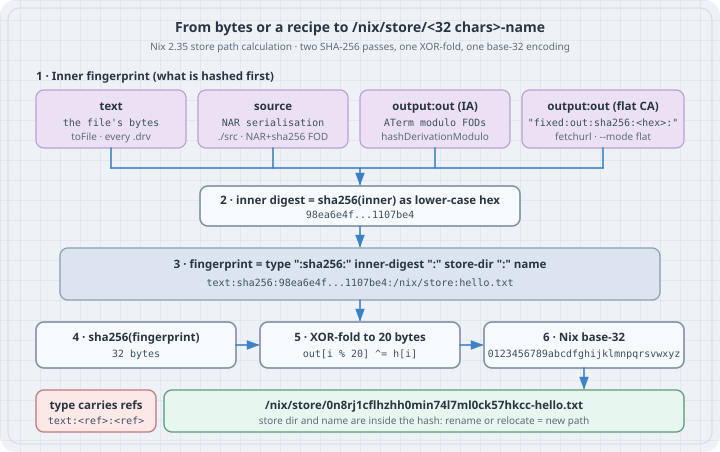

# How Nix computes a store path

**Goal:** Recompute `/nix/store/<32 characters>-<name>` by hand for each kind of store object: a `builtins.toFile` text, a source tree added by NAR hash, a flat fixed-output file, an input-addressed derivation output, and the `.drv` file itself. Then confirm that the reimplementation agrees with Nix byte for byte. Once you can do that, cache misses, "why did this rebuild?", and "why did nothing rebuild when I changed the URL?" have exact answers.

Version note: written against **Nix 2.35.3**, the latest upstream tag at the time of writing (nixos.org's download page still lists 2.35.2), and **NixOS 26.05**. Every `nix` command below really ran, using a statically linked Nix 2.35.3 binary on a box with no `/nix`, no daemon, and no root. It ran against a *chroot store* (`--store /tmp/nixlab/store`), whose logical store directory is still `/nix/store`, so every path printed is the path a NixOS host would print. On your own NixOS machine, drop `--store "$S"` (with `nix-command` enabled, as it usually is). The reimplementation uses only the Python standard library and was run with Python 3.13.5.

## Thesis

A store path is not a random ID and not the hash of "the package". It is the SHA-256 of a short **fingerprint** string, `type:sha256:<inner digest>:<store dir>:<name>`, folded to 160 bits and written in Nix's own base-32 alphabet. Everything Nix means by "input-addressed" and "content-addressed" lives in two parts of that fingerprint: the **type**, and **what the inner digest is a hash of**. That can be file bytes, a NAR, a derivation's ATerm with fixed-output inputs factored out, or a `fixed:out:` string. The algorithm is specified in the Nix manual's [store path calculation](https://nix.dev/manual/nix/latest/protocols/store-path). It is about 150 lines of Python, and it explains several things people normally learn by surprise: renaming a source changes its path, mirrors of the same tarball share an output path, and a store at `/opt/nix/store` can never share binaries with `cache.nixos.org`.

## Mental model

{fig-alt="Four kinds of inner fingerprint: text (the file's bytes, used by builtins.toFile and every .drv), source (the NAR serialisation), output:out for input-addressed outputs (the derivation's ATerm modulo fixed-output derivations), and output:out for flat content-addressed outputs (the string fixed:out:sha256:hex:). The inner fingerprint is hashed with SHA-256 to a lower-case hex inner digest. That goes into the fingerprint type:sha256:inner-digest:store-dir:name, which is hashed with SHA-256 again, XOR-folded to 20 bytes and encoded in Nix base-32 to give /nix/store/0n8rj1cflhzhh0min74l7ml0ck57hkcc-hello.txt. References are appended to the type. The store directory and the name are inside the hash."}

| Store object | `type` in the fingerprint | Inner digest is SHA-256 of |
| --- | --- | --- |
| `builtins.toFile`, every `.drv` file | `text` + `:<ref>` for each reference | the file's bytes |
| `./src`, `builtins.path`, `nix store add` (NAR, SHA-256) | `source` + `:<ref>`… (+ `:self`) | the NAR serialisation |
| Flat fixed-output (`fetchurl`, `--mode flat`) | `output:out` | the string `fixed:out:sha256:<hex>:` |
| Input-addressed derivation output `out` | `output:out` | the derivation's ATerm, **modulo fixed-output derivations** |

- **Two hashes, then a fold.** `sha256(fingerprint)` is 32 bytes. Nix XOR-folds it to 20 (`out[i % 20] ^= h[i]`) and encodes the 160 bits as 32 characters in base-32, using an alphabet without `e`, `o`, `u` or `t`.
- **The name and the store directory are hashed too.** The manual says so explicitly, "to make sure that changes to either of those are reflected in the hash". The same bytes at `/gnu/store` or under another name get a different digest.
- **NAR is the canonical form of a file tree.** It records file type, contents, the executable bit, symlink targets, and sorted directory entries. It records nothing else: no mtimes, owners, or group/other permission bits. That is why `nix hash path` is reproducible across machines ([Nix Archive format](https://nix.dev/manual/nix/latest/protocols/nix-archive)).
- **"Modulo" means fixed-output inputs are replaced by their promised output.** When Nix hashes a derivation to name its outputs, every input `.drv` path is replaced by *that* derivation's modulo hash. For a fixed-output input, that hash comes only from its declared output hash and path, not from its URL or builder ([input-addressing](https://nix.dev/manual/nix/latest/store/derivation/outputs/input-address)). Case 5 is the payoff.

## The code

Two files, standard library only. `storepath.py` holds the fingerprint, the fold, base-32, NAR, and the three content-addressed path kinds:

```python
# storepath.py - how Nix turns content and recipes into /nix/store/<hash>-<name>
# Standard library only. Mirrors the algorithm in the Nix manual's
# "Store Path" and "Content-Addressing Store Objects" pages.
import hashlib
import os
import stat

STORE_DIR = "/nix/store"
ALPHABET = "0123456789abcdfghijklmnpqrsvwxyz"   # Nix base-32: no e, o, u, t


def nix32(digest: bytes) -> str:
    """Nix's base-32: 5 bits at a time, starting from the END of the digest."""
    n = (len(digest) * 8 - 1) // 5 + 1
    out = []
    for k in range(n - 1, -1, -1):
        b = k * 5
        i, j = divmod(b, 8)
        c = digest[i] >> j
        if i + 1 < len(digest):
            c |= digest[i + 1] << (8 - j)
        out.append(ALPHABET[c & 0x1F])
    return "".join(out)


def compress(digest: bytes, size: int = 20) -> bytes:
    """XOR-fold a 32-byte SHA-256 down to 20 bytes (160 bits)."""
    out = bytearray(size)
    for i, b in enumerate(digest):
        out[i % size] ^= b
    return bytes(out)


def make_store_path(kind: str, inner_hex: str, name: str) -> str:
    store_dir = STORE_DIR                       # read at call time, so callers can change it
    fingerprint = f"{kind}:sha256:{inner_hex}:{store_dir}:{name}"
    digest = hashlib.sha256(fingerprint.encode()).digest()
    return f"{store_dir}/{nix32(compress(digest))}-{name}"


def refs(kind: str, references=()) -> str:
    return kind + "".join(":" + r for r in sorted(references))


# --- NAR: the canonical serialisation of a file system object -------------

def _str(b: bytes) -> bytes:
    return len(b).to_bytes(8, "little") + b + b"\0" * (-len(b) % 8)


def nar(path: str) -> bytes:
    def node(p):
        st = os.lstat(p)
        out = _str(b"(")
        if stat.S_ISLNK(st.st_mode):
            out += _str(b"type") + _str(b"symlink") + _str(b"target") + _str(os.readlink(p).encode())
        elif stat.S_ISDIR(st.st_mode):
            out += _str(b"type") + _str(b"directory")
            for entry in sorted(os.listdir(p)):
                out += _str(b"entry") + _str(b"(") + _str(b"name") + _str(entry.encode())
                out += _str(b"node") + node(os.path.join(p, entry)) + _str(b")")
        else:
            out += _str(b"type") + _str(b"regular")
            if st.st_mode & 0o100:
                out += _str(b"executable") + _str(b"")
            out += _str(b"contents") + _str(open(p, "rb").read())
        return out + _str(b")")
    return _str(b"nix-archive-1") + node(path)


# --- the three ways a store path is born -----------------------------------

def text_path(name: str, contents: bytes, references=()) -> str:
    """builtins.toFile, and every .drv file."""
    return make_store_path(refs("text", references), hashlib.sha256(contents).hexdigest(), name)


def source_path(path: str, name: str, references=()) -> str:
    """Files added to the store by NAR hash: ./src, builtins.path, nix store add."""
    return make_store_path(refs("source", references), hashlib.sha256(nar(path)).hexdigest(), name)


def fixed_output_path(name: str, sha256_hex: str, recursive: bool) -> str:
    """Fixed-output derivations (fetchurl, ...) and `nix store add --mode flat`."""
    if recursive:
        return make_store_path("source", sha256_hex, name)
    inner = hashlib.sha256(f"fixed:out:sha256:{sha256_hex}:".encode()).hexdigest()
    return make_store_path("output:out", inner, name)
```

`drv.py` holds derivations: the ATerm serialisation ([derivation ATerm format](https://nix.dev/manual/nix/latest/protocols/derivation-aterm)), `hashDerivationModulo`, and what `derivation { … }` does at evaluation time. It covers single-output input-addressed derivations and flat fixed-output derivations, which is enough for every case below:

```python
# drv.py - derivations: ATerm, hashDerivationModulo, output and .drv paths
import hashlib

from storepath import make_store_path, text_path


def _s(x: str) -> str:
    return '"' + x.replace("\\", "\\\\").replace('"', '\\"').replace("\n", "\\n") \
                  .replace("\r", "\\r").replace("\t", "\\t") + '"'


def _list(items) -> str:
    return "[" + ",".join(items) + "]"


def aterm(d: dict, input_drvs: dict) -> str:
    """Serialise like a .drv file. input_drvs maps a key (a .drv path, or a
    hash when computing the modulo) to the list of outputs used."""
    outs = _list("(" + ",".join(_s(v) for v in (o, *d["outputs"][o])) + ")" for o in sorted(d["outputs"]))
    drvs = _list("(" + _s(k) + "," + _list(_s(o) for o in sorted(v)) + ")" for k, v in sorted(input_drvs.items()))
    srcs = _list(_s(p) for p in sorted(d["input_srcs"]))
    args = _list(_s(a) for a in d["args"])
    env = _list("(" + _s(k) + "," + _s(v) + ")" for k, v in sorted(d["env"].items()))
    return f"Derive({outs},{drvs},{srcs},{_s(d['system'])},{_s(d['builder'])},{args},{env})"


def is_fixed_output(d: dict) -> bool:
    return d["outputs"].keys() == {"out"} and d["outputs"]["out"][2] != ""


def hash_modulo(d: dict) -> str:
    """hashDerivationModulo: the hash that names a derivation's outputs."""
    if is_fixed_output(d):
        path, algo, h = d["outputs"]["out"]
        return hashlib.sha256(f"fixed:out:{algo}:{h}:{path}".encode()).hexdigest()
    # Replace every input .drv path by *its* modulo hash, then hash the ATerm.
    masked = {hash_modulo(dep): outs for dep, outs in d["input_drv_objs"]}
    return hashlib.sha256(aterm(d, masked).encode()).hexdigest()


def finalise(name: str, system: str, builder: str, args, env: dict, input_drv_objs=(), input_srcs=(),
             fixed=None):
    """What `derivation { ... }` does at evaluation time (input-addressed or flat FOD)."""
    from storepath import fixed_output_path
    env = {"name": name, "system": system, "builder": builder, **env}
    d = {"system": system, "builder": builder, "args": list(args), "input_srcs": list(input_srcs),
         "input_drv_objs": list(input_drv_objs)}
    if fixed:                                          # fixed=("sha256", hex): outputHashMode = "flat"
        algo, h = fixed
        out = fixed_output_path(name, h, recursive=False)
        d["outputs"] = {"out": (out, algo, h)}
        d["env"] = {**env, "out": out}
    else:
        d["outputs"] = {"out": ("", "", "")}            # 1. blank the output path ...
        d["env"] = {**env, "out": ""}                   #    ... everywhere it appears
        out = make_store_path("output:out", hash_modulo(d), name)   # 2. name it by the modulo hash
        d["outputs"] = {"out": (out, "", "")}           # 3. write it back
        d["env"]["out"] = out
    real_drvs = {dep["drv_path"]: outs for dep, outs in d["input_drv_objs"]}
    d["aterm"] = aterm(d, real_drvs)
    d["out_path"] = out
    d["drv_path"] = text_path(name + ".drv", d["aterm"].encode(),
                              references=[*d["input_srcs"], *real_drvs])
    return d
```

Set up the lab once. On a NixOS host, skip `S` and every `--store "$S"`:

```bash
mkdir -p /tmp/nixlab && cd /tmp/nixlab     # storepath.py, drv.py and the case files live here
S=/tmp/nixlab/store                         # chroot store; logical store dir is still /nix/store
nix --version
python3 --version
```

```text
nix (Nix) 2.35.3
Python 3.13.5
```

## Worked examples

### Case 1: `builtins.toFile`, one step at a time

```python
# case1.py - builtins.toFile "hello.txt" "hi\n", by hand
import hashlib
from storepath import nix32, compress, text_path

contents = b"hi\n"
inner = hashlib.sha256(contents).hexdigest()
fingerprint = f"text:sha256:{inner}:/nix/store:hello.txt"
digest = hashlib.sha256(fingerprint.encode()).digest()

print("fingerprint :", fingerprint)
print("sha256      :", digest.hex())
print("xor-fold 20 :", compress(digest).hex())
print("nix32       :", nix32(compress(digest)))
print("store path  :", text_path("hello.txt", contents))
```

```bash
python3 case1.py
nix --store "$S" eval --raw --expr 'builtins.toFile "hello.txt" "hi\n"'; echo
```

Output:

```text
fingerprint : text:sha256:98ea6e4f216f2fb4b69fff9b3a44842c38686ca685f3f55dc48c5d3fb1107be4:/nix/store:hello.txt
sha256      : 0e898c0e1e74df971c7c03b1083fa48e0599910582c4f4c47af409d4d5cdb2b3
xor-fold 20 : 8c4d78ca6480d643c9b1b102083fa48e05999105
nix32       : 0n8rj1cflhzhh0min74l7ml0ck57hkcc
store path  : /nix/store/0n8rj1cflhzhh0min74l7ml0ck57hkcc-hello.txt
/nix/store/0n8rj1cflhzhh0min74l7ml0ck57hkcc-hello.txt
```

The first five lines are the algorithm and the last line is Nix, and they match. Notice what the inner digest is: `98ea6e4f…` is simply `sha256("hi\n")`. A text object is addressed by its contents plus its name. Change either one and the path changes.

### Case 2: A directory: NAR bytes, NAR hash, `source` path

Build a small tree with one executable, one plain file, and a symlink, then serialise and hash it in Python.

```python
# case2.py - NAR-hash a directory and predict its store path
import base64
import hashlib
import sys

from storepath import nar, nix32, source_path

tree = sys.argv[1]
blob = nar(tree)
digest = hashlib.sha256(blob).digest()
open("tree.py.nar", "wb").write(blob)

print("NAR bytes    :", len(blob))
print("sha256 hex   :", digest.hex())
print("sha256 SRI   :", "sha256-" + base64.b64encode(digest).decode())
print("sha256 nix32 :", nix32(digest))
print("store path   :", source_path(tree, "tree"))
```

```bash
mkdir -p tree/bin
printf '#!/bin/sh\necho hello\n' > tree/bin/hello && chmod 755 tree/bin/hello
printf 'hi\n' > tree/README && chmod 644 tree/README
ln -s bin/hello tree/run
python3 case2.py tree
nix nar pack tree > tree.nix.nar && cmp tree.py.nar tree.nix.nar && echo "NAR bytes identical"
nix hash path tree
nix hash path --base32 tree
nix --store "$S" store add tree
```

Output:

```text
NAR bytes    : 896
sha256 hex   : 76089773df8aecb93056dbf6e3e015abb02b03433441699c061aa6988fcf894e
sha256 SRI   : sha256-dgiXc9+K7LkwVtv24+AVq7ArA0M0QWmcBhqmmI/PiU4=
sha256 nix32 : 0kl9ry7ri9hs0sf6jh9l8c1jpc5b2phf7xnvaqqbkv4avxrrf23n
store path   : /nix/store/zb37ng1sjjd4gilsna650k7mankgdjc9-tree
NAR bytes identical
sha256-dgiXc9+K7LkwVtv24+AVq7ArA0M0QWmcBhqmmI/PiU4=
0kl9ry7ri9hs0sf6jh9l8c1jpc5b2phf7xnvaqqbkv4avxrrf23n
/nix/store/zb37ng1sjjd4gilsna650k7mankgdjc9-tree
```

The 896 NAR bytes are identical to Nix's, so the hash is identical in all three spellings (hex, SRI base-64, Nix base-32), and so is the `source:` store path. Now change what NAR ignores, and then what it keeps:

```bash
touch -d 2001-01-01 tree/README && chmod g+w tree/README   # mtime and group bits: not in NAR
nix hash path tree
chmod -x tree/bin/hello                                    # executable bit: in NAR
nix hash path tree
chmod +x tree/bin/hello
```

Output:

```text
sha256-dgiXc9+K7LkwVtv24+AVq7ArA0M0QWmcBhqmmI/PiU4=
sha256-mQ8ZVZA7F6E7KJMY4dq0jELaewFiaRllv114SJv3CzY=
```

### Case 3: One file, three addresses

The same `hi.txt` added three ways: as a flat file, as a NAR, and as a NAR under a different name.

```python
# case3.py - one file, three addresses: flat, recursive (NAR), and a different name
import hashlib
import sys

from storepath import fixed_output_path, nar

path = sys.argv[1]
flat = hashlib.sha256(open(path, "rb").read()).hexdigest()
rec = hashlib.sha256(nar(path)).hexdigest()
print("sha256(file bytes):", flat)
print("sha256(NAR)       :", rec)
print("flat      hi.txt  :", fixed_output_path("hi.txt", flat, recursive=False))
print("recursive hi.txt  :", fixed_output_path("hi.txt", rec, recursive=True))
print("recursive hello   :", fixed_output_path("hello", rec, recursive=True))
```

```bash
printf 'hi\n' > hi.txt
python3 case3.py hi.txt
nix --store "$S" store add --mode flat hi.txt
nix --store "$S" store add --mode nar hi.txt
nix --store "$S" store add --mode nar --name hello hi.txt
```

Output:

```text
sha256(file bytes): 98ea6e4f216f2fb4b69fff9b3a44842c38686ca685f3f55dc48c5d3fb1107be4
sha256(NAR)       : 10551daed7fa467d0b58826e7eb9a0f2af7d693de319f2ef775fffcda244b9f6
flat      hi.txt  : /nix/store/a1qbm6bia1qj42ganmyz01knaai6d59p-hi.txt
recursive hi.txt  : /nix/store/qs2vcw1sd6lzsvgvq6gggnw1v31qrm28-hi.txt
recursive hello   : /nix/store/a5izqk5bgpxcrrnrm1m8n1fvyq2jlc52-hello
/nix/store/a1qbm6bia1qj42ganmyz01knaai6d59p-hi.txt
/nix/store/qs2vcw1sd6lzsvgvq6gggnw1v31qrm28-hi.txt
/nix/store/a5izqk5bgpxcrrnrm1m8n1fvyq2jlc52-hello
```

Three different paths for one 3-byte file. A flat SHA-256 is wrapped in `fixed:out:sha256:<hex>:` and goes through the `output:out` type. A NAR SHA-256 uses `source` directly. The manual's historical note explains that NAR + SHA-256 "always uses the `source:...` construction, regardless of how it was produced", which is why a `fetchzip`-style recursive fixed-output derivation and a manual `nix store add` of the same tree land on the same path. Renaming changes the path even though the hash of the content does not.

### Case 4: An input-addressed derivation, byte for byte

```nix
derivation {
  name = "hello";
  system = "x86_64-linux";
  builder = "/bin/sh";
  args = [ "-c" "echo hi > $out" ];
}
```

```python
# case4.py - predict hello.nix's .drv bytes, outPath and drvPath
from drv import finalise

hello = finalise("hello", "x86_64-linux", "/bin/sh", ["-c", "echo hi > $out"], {})
print("outPath :", hello["out_path"])
print("drvPath :", hello["drv_path"])
open("hello.py.drv", "w").write(hello["aterm"])
```

```bash
python3 case4.py
nix --store "$S" eval --raw -f hello.nix outPath; echo
drv=$(nix --store "$S" eval --raw -f hello.nix drvPath); echo "$drv"
cat "$S$drv"; echo
cmp hello.py.drv "$S$drv" && echo ".drv bytes identical"
```

Output:

```text
outPath : /nix/store/mjs27ix6ig2bkbi3s3sm470vrv4lf7ic-hello
drvPath : /nix/store/76w21n1f03fs5kw8fnffphx7qrqffw6r-hello.drv
/nix/store/mjs27ix6ig2bkbi3s3sm470vrv4lf7ic-hello
/nix/store/76w21n1f03fs5kw8fnffphx7qrqffw6r-hello.drv
Derive([("out","/nix/store/mjs27ix6ig2bkbi3s3sm470vrv4lf7ic-hello","","")],[],[],"x86_64-linux","/bin/sh",["-c","echo hi > $out"],[("builder","/bin/sh"),("name","hello"),("out","/nix/store/mjs27ix6ig2bkbi3s3sm470vrv4lf7ic-hello"),("system","x86_64-linux")])
.drv bytes identical
```

Nix does three things here, in this order. (1) It builds the derivation with every output path set to `""`, both in the outputs list and in the `out` environment variable, then serialises that to ATerm and hashes it. (2) It names the output `make_store_path("output:out", that_hash, "hello")`. (3) It writes the path back in, serialises the final ATerm, which is the `.drv` file, and stores *that* as a `text` object named `hello.drv`, with its input sources and input derivations as references. The output path is computed **before** the `.drv` exists, so the output cannot depend on the `.drv` path. That is the circularity "modulo" breaks.

### Case 5: The "modulo": two mirrors, one output path

A fixed-output "fetch" (the builder just prints a URL; nothing is built) and an app that copies it. Mirror `a` and mirror `b` differ only in the URL.

```nix
# app.nix - one fixed-output source, two different "mirrors", one consumer
let
  greeting = url: derivation {
    name = "greeting.txt";
    system = "x86_64-linux";
    builder = "/bin/sh";
    args = [ "-c" "echo fetching ${url}; printf 'hi\\n' > $out" ];
    outputHashMode = "flat";
    outputHashAlgo = "sha256";
    outputHash = "98ea6e4f216f2fb4b69fff9b3a44842c38686ca685f3f55dc48c5d3fb1107be4";
  };
  app = src: derivation {
    name = "app";
    system = "x86_64-linux";
    builder = "/bin/sh";
    args = [ "-c" "cp ${src} $out" ];
  };
in {
  a = app (greeting "https://a.example/greeting.txt");
  b = app (greeting "https://b.example/greeting.txt");
}
```

```python
# case5.py - the "modulo" in hashDerivationModulo
from drv import finalise

SHA = "98ea6e4f216f2fb4b69fff9b3a44842c38686ca685f3f55dc48c5d3fb1107be4"


def greeting(url):
    return finalise("greeting.txt", "x86_64-linux", "/bin/sh",
                    ["-c", f"echo fetching {url}; printf 'hi\\n' > $out"],
                    {"outputHashMode": "flat", "outputHashAlgo": "sha256", "outputHash": SHA},
                    fixed=("sha256", SHA))


def app(src):
    return finalise("app", "x86_64-linux", "/bin/sh", ["-c", f"cp {src['out_path']} $out"], {},
                    input_drv_objs=[(src, ["out"])])


for mirror in ("a", "b"):
    src = greeting(f"https://{mirror}.example/greeting.txt")
    top = app(src)
    print(f"{mirror}: greeting.drvPath {src['drv_path']}")
    print(f"   greeting.outPath {src['out_path']}")
    print(f"   app.drvPath      {top['drv_path']}")
    print(f"   app.outPath      {top['out_path']}")
```

```bash
for x in a b; do for k in drvPath outPath; do
  echo "$x.$k $(nix --store "$S" eval --raw -f app.nix $x.$k)"; done; done
python3 case5.py
```

Output:

```text
a.drvPath /nix/store/ah3ma3iq16cc07b5a1q31h7zxjpalmfk-app.drv
a.outPath /nix/store/gxiksvnwx12gg9nlvcnqw884mfp2ppfk-app
b.drvPath /nix/store/zhd4fazximx9kzrich1rk4qfcy3a7y7s-app.drv
b.outPath /nix/store/gxiksvnwx12gg9nlvcnqw884mfp2ppfk-app
a: greeting.drvPath /nix/store/1f76makgrz9w9s6qsghadmvfv333fnzx-greeting.txt.drv
   greeting.outPath /nix/store/0cd9wfphx5i9sly07cr00rzqn22d3lbj-greeting.txt
   app.drvPath      /nix/store/ah3ma3iq16cc07b5a1q31h7zxjpalmfk-app.drv
   app.outPath      /nix/store/gxiksvnwx12gg9nlvcnqw884mfp2ppfk-app
b: greeting.drvPath /nix/store/mpd6qm01vvislikzq4marrgwacpr272c-greeting.txt.drv
   greeting.outPath /nix/store/0cd9wfphx5i9sly07cr00rzqn22d3lbj-greeting.txt
   app.drvPath      /nix/store/zhd4fazximx9kzrich1rk4qfcy3a7y7s-app.drv
   app.outPath      /nix/store/gxiksvnwx12gg9nlvcnqw884mfp2ppfk-app
```

Read it from the bottom up. The two `greeting.txt.drv` files differ, because the URL is in their args. Their output path is the same, because a flat fixed-output path depends only on `name` and `outputHash`. The two `app.drv` files differ, because each one names a different input `.drv`. Yet `app`'s **output path is identical**: when Nix hashed `app` to name its output, it replaced each input `.drv` path with `sha256("fixed:out:sha256:<hash>:<outPath>")`, and that string is the same for both mirrors. This is why moving a `fetchurl` to a mirror, or changing its `curl` flags, does not rebuild the world, and why a wrong `outputHash` is caught at fetch time rather than silently accepted.

## The trap

Two things in the fingerprint are not your bytes, and both bite in practice. One is the recipe: an input-addressed path is named by the ATerm, not by what the build produces. The [content-addressed internals](../13-platform-engineering/11-content-addressed-nix-internals.qmd) chapter shows the rebuild this causes. The other is the store directory itself.

```python
# trap.py - two things in the fingerprint that are not your bytes
import storepath
from drv import finalise

v1 = finalise("hello", "x86_64-linux", "/bin/sh", ["-c", "echo hi > $out"], {})
v2 = finalise("hello", "x86_64-linux", "/bin/sh", ["-c", "echo hi > $out  # same output"], {})
print("recipe v1          :", v1["out_path"])
print("recipe v2 (comment):", v2["out_path"])

storepath.STORE_DIR = "/opt/nix/store"
v1_opt = finalise("hello", "x86_64-linux", "/bin/sh", ["-c", "echo hi > $out"], {})
print("v1 in /opt/nix/store:", v1_opt["out_path"])
```

```bash
python3 trap.py
nix --store "$S" eval --raw --expr 'derivation { name = "hello"; system = "x86_64-linux"; builder = "/bin/sh"; args = [ "-c" "echo hi > $out  # same output" ]; }'; echo
nix --store 'local?store=/opt/nix/store&real=/tmp/alt/store&state=/tmp/alt/state&log=/tmp/alt/log' eval --raw -f hello.nix outPath; echo
```

Output:

```text
recipe v1          : /nix/store/mjs27ix6ig2bkbi3s3sm470vrv4lf7ic-hello
recipe v2 (comment): /nix/store/52vkb7gk02c7kdgmfzbzr1z860vsk9id-hello
v1 in /opt/nix/store: /opt/nix/store/9nyvidn6yc9hq5kcvw9iwk3hd71kzb6v-hello
/nix/store/52vkb7gk02c7kdgmfzbzr1z860vsk9id-hello
/opt/nix/store/9nyvidn6yc9hq5kcvw9iwk3hd71kzb6v-hello
```

A shell comment that cannot change the output still gives a new path, because the ATerm changed. Moving the store to `/opt/nix/store`, a common wish on machines where `/` is small or read-only, changes **every** hash. The binary cache is keyed by `/nix/store/<hash>`, so a store with a different directory gets no substitutes from `cache.nixos.org` and builds everything from source, including the compiler. If `/nix` is the problem, move the bytes rather than the name: a bind mount or a dedicated filesystem mounted at `/nix`.

## The boring rule

1. Keep the store directory `/nix/store`. Relocate storage with mounts, never with `store=`.
2. Treat a store path as `hash(type, inner digest, store dir, name)`. When a path changes unexpectedly, ask which of the four changed.
3. Use `nix hash path` (NAR) for trees and `nix hash file` (flat) for single files, and know that they give different store paths for the same bytes.
4. Pin sources with fixed-output hashes. Mirrors and fetch flags then stay out of every downstream output path.
5. When debugging a rebuild, diff the two `.drv` files (`nix derivation show` on both), not the outputs. The output path is a pure function of the ATerm modulo fixed-output inputs.

## Try this

1. Add a reference to `text_path`: compute `builtins.toFile "b" "${builtins.toFile "a" "x"}"` in Python (the reference goes into the type as `text:/nix/store/…-a`) and compare with `nix eval --raw --expr`.
2. Give `hello.nix` a second output (`outputs = [ "out" "dev" ];`). Extend `finalise` so both outputs are blanked before hashing and each is named `output:<id>` with the name `hello` or `hello-dev`. Check against `nix eval .dev.outPath`.
3. Change Case 5's fixed-output derivation to `outputHashMode = "recursive"`. Which line of `fixed_output_path` now applies, and does `app`'s output path change?
4. Write the inverse of `nix32()` in Python (decode 52 characters back to 32 bytes) and check it against `nix hash convert --hash-algo sha256 --to base16 0kl9ry7ri9hs0sf6jh9l8c1jpc5b2phf7xnvaqqbkv4avxrrf23n` from Case 2.
5. Compute the path of a store object that refers to itself (`source:...:self`). Which kind of build produces such an object, and why must the path be computed with the self-reference masked?

## Sources

- Nix Reference Manual (2.35): [Store path calculation](https://nix.dev/manual/nix/latest/protocols/store-path) (fingerprint grammar, `text` / `source` / `output:` types, `fixed:out:` inner fingerprint, historical note on `source:`), [Store path](https://nix.dev/manual/nix/latest/store/store-path), [Content-addressing store objects](https://nix.dev/manual/nix/latest/store/store-object/content-address), [Nix Archive (NAR) format](https://nix.dev/manual/nix/latest/protocols/nix-archive), [Derivation ATerm file format](https://nix.dev/manual/nix/latest/protocols/derivation-aterm), [Input-addressing derivation outputs](https://nix.dev/manual/nix/latest/store/derivation/outputs/input-address).
- Nix command reference: `nix eval`, `nix store add`, `nix hash path`, `nix nar pack`, `nix derivation show` (`nix <command> --help` on 2.35.3).
- Eelco Dolstra, *The Purely Functional Software Deployment Model* (PhD thesis, 2006), section 5.1, cited by the manual for the hash compression.
- [Nix 2.35 release notes](https://nix.dev/manual/nix/latest/release-notes/rl-2.35) and the [NixOS download page](https://nixos.org/download/) for the current versions (Nix 2.35.x, NixOS 26.05).
