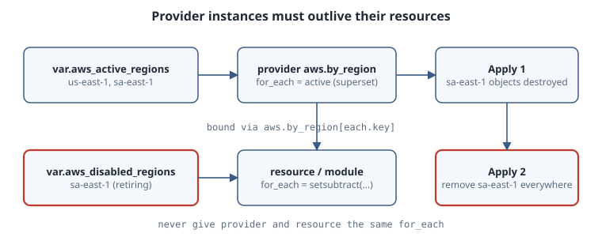

# Provider Instances with for_each and the enabled Meta-Argument

Chapter 6 introduced aliases: a second, hand-written provider block for a second region or account. Chapter 8 used `for_each` to stamp out module instances. This chapter joins the two. Since OpenTofu 1.9 a provider block can itself take `for_each`, so the set of regions becomes data instead of copy-pasted blocks. Since 1.11 the `enabled` meta-argument replaces the `count = var.x ? 1 : 0` trick for "zero or one" resources. Both are on the pinned 1.13.2, and both have one rule you must learn before production: what happens when something is *removed*.

::: {.callout-note}
## What was and was not run

No `tofu` binary was available on the authoring box and the run rules forbid installs, so nothing here was executed. The HCL follows the OpenTofu 1.13 documentation. The warning and error texts are quoted from that documentation, not captured locally. The AWS blocks are sketches; validate them with `tofu validate` before use.
:::

## Learning goals

- Declare many instances of one provider configuration from a map or set
- Bind resources and whole modules to a chosen provider instance
- Retire a region without a "provider instance not present" error
- Use `lifecycle { enabled = ... }` for optional single resources and migrate from `count`

## Static aliases do not scale

With aliases, three regions mean three provider blocks, and every module call is written three times. Adding a region is a code change in several places, and forgetting one is silent. What you want is a variable:

```hcl
variable "aws_regions" {
  type = map(object({
    vpc_cidr_block = string
  }))
}

provider "aws" {
  alias    = "by_region"
  for_each = var.aws_regions
  region   = each.key
}
```

```hcl
# terraform.tfvars
aws_regions = {
  eu-central-2   = { vpc_cidr_block = "10.1.0.0/16" }
  ap-northeast-1 = { vpc_cidr_block = "10.2.0.0/16" }
}
```

The rules for the provider block:

- `for_each` is allowed only together with `alias`. The *default* configuration of a provider must always be exactly one instance, so OpenTofu can pick it automatically.
- The value must be a map, an object, or a set of strings. Map keys (or set elements) become **instance keys**.
- Provider configuration is evaluated before anything is applied, so the collection must be known at plan time: input variables and literals, not attributes of resources created in the same run.

## Selecting an instance

A provider reference is not an ordinary expression. It may appear only in a resource's or data source's `provider` argument, or in a module's `providers` map. With `for_each`, the reference grows an index:

```hcl
resource "aws_vpc" "private" {
  for_each = {
    for region, config in var.aws_regions : region => config
    if config != null
  }
  provider   = aws.by_region[each.key]
  cidr_block = each.value.vpc_cidr_block
}
```

The configuration name (`aws.by_region`) is static so OpenTofu can draw the dependency graph before evaluating anything. Only the key in brackets is dynamic. Consequently every instance of one resource block binds to *the same* provider block, though each may bind to a different instance of it.

### One module instance per region

The more common shape is a whole module per region. The child module uses only its *default* AWS provider and knows nothing about regions:

```hcl
module "per_region" {
  source   = "./per-region"
  for_each = {
    for region, config in var.aws_regions : region => config
    if config != null
  }

  providers = {
    aws = aws.by_region[each.key]
  }

  region_name    = each.key
  vpc_cidr_block = each.value.vpc_cidr_block
}
```

This is the payoff. The child stays simple and reusable, the root decides where it runs, and adding a region is one entry in `terraform.tfvars`.

## The removal rule

OpenTofu uses a resource's provider instance for *every* action on it, including destroying it after it disappears from configuration. So a provider instance must outlive all of its resources by at least one plan/apply round.

If the provider and the resource share the same `for_each` collection, deleting a key removes both at once, and the plan fails:

```text
│ Error: Provider instance not present
│
│ To work with aws_cloudwatch_log_group.lambda_cloudfront["sa-east-1"]
│ its original provider instance at
│ provider["registry.opentofu.org/hashicorp/aws"].by_region["sa-east-1"]
│ is required, but it has been removed.
```

OpenTofu warns you earlier, at the moment you write it, with *"Provider configuration for_each matches resource"*. Treat that warning as a design error. Two patterns avoid it.

**Null means retiring.** The examples above filter out `null` values for the resource but not for the provider. Setting a region's value to `null` keeps its provider instance while the plan destroys its resources. Delete the key on the next round.

**An explicit disabled set.** Clearer to reviewers:

```hcl
variable "aws_active_regions" {
  type    = set(string)
  default = ["us-east-1", "sa-east-1"]
}

variable "aws_disabled_regions" {
  description = "Regions whose resources should be destroyed."
  type        = set(string)
  default     = []
}

provider "aws" {
  alias    = "by_region"
  for_each = var.aws_active_regions # superset
  region   = each.key
}

resource "aws_cloudwatch_log_group" "lambda_cloudfront" {
  for_each = setsubtract(var.aws_active_regions, var.aws_disabled_regions)
  provider = aws.by_region[each.key]
  name     = "/aws/lambda/${each.key}.lambda"
}
```

{fig-alt="Provider for_each superset: the provider block iterates active regions, resources iterate active minus disabled, so a disabled region keeps its provider instance for one more apply while its resources are destroyed"}

Retiring `sa-east-1` is then two reviewed changes: add it to `aws_disabled_regions` and apply (resources destroyed, provider kept), then remove it from both sets and apply again. If you are already stuck with a shared collection, the escape hatch the warning suggests is a targeted destroy first: `tofu apply -destroy -target=...` for the affected addresses, then remove the key.

## `enabled`: zero or one, without `[0]`

The other half of "how many of these" is the optional single resource. The old idiom was:

```hcl
resource "aws_instance" "bastion" {
  count = var.create_bastion ? 1 : 0
  # ...
}

output "bastion_id" {
  value = length(aws_instance.bastion) > 0 ? aws_instance.bastion[0].id : null
}
```

It works, but every reference carries `[0]`, and the address in state is `aws_instance.bastion[0]`. OpenTofu 1.11 added `enabled` inside `lifecycle`:

```hcl
variable "create_bastion" {
  type    = bool
  default = false
}

resource "aws_instance" "bastion" {
  # ...
  lifecycle {
    enabled = var.create_bastion
  }
}

output "bastion_id" {
  value = aws_instance.bastion != null ? aws_instance.bastion.id : null
}
```

When `enabled` is `false`, the resource is not created and the expression `aws_instance.bastion` evaluates to `null`. Reading an attribute of it directly is an error ("Attempt to get attribute from null value"), so guard with a null check or `try()`. The docs note that `try()` is concise but also masks unrelated errors, so prefer the explicit null check in modules other people consume.

`enabled` works on `resource` and `module` blocks (and on ephemeral resources). Its restrictions:

- It cannot be combined with `count` or `for_each` on the same block.
- Its value must be a known, non-null, non-sensitive, non-ephemeral boolean at plan time.

### Migrating from count

Replace `count = var.x ? 1 : 0` with `lifecycle { enabled = var.x }` and drop the `[0]` from references. On the next apply OpenTofu moves the state entry from `aws_instance.bastion[0]` to `aws_instance.bastion` by itself. No `moved` block and no `tofu state mv` are needed. Read the plan anyway: it should show a move, not a destroy and create.

## Choosing the construct

| Need | Use |
|------|-----|
| Optional single resource or module | `lifecycle { enabled = ... }` |
| Several numbered, interchangeable copies | `count` |
| Several named copies | `for_each` |
| Same infrastructure in a dynamic set of regions or accounts | provider `for_each` plus module `for_each`, with a superset provider collection |
| Fixed second region, never changes | a plain alias (chapter 6) |

## Diagnosis

| Symptom | Cause | Fix |
|---------|-------|-----|
| "Provider configuration for_each matches resource" warning | Same collection on provider and resource/module | Give the provider a superset; filter the resource |
| "Provider instance not present" error | Key removed while resources still exist | Re-add the key, retire via null or the disabled set, then remove |
| Error that `for_each` is only valid with `alias` | `for_each` on a default provider block | Add `alias` and pass instances explicitly |
| Provider `for_each` value unknown | Collection derives from a resource attribute | Drive it from variables or literals |
| "Attempt to get attribute from null value" | Reading a disabled resource directly | Null check or `try()` |
| Plan wants to destroy and recreate after switching to `enabled` | Running a version older than 1.11, or `count` still present | Check `tofu version`; remove `count` |

## Operational care

- Keep the region map in one tfvars file per root and review changes to it like code. It now decides where infrastructure exists.
- Each provider instance is a separate plugin configuration, with its own API calls on every plan. Dozens of regions or accounts make plans slower; split roots before that becomes painful.
- Document in module READMEs that the module expects only a default provider, so callers know to pass `aws = aws.by_region[each.key]`.

## Practice

1. Convert a configuration with three hand-written regional aliases to a single `aws.by_region` provider with a map variable and a per-region module.
2. Retire one region using the disabled-set pattern and write down the two plans you expect, before you run them.
3. Find a `count = ... ? 1 : 0` resource in your code base. Migrate it to `enabled` and confirm the plan shows a move.

## Recall card

- Provider `for_each` requires `alias`; keys must be known at plan time.
- Bind with `aws.by_region[each.key]`; the block name is static, the key is dynamic.
- The provider collection must be a superset of its resources' collections. Retire in two applies.
- `lifecycle { enabled = bool }` gives zero-or-one without `[0]`, and migrates from `count` automatically.

## Sources

- OpenTofu, [Provider configuration: `for_each`](https://opentofu.org/docs/language/providers/configuration/)
- OpenTofu, [The `providers` meta-argument: module instances with differing provider instances](https://opentofu.org/docs/language/meta-arguments/module-providers/)
- OpenTofu, [The `enabled` meta-argument](https://opentofu.org/docs/language/meta-arguments/enabled/)
