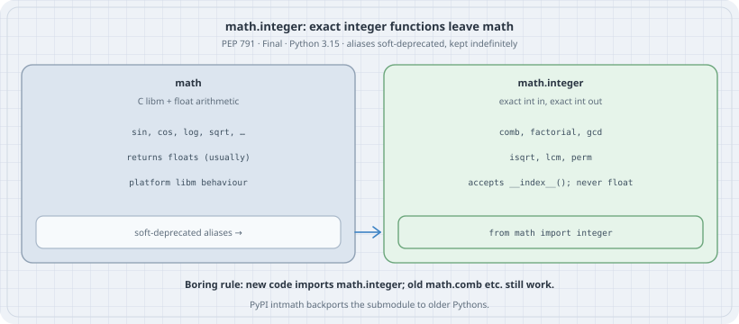

# `math.integer` (PEP 791): Exact Integer Functions Leave `math`

## Thesis

For years the `math` docs opened with "access to the mathematical functions defined by the C standard" and "except when explicitly noted otherwise, all return values are floats." Neither sentence survived contact with `math.comb`, `math.factorial`, `math.gcd`, `math.isqrt`, `math.lcm` and `math.perm`. Those six functions take integers (or `__index__` objects), return exact integers, and have nothing to do with `libm`. [PEP 791](https://peps.python.org/pep-0791/) (Final, Python 3.15) moves them into a new submodule, `math.integer`, and leaves soft-deprecated aliases on `math`. New code imports the submodule. Old code keeps working. That is the whole change, and it is the right place to put the next integer function too.

Version note: every listing was run on **CPython 3.15.0**. `import math.integer` raises `ModuleNotFoundError` on 3.14.8.

## Mental model

{fig-alt="Left: the math module holds C libm and float arithmetic such as sin, cos, log, sqrt, usually returning floats with platform libm behaviour, and still exposes soft-deprecated aliases. Right: math.integer holds comb, factorial, gcd, isqrt, lcm, perm: exact int in, exact int out, accepts __index__, never float. Arrow from the aliases to math.integer. Boring rule: new code imports math.integer; PyPI intmath backports the submodule."}

| Question | Answer |
|----------|--------|
| What moved? | `comb`, `factorial`, `gcd`, `isqrt`, `lcm`, `perm` |
| Are the `math.*` names gone? | No. Soft-deprecated aliases, kept indefinitely, same objects |
| What do they accept? | `int` and anything with `__index__()` — not `float` |
| What do they return? | Exact integers |
| Older Pythons? | The [`intmath`](https://pypi.org/project/intmath/) package on PyPI backports the submodule |

## Worked examples

### Case 1: The tour

```python
# mathint_tour.py
import math
import math.integer as mi
import sys
import warnings

print(sys.version.split()[0])
print("math.integer functions:", sorted(x for x in dir(mi) if not x.startswith("_")))
print()
print("aliases are the same objects:")
for name in ("comb", "factorial", "gcd", "isqrt", "lcm", "perm"):
    print(f"  math.{name} is math.integer.{name}: {getattr(math, name) is getattr(mi, name)}")

print()
print("exact integer results:")
print(f"  comb(100, 50) = {mi.comb(100, 50)}")
print(f"  factorial(20) = {mi.factorial(20)}")
print(f"  isqrt(10**40) = {mi.isqrt(10**40)}")
print(f"  ceiling isqrt for n=10 via 1+isqrt(n-1) = {1 + mi.isqrt(10 - 1)}")
print(f"  gcd(48, 18, 30) = {mi.gcd(48, 18, 30)}")
print(f"  lcm(4, 6, 8) = {mi.lcm(4, 6, 8)}")
print(f"  perm(10, 3) = {mi.perm(10, 3)};  perm(10) = {mi.perm(10)}")

class Idx:
    def __index__(self):
        return 7

print()
print(f"accepts __index__: factorial(Idx()) = {mi.factorial(Idx())}")

print()
print("rejects floats (not __index__):")
for label, call in [
    ("comb(5.0, 2)", lambda: mi.comb(5.0, 2)),
    ("factorial(5.0)", lambda: mi.factorial(5.0)),
    ("isqrt(5.0)", lambda: mi.isqrt(5.0)),
]:
    try:
        call()
    except TypeError as e:
        print(f"  {label}: TypeError: {e}")

print()
print("rejects negatives where required:")
for label, call in [
    ("factorial(-1)", lambda: mi.factorial(-1)),
    ("isqrt(-1)", lambda: mi.isqrt(-1)),
    ("comb(5, -1)", lambda: mi.comb(5, -1)),
]:
    try:
        call()
    except ValueError as e:
        print(f"  {label}: ValueError: {e}")

print()
with warnings.catch_warnings(record=True) as w:
    warnings.simplefilter("always")
    _ = math.comb(5, 2)
    print(f"warnings from math.comb(5, 2) under catch_warnings: {len(w)}")
```

```bash
python3.15 mathint_tour.py
```

Output:

```text
3.15.0
math.integer functions: ['comb', 'factorial', 'gcd', 'isqrt', 'lcm', 'perm']

aliases are the same objects:
  math.comb is math.integer.comb: True
  math.factorial is math.integer.factorial: True
  math.gcd is math.integer.gcd: True
  math.isqrt is math.integer.isqrt: True
  math.lcm is math.integer.lcm: True
  math.perm is math.integer.perm: True

exact integer results:
  comb(100, 50) = 100891344545564193334812497256
  factorial(20) = 2432902008176640000
  isqrt(10**40) = 100000000000000000000
  ceiling isqrt for n=10 via 1+isqrt(n-1) = 4
  gcd(48, 18, 30) = 6
  lcm(4, 6, 8) = 24
  perm(10, 3) = 720;  perm(10) = 3628800

accepts __index__: factorial(Idx()) = 5040

rejects floats (not __index__):
  comb(5.0, 2): TypeError: 'float' object cannot be interpreted as an integer
  factorial(5.0): TypeError: 'float' object cannot be interpreted as an integer
  isqrt(5.0): TypeError: 'float' object cannot be interpreted as an integer

rejects negatives where required:
  factorial(-1): ValueError: factorial() not defined for negative values
  isqrt(-1): ValueError: isqrt() argument must be nonnegative
  comb(5, -1): ValueError: k must be a non-negative integer

warnings from math.comb(5, 2) under catch_warnings: 0
```

Three facts from that run:

1. **The aliases are the same objects.** `math.comb is math.integer.comb` is `True` for all six names. `help(math.comb)` already says `built-in function comb in module math.integer`. Soft deprecation here means "prefer the new home in new code", not "a `DeprecationWarning` fires today" — zero warnings under `catch_warnings`.
2. **Results are exact.** `comb(100, 50)` is the full 30-digit integer, not a float approximation. That is the contrast the PEP draws with `scipy.special.factorial`, which returns a float by default.
3. **The contract is `__index__`, not "number-like".** An object with `__index__` works; a `float` is rejected with `TypeError: 'float' object cannot be interpreted as an integer`. Negatives that are out of domain raise `ValueError`.

### Case 2: Where to put new code

```python
# mathint_import.py
import sys

try:
    from math import integer as mi          # 3.15+
except ImportError:                         # 3.14 and earlier
    import intmath as mi                    # pip install intmath

print(sys.version.split()[0], "→", mi.comb(10, 3), mi.isqrt(99))
```

```bash
python3.15 mathint_import.py
python3.14 -c "import math.integer" 2>&1 | tail -1
```

Output:

```text
3.15.0 → 120 9
ModuleNotFoundError: No module named 'math.integer'; 'math' is not a package
```

On 3.15, `math` becomes a package (a built-in package exposing the `integer` submodule). On 3.14 it is still a plain built-in module, so `import math.integer` fails. Libraries that want one source tree for 3.14 and 3.15 should use the try/except above, or depend on `intmath` which re-exports the same names.

### Case 3: Why the split helps

The six functions share a contract that `math.sin` does not: exact integer in, exact integer out, no `libm`. Putting them under `math.integer` means:

- The `math` docs can honestly say "float functions, C standard" again.
- Tab completion on `math.integer.` lists only the integer API.
- Future additions the PEP floated (`c_div` / `n_div` for ceiling and nearest integer division, `gcdext`, `isqrt_rem`, `ilog`, `fibonacci`) have a home that does not collide with float names like `math.ceil`.

None of those extensions shipped in 3.15.0. The submodule's job in this release is the move and the contract.

## The trap

**Importing `math.integer` and then calling `math.comb` anyway.** Soft deprecation does not warn. A codebase can "migrate" by adding the import and never changing a call site. Grep for `math\.(comb|factorial|gcd|isqrt|lcm|perm)\b` in new modules, or make the try/except import the only binding you use (`mi.comb`, not `math.comb`).

**Assuming `isqrt` is rounding.** `isqrt(n)` is $\lfloor\sqrt{n}\rfloor$. The docs give the ceiling form for positive `n`: `1 + isqrt(n - 1)`. Case 1 prints `4` for $n=10$, which is $\lceil\sqrt{10}\rceil$. Off-by-one bugs here show up in block-size and page-size calculations.

## The boring rule

1. On 3.15+, write `from math import integer` (or `import math.integer as mi`) for combinatorial and number-theoretic helpers.
2. Treat `math.comb` and friends as compatibility aliases. Do not use them in new code.
3. Pass integers or `__index__` objects. Do not pass floats and do not cast with `int(x)` unless you mean to truncate.
4. For 3.14 support, depend on PyPI `intmath` or gate the import.
5. Prefer this submodule over rolling your own binomial coefficient that overflows a float at `comb(100, 50)`.

## Try this

1. Time `mi.factorial(n)` against a pure-Python loop for $n$ up to a few thousand. Where does the C implementation pull away?
2. Implement ceiling division as discussed in the PEP's motivation (`-(-a // b)` vs `(a + b - 1) // b` for positive operands) and list the sign cases that go wrong. That is why the PEP wants `c_div` in this submodule later.
3. Write a tiny `binomial_row(n)` that builds row $n$ of Pascal's triangle with `mi.comb`. Check `sum(binomial_row(n)) == 2**n`.
4. On a 3.14 interpreter, `pip install intmath` and confirm the try/except import from Case 2 returns the same `comb(10, 3)`.

## Sources

- [PEP 791 — math.integer](https://peps.python.org/pep-0791/) (Final; Python 3.15; Serhiy Storchaka et al.; soft-deprecated aliases, no breaking change)
- [`math.integer` — integer-specific mathematics functions](https://docs.python.org/3.15/library/math.integer.html) (3.15 documentation)
- [What's New in Python 3.15: New modules — math.integer](https://docs.python.org/3.15/whatsnew/3.15.html) (gh-81313)
- [`intmath` on PyPI](https://pypi.org/project/intmath/) (backport for older Pythons)
