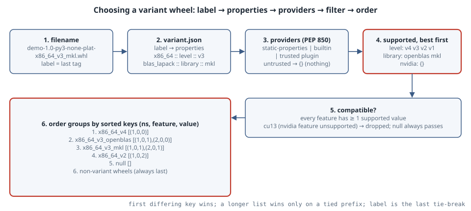

# Wheel Variants (PEP 825 and PEP 850): Labels, variant.json, Providers and the Selection Order

## Thesis

Platform tags (`cp313`, `manylinux_2_28_x86_64`) describe the interpreter, ABI and OS a wheel needs. They cannot say "built for AVX-512", "built against CUDA 13" or "linked to MKL rather than OpenBLAS". That is why projects such as PyTorch run their own per-CUDA indexes, and why projects with compiled code either target a conservative CPU baseline or carry their own runtime dispatch. **Wheel variants** fill that gap in two layers.

- **PEP 825** (Provisional) is the format. A wheel filename may end in a **variant label**. The label indexes a `variant.json` file that maps it to **properties** written `namespace :: feature :: value`. PEP 825 also defines an exact algorithm that ranks the compatible variants.
- **PEP 825 does not say how an installer learns what the machine supports. PEP 850** (Draft) covers that. Each namespace is governed by a **provider**: a static list, a builtin, or a plugin package. A plugin package is never installed or run unless it is trusted or the user opts in.

This chapter builds a small installer front end with nothing but the standard library. It reads the machine's x86-64 level from `/proc/cpuinfo`, filters a mock index and ranks it the way both PEPs specify. Read the ordering rule carefully. It is lexicographic over sort keys, so "more properties" does **not** mean "more preferred". Version note: both PEPs are still under discussion (PEP 825 was created 17 February 2026, PEP 850 on 15 October 2026). Field names may change before the PEPs are final, and no released pip can install variant wheels yet.

## Mental model

{fig-alt="Six boxes. 1, filename: demo-1.0-py3-none-plat-x86_64_v3_mkl.whl, where the label is the last tag. 2, variant.json maps the label to properties x86_64 :: level :: v3 and blas_lapack :: library :: mkl. 3, providers from PEP 850: static-properties, builtin or a trusted plugin; an untrusted provider yields nothing. 4, highlighted, the supported values best first: level v4 v3 v2 v1, library openblas mkl, nvidia empty. 5, compatible if every feature has at least one supported value: cu13 is dropped because its nvidia feature is unsupported, and null always passes. 6, highlighted, the groups ordered by sorted keys: x86_64_v4 with key (1,0,0); x86_64_v3_openblas with (1,0,1),(2,0,0); x86_64_v3_mkl with (1,0,1),(2,0,1); x86_64_v2 with (1,0,2); then null; then non-variant wheels. Footer: the first differing key wins, a longer list wins only on a tied prefix, and the label is the last tie-break."}

Five rules carry the whole design.

1. **The filename.** The PEP 825 filename is `{dist}-{ver}(-{build})?-{py}-{abi}-{plat}(-{label})?.whl`. Labels match `^[0-9a-z_.]+$`. A six-part name is ambiguous: it has either a build tag or a label. PEP 825 settles this with the existing rule that a build tag starts with a digit and adds that the Python tag **MUST NOT** start with a digit. The label `null` is reserved for the **null variant**, a wheel with zero properties. It is the fallback a variant-aware installer picks when nothing better fits.
2. **`variant.json`.** A file at `*.dist-info/variant.json` has three keys. `default-priorities.namespace` orders the namespaces. `variants` maps label → namespace → feature → a lexically sorted list of values. `providers` (added by PEP 850) says how each namespace is answered. An index may also serve a `{name}-{version}-variants.json` file that combines the metadata of all of that release's wheels. Tools SHOULD prefer it, because it lets an installer rank variants before downloading any wheel.
3. **The providers' answer.** For every namespace, the installer gets an *ordered* list of supported values for each feature, most preferred first. PEP 850 fixes the order of checks:
   - a user override
   - `optional` (disabled by default)
   - `builtin`
   - `static-properties`
   - a trusted implementation of the plugin named by `requires` / `plugin-api`
   - otherwise only explicitly trusted, installed plugins.

   **An untrusted provider counts as "no compatible features".** It is never installed silently.
4. **Compatibility.** A variant is compatible if **every feature** it names has **at least one** supported value. A property list is an AND over features and an OR over the values of one feature. The null variant is always compatible.
5. **Ordering.** Each property gets a key (namespace index, feature index, value index), using the best supported value of each feature. Each variant's keys are sorted, and variants are compared lexicographically:
   - The first differing key wins.
   - If one list is a prefix of the other, the longer list wins.
   - If the lists are identical, the label decides.

   The null variant has an empty list, so it lands after every compatible variant. **Non-variant wheels go after all variant groups.** Inside a group, the usual tag and build-number ordering still applies.

## Worked example

The script below is a toy installer front end. It has no network and no real wheels: the index is eight filenames plus index-level `variant.json`. The `x86_64` provider is a local reimplementation of a plugin's `get_supported_configs()`, which is what PEP 850 calls a trusted reimplementation. It derives the x86-64 micro-architecture level (psABI v2/v3/v4) from the CPU flags Linux reports. The `nvidia` namespace names a plugin package the tool does not trust, and `blas_lapack` uses `static-properties`.

```{.python filename="variants.py"}
"""A toy installer front end for wheel variants (PEP 825 format + PEP 850 providers).

No network and no real wheels: the "index" is a list of filenames plus the
index-level variant metadata. The x86_64 provider is a local reimplementation
that reads /proc/cpuinfo, which is what PEP 850 calls a trusted reimplementation.
"""
import re
from dataclasses import dataclass

LABEL_RE = re.compile(r"^[0-9a-z_.]+$")
NAME_RE = re.compile(r"^[a-z0-9_]+$")
VALUE_RE = re.compile(r"^[a-z0-9_.]+$")

def parse_wheel(fn: str):
    """Split a wheel filename; return (dist, version, build, py, abi, plat, label)."""
    parts = fn.removesuffix(".whl").split("-")
    if len(parts) == 5:
        return (*parts[:2], None, *parts[2:], None)
    if len(parts) == 6:
        # PEP 825: the Python tag MUST NOT start with a digit, a build tag MUST.
        if parts[2][0].isdigit():
            return (*parts[:3], *parts[3:], None)
        label = parts[5]
        return (*parts[:2], None, *parts[2:5], label)
    if len(parts) == 7:
        return tuple(parts)
    raise ValueError(f"not a wheel filename: {fn}")

# ---- providers (PEP 850) ----------------------------------------------------
@dataclass
class VariantFeatureConfig:
    name: str
    values: list[str]
    multi_value: bool

LEVELS = {  # x86-64 psABI micro-architecture levels, as Linux /proc/cpuinfo flag names
    "v2": {"cx16", "lahf_lm", "popcnt", "pni", "sse4_1", "sse4_2", "ssse3"},
    "v3": {"avx", "avx2", "bmi1", "bmi2", "f16c", "fma", "abm", "movbe", "xsave"},
    "v4": {"avx512f", "avx512bw", "avx512cd", "avx512dq", "avx512vl"},
}

def x86_64_get_supported_configs() -> list[VariantFeatureConfig]:
    flags = set()
    for line in open("/proc/cpuinfo"):
        if line.startswith("flags"):
            flags = set(line.split(":", 1)[1].split())
            break
    ok = ["v1"]
    for lvl in ("v2", "v3", "v4"):
        if LEVELS[lvl] <= flags:
            ok.append(lvl)
        else:
            break
    return [VariantFeatureConfig("level", ok[::-1], multi_value=False)]  # best first

TRUSTED_PLUGINS = {"provider_variant_x86_64": x86_64_get_supported_configs}

def supported(namespace: str, info: dict) -> dict[str, list[str]]:
    """PEP 850's provider algorithm, steps 2-7 (no user override in step 1)."""
    if info.get("optional", False):
        return {}                                            # step 2: disabled by default
    if "builtin" in info:
        return {}                                            # step 3: we know no builtins
    if "static-properties" in info:                          # step 4
        sp = info["static-properties"]
        order = info.get("feature-order", list(sp))
        return {f: sp[f] for f in order}
    api = info.get("plugin-api") or re.split(r"[ ;<>=!~\[]", info["requires"][0])[0].lower().replace("-", "_")
    plugin = TRUSTED_PLUGINS.get(api)                        # step 5: trusted reimplementation?
    if plugin is None:
        return {}                                            # steps 6-7: untrusted -> nothing compatible
    return {c.name: c.values for c in plugin()}

# ---- the index ----------------------------------------------------------------
INDEX_FILES = [
    "demo-1.0-py3-none-manylinux_2_28_x86_64-x86_64_v4.whl",
    "demo-1.0-py3-none-manylinux_2_28_x86_64-x86_64_v3_openblas.whl",
    "demo-1.0-py3-none-manylinux_2_28_x86_64-x86_64_v3_mkl.whl",
    "demo-1.0-py3-none-manylinux_2_28_x86_64-x86_64_v2.whl",
    "demo-1.0-py3-none-manylinux_2_28_x86_64-cu13.whl",
    "demo-1.0-py3-none-manylinux_2_28_x86_64-null.whl",
    "demo-1.0-py3-none-manylinux_2_28_x86_64.whl",
    "demo-1.0-1-py3-none-manylinux_2_28_x86_64.whl",
]
VARIANTS_JSON = {  # the index-level metadata (combined variant.json of all wheels)
    "default-priorities": {"namespace": ["nvidia", "x86_64", "blas_lapack"]},
    "providers": {
        "nvidia": {"requires": ["nvidia-variant-provider >=0.1"]},
        "x86_64": {"requires": ["provider-variant-x86-64 >=0.0.1"]},
        "blas_lapack": {"static-properties": {"library": ["openblas", "mkl"]}},
    },
    "variants": {
        "x86_64_v4": {"x86_64": {"level": ["v4"]}},
        "x86_64_v3_openblas": {"x86_64": {"level": ["v3"]}, "blas_lapack": {"library": ["openblas"]}},
        "x86_64_v3_mkl": {"x86_64": {"level": ["v3"]}, "blas_lapack": {"library": ["mkl"]}},
        "x86_64_v2": {"x86_64": {"level": ["v2"]}},
        "cu13": {"nvidia": {"cuda_version_lower_bound": ["13.0"]}, "x86_64": {"level": ["v2"]}},
        "null": {},
    },
}

# ---- validation (PEP 825) -----------------------------------------------------
for label, props in VARIANTS_JSON["variants"].items():
    assert LABEL_RE.match(label), label
    for ns, feats in props.items():
        assert NAME_RE.match(ns) and ns in VARIANTS_JSON["default-priorities"]["namespace"]
        for f, vals in feats.items():
            assert NAME_RE.match(f) and all(VALUE_RE.match(v) for v in vals)
            assert vals == sorted(vals), "feature values are stored sorted lexically"

# ---- what this machine supports ------------------------------------------------
namespace_order = VARIANTS_JSON["default-priorities"]["namespace"]
sup = {ns: supported(ns, VARIANTS_JSON["providers"][ns]) for ns in namespace_order}
print("supported properties on this machine:")
for ns in namespace_order:
    print(f"  {ns:12} {sup[ns] or '{}  (no compatible features)'}")

feature_order = {ns: list(sup[ns]) for ns in namespace_order}
value_order = sup

def compatible(props) -> bool:
    """Every feature needs at least one value the system supports; null always passes."""
    return all(any(v in sup[ns].get(f, []) for v in vals)
               for ns, feats in props.items() for f, vals in feats.items())

def property_key(p):
    ns, f, v = p
    return (namespace_order.index(ns), feature_order[ns].index(f), value_order[ns][f].index(v))

def sorted_best(props):
    best = [(ns, f, next(v for v in value_order[ns][f] if v in vals))
            for ns, feats in props.items() for f, vals in feats.items()]
    return sorted(best, key=property_key)

class Group:
    def __init__(self, label, props):
        self.label, self.props = label, sorted_best(props)
    def __lt__(self, other):  # PEP 825 step 7
        for a, b in zip(self.props, other.props):
            if a != b:
                return property_key(a) < property_key(b)
        if len(self.props) != len(other.props):
            return len(self.props) > len(other.props)
        return self.label < other.label

print("\nwheels on the index:")
groups, non_variant = {}, []
for fn in INDEX_FILES:
    *_, build, py, abi, plat, label = parse_wheel(fn)
    if label is None:
        non_variant.append(fn)
        print(f"  {fn:62} non-variant" + (f" (build tag {build})" if build else ""))
        continue
    props = VARIANTS_JSON["variants"][label]
    ok = compatible(props)
    print(f"  {fn:62} label={label:18} {'compatible' if ok else 'INCOMPATIBLE'}")
    if ok:
        groups.setdefault(label, []).append(fn)

order = sorted(Group(l, VARIANTS_JSON["variants"][l]) for l in groups)
print("\npreference order (best first):")
for k, g in enumerate(order, 1):
    keys = [property_key(p) for p in g.props]
    print(f"  {k}. {g.label:18} best props {[' :: '.join(p) for p in g.props]}  keys {keys}")
print(f"  {len(order) + 1}. non-variant group: {non_variant}")
print("\nselected:", groups[order[0].label][0])
```

Output on an 8-core x86-64 Linux box (CPython 3.13.5), verbatim:

```text
supported properties on this machine:
  nvidia       {}  (no compatible features)
  x86_64       {'level': ['v4', 'v3', 'v2', 'v1']}
  blas_lapack  {'library': ['openblas', 'mkl']}

wheels on the index:
  demo-1.0-py3-none-manylinux_2_28_x86_64-x86_64_v4.whl          label=x86_64_v4          compatible
  demo-1.0-py3-none-manylinux_2_28_x86_64-x86_64_v3_openblas.whl label=x86_64_v3_openblas compatible
  demo-1.0-py3-none-manylinux_2_28_x86_64-x86_64_v3_mkl.whl      label=x86_64_v3_mkl      compatible
  demo-1.0-py3-none-manylinux_2_28_x86_64-x86_64_v2.whl          label=x86_64_v2          compatible
  demo-1.0-py3-none-manylinux_2_28_x86_64-cu13.whl               label=cu13               INCOMPATIBLE
  demo-1.0-py3-none-manylinux_2_28_x86_64-null.whl               label=null               compatible
  demo-1.0-py3-none-manylinux_2_28_x86_64.whl                    non-variant
  demo-1.0-1-py3-none-manylinux_2_28_x86_64.whl                  non-variant (build tag 1)

preference order (best first):
  1. x86_64_v4          best props ['x86_64 :: level :: v4']  keys [(1, 0, 0)]
  2. x86_64_v3_openblas best props ['x86_64 :: level :: v3', 'blas_lapack :: library :: openblas']  keys [(1, 0, 1), (2, 0, 0)]
  3. x86_64_v3_mkl      best props ['x86_64 :: level :: v3', 'blas_lapack :: library :: mkl']  keys [(1, 0, 1), (2, 0, 1)]
  4. x86_64_v2          best props ['x86_64 :: level :: v2']  keys [(1, 0, 2)]
  5. null               best props []  keys []
  6. non-variant group: ['demo-1.0-py3-none-manylinux_2_28_x86_64.whl', 'demo-1.0-1-py3-none-manylinux_2_28_x86_64.whl']

selected: demo-1.0-py3-none-manylinux_2_28_x86_64-x86_64_v4.whl
```

As a cross-check, glibc's dynamic loader agrees on the CPU level. `/lib64/ld-linux-x86-64.so.2 --help` on the same machine prints `x86-64-v4 (supported, searched)`, `x86-64-v3 (supported, searched)` and `x86-64-v2 (supported, searched)`.

### Reading it

- **The provider answers.**
  - `x86_64` came from the trusted reimplementation. It reports `['v4', 'v3', 'v2', 'v1']`, best first, as PEP 850 requires of `get_supported_configs()`.
  - `blas_lapack` came straight from `static-properties`. This is PEP 850's case for non-platform variants: every variant that was built is installable, and the list order is just the default preference.
  - `nvidia` names `nvidia-variant-provider` under `requires`. The tool has no trusted implementation and the user did not opt in, so step 7 applies: **assume nothing is compatible**. The installer did not fetch or run anything.
- **Compatibility.**
  - `cu13` needs `nvidia :: cuda_version_lower_bound`, which is unsupported, so the whole variant is out. Its `x86_64 :: level :: v2` property would have matched, but every feature must match.
  - `null` has no features, so it passes.
- **The two six-part names.** `demo-1.0-py3-none-manylinux_2_28_x86_64-null.whl` and `demo-1.0-1-py3-none-manylinux_2_28_x86_64.whl` both have six dash-separated parts. The parser separates them with one test: a build tag starts with a digit, and the Python tag cannot. Without that new constraint in PEP 825, the parse would be ambiguous.
- **The ordering.** The namespace order `["nvidia", "x86_64", "blas_lapack"]` gives `x86_64` index 1 and `blas_lapack` index 2.
  - `x86_64_v4` → `[(1,0,0)]` beats `x86_64_v3_openblas` → `[(1,0,1),(2,0,0)]` on the **first** key. Having two properties does not help, because the CPU level is the more important namespace.
  - The two v3 builds tie on `(1,0,1)`. The second key decides: openblas `(2,0,0)` comes before mkl `(2,0,1)`, because the static list puts openblas first.
  - `x86_64_v2` follows. `null` (an empty list) comes after every compatible variant, and both non-variant wheels come last.
- **The prefix rule.** It matters for a pair like `x86_64_v3` against `x86_64_v3_openblas`: the keys are `[(1,0,1)]` against `[(1,0,1),(2,0,0)]`. The prefix ties, so the longer list wins. A more specific build beats a less specific one only when they agree on everything the shorter one says.

## Pitfalls

- **Treating more properties as better.** Comparison is lexicographic on sorted keys, so one property in a high-priority namespace beats any number in lower ones. If you want BLAS choice to dominate CPU level, put `blas_lapack` first in `default-priorities.namespace`, or override it in the installer (PEP 825 allows tools to do that).
- **Expecting an unknown plugin to just work.** Under PEP 850, a namespace whose plugin is untrusted yields *no* compatible features, so every variant that uses it is skipped. That is the security design, not a bug. Ship a `null` variant or a non-variant wheel so these users still get something. Otherwise the resolver falls back to an older release or the sdist.
- **Forgetting the AND.** A variant with properties in two namespaces needs both to be supported. Adding a CPU-level property to a GPU build (`cu13` above) narrows it. It does not widen it.
- **Unsorted or uppercase values.** Values in `variants` are sets, stored as lexically sorted lists. Names match `^[a-z0-9_]+$` and values match `^[a-z0-9_.]+$`. The script asserts both, so `"V3"` or `["v3", "v2"]` would fail validation.
- **Simplified CPU detection.** The flag sets in `LEVELS` follow the x86-64 psABI level definitions using Linux flag names (`pni` is SSE3, `abm` covers LZCNT). A real provider also checks OS support for the wider register state (OSXSAVE/XGETBV), and handles macOS, Windows and virtual machines that hide flags. Use a maintained provider, not this toy.
- **Assuming installers support this today.** Both PEPs are under discussion, and the `$schema` URL and field names may still change. Treat `variant.json` produced by experimental tooling as unstable.

## Try this

1. Reorder `default-priorities.namespace` to `["nvidia", "blas_lapack", "x86_64"]` and re-run. Predict the new top choice before you look (hint: `x86_64_v3_openblas` now has the key `(1,0,0)`).
2. Add a variant `x86_64_v3` with only `{"x86_64": {"level": ["v3"]}}`, and add its wheel `demo-1.0-py3-none-manylinux_2_28_x86_64-x86_64_v3.whl` to `INDEX_FILES` (the script only ranks labels that have a wheel). Confirm that it sorts *after* both v3 BLAS variants (prefix rule) and *before* `x86_64_v2`.
3. Make `nvidia` trusted by adding a fake plugin to `TRUSTED_PLUGINS` that returns `cuda_version_lower_bound = ["13.0", "12.8"]`. Now `cu13` is compatible. Where does it land, and why does the `nvidia` namespace's index 0 put it first?
4. Mark `blas_lapack` `"optional": true` and explain why both v3 BLAS builds disappear while `x86_64_v4` is unaffected.

## Sources

- [PEP 825: Wheel Variants: Package Format](https://peps.python.org/pep-0825/). Covers the filename and label rules, the `variant.json` structure, the compatibility rule and the ordering algorithm (steps 1–7 with reference pseudocode).
- [PEP 850: Wheel Variants: Providers](https://peps.python.org/pep-0850/). Covers the provider resolution steps, the `providers` keys (`requires`, `plugin-api`, `static-properties`, `feature-order`, `builtin`, `optional`), the plugin API `get_supported_configs()` and the trust model. [Discussion thread](https://discuss.python.org/t/pep-850-wheel-variants-providers/109568).
- [Binary distribution format (wheel) specification](https://packaging.python.org/en/latest/specifications/binary-distribution-format/). Covers the existing filename convention and build-tag rule.
- [Platform compatibility tags](https://packaging.python.org/en/latest/specifications/platform-compatibility-tags/). Explains what tags can and cannot express.
- [x86-64 psABI](https://gitlab.com/x86-psABIs/x86-64-ABI). Gives the definitions of the x86-64-v2/v3/v4 micro-architecture levels.
- [glibc 2.33 NEWS](https://sourceware.org/git/?p=glibc.git;a=blob_plain;f=NEWS;hb=refs/tags/glibc-2.33). Introduces the glibc-hwcaps subdirectories `x86-64-v2`/`v3`/`v4` and the dynamic linker's `--help` option used for the cross-check.

Inspiration: [Pycoder's Weekly on PEP 850](https://x.com/pycoders/status/2115150040201109821).
