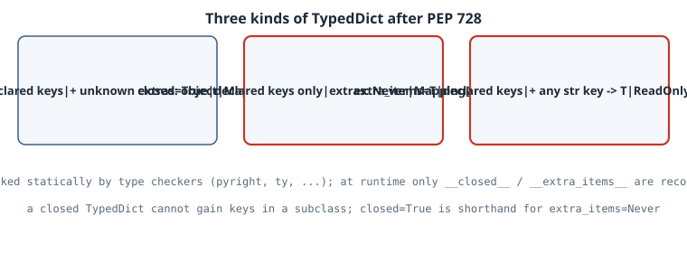

# Closed TypedDicts and Typed Extra Items (PEP 728)

## Thesis

Before Python 3.15, a `TypedDict` described the keys you *listed* and said nothing about the rest. A value of type `Movie` might hold any number of other keys of any type. That made two common shapes impossible to type:

- "exactly these keys and nothing else", such as a strict API payload;
- "these keys, plus any number of extras whose values are all `int`", such as a scores record.

**PEP 728** (Final, Python 3.15) adds two class parameters to fix this. `closed=True` forbids extra keys. `extra_items=T` allows extra keys, but only with values of type `T`, optionally `ReadOnly[T]`. Checkers can then do things they couldn't before: treat a `TypedDict` as a precise `Mapping[str, V]`, reject stray keys, and forbid subclasses from adding keys. This chapter runs one file through Python 3.15 and pyright to show each rule, then shows how mypy's support differs.

## Mental model

{fig-alt="Three boxes. Open TypedDict: declared keys plus unknown extra keys of any type, so it is only a Mapping of str to object. Closed TypedDict with closed=True: declared keys only, extras are Never, so it is a Mapping of str to the union of declared value types. extra_items=T: declared keys plus any number of extra str keys whose values are T; extra keys are never required and can be deleted unless ReadOnly."}

- **Open (the default).** Per the PEP, an open TypedDict behaves as if it had non-required extra items of type `ReadOnly[object]`. So the most a checker can say is `Mapping[str, object]`.
- **`closed=True`.** This is equivalent to `extra_items=Never`: no value is assignable to `Never`, so no extra key can exist. The value types are then known exactly, which makes the TypedDict a `Mapping[str, V1 | V2 | ...]`.
- **`extra_items=T`.** Any other `str` key maps to `T`. Extra keys are never *required*, so `del d["k"]` on an extra key is allowed. Wrapping `T` in `ReadOnly[...]` (PEP 705) forbids writing extras.
- **Inheritance.** A subclass of a closed TypedDict can't add keys. A subclass with `extra_items=T` can add only keys whose type is compatible with `T`.
- **Runtime.** Nothing is validated. The class records `__closed__` and `__extra_items__` for introspection. Passing both `closed` and `extra_items` is a runtime error.

## Worked example

Every line commented `ERROR` should be rejected by a checker that implements PEP 728, and every line marked `ok` should be accepted.

```python
"""PEP 728 (Python 3.15): closed TypedDicts and typed extra items."""
from collections.abc import Mapping
from typing import NotRequired, ReadOnly, TypedDict


class Movie(TypedDict):                       # open (the pre-3.15 default)
    name: str


class ClosedMovie(TypedDict, closed=True):    # no keys beyond the declared ones
    name: str
    year: NotRequired[int]


class Scores(TypedDict, extra_items=int):     # any other str key must map to int
    player: str


class Labels(TypedDict, extra_items=ReadOnly[str]):   # extras are read-only
    id: str


def check_static() -> None:
    a: ClosedMovie = {"name": "Alien", "director": "Scott"}   # ERROR: closed
    b: Scores = {"player": "ana", "round1": 3, "round2": 5}   # ok: extras are int
    c: Scores = {"player": "ana", "round1": "three"}          # ERROR: extra not int
    b["bonus"] = 2                                            # ok
    b["note"] = "late"                                        # ERROR
    lab: Labels = {"id": "x", "color": "red"}
    lab["color"] = "blue"                                     # ERROR: read-only extra
    del b["round1"]                                           # ok: extras are not required


def total(m: Mapping[str, int]) -> int:
    return sum(m.values())


class IntOnly(TypedDict, extra_items=int):
    base: int


def check_mapping(s: Scores, i: IntOnly, cm: ClosedMovie, mv: Movie) -> None:
    total(i)          # ok: every value (declared and extra) is int
    total(s)          # ERROR: "player" is str
    m1: Mapping[str, str | int] = cm     # ok: closed, so values are str | int
    m2: Mapping[str, str | int] = mv     # ERROR: open TypedDict could hold anything


class MoreMovie(ClosedMovie):
    rating: float     # ERROR: a closed TypedDict cannot gain new keys in a subclass


if __name__ == "__main__":
    # Runtime: the flags are introspectable, but nothing is validated.
    for td in (Movie, ClosedMovie, Scores, Labels):
        print(f"{td.__name__:12s} __closed__={td.__closed__!s:5s} "
              f"__extra_items__={td.__extra_items__}")
    bad: Scores = {"player": "ana", "round1": "three"}    # type: ignore[typeddict-item]
    print("runtime accepts a wrong extra:", bad)
```

Running it under CPython 3.15.0:

```text
$ python3.15 extra_items.py
Movie        __closed__=None  __extra_items__=NoExtraItems
ClosedMovie  __closed__=True  __extra_items__=NoExtraItems
Scores       __closed__=None  __extra_items__=<class 'int'>
Labels       __closed__=None  __extra_items__=typing.ReadOnly[str]
runtime accepts a wrong extra: {'player': 'ana', 'round1': 'three'}
```

Checking it with pyright 1.1.414 (`--pythonversion 3.15`):

```text
$ pyright --pythonversion 3.15 extra_items.py
extra_items.py
  extra_items.py:24:40 - error: Type "dict[str, str]" is not assignable to declared type "ClosedMovie"
    Type "Literal['Scott']" is not assignable to item "extra_items"
      Type "Literal['Scott']" is not assignable to type "Never" (reportAssignmentType)
  extra_items.py:26:45 - error: Type "dict[str, str]" is not assignable to declared type "Scores"
    "Literal['three']" is not assignable to "int" (reportAssignmentType)
  extra_items.py:28:5 - error: Could not assign item in TypedDict
    "Literal['late']" is not assignable to "int" (reportGeneralTypeIssues)
  extra_items.py:30:5 - error: Could not assign item in TypedDict
    "color" is a read-only key in "Labels" (reportTypedDictNotRequiredAccess)
  extra_items.py:44:11 - error: Argument of type "Scores" cannot be assigned to parameter "m" of type "Mapping[str, int]" in function "total"
    "Mapping[str, str | int]" is not assignable to "Mapping[str, int]"
      Type parameter "_VT_co@Mapping" is covariant, but "str | int" is not a subtype of "int"
        Type "str | int" is not assignable to type "int"
          "str" is not assignable to "int" (reportArgumentType)
  extra_items.py:46:35 - error: Type "Movie" is not assignable to declared type "Mapping[str, str | int]"
    "Movie" is not assignable to "Mapping[str, str | int]"
      Type parameter "_VT_co@Mapping" is covariant, but "object" is not a subtype of "str | int"
        Type "object" is not assignable to type "str | int"
          "object" is not assignable to "str"
          "object" is not assignable to "int" (reportAssignmentType)
  extra_items.py:49:7 - error: Base class "ClosedMovie" is a TypedDict that limits the type of extra items to type "Never"
    Cannot add item "rating" (reportIncompatibleVariableOverride)
7 errors, 0 warnings, 0 informations
```

### Reading the output

- **Runtime only records the flags.** `ClosedMovie.__closed__` is `True` and `Scores.__extra_items__` is `int`. An open class reports `__closed__=None` and the sentinel `typing.NoExtraItems`. The wrong extra `"three"` is accepted at runtime, so PEP 728 is a *static* contract.
- **Exactly the seven marked lines fail in pyright, and nothing else does.** It reports the closed literal with a stray `"director"` key (shown as extra type `Never`), the non-`int` extra in a literal and in an assignment, the write to a `ReadOnly` extra, `Scores` passed where `Mapping[str, int]` is expected (because `"player"` is `str`), the open `Movie` widened to `Mapping[str, object]`, and the subclass adding `rating` to a closed base.
- **Two `ok` lines are the payoff.** `total(i)` type-checks because every value of `IntOnly` is `int`. `ClosedMovie` is accepted as `Mapping[str, str | int]` because closing it pins down every possible value. Neither was expressible before 3.15.
- **`del b["round1"]` is fine** because extra items are never required.

## Pitfalls

- **Checker support varies; check yours.** The same file under mypy 2.4.1 understands `closed=True`, but rejects `extra_items` as an unknown class argument. That leads to false positives on every `ok` line that uses extras (16 errors):

```text
$ mypy --python-version 3.15 extra_items.py
extra_items.py:15: error: Unexpected keyword argument "extra_items" for "__init_subclass__" of "TypedDict"  [call-arg]
extra_items.py:19: error: Unexpected keyword argument "extra_items" for "__init_subclass__" of "TypedDict"  [call-arg]
extra_items.py:24: error: Extra key "director" for TypedDict "ClosedMovie"  [typeddict-unknown-key]
extra_items.py:25: error: Extra keys ("round1", "round2") for TypedDict "Scores"  [typeddict-unknown-key]
extra_items.py:26: error: Extra key "round1" for TypedDict "Scores"  [typeddict-unknown-key]
extra_items.py:27: error: TypedDict "Scores" has no key "bonus"  [typeddict-unknown-key]
extra_items.py:28: error: TypedDict "Scores" has no key "note"  [typeddict-unknown-key]
extra_items.py:29: error: Extra key "color" for TypedDict "Labels"  [typeddict-unknown-key]
extra_items.py:30: error: TypedDict "Labels" has no key "color"  [typeddict-unknown-key]
extra_items.py:31: error: TypedDict "Scores" has no key "round1"  [typeddict-item]
extra_items.py:38: error: Unexpected keyword argument "extra_items" for "__init_subclass__" of "TypedDict"  [call-arg]
extra_items.py:43: error: Argument 1 to "total" has incompatible type "IntOnly"; expected "Mapping[str, int]"  [arg-type]
extra_items.py:44: error: Argument 1 to "total" has incompatible type "Scores"; expected "Mapping[str, int]"  [arg-type]
extra_items.py:45: error: Incompatible types in assignment (expression has type "ClosedMovie", variable has type "Mapping[str, str | int]")  [assignment]
extra_items.py:46: error: Incompatible types in assignment (expression has type "Movie", variable has type "Mapping[str, str | int]")  [assignment]
extra_items.py:50: error: Cannot extend closed base class "ClosedMovie" with new field "rating"  [misc]
Found 16 errors in 1 file (checked 1 source file)
```

  For the general trade-offs between checkers, see [Choosing a Type Checker](07-choosing-a-type-checker.qmd). If you need to support older interpreters, `typing_extensions.TypedDict` accepts the same parameters.
- **Closed doesn't mean validated.** Data from JSON is still a plain `dict` at runtime. Validate it at the boundary with a validation library or with your own checks before you trust it.
- **Don't combine `closed` and `extra_items`.** That raises an error at class creation, and the combination is meaningless anyway, because `closed=True` *is* `extra_items=Never`.
- **Closing is a public-API commitment.** Downstream subclasses can no longer add keys. Close payload types you own, and leave extension points open.

## Exercises

1. Make `Movie` a subclass with `extra_items=int`, then add a declared key `rating: float` in a sub-subclass. What does pyright say, and which PEP rule explains it?
2. Write `def merge(a: Scores, b: Scores) -> Scores` that uses `a | b`. Does it type-check?
3. Replace `ReadOnly[str]` in `Labels` with `str` and re-run pyright. Which error disappears?
4. Read `__closed__` and `__extra_items__` to write a tiny runtime validator `check(td, value) -> list[str]` that reports stray or mistyped extra keys for `int`/`str` extras.

## Sources

- [PEP 728 – TypedDict with Typed Extra Items](https://peps.python.org/pep-0728/) (Final, Python 3.15).
- [What's New In Python 3.15](https://docs.python.org/3.15/whatsnew/3.15.html) (lists PEP 728 under new typing features).
- [`typing.TypedDict`](https://docs.python.org/3.15/library/typing.html#typing.TypedDict) reference; [PEP 705 – `ReadOnly`](https://peps.python.org/pep-0705/).
- Typing spec, [TypedDict](https://typing.python.org/en/latest/spec/typeddict.html).
- Astral, ["Python 3.15"](https://astral.sh/blog/python-3.15) (overview including `closed` and `extra_items`).
