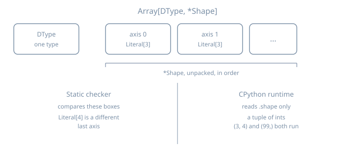

# TypeVarTuple Array Shapes

## Thesis

A type variable stands for one type. A **type variable tuple** (`TypeVarTuple`) stands for a tuple of types. You unpack it with `*` or with `typing.Unpack`. PEP 646 added that tool in Python 3.11 so an array can be generic in its dtype and in every axis: `Array[DType, *Shape]`. PEP 695 (Python 3.12) adds the spelling `class Array[DType, *Shape]`. The integers in a runtime `.shape` are a separate object. A type checker compares the type arguments. CPython runs the function either way.

On Python 3.15 the constructor grew four keyword arguments: `bound`, `covariant`, `contravariant`, and `infer_variance`. What's New in Python 3.15 says the meaning of `bound` is still undefined in the typing specification. mypy 2.4.0 and pyright 1.1.414 still reject those keywords. Case 8 runs the constructor and both checkers. Shape checks of the kind in this chapter have been expressible since 3.11.

NumPy 2.5.4 and PyTorch 2.14.1, in the stubs installed here, still describe a shape as one tuple type. NumPy's `ndarray` is `Generic[_ShapeT_co, _DTypeT_co]`. `_ShapeT_co` is one type variable bound to `tuple[int, ...]`, defaulting to `tuple[Any, ...]`. `numpy.typing.NDArray` evaluates to `numpy.ndarray[_AnyShape, numpy.dtype[ScalarT]]` with `_AnyShape` equal to `tuple[Any, ...]`, so the public alias keeps a dtype and drops rank. PyTorch's `torch.__version__` is `2.14.1+cu130`. In that stub `Tensor.shape` is `Size`, and `Size` subclasses `tuple[int, ...]`. Those facts come from reading the stubs. This chapter does not type-check either library. The class below is the small PEP 646 array, so the rule is visible on its own.

Every listing ran on CPython 3.15.0. `python3.15 --version` prints `Python 3.15.0`. `sys.version` on this machine is `3.15.0 (main, Oct  9 2026, 15:24:40) [Clang 22.1.3 ]`. Checker commands use that same 3.15.0 with mypy 2.4.0 (`python3.15 -m mypy --version` prints `mypy 2.4.0 (compiled: yes)`) and pyright 1.1.414. Pyright is `python3.15 -m pyright --pythonversion 3.15`. It prints the absolute path of the file. These runs lived in `/tmp/py-shapes-lab/`.

## Mental model

```text
Array[DType, *Shape]
      |        +-- zero or more axis types, always written unpacked
      +-- exactly one dtype

type arguments                              runtime value
Array[float, Literal[3], Literal[3]]        .shape is some tuple[int, ...]
Array[float, int]                           one axis, and that axis's type is int
Array[float, int, int]                      two axes, each typed int
Array[float, *tuple[int, ...]]              any rank, each axis typed int
```

Rank here means how many axis types you wrote. It is the length of the type-argument tuple, which a checker can see. It is not `len(array.shape)` unless you write that test yourself.

Four rules. The listings below are the ones that go wrong in array code:

- Unpack a `TypeVarTuple`. The `TypeVarTuple` docs require `tuple[*Ts]`. A bare `Ts` in that slot is invalid.
- One unpacked `TypeVarTuple` per parameter list and per type-argument list. A second one is a checker error. CPython still builds the function.
- `*args: *Ts` gives each positional argument its own slot in `Ts`. `*args: int` means every argument is `int`.
- `*tuple[int, ...]` and `Unpack[tuple[int, ...]]` are one type to mypy and pyright. `get_args` on the two aliases does not return equal objects.



## Worked examples

### Case 1: A dtype and a tuple of axis types

`relu` promises the same dtype and the same axis types out as in. The body builds a new `Array` and copies `.shape`. Nothing in `Array.__init__` consults `DType` or `Shape`.

```python
# array_relu.py — dtype plus a variadic shape, at runtime
from typing import get_args


class Array[DType, *Shape]:
    def __init__(self, values: list[float], shape: tuple[int, ...]) -> None:
        self.values = values
        self.shape = shape

    def __repr__(self) -> str:
        return f"Array(shape={self.shape}, n={len(self.values)})"


def relu[DType, *Shape](x: Array[DType, *Shape]) -> Array[DType, *Shape]:
    return Array([v if v > 0.0 else 0.0 for v in x.values], x.shape)


def main() -> None:
    image: Array[float, int, int] = Array([1.0, -2.0, 3.0, -4.0], (2, 2))
    print(relu(image))
    alias = Array[float, int, int]
    print("args", get_args(alias))
    print("params", tuple(p.__name__ for p in Array.__type_params__))
    print("kinds", tuple(type(p).__name__ for p in Array.__type_params__))


if __name__ == "__main__":
    main()
```

```console
$ python3.15 array_relu.py
Array(shape=(2, 2), n=4)
args (<class 'float'>, <class 'int'>, <class 'int'>)
params ('DType', 'Shape')
kinds ('TypeVar', 'TypeVarTuple')
```

`get_args(Array[float, int, int])` is the dtype and then one entry per axis. The class's own type parameters are a `TypeVar` named `DType` and a `TypeVarTuple` named `Shape`. The printed object is the values and the shape tuple. The type arguments showed up only on the alias. `relu` copied `.shape`, so the new object still prints `(2, 2)`. That copy is ordinary Python.

Both checkers accept the file.

```console
$ python3.15 -m mypy array_relu.py
Success: no issues found in 1 source file
```

```console
$ python3.15 -m pyright --pythonversion 3.15 array_relu.py
0 errors, 0 warnings, 0 informations
```

### Case 2: A square the checker accepts

`Literal[3]` is a type with one inhabitant, the integer 3. Two of them are two axis types. `square` asks for that pair and returns it. `relu` is shape-preserving, so the checker lets the result flow back out.

```python
# shape_ok.py
from typing import Literal


class Array[DType, *Shape]:
    def __init__(self, values: list[float], shape: tuple[int, ...]) -> None:
        self.values = values
        self.shape = shape


def relu[DType, *Shape](x: Array[DType, *Shape]) -> Array[DType, *Shape]:
    return Array([v if v > 0.0 else 0.0 for v in x.values], x.shape)


def square(x: Array[float, Literal[3], Literal[3]]) -> Array[float, Literal[3], Literal[3]]:
    return relu(x)


def main() -> None:
    kernel: Array[float, Literal[3], Literal[3]] = Array(
        [1.0, -1.0, 0.0, 2.0, -2.0, 0.5, 0.0, 0.0, 3.0],
        (3, 3),
    )
    out = square(kernel)
    print(out.shape)


if __name__ == "__main__":
    main()
```

```console
$ python3.15 shape_ok.py
(3, 3)
```

```console
$ python3.15 -m mypy shape_ok.py
Success: no issues found in 1 source file
```

```console
$ python3.15 -m pyright --pythonversion 3.15 shape_ok.py
0 errors, 0 warnings, 0 informations
```

### Case 3: The same rank, a different last axis

`Array[float, Literal[3], Literal[4]]` is still rank 2. The last axis type is `Literal[4]`. `square` requires `Literal[3]`. CPython prints the real shape and exits 0. Both checkers reject the call. Pyright adds the reason: `Shape` on this class is invariant, so `*tuple[Literal[3], Literal[4]]` is not the same pack as `*tuple[Literal[3], Literal[3]]`.

```python
# shape_wrong.py
from typing import Literal


class Array[DType, *Shape]:
    def __init__(self, values: list[float], shape: tuple[int, ...]) -> None:
        self.values = values
        self.shape = shape


def square(x: Array[float, Literal[3], Literal[3]]) -> None:
    print(len(x.values), x.shape)


def main() -> None:
    wide: Array[float, Literal[3], Literal[4]] = Array([0.0] * 12, (3, 4))
    square(wide)


if __name__ == "__main__":
    main()
```

```console
$ python3.15 shape_wrong.py
12 (3, 4)
```

```console
$ python3.15 -m mypy shape_wrong.py
shape_wrong.py:17: error: Argument 1 to "square" has incompatible type "Array[float, Literal[3], Literal[4]]"; expected "Array[float, Literal[3], Literal[3]]"  [arg-type]
Found 1 error in 1 file (checked 1 source file)
```

```console
$ python3.15 -m pyright --pythonversion 3.15 shape_wrong.py
/tmp/py-shapes-lab/shape_wrong.py
  /tmp/py-shapes-lab/shape_wrong.py:17:12 - error: Argument of type "Array[float, Literal[3], Literal[4]]" cannot be assigned to parameter "x" of type "Array[float, Literal[3], Literal[3]]" in function "square"
    "Array[float, Literal[3], Literal[4]]" is not assignable to "Array[float, Literal[3], Literal[3]]"
      Type parameter "Shape@Array" is invariant, but "*tuple[Literal[3], Literal[4]]" is not the same as "*tuple[Literal[3], Literal[3]]" (reportArgumentType)
1 error, 0 warnings, 0 informations
```

### Case 4: Rank is the length of the pack

`Array[float, int]` is one axis. `Array[float, int, int]` is two. The axis type is `int` in both, which means "some integer extent", and it says nothing about the number 3 stored in `.shape`.

```python
# rank_wrong.py
class Array[DType, *Shape]:
    def __init__(self, values: list[float], shape: tuple[int, ...]) -> None:
        self.values = values
        self.shape = shape


def need_matrix(x: Array[float, int, int]) -> None:
    print(x.shape)


def main() -> None:
    vector: Array[float, int] = Array([1.0, 2.0, 3.0], (3,))
    need_matrix(vector)


if __name__ == "__main__":
    main()
```

```console
$ python3.15 rank_wrong.py
(3,)
```

```console
$ python3.15 -m mypy rank_wrong.py
rank_wrong.py:14: error: Argument 1 to "need_matrix" has incompatible type "Array[float, int]"; expected "Array[float, int, int]"  [arg-type]
Found 1 error in 1 file (checked 1 source file)
```

```console
$ python3.15 -m pyright --pythonversion 3.15 rank_wrong.py
/tmp/py-shapes-lab/rank_wrong.py
  /tmp/py-shapes-lab/rank_wrong.py:14:17 - error: Argument of type "Array[float, int]" cannot be assigned to parameter "x" of type "Array[float, int, int]" in function "need_matrix"
    "Array[float, int]" is not assignable to "Array[float, int, int]"
      Type parameter "Shape@Array" is invariant, but "*tuple[int]" is not the same as "*tuple[int, int]" (reportArgumentType)
1 error, 0 warnings, 0 informations
```

Pyright's detail line is the whole rule in one place: `*tuple[int]` is not `*tuple[int, int]`.

### Case 5: Concatenate an axis, or move one to the end

Concatenating shapes, in this type system, means building a new type-argument list. `prepend_axis` puts a fresh `int` in front of `*Shape`. `move_first_axis_to_last` is the standard library's tuple trick from the `TypeVarTuple` docs, applied to axes: peel off `Axis0`, keep `*Rest`, and write `*Rest` then `Axis0`.

The bodies do the same thing to the integer tuple. That agreement is the author's. The checker is looking at the annotations.

```python
# concat_ok.py
from typing import Literal


class Array[DType, *Shape]:
    def __init__(self, values: list[float], shape: tuple[int, ...]) -> None:
        self.values = values
        self.shape = shape

    def __repr__(self) -> str:
        return f"Array(shape={self.shape})"


def prepend_axis[DType, *Shape](x: Array[DType, *Shape]) -> Array[DType, int, *Shape]:
    return Array(x.values, (1, *x.shape))


def move_first_axis_to_last[DType, Axis0, *Rest](
    x: Array[DType, Axis0, *Rest],
) -> Array[DType, *Rest, Axis0]:
    return Array(x.values, (*x.shape[1:], x.shape[0]))


def main() -> None:
    image: Array[float, Literal[2], Literal[3]] = Array([0.0] * 6, (2, 3))
    batched: Array[float, int, Literal[2], Literal[3]] = prepend_axis(image)
    moved: Array[float, Literal[3], Literal[2]] = move_first_axis_to_last(image)
    print(batched)
    print(moved)


if __name__ == "__main__":
    main()
```

```console
$ python3.15 concat_ok.py
Array(shape=(1, 2, 3))
Array(shape=(3, 2))
```

```console
$ python3.15 -m mypy concat_ok.py
Success: no issues found in 1 source file
```

```console
$ python3.15 -m pyright --pythonversion 3.15 concat_ok.py
0 errors, 0 warnings, 0 informations
```

`(2, 3)` becomes `(1, 2, 3)` because the function prepended the integer `1`, and it becomes `(3, 2)` because the function rotated the tuple. The annotations say the result types are `Array[float, int, Literal[2], Literal[3]]` and `Array[float, Literal[3], Literal[2]]`. Both checkers accept those two assignments.

Claiming the rotated value still has axes `(Literal[2], Literal[3])` is a type error. The program still prints `(3, 2)`.

```python
# concat_wrong.py
from typing import Literal


class Array[DType, *Shape]:
    def __init__(self, values: list[float], shape: tuple[int, ...]) -> None:
        self.values = values
        self.shape = shape


def move_first_axis_to_last[DType, Axis0, *Rest](
    x: Array[DType, Axis0, *Rest],
) -> Array[DType, *Rest, Axis0]:
    return Array(x.values, (*x.shape[1:], x.shape[0]))


def main() -> None:
    image: Array[float, Literal[2], Literal[3]] = Array([0.0] * 6, (2, 3))
    moved = move_first_axis_to_last(image)
    same: Array[float, Literal[2], Literal[3]] = moved
    print(same.shape)


if __name__ == "__main__":
    main()
```

```console
$ python3.15 concat_wrong.py
(3, 2)
```

```console
$ python3.15 -m mypy concat_wrong.py
concat_wrong.py:20: error: Incompatible types in assignment (expression has type "Array[float, Literal[3], Literal[2]]", variable has type "Array[float, Literal[2], Literal[3]]")  [assignment]
Found 1 error in 1 file (checked 1 source file)
```

```console
$ python3.15 -m pyright --pythonversion 3.15 concat_wrong.py
/tmp/py-shapes-lab/concat_wrong.py
  /tmp/py-shapes-lab/concat_wrong.py:20:50 - error: Type "Array[float, Literal[3], Literal[2]]" is not assignable to declared type "Array[float, Literal[2], Literal[3]]"
    "Array[float, Literal[3], Literal[2]]" is not assignable to "Array[float, Literal[2], Literal[3]]"
      Type parameter "Shape@Array" is invariant, but "*tuple[Literal[3], Literal[2]]" is not the same as "*tuple[Literal[2], Literal[3]]" (reportAssignmentType)
1 error, 0 warnings, 0 informations
```

Inside the generic function the two packs stay different even when a later call would fill both with `int`. Returning the input unchanged is rejected, and the call still runs:

```python
# rotate_erased.py — identical axis types hide a missing rotation
class Array[DType, *Shape]:
    def __init__(self, values: list[float], shape: tuple[int, ...]) -> None:
        self.values = values
        self.shape = shape


def move_first_axis_to_last[DType, Axis0, *Rest](
    x: Array[DType, Axis0, *Rest],
) -> Array[DType, *Rest, Axis0]:
    return x


def main() -> None:
    image: Array[float, int, int] = Array([1.0, 2.0, 3.0, 4.0], (2, 2))
    out: Array[float, int, int] = move_first_axis_to_last(image)
    print(out.shape)


if __name__ == "__main__":
    main()
```

```console
$ python3.15 rotate_erased.py
(2, 2)
```

```console
$ python3.15 -m mypy rotate_erased.py
rotate_erased.py:11: error: Incompatible return value type (got "Array[DType, Axis0, *Rest]", expected "Array[DType, *Rest, Axis0]")  [return-value]
Found 1 error in 1 file (checked 1 source file)
```

```console
$ python3.15 -m pyright --pythonversion 3.15 rotate_erased.py
/tmp/py-shapes-lab/rotate_erased.py
  /tmp/py-shapes-lab/rotate_erased.py:11:12 - error: Type "Array[DType@move_first_axis_to_last, Axis0@move_first_axis_to_last, *Rest@move_first_axis_to_last]" is not assignable to return type "Array[DType@move_first_axis_to_last, *Rest@move_first_axis_to_last, Axis0@move_first_axis_to_last]"
    "Array[DType@move_first_axis_to_last, Axis0@move_first_axis_to_last, *Rest@move_first_axis_to_last]" is not assignable to "Array[DType@move_first_axis_to_last, *Rest@move_first_axis_to_last, Axis0@move_first_axis_to_last]"
      Type parameter "Shape@Array" is invariant, but "*tuple[Axis0@move_first_axis_to_last, *Rest@move_first_axis_to_last]" is not the same as "*tuple[*Rest@move_first_axis_to_last, Axis0@move_first_axis_to_last]" (reportReturnType)
1 error, 0 warnings, 0 informations
```

mypy reports `Array[DType, Axis0, *Rest]` against `Array[DType, *Rest, Axis0]`. The function has to be valid for every instantiation, including `Literal[2]` then `Literal[3]`, so the checker does not wait for a call site where both axes happen to be plain `int`.

You cannot type "concatenate two unknown shapes" with two type-variable tuples. That attempt is in the trap.

### Case 6: `Unpack[tuple[int, ...]]` is any number of `int` axes

`*tuple[int, ...]` unpacks an open homogeneous tuple into the axis list. `Unpack[tuple[int, ...]]` is the spelling you need when the star is not available in that position, and it is the form older code wrote everywhere. On 3.15 both spellings are legal. `get_args` shows they are stored differently, and the alias objects compare unequal. A rank-2 `Array[float, int, int]` is still a legal argument to a parameter typed with the `Unpack` form, which is why both checkers accept this file.

```python
# unpack_axes.py — star form and Unpack form of an open axis tuple
from typing import Unpack, get_args


class Array[DType, *Shape]:
    def __init__(self, values: list[float], shape: tuple[int, ...]) -> None:
        self.values = values
        self.shape = shape


def sum_values(x: Array[float, Unpack[tuple[int, ...]]]) -> float:
    return sum(x.values)


def main() -> None:
    star = Array[float, *tuple[int, ...]]
    unpacked = Array[float, Unpack[tuple[int, ...]]]
    print("star", get_args(star))
    print("unpack", get_args(unpacked))
    print("equal", star == unpacked)
    matrix: Array[float, int, int] = Array([1.0, 2.0, 3.0, 4.0], (2, 2))
    print("sum", sum_values(matrix))


if __name__ == "__main__":
    main()
```

```console
$ python3.15 unpack_axes.py
star (<class 'float'>, *tuple[int, ...])
unpack (<class 'float'>, typing.Unpack[tuple[int, ...]])
equal False
sum 10.0
```

```console
$ python3.15 -m mypy unpack_axes.py
Success: no issues found in 1 source file
```

```console
$ python3.15 -m pyright --pythonversion 3.15 unpack_axes.py
0 errors, 0 warnings, 0 informations
```

An axis typed `str` is outside `tuple[int, ...]`. The sum still runs. mypy and pyright both print the expected type as `Array[float, *tuple[int, ...]]` even though the source wrote `Unpack[...]`. That is the checkers treating the two spellings as one type.

```python
# unpack_wrong.py — a str axis is not an int axis
from typing import Unpack


class Array[DType, *Shape]:
    def __init__(self, values: list[float], shape: tuple[int, ...]) -> None:
        self.values = values
        self.shape = shape


def sum_values(x: Array[float, Unpack[tuple[int, ...]]]) -> float:
    return sum(x.values)


def main() -> None:
    named: Array[float, str] = Array([1.0], (1,))
    print(sum_values(named))


if __name__ == "__main__":
    main()
```

```console
$ python3.15 unpack_wrong.py
1.0
```

```console
$ python3.15 -m mypy unpack_wrong.py
unpack_wrong.py:17: error: Argument 1 to "sum_values" has incompatible type "Array[float, str]"; expected "Array[float, *tuple[int, ...]]"  [arg-type]
Found 1 error in 1 file (checked 1 source file)
```

```console
$ python3.15 -m pyright --pythonversion 3.15 unpack_wrong.py
/tmp/py-shapes-lab/unpack_wrong.py
  /tmp/py-shapes-lab/unpack_wrong.py:17:22 - error: Argument of type "Array[float, str]" cannot be assigned to parameter "x" of type "Array[float, *tuple[int, ...]]" in function "sum_values"
    "Array[float, str]" is not assignable to "Array[float, *tuple[int, ...]]"
      Type parameter "Shape@Array" is invariant, but "*tuple[str]" is not the same as "*tuple[int, ...]" (reportArgumentType)
1 error, 0 warnings, 0 informations
```

`Unpack` is also how PEP 692 types `**kwargs` from a `TypedDict`. Same name, different job. An unpacked `TypeVarTuple` describes positional slots. `Unpack[SomeTypedDict]` describes keyword names. They meet only if you import `Unpack` and then use it for both.

### Case 7: `*args: *Ts`

`*args: *Ts` is not "a tuple of `Ts`". Each argument is one element of `Ts`, and the annotation is stored as `Unpack[Ts]`. Here `Ts` is tied to the callback's positional parameters, the same idea as the `call_soon` example in the `TypeVarTuple` docs.

```python
# args_ok.py — *args: *Ts matches the callback argument by argument
from collections.abc import Callable
from typing import get_type_hints


def apply_axes[*Ts](callback: Callable[[*Ts], str], *args: *Ts) -> str:
    return callback(*args)


def label(height: int, width: int) -> str:
    return f"{height}x{width}"


def main() -> None:
    print(get_type_hints(apply_axes))
    print(apply_axes(label, 2, 3))


if __name__ == "__main__":
    main()
```

```console
$ python3.15 args_ok.py
{'callback': collections.abc.Callable[[typing.Unpack[Ts]], str], 'args': typing.Unpack[Ts], 'return': <class 'str'>}
2x3
```

```console
$ python3.15 -m mypy args_ok.py
Success: no issues found in 1 source file
```

```console
$ python3.15 -m pyright --pythonversion 3.15 args_ok.py
0 errors, 0 warnings, 0 informations
```

`label` formats whatever it is given, so a string width runs. The checkers both reject the call, and they point at different arguments. mypy solves `Ts` from the call as `(int, str)` and then says the callback is the wrong `Callable`. pyright solves `Ts` from `label` as `(int, int)` and then says the argument pack is wrong, down to `Literal['3']` versus `int`. Same mistake, two reports. Trust the shared conclusion, and read the note under the error before you "fix" the wrong parameter.

```python
# args_wrong.py — a str in *args does not match label's int
from collections.abc import Callable


def apply_axes[*Ts](callback: Callable[[*Ts], str], *args: *Ts) -> str:
    return callback(*args)


def label(height: int, width: int) -> str:
    return f"{height}x{width}"


def main() -> None:
    print(apply_axes(label, 2, "3"))


if __name__ == "__main__":
    main()
```

```console
$ python3.15 args_wrong.py
2x3
```

```console
$ python3.15 -m mypy args_wrong.py
args_wrong.py:14: error: Argument 1 to "apply_axes" has incompatible type "Callable[[int, int], str]"; expected "Callable[[int, str], str]"  [arg-type]
Found 1 error in 1 file (checked 1 source file)
```

```console
$ python3.15 -m pyright --pythonversion 3.15 args_wrong.py
/tmp/py-shapes-lab/args_wrong.py
  /tmp/py-shapes-lab/args_wrong.py:14:11 - error: Argument of type "tuple[Literal[2], Literal['3']]" cannot be assigned to parameter "args" of type "Ts@apply_axes" in function "apply_axes"
    Type "*tuple[Literal[2], Literal['3']]" is not assignable to type "*tuple[int, int]"
      "*tuple[Literal[2], Literal['3']]" is not assignable to "*tuple[int, int]"
        Tuple entry 2 is incorrect type
          "Literal['3']" is not assignable to "int" (reportArgumentType)
1 error, 0 warnings, 0 informations
```

### Case 8: The 3.15 constructor, and today's checkers

This is the 3.15-only piece. The attributes exist at runtime. Setting both `covariant=True` and `contravariant=True` raises `ValueError`, with the message `Bivariant types are not supported.` The `bound=int` object is created, and `__bound__` is `int`. That does not mean a checker will reject an axis that is not `int`. The specification has not defined what `bound` means on a `TypeVarTuple`.

```python
# tvt_kwargs.py
from typing import TypeVarTuple

Shape = TypeVarTuple("Shape", covariant=True)
print(
    "covariant",
    Shape.__covariant__,
    "contravariant",
    Shape.__contravariant__,
    "infer",
    Shape.__infer_variance__,
    "bound",
    Shape.__bound__,
)

Bounded = TypeVarTuple("Bounded", bound=int)
print("bounded", Bounded.__bound__)

try:
    TypeVarTuple("Both", covariant=True, contravariant=True)
except ValueError as exc:
    print(type(exc).__name__ + ":", exc)
```

```console
$ python3.15 tvt_kwargs.py
covariant True contravariant False infer False bound None
bounded <class 'int'>
ValueError: Bivariant types are not supported.
```

```console
$ python3.15 -m mypy tvt_kwargs.py
tvt_kwargs.py:4: error: Unexpected keyword argument "covariant" for "TypeVarTuple"  [misc]
tvt_kwargs.py:7: error: "object" has no attribute "__covariant__"  [attr-defined]
tvt_kwargs.py:9: error: "object" has no attribute "__contravariant__"  [attr-defined]
tvt_kwargs.py:11: error: "object" has no attribute "__infer_variance__"  [attr-defined]
tvt_kwargs.py:13: error: "object" has no attribute "__bound__"  [attr-defined]
tvt_kwargs.py:16: error: Unexpected keyword argument "bound" for "TypeVarTuple"  [misc]
tvt_kwargs.py:17: error: "object" has no attribute "__bound__"  [attr-defined]
Found 7 errors in 1 file (checked 1 source file)
```

```console
$ python3.15 -m pyright --pythonversion 3.15 tvt_kwargs.py
/tmp/py-shapes-lab/tvt_kwargs.py
  /tmp/py-shapes-lab/tvt_kwargs.py:4:31 - error: "covariant" is unknown parameter to TypeVarTuple (reportGeneralTypeIssues)
  /tmp/py-shapes-lab/tvt_kwargs.py:16:35 - error: "bound" is unknown parameter to TypeVarTuple (reportGeneralTypeIssues)
  /tmp/py-shapes-lab/tvt_kwargs.py:20:26 - error: "covariant" is unknown parameter to TypeVarTuple (reportGeneralTypeIssues)
  /tmp/py-shapes-lab/tvt_kwargs.py:20:42 - error: "contravariant" is unknown parameter to TypeVarTuple (reportGeneralTypeIssues)
4 errors, 0 warnings, 0 informations
```

mypy 2.4.0 calls `covariant` and `bound` unexpected keywords, then treats the result as `object`, so the attribute reads fail too. pyright 1.1.414 says each keyword is an unknown parameter of `TypeVarTuple`. The keywords exist on CPython 3.15. These two checkers do not accept them yet, and `bound` still has no meaning in the typing specification. Keep them off array signatures.

## The trap

The trap is believing the annotation inspects the tuple you passed to `__init__`.

`Array.__init__` is typed as `values: list[float]` and `shape: tuple[int, ...]`. Those parameters are not `*Shape`. Writing `Array[float, Literal[3], Literal[3]]` on the variable is a claim about the variable. Both checkers accept the claim. The value's `.shape` is `(99,)`, and `square` accepts it.

```python
# lie_ok.py
from typing import Literal


class Array[DType, *Shape]:
    def __init__(self, values: list[float], shape: tuple[int, ...]) -> None:
        self.values = values
        self.shape = shape


def square(x: Array[float, Literal[3], Literal[3]]) -> Array[float, Literal[3], Literal[3]]:
    return x


def main() -> None:
    lie: Array[float, Literal[3], Literal[3]] = Array([1.0], (99,))
    print(square(lie).shape)


if __name__ == "__main__":
    main()
```

```console
$ python3.15 lie_ok.py
(99,)
```

```console
$ python3.15 -m mypy lie_ok.py
Success: no issues found in 1 source file
```

```console
$ python3.15 -m pyright --pythonversion 3.15 lie_ok.py
0 errors, 0 warnings, 0 informations
```

`Literal[3]` checked out in Case 3 because two *variables* disagreed. Here one variable is annotated with a precise type and then filled with a constructor the checker cannot connect to those literals. A shape bug of this kind needs a runtime test: `if self.shape != expected: raise ...`, or a checker plugin that understands your constructor. PEP 646 does not add that test.

The second trap is two type-variable tuples, which is the obvious way to write "concatenate an unknown prefix with an unknown suffix". The syntax is legal. The call returns `(1, 2, 'a')`. The type parameters really are `(Left, Right)`.

```python
# two_tuples.py
def concat[*Left, *Right](left: tuple[*Left], right: tuple[*Right]) -> tuple[*Left, *Right]:
    return (*left, *right)


def main() -> None:
    print(concat((1, 2), ("a",)))
    print("defined", concat.__type_params__)


if __name__ == "__main__":
    main()
```

```console
$ python3.15 two_tuples.py
(1, 2, 'a')
defined (Left, Right)
```

```console
$ python3.15 -m mypy two_tuples.py
two_tuples.py:2: error: More than one variadic Unpack in a type is not allowed  [misc]
two_tuples.py:3: error: Incompatible return value type (got "tuple[object, ...]", expected "tuple[*Left]")  [return-value]
Found 2 errors in 1 file (checked 1 source file)
```

```console
$ python3.15 -m pyright --pythonversion 3.15 two_tuples.py
/tmp/py-shapes-lab/two_tuples.py
  /tmp/py-shapes-lab/two_tuples.py:2:86 - error: Type argument list can have at most one unpacked TypeVarTuple or tuple (reportInvalidTypeForm)
1 error, 0 warnings, 0 informations
```

mypy reports two errors. The first is the rule: more than one variadic unpack in a type. The second says the return is `tuple[object, ...]`, the type mypy uses once that two-unpack return is rejected. pyright reports the rule once, on the return annotation: a type-argument list can have at most one unpacked `TypeVarTuple` or tuple. To prepend or append a known axis, use an ordinary type variable beside the single `TypeVarTuple`, as `prepend_axis` and `move_first_axis_to_last` do.

## The boring rule

- One dtype type variable, then one unpacked shape: `class Array[DType, *Shape]`.
- Preserve a shape by repeating `*Shape` in the parameter and the return.
- Add an axis by concatenating a normal type: `Array[DType, int, *Shape]` or `Array[DType, *Shape, Axis]`.
- Unknown rank, every axis an `int`: `Array[DType, *tuple[int, ...]]`. `Unpack[tuple[int, ...]]` is the same type to the checkers used here.
- `*args: *Ts` when each argument has its own type. `*args: int` when they all share one.
- At most one unpacked `TypeVarTuple` in a list. CPython will not stop you. mypy and pyright will.
- `Literal` sizes are compared only when they appear as type arguments on names the checker can see. The constructor in this chapter does not put `.shape` into those arguments.
- On 3.15, do not pass `bound=` to `TypeVarTuple` and expect either a specified meaning or a clean run under mypy 2.4.0 or pyright 1.1.414.
- If the numbers must hold at run time, test `.shape` in ordinary Python.

## Try this

1. In `shape_wrong.py`, change the wide array to `Array[float, Literal[3], Literal[3]]` and pass a values list of length 9 with shape `(3, 3)`. Confirm mypy and pyright both go quiet, then change only the annotation's last axis back to `Literal[4]` and watch the error return while `python3.15` still prints.
2. In `concat_ok.py`, add `flat: Array[float, Literal[2], Literal[3]] = prepend_axis(image)` and read the error. Say which axis was concatenated, and where.
3. In `unpack_wrong.py`, replace `str` with `int` and confirm the checkers accept it. Then try `Array[float, int, str]` and see whether `*tuple[int, ...]` rejects a pack that is only partly `int`.
4. In `two_tuples.py`, delete `*Right`. Type the second parameter as `tuple[str, ...]` and the return as `tuple[*Left, *tuple[str, ...]]`. Run mypy and pyright. An unpacked `TypeVarTuple` already counts as an open-ended tuple, and the typing spec rejects two open-ended unpacks in one `tuple[...]`. Record the message you get. If your checker accepts it, say so: that is a checker gap, and the spec is the rule.
5. Copy `lie_ok.py`. At the start of `square`, add `if x.shape != (3, 3): raise ValueError(x.shape)`. Run `python3.15 lie_ok.py`, then mypy. Compare the exception with mypy's report.

## Sources

- PEP 646, *Variadic Generics* (Python 3.11): <https://peps.python.org/pep-0646/>
- PEP 695, *Type Parameter Syntax* (the `class Array[DType, *Shape]` spelling, Python 3.12): <https://peps.python.org/pep-0695/>
- Python 3.15, `typing.TypeVarTuple`, including the 3.15 constructor parameters and the note that `bound` semantics are not decided: <https://docs.python.org/3.15/library/typing.html#typing.TypeVarTuple>
- Python 3.15, `typing.Unpack` (type-variable tuples, tuple unpacking, and `**kwargs` `TypedDict`s): <https://docs.python.org/3.15/library/typing.html#typing.Unpack>
- What's New in Python 3.15, typing section (`TypeVarTuple` gains `bound`, `covariant`, `contravariant`, `infer_variance`; `bound` semantics remain undefined): <https://docs.python.org/3.15/whatsnew/3.15.html>
- Typing specification, unpacked tuple forms (one open-ended unpack per tuple; a `TypeVarTuple` counts as open-ended): <https://typing.python.org/en/latest/spec/tuples.html>
- NumPy 2.5.4 stubs read locally: `numpy/__init__.pyi` (`_ShapeT_co`, `class ndarray`) and `numpy/_typing/_shape.py` (`_Shape`, `_AnyShape`). `numpy.typing.NDArray.__value__` printed `numpy.ndarray[_AnyShape, numpy.dtype[ScalarT]]`.
- PyTorch 2.14.1 stub read locally: `torch/_C/__init__.pyi` (`class Size(tuple[_int, ...])`, `TensorBase.shape: Size`).
