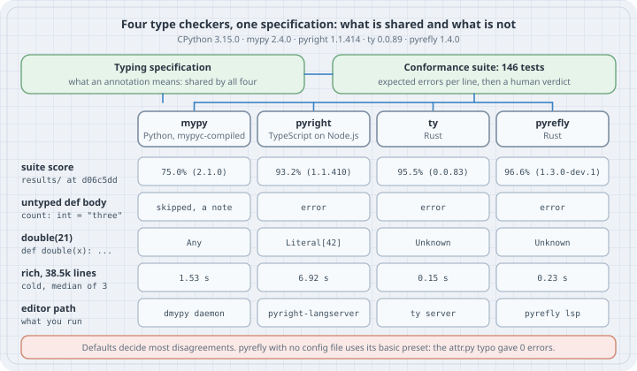

# Choosing a Type Checker: mypy, pyright, ty and Pyrefly

## Thesis

The typing specification at typing.python.org says what a type annotation means. A type checker is a program that reads the annotations and reports where the code disagrees with them. Python ships no checker. You pick one, and four are in wide use: **mypy**, **pyright**, Astral's **ty**, and Meta's **Pyrefly**. ty and Pyrefly are written in Rust. mypy is written in Python and compiled with mypyc. pyright is written in TypeScript and runs on Node.js.

The four agree on annotated code that the specification covers. They disagree in three places, and those decide most of the choice:

1. **Defaults.** Whether the bodies of unannotated functions are checked at all, and how much is reported when there is no config file.
2. **Inference the specification leaves open.** What `[]` becomes, whether a variable may change type, and what an unannotated function returns.
3. **Speed and editor integration.** A cold check of a 38,515-line package took 0.15 s with ty and 6.92 s with pyright on this machine.

The python/typing **conformance suite** scores each checker against the specification. It is the closest thing to a neutral grade. It is also a snapshot of particular versions, and Case 6 shows a score that was already out of date.

Every listing ran on CPython 3.15.0, released 2026-10-09. The four checkers live in one 3.15.0 virtual environment, installed with uv, and every command below runs with that environment on `PATH`. Each checker is told to target 3.15. The runs lived in `/tmp/py-checkers-lab/` on an 8-core Linux machine.

```console
$ python --version
Python 3.15.0
$ mypy --version
mypy 2.4.0 (compiled: yes)
$ pyright --version
pyright 1.1.414
$ ty --version
ty 0.0.89
$ pyrefly --version
pyrefly 1.4.0
```

ty's version number still starts with `0.0.`, so expect its behaviour to change between releases, and pin it.

## Mental model

```text
typing specification ── says what annotations mean (shared)
        │
conformance suite ───── 146 test files: expected errors per line,
        │               plus a human verdict per checker version
        ▼
 ┌──────────┬───────────┬──────────┬───────────┐
 │ mypy     │ pyright   │ ty       │ pyrefly   │  each one adds its own:
 │          │           │          │           │   • defaults (what is checked)
 │          │           │          │           │   • inference where the spec is silent
 │          │           │          │           │   • speed, caching, language server
 └──────────┴───────────┴──────────┴───────────┘
```

A clean run means "clean for that checker, with that configuration, at that version". It does not mean "type-correct Python". When two checkers disagree, first ask which of the three layers is involved. Is it the specification, a default, or inference? Only the first is a bug in one of them.



## Worked examples

All four checkers run on the same file with the same target version through one small script. The pyright line strips the absolute path that pyright prints. Pyrefly gets `--preset default` here. The trap section shows why that flag matters.

```bash
#!/usr/bin/env bash
# check_all.sh: run the four checkers on one file, same Python version.
f=$1
echo "--- mypy";    mypy --python-version 3.15 "$f"
echo "--- pyright"; pyright --pythonversion 3.15 "$f" | sed "s|$PWD/||"
echo "--- ty";      ty check --python-version 3.15 --output-format concise "$f"
echo "--- pyrefly"; pyrefly check --python-version 3.15 --preset default --output-format min-text "$f" 2>&1
```

### Case 1: Annotated code with a plain bug

Start where they should agree. `Config` has a `host` attribute, and `connect` reads `hostname`.

```python
# attr.py: a typo every checker should catch
class Config:
    def __init__(self) -> None:
        self.host = "localhost"


def connect(cfg: Config) -> str:
    return cfg.hostname
```

```console
$ bash check_all.sh attr.py
--- mypy
attr.py:8: error: "Config" has no attribute "hostname"  [attr-defined]
Found 1 error in 1 file (checked 1 source file)
--- pyright
attr.py
  attr.py:8:16 - error: Cannot access attribute "hostname" for class "Config"
    Attribute "hostname" is unknown (reportAttributeAccessIssue)
1 error, 0 warnings, 0 informations
--- ty
attr.py:8:12: error[unresolved-attribute] Object of type `Config` has no attribute `hostname`
Found 1 diagnostic
--- pyrefly
ERROR attr.py:8:12-24: Object of class `Config` has no attribute `hostname` [missing-attribute]
 INFO 1 error
```

The four checkers report the same line and give the same reason, each in its own words. mypy calls the rule `attr-defined`, pyright `reportAttributeAccessIssue`, ty `unresolved-attribute`, Pyrefly `missing-attribute`. The rule names differ, so a `# type: ignore[attr-defined]` written for mypy says nothing to the others. Each checker has its own suppression syntax. All of them also honour a bare `# type: ignore`.

### Case 2: The body of an unannotated function

`unannotated` has no annotation on its parameters or return. The annotation inside it is plainly wrong. `annotated` has the same body and a return annotation.

```python
# untyped.py: the same mistake inside an unannotated and an annotated function
def unannotated():
    count: int = "three"
    return count


def annotated() -> int:
    count: int = "three"
    return count
```

```console
$ bash check_all.sh untyped.py
--- mypy
untyped.py:3: note: By default the bodies of untyped functions are not checked, consider using --check-untyped-defs  [annotation-unchecked]
untyped.py:8: error: Incompatible types in assignment (expression has type "str", variable has type "int")  [assignment]
Found 1 error in 1 file (checked 1 source file)
--- pyright
untyped.py
  untyped.py:3:18 - error: Type "Literal['three']" is not assignable to declared type "int"
    "Literal['three']" is not assignable to "int" (reportAssignmentType)
  untyped.py:8:18 - error: Type "Literal['three']" is not assignable to declared type "int"
    "Literal['three']" is not assignable to "int" (reportAssignmentType)
2 errors, 0 warnings, 0 informations
--- ty
untyped.py:3:18: error[invalid-assignment] Object of type `Literal["three"]` is not assignable to `int`
untyped.py:8:18: error[invalid-assignment] Object of type `Literal["three"]` is not assignable to `int`
Found 2 diagnostics
--- pyrefly
ERROR untyped.py:3:18-25: `Literal['three']` is not assignable to `int` [bad-assignment]
ERROR untyped.py:8:18-25: `Literal['three']` is not assignable to `int` [bad-assignment]
 INFO 2 errors
```

mypy reports line 8 and prints only a note for line 3. By default mypy does not check the body of a function that has no annotations. PEP 484 allowed that so a codebase can adopt types one function at a time. pyright, ty and Pyrefly check every body. With mypy's `--check-untyped-defs`, or `check_untyped_defs = true` in config, the two counts match:

```console
$ mypy --python-version 3.15 --check-untyped-defs untyped.py
untyped.py:3: error: Incompatible types in assignment (expression has type "str", variable has type "int")  [assignment]
untyped.py:8: error: Incompatible types in assignment (expression has type "str", variable has type "int")  [assignment]
Found 2 errors in 1 file (checked 1 source file)
```

`strict = true` in mypy's config turns this on as well. Pyrefly has the same switch, `check-unannotated-defs`, and it defaults to true. Pyrefly's `legacy` preset, written by `pyrefly init` when it finds a mypy config, sets it to false to match mypy.

### Case 3: Inference the specification leaves open

The typing specification says what annotations mean. It mostly does not say what type an unannotated variable gets. Each checker answers in its own way.

```python
# inference.py: two places where the spec leaves inference to the checker
from typing import reveal_type


def empty_list() -> None:
    items = []
    items.append(1)
    items.append("two")
    reveal_type(items)


def redefine() -> None:
    value = 1
    value = "one"
    reveal_type(value)
```

```console
$ bash check_all.sh inference.py
--- mypy
inference.py:8: error: Argument 1 to "append" of "list" has incompatible type "str"; expected "int"  [arg-type]
inference.py:9: note: Revealed type is "list[int]"
inference.py:14: error: Incompatible types in assignment (expression has type "str", variable has type "int")  [assignment]
inference.py:15: note: Revealed type is "int"
Found 2 errors in 1 file (checked 1 source file)
--- pyright
inference.py
  inference.py:9:17 - information: Type of "items" is "list[Unknown]"
  inference.py:15:17 - information: Type of "value" is "Literal['one']"
0 errors, 0 warnings, 2 informations
--- ty
inference.py:9:17: info[revealed-type] Revealed type: `list[int | str]`
inference.py:15:17: info[revealed-type] Revealed type: `Literal["one"]`
Found 2 diagnostics
--- pyrefly
ERROR inference.py:8:18-23: Argument `Literal['two']` is not assignable to parameter `object` with type `int` in function `list.append` [bad-argument-type]
 INFO inference.py:9:16-23: revealed type: list[int] [reveal-type]
 INFO inference.py:15:16-23: revealed type: Literal['one'] [reveal-type]
 INFO 1 error
```

Take `items = []` first. mypy and Pyrefly use the first `append` to fix the list as `list[int]` and reject `"two"`. pyright leaves the element type `Unknown`, so both appends are accepted. Its documentation lists `list()` with no arguments as `list[Unknown]`. ty reveals `list[int | str]` and reports no error. The same five lines give three different types.

Now `value = 1` followed by `value = "one"`. mypy treats the first assignment as the variable's declared type and rejects the second. pyright's documentation says the declared type of an unannotated variable is the union of every assigned type, and at the `reveal_type` it narrows to the last one, `Literal['one']`. ty and Pyrefly reveal the same `Literal['one']` and accept the reassignment. ty's documentation lists support for redeclarations among its design goals.

None of these answers is a conformance failure. If the type matters to you, write it down. With `items: list[int] = []`, all four checkers report the `append("two")` on line 8. With `value: int | str = 1`, they all accept the reassignment.

### Case 4: Calling code that has no annotations

`double` has no annotations at all. `use` calls it with an `int` and then calls a method that does not exist.

```python
# helper.py: calling a function that has no annotations at all
from typing import reveal_type


def double(x):
    return x * 2


def use() -> None:
    result = double(21)
    reveal_type(result)
    result.no_such_method()
```

```console
$ bash check_all.sh helper.py
--- mypy
helper.py:11: note: Revealed type is "Any"
Success: no issues found in 1 source file
--- pyright
helper.py
  helper.py:11:17 - information: Type of "result" is "Literal[42]"
  helper.py:12:12 - error: Cannot access attribute "no_such_method" for class "Literal[42]"
    Attribute "no_such_method" is unknown (reportAttributeAccessIssue)
1 error, 0 warnings, 1 information
--- ty
helper.py:11:17: info[revealed-type] Revealed type: `Unknown`
Found 1 diagnostic
--- pyrefly
 INFO helper.py:11:16-24: revealed type: Unknown [reveal-type]
 INFO 0 errors
```

mypy treats an unannotated function as returning `Any`. `Any` allows every operation, so the bad call passes. ty and Pyrefly reveal `Unknown`, which behaves like `Any`: no error. pyright reports the bug. Its documentation calls the technique *call-site return type inference*. When every parameter of a function is unannotated, pyright re-infers the body using the argument types at each call. `double(21)` becomes `Literal[42]`, and `Literal[42]` has no `no_such_method`.

That is the clearest difference in gradual typing among the four. pyright finds more bugs in unannotated code. mypy, ty and Pyrefly report less noise from it. The specification does not require either behaviour. Only annotations make the result the same everywhere.

### Case 5: Reading the conformance suite yourself

The suite lives in `conformance/` in the python/typing repository. Each test file marks the lines where a checker must report an error with `# E`. For each checker version, the maintainers commit one TOML file per test under `results/<checker>/`:

- `conformance_automated` is `Pass` or `Fail`. The README says it fails when the checker's output shows any discrepancy from the `# E` markers. A line marked `# E?` may report an error or not.
- `conformant` is a human verdict: `Pass`, `Partial`, or `Unsupported`, often with `notes`.

The published summary, `results/results.html`, counts `Pass` as 1 and `Partial` as 0.5. A test without a `conformant` key counts as passed if its automated check passed. Test files are the `.py` and `.pyi` files whose names start with a group name from `src/test_groups.toml`. Other files are helpers. This script redoes the count from the committed TOML.

```python
# conformance_scores.py: score each checker's committed results in the
# python/typing conformance suite the way results.html does:
# Pass = 1, Partial = 0.5, otherwise 0; if "conformant" is missing, an
# automated Pass counts as Pass.
import sys
import tomllib
from collections import defaultdict
from pathlib import Path

root = Path(sys.argv[1])                       # .../typing/conformance
groups_toml = tomllib.loads((root / "src" / "test_groups.toml").read_text())
# Like the suite's own reporting: a test is a .py/.pyi file whose name starts
# with a known group name; other files are helpers imported by the tests.
tests = sorted(p.stem for p in (root / "tests").iterdir()
               if p.suffix in (".py", ".pyi") and p.name.split("_")[0] in groups_toml)
checkers = sorted(d.name for d in (root / "results").iterdir() if d.is_dir())


def score(checker, test):
    path = root / "results" / checker / f"{test}.toml"
    data = tomllib.loads(path.read_text()) if path.exists() else {}
    status = data.get("conformant") or (
        "Pass" if data.get("conformance_automated") == "Pass" else "Unknown")
    return {"Pass": 1.0, "Partial": 0.5}.get(status, 0.0)


print(f"{len(tests)} test files\n")
print(f"{'checker':11} {'version':22} {'score':>9} {'pct':>6}")
groups = defaultdict(lambda: defaultdict(float))
for c in checkers:
    version = tomllib.loads((root / "results" / c / "version.toml").read_text())["version"]
    total = 0.0
    for t in tests:
        s = score(c, t)
        total += s
        groups[t.split("_")[0]][c] += s
    print(f"{c:11} {version:22} {total:6.1f}/{len(tests)} {100 * total / len(tests):5.1f}%")

sizes = defaultdict(int)
for t in tests:
    sizes[t.split("_")[0]] += 1
print("\nweakest groups per checker (passed/total, groups below 100% only):")
for c in checkers:
    below = [g for g in groups if groups[g][c] < sizes[g]]
    worst = sorted(below, key=lambda g: groups[g][c] / sizes[g])[:3]
    shown = ", ".join(f"{g} {groups[g][c]:g}/{sizes[g]}" for g in worst)
    print(f"  {c:11} {shown or 'every group at 100%'}")
```

```console
$ git -C typing log -1 --format='%h %cs %s'
d06c5dd 2026-10-14 conformance: remove questionable generic syntax test (#2368)
$ python conformance_scores.py typing/conformance
146 test files

checker     version                    score    pct
mypy        mypy 2.1.0              109.5/146  75.0%
pycroscope  pycroscope 0.5.0        138.5/146  94.9%
pyrefly     pyrefly 1.3.0-dev.1     141.0/146  96.6%
pyright     pyright 1.1.410         136.0/146  93.2%
ty          ty 0.0.83               139.5/146  95.5%
zuban       zuban 0.10.0            146.0/146 100.0%

weakest groups per checker (passed/total, groups below 100% only):
  mypy        classes 1/2, constructors 3/6, historical 0.5/1
  pycroscope  typeforms 0.5/1, overloads 3.5/5, annotations 4.5/6
  pyrefly     annotations 5/6, generics 30/33, protocols 10.5/11
  pyright     typeforms 0/1, classes 1.5/2, annotations 5/6
  ty          protocols 8.5/11, constructors 5/6, aliases 6/7
  zuban       every group at 100%
```

The totals agree with the committed HTML report:

```console
$ grep -o '[0-9.]* / 146 • [0-9.]*%' typing/conformance/results/results.html
109.5 / 146 • 75.0%
138.5 / 146 • 94.9%
141 / 146 • 96.6%
136 / 146 • 93.2%
139.5 / 146 • 95.5%
146 / 146 • 100.0%
```

The order is the table's column order: mypy, pycroscope, Pyrefly, pyright, ty, zuban. Look at the version column before the percentages. These are the versions whose results were committed: mypy 2.1.0, pyright 1.1.410, ty 0.0.83, and a Pyrefly 1.3.0 development build. They are not the versions installed here. zuban is another Rust checker. Its documentation describes a mypy-compatible mode and a pyright-like mode. At this commit it passes all 146 tests. It is not installed on this machine, so no listing in this chapter runs it.

"Conformant" covers what the specification says and the suite tests. It does not cover Case 3 and Case 4. It says nothing about speed or editor features.

### Case 6: A score is a snapshot

`specialtypes_sentinels.py` tests sentinel values from `typing_extensions`. Each checker's committed verdict for it:

```console
$ head -2 typing/conformance/results/mypy/specialtypes_sentinels.toml
conformant = "Unsupported"
conformance_automated = "Fail"
$ head -2 typing/conformance/results/pyright/specialtypes_sentinels.toml
conformant = "Partial"
notes = """
$ head -2 typing/conformance/results/ty/specialtypes_sentinels.toml
conformant = "Pass"
conformance_automated = "Pass"
$ head -2 typing/conformance/results/pyrefly/specialtypes_sentinels.toml
conformant = "Pass"
conformance_automated = "Pass"
```

The test marks three lines with `# E`:

```console
$ grep -n '# E' specialtypes_sentinels.py
14:def func1(x: int = MISSING) -> None:  # E: incompatible default
36:func2(Cls.IN_CLASS)  # E: incompatible argument
39:func3(MISSING)  # E: incompatible argument
```

Now run the same file with the installed versions:

```console
$ bash check_all.sh specialtypes_sentinels.py
--- mypy
specialtypes_sentinels.py:14: error: Incompatible default for parameter "x" (default has type "MISSING", parameter has type "int")  [assignment]
specialtypes_sentinels.py:36: error: Argument 1 to "func2" has incompatible type "Cls.IN_CLASS"; expected "int | MISSING | SPECIAL"  [arg-type]
specialtypes_sentinels.py:39: error: Argument 1 to "func3" has incompatible type "MISSING"; expected "int | Cls.IN_CLASS"  [arg-type]
Found 3 errors in 1 file (checked 1 source file)
--- pyright
specialtypes_sentinels.py
  specialtypes_sentinels.py:7:1 - error: Sentinel must be assigned to a variable with the same name (reportGeneralTypeIssues)
  specialtypes_sentinels.py:11:5 - error: Sentinel must be assigned to a variable with the same name (reportGeneralTypeIssues)
  specialtypes_sentinels.py:20:20 - error: Variable not allowed in type expression (reportInvalidTypeForm)
  specialtypes_sentinels.py:22:21 - error: "assert_type" mismatch: expected "Unknown" but received "int | Unknown | SPECIAL" (reportAssertTypeFailure)
  specialtypes_sentinels.py:22:24 - error: Variable not allowed in type expression (reportInvalidTypeForm)
  specialtypes_sentinels.py:24:21 - error: "assert_type" mismatch: expected "int | SPECIAL" but received "int | Unknown | SPECIAL" (reportAssertTypeFailure)
  specialtypes_sentinels.py:26:24 - error: Variable not allowed in type expression (reportInvalidTypeForm)
  specialtypes_sentinels.py:28:21 - error: "assert_type" mismatch: expected "Unknown" but received "int | Unknown" (reportAssertTypeFailure)
  specialtypes_sentinels.py:28:28 - error: Variable not allowed in type expression (reportInvalidTypeForm)
  specialtypes_sentinels.py:30:21 - error: "assert_type" mismatch: expected "int" but received "int | Unknown" (reportAssertTypeFailure)
10 errors, 0 warnings, 0 informations
--- ty
specialtypes_sentinels.py:14:11: error[invalid-parameter-default] Default value of type `MISSING` is not assignable to annotated parameter type `int`
specialtypes_sentinels.py:36:7: error[invalid-argument-type] Argument to function `func2` is incorrect: Expected `int | MISSING | SPECIAL`, found `IN_CLASS`
specialtypes_sentinels.py:39:7: error[invalid-argument-type] Argument to function `func3` is incorrect: Expected `int | IN_CLASS`, found `MISSING`
Found 3 diagnostics
--- pyrefly
ERROR specialtypes_sentinels.py:14:20-27: Default `<MISSING>` is not assignable to parameter `x` with type `int` [bad-function-definition]
ERROR specialtypes_sentinels.py:36:7-19: Argument `Cls.Cls.IN_CLASS` is not assignable to parameter `x` with type `int | <MISSING> | SPECIAL` in function `func2` [bad-argument-type]
ERROR specialtypes_sentinels.py:39:7-14: Argument `<MISSING>` is not assignable to parameter `x` with type `int | Cls.Cls.IN_CLASS` in function `func3` [bad-argument-type]
 INFO 3 errors
```

The committed results mark mypy 2.1.0 `Unsupported` on this test. mypy 2.4.0 reports exactly lines 14, 36 and 39, the same three as ty and Pyrefly. That is the automated pass condition. At least this test has moved since 2.1.0, so the committed 75.0% understates mypy 2.4.0 here. pyright 1.1.414 still prints the ten errors the `Partial` note describes. It requires the string passed to `Sentinel` to match the variable name. The test's own comment on line 7 says the name is not required to match. When the suite matters to your choice, run the tests you care about against your versions, as here.

### Case 7: Speed on a real package

The corpus is Rich at commit 9d8f9a3: 38,515 lines of Python under `rich/rich/`. Rich's own `pyproject.toml` has a `[tool.mypy]` section with `strict = true`. Its third-party dependencies are not installed here.

Run each checker from the project root. Changing into the package directory first does not work:

```console
$ find rich/rich -name "*.py" | xargs cat | wc -l
38515
$ (cd rich/rich && mypy --python-version 3.15 .)
abc.py: error: This file shadows library module "abc"
abc.py: note: A user-defined top-level module with name "abc" is not supported
Found 1 error in 1 file (errors prevented further checking)
```

Rich has a module named `rich/abc.py`. Checked from inside the package, it becomes a top-level module called `abc`, which shadows the standard library. mypy refuses to continue. The timing script runs from the root and passes the package name. Each run gets a new mypy cache directory, so every run is cold. A last row keeps one cache across three mypy runs.

```python
# time_checkers.py: run each checker over one package, three times,
# from a cold start, and print wall-clock seconds and diagnostic counts.
# Usage: python time_checkers.py PROJECT_ROOT PACKAGE_DIR
import shutil
import subprocess
import sys
import tempfile
import time
from pathlib import Path

root = Path(sys.argv[1]).resolve()   # run from here, so config files apply
pkg = sys.argv[2]                     # e.g. "rich"; never cd into the package
bin_dir = Path(sys.executable).parent          # the venv the checkers live in
PY = "3.15"


def commands(cache: str) -> dict[str, list[str]]:
    return {
        "mypy": [f"{bin_dir}/mypy", "--python-version", PY,
                 "--cache-dir", cache, "--no-error-summary", pkg],
        "pyright": [f"{bin_dir}/pyright", "--pythonversion", PY, pkg],
        "ty": [f"{bin_dir}/ty", "check", "--python-version", PY,
               "--output-format", "concise", pkg],
        "pyrefly": [f"{bin_dir}/pyrefly", "check", "--python-version", PY,
                    "--preset", "default", "--output-format", "min-text", pkg],
    }


def errors(name: str, out: str) -> int:
    lines = out.splitlines()
    if name == "mypy":
        return sum(": error:" in l for l in lines)
    if name == "pyright":
        return sum(" - error:" in l for l in lines)
    if name == "ty":
        return sum(" error[" in l for l in lines)
    return sum(l.startswith("ERROR ") for l in lines)


print(f"{'checker':8} {'run 1':>6} {'run 2':>6} {'run 3':>6} {'errors':>7}")
for name in ("mypy", "pyright", "ty", "pyrefly"):
    times, count = [], 0
    for _ in range(3):
        cache = tempfile.mkdtemp()               # fresh mypy cache every run
        cmd = commands(cache)[name]
        start = time.perf_counter()
        proc = subprocess.run(cmd, cwd=root, capture_output=True, text=True)
        times.append(time.perf_counter() - start)
        count = errors(name, proc.stdout + proc.stderr)
        shutil.rmtree(cache)
    print(f"{name:8} " + " ".join(f"{t:6.2f}" for t in times) + f" {count:7}")

# mypy again, but keeping its cache between runs: the incremental path.
cache = tempfile.mkdtemp()
warm = []
for _ in range(3):
    start = time.perf_counter()
    subprocess.run(commands(cache)["mypy"], cwd=root, capture_output=True)
    warm.append(time.perf_counter() - start)
shutil.rmtree(cache)
print(f"{'mypy*':8} " + " ".join(f"{t:6.2f}" for t in warm) + "   (*cache kept)")
```

```console
$ python time_checkers.py rich rich
checker   run 1  run 2  run 3  errors
mypy       1.61   1.50   1.53       6
pyright    6.92   6.78   7.01      50
ty         0.15   0.13   0.15      57
pyrefly    0.23   0.23   0.25      34
mypy*      1.56   0.15   0.12   (*cache kept)
```

The median cold runs are ty 0.15 s, Pyrefly 0.23 s, mypy 1.53 s and pyright 6.92 s. ty is about ten times faster than mypy here and about forty-five times faster than pyright. Starting pyright and Node.js with nothing to check takes about a third of a second, so most of pyright's time goes to analysis:

```console
$ time pyright --version
pyright 1.1.414

real	0m0.318s
user	0m0.263s
sys	0m0.042s
```

With its cache kept, mypy drops to about 0.1 s once nothing has changed. For CI on a package this size, any of the four is fast enough. On a large monorepo, and on every keystroke in an editor, the gap matters more.

mypy's incremental path for editors is its daemon, `dmypy`. It keeps the checked program in memory:

```bash
#!/usr/bin/env bash
# dmypy_loop.sh: time mypy's daemon, the incremental mode behind dmypy-based editor setups.
# Run from the project root: bash dmypy_loop.sh rich rich/color.py
set -u
pkg=$1 touched=$2
ms() { local s=$(date +%s%N); "$@" > /dev/null 2>&1; echo $(( ($(date +%s%N) - s) / 1000000 )); }
dmypy stop > /dev/null 2>&1
echo "start + full check: $(ms dmypy run -- --python-version 3.15 "$pkg") ms"
echo "nothing changed:    $(ms dmypy run -- --python-version 3.15 "$pkg") ms"
echo "# edited" >> "$touched"
echo "one file edited:    $(ms dmypy run -- --python-version 3.15 "$pkg") ms"
git checkout -q -- "$touched"            # undo the edit
dmypy stop
```

```console
$ (cd rich && bash ../dmypy_loop.sh rich rich/color.py)
start + full check: 1680 ms
nothing changed:    83 ms
one file edited:    278 ms
Daemon stopped
```

The daemon took 1.7 s to start and do a full check. After that, an unchanged tree took 83 ms and a one-line edit took 278 ms. Those are run-to-run timings on one machine. Run the script on your own project before you choose by speed.

### Case 8: What each language server offers

ty, Pyrefly and pyright ship language servers. Their editor features come from the same analysis as their command-line checks. mypy has no language server of its own. Editor integrations use the mypy command or `dmypy`. A language server announces what it supports in its reply to the LSP `initialize` request. This script sends that request directly, with no editor in between.

```python
# lsp_probe.py: start each language server, send LSP "initialize", and
# print what the server says about itself. No editor involved.
import json
import subprocess
import sys
from pathlib import Path

bin_dir = Path(sys.executable).parent
SERVERS = {
    "pyright": [f"{bin_dir}/pyright-langserver", "--stdio"],
    "ty": [f"{bin_dir}/ty", "server"],
    "pyrefly": [f"{bin_dir}/pyrefly", "lsp"],
}
WANTED = ["hoverProvider", "definitionProvider", "referencesProvider",
          "renameProvider", "inlayHintProvider", "codeActionProvider",
          "diagnosticProvider"]


def send(proc, msg):
    body = json.dumps(msg).encode()
    proc.stdin.write(b"Content-Length: %d\r\n\r\n" % len(body) + body)
    proc.stdin.flush()


def receive(proc):
    length = 0
    while (line := proc.stdout.readline().strip()):
        if line.lower().startswith(b"content-length:"):
            length = int(line.split(b":")[1])
    return json.loads(proc.stdout.read(length))


root = Path.cwd().as_uri()
for name, cmd in SERVERS.items():
    proc = subprocess.Popen(cmd, stdin=subprocess.PIPE, stdout=subprocess.PIPE,
                            stderr=subprocess.DEVNULL)
    send(proc, {"jsonrpc": "2.0", "id": 1, "method": "initialize",
                "params": {"processId": None, "rootUri": root,
                           "capabilities": {"textDocument": {
                               "hover": {}, "inlayHint": {}, "diagnostic": {},
                               "codeAction": {}, "rename": {}}}}})
    while "id" not in (reply := receive(proc)):   # skip server notifications
        pass
    caps = reply["result"]["capabilities"]
    info = reply["result"].get("serverInfo", {})
    have = [k.removesuffix("Provider") for k in WANTED if caps.get(k)]
    print(f"{name:8} serverInfo={info.get('name')} {info.get('version', '')}")
    print(f"{'':8} {', '.join(have)}")
    send(proc, {"jsonrpc": "2.0", "method": "initialized", "params": {}})
    send(proc, {"jsonrpc": "2.0", "id": 2, "method": "shutdown"})
    while receive(proc).get("id") != 2:            # wait for the shutdown reply
        pass
    send(proc, {"jsonrpc": "2.0", "method": "exit"})
    proc.wait(timeout=10)
```

```console
$ python lsp_probe.py
pyright  serverInfo=None 
         hover, definition, references, rename, codeAction
ty       serverInfo=ty 0.0.89
         hover, definition, references, rename, codeAction, diagnostic
pyrefly  serverInfo=pyrefly-lsp 1.4.0
         hover, definition, references, rename, inlayHint, codeAction
```

The reply lists only capabilities announced up front. A server may register more after `initialized`, and pyright's reply carries no `serverInfo` at all. So read the lists as a floor. All three servers announce hover, go-to-definition, references, rename and code actions. Pyrefly announces inlay hints in the reply. ty announces pull diagnostics. The ty and Pyrefly documentation have setup pages for each editor.

## The trap

The trap is reading an error count as a grade.

First, a checker with no configuration may be running a lenient mode. Pyrefly 1.4.0 with no `pyrefly.toml` and no `[tool.pyrefly]` table looks for a mypy or pyright config to migrate. If it finds none, it uses its `basic` preset. That preset enables a short list of high-confidence error kinds. Missing attributes are not on it.

```bash
#!/usr/bin/env bash
# no_config.sh: pyrefly in a directory with no pyrefly.toml and no pyproject.toml
ls pyrefly.toml pyproject.toml 2>&1
for f in untyped.py inference.py attr.py; do
  echo "--- pyrefly check $f"
  pyrefly check --python-version 3.15 --output-format min-text "$f" 2>&1
done
```

```console
$ bash no_config.sh
ls: cannot access 'pyrefly.toml': No such file or directory
ls: cannot access 'pyproject.toml': No such file or directory
--- pyrefly check untyped.py
 INFO 0 errors
No `pyrefly.toml` found — using preset `basic`.
Run `pyrefly init` to continue setting up Pyrefly.
Docs: https://pyrefly.org/en/docs/installation/
--- pyrefly check inference.py
 INFO 0 errors
No `pyrefly.toml` found — using preset `basic`.
Run `pyrefly init` to continue setting up Pyrefly.
Docs: https://pyrefly.org/en/docs/installation/
--- pyrefly check attr.py
 INFO 0 errors
No `pyrefly.toml` found — using preset `basic`.
Run `pyrefly init` to continue setting up Pyrefly.
Docs: https://pyrefly.org/en/docs/installation/
```

The `hostname` typo from Case 1, the bad assignment from Case 2, and the bad `append` from Case 3 all produced 0 errors. The hint is printed below the result. Add an explicit table and the default preset applies:

```toml
# pyproject.toml: an explicit [tool.pyrefly] table, so no preset is guessed
[project]
name = "configured"
version = "0"
requires-python = ">=3.15"

[tool.pyrefly]
python-version = "3.15"
```

```console
$ cd configured && pyrefly check --output-format min-text attr.py
ERROR attr.py:8:12-24: Object of class `Config` has no attribute `hostname` [missing-attribute]
 INFO 1 error
```

Second, counts on the same code are not comparable. Here are the Rich errors grouped by rule, warnings left out:

```python
# error_codes.py: what are each checker's errors on a package, by rule?
# Usage: python error_codes.py PROJECT_ROOT PACKAGE_DIR
import json
import re
import subprocess
import sys
from collections import Counter
from pathlib import Path

root, pkg = Path(sys.argv[1]).resolve(), sys.argv[2]
bin_dir = Path(sys.executable).parent


def run(*cmd: str) -> str:
    proc = subprocess.run([f"{bin_dir}/{cmd[0]}", *cmd[1:]], cwd=root,
                          capture_output=True, text=True)
    return proc.stdout


codes: dict[str, Counter[str]] = {}
out = run("mypy", "--python-version", "3.15", "--no-error-summary", pkg)
codes["mypy"] = Counter(re.findall(r": error: .*\[([a-z-]+)\]$", out, re.M))

out = run("pyright", "--pythonversion", "3.15", "--outputjson", pkg)
codes["pyright"] = Counter(d.get("rule", "?") for d in json.loads(out)["generalDiagnostics"]
                           if d["severity"] == "error")

out = run("ty", "check", "--python-version", "3.15", "--output-format", "concise", pkg)
codes["ty"] = Counter(re.findall(r" error\[([a-z-]+)\]", out))

out = run("pyrefly", "check", "--python-version", "3.15", "--preset", "default",
          "--output-format", "json", pkg)
codes["pyrefly"] = Counter(e["name"] for e in json.loads(out)["errors"]
                           if e["severity"] == "error")

for name, counter in codes.items():
    top = ", ".join(f"{code} {n}" for code, n in counter.most_common(3))
    print(f"{name:8} {counter.total():3} errors: {top}")
```

```console
$ python error_codes.py rich rich
mypy       6 errors: import-not-found 3, return-value 2, redundant-cast 1
pyright   50 errors: reportAttributeAccessIssue 14, reportArgumentType 14, reportPossiblyUnboundVariable 7
ty        57 errors: unresolved-import 19, unresolved-attribute 10, invalid-argument-type 9
pyrefly   34 errors: bad-argument-type 11, missing-source-for-stubs 11, missing-import 7
```

mypy reports 6 errors. Rich's CI workflow has a "Typecheck with mypy" step, its config is strict, and three of the 6 are dependencies that are not installed. ty's largest group is `unresolved-import`, 19 errors, again mostly the missing dependencies. Pyrefly's `missing-source-for-stubs` says Pyrefly ships stubs for the package, `pygments` here, but the package itself is not installed. Much of the rest comes from inference and platform choices. For example, Pyrefly reports the Windows-only `sys.getwindowsversion` in `rich/_windows.py` when it checks for Linux. The counts do not show that one checker is "stricter" in general. A project is clean for the checker its CI runs. A second checker on the same code finds the places where the two infer differently, and some of those are real bugs.

## The boring rule

- Pick one checker as the gate in CI, pin its version, and set the target with `--python-version` / `--pythonversion` or in config.
- Always commit an explicit config section for the checker you run (`[tool.mypy]`, `[tool.pyright]`, `[tool.ty]`, `[tool.pyrefly]`). Defaults differ, and Pyrefly's no-config default is lenient.
- On mypy, turn on `check_untyped_defs` (or `strict`) unless you are deliberately adopting types one function at a time.
- Annotate where inference differs: empty containers, variables that change type, and public function signatures. That leaves the checkers less to disagree about.
- Run from the project root, with dependencies installed, before you compare checkers.
- Read conformance scores with their version column. Rerun the suite tests you rely on with your own versions.
- Choose by what you need: mypy's plugin ecosystem and incremental daemon, pyright's call-site inference in unannotated code, ty and Pyrefly speed in large trees and in the editor. Any of the four is fine for a well-annotated project.
- Running a second checker in the editor costs little. Making two checkers block a merge means two sets of suppression comments.

## Try this

1. Add `items: list[int] = []` to `empty_list` in `inference.py` and run `check_all.sh`. Confirm the four now agree on line 8. Then remove the annotation and add `--strict` to the mypy line only. Does anything change for `empty_list`?
2. In `helper.py`, add `-> int` to `double` without annotating `x`. Which checkers start reporting `no_such_method`? Then annotate `x: int` and see whether pyright's message changes.
3. Pick a conformance test where two checkers differ, using the TOML files in `results/`. Copy the test into the lab, run `check_all.sh`, and compare each checker's lines with the `# E` markers. Say whether your installed versions would still get the committed verdict.
4. Run `time_checkers.py` on a package from your own work, from its root, with its dependencies installed. Then run it again on a tree twice as large. Which checker's time grows the fastest?
5. Run `pyrefly init` in a copy of `rich/` and read the config it writes. Which preset did it pick from Rich's `[tool.mypy]` section, and which mypy defaults does that preset copy?

## Sources

- Typing specification: <https://typing.python.org/en/latest/spec/>
- python/typing conformance suite (README, `src/test_groups.toml`, `results/`): <https://github.com/python/typing/tree/main/conformance>, read at commit d06c5dd (2026-10-14)
- PEP 484, *Type Hints* (unannotated functions may be treated as dynamically typed): <https://peps.python.org/pep-0484/>
- mypy documentation, `check_untyped_defs`: <https://mypy.readthedocs.io/en/stable/config_file.html#confval-check_untyped_defs>; mypy daemon: <https://mypy.readthedocs.io/en/stable/mypy_daemon.html>
- Pyright documentation, type inference (empty list inference, multi-assignment inference, call-site return type inference): <https://microsoft.github.io/pyright/#/type-inference>; mypy comparison: <https://microsoft.github.io/pyright/#/mypy-comparison>
- ty documentation: <https://docs.astral.sh/ty/>; rules reference: <https://docs.astral.sh/ty/reference/rules/>
- Pyrefly documentation, configuration (presets, automatic preset selection, `check-unannotated-defs`, `infer-return-types`): <https://pyrefly.org/en/docs/configuration/>
- Zuban documentation (implementation language, modes): <https://docs.zubanls.com/>
- Language Server Protocol 3.17, `initialize` and server capabilities: <https://microsoft.github.io/language-server-protocol/specifications/lsp/3.17/specification/#initialize>
- Rich source, commit 9d8f9a3 (2026-06-23): <https://github.com/Textualize/rich>
