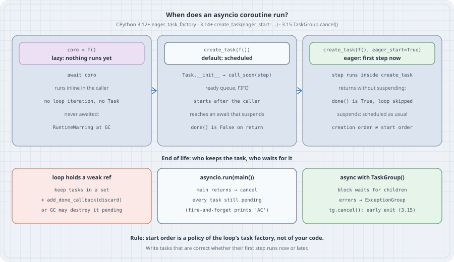

# When Does an asyncio Task Start? Lazy Coroutines, Eager Tasks, and Task Lifetimes

## Thesis

`async def` and `await` look alike in every language that has them, but they do not behave alike. A 2026 design-space study from Brown University ([Gray et al., "A Design Space Exploration of Async/Await"](https://cel.cs.brown.edu/blog/design-space-async-await)) ran one twelve-line fire-and-forget program on seven runtimes and got four different outputs. The differences come from a handful of independent decisions. When does a spawned task start running? Who keeps it alive? What happens to it when its parent finishes?

asyncio answers each of those questions, but some of the answers are surprising, and one of them changes with configuration. Calling a coroutine function is **lazy**: nothing runs. `asyncio.create_task()` is **scheduled** by default: the task starts on a later turn of the loop, after the caller next suspends. Since 3.12, a loop can use an **eager** task factory, and since 3.14 a single `create_task(..., eager_start=True)` call can opt in. With eager start the task's first step runs *inside* `create_task`. On the other end of a task's life, the loop holds only a **weak** reference to it, `asyncio.run()` **cancels** whatever is still pending when `main()` returns, and only a `TaskGroup` **waits** for its children.

This chapter makes each of those rules visible with a program you can run, measures what eager start buys, and shows the bug it introduces into code that assumed a new task "hasn't started yet".

Version note: every listing was run on **CPython 3.15.0** (released 2026-10-09) and **CPython 3.14.8**, both from `uv` (python-build-standalone, Linux x86-64), plus the system **3.13.5** where noted. Output is identical on 3.14.8 and 3.15.0 except for `TaskGroup.cancel()`, which is new in 3.15. The timings in Case 4 come from a shared 8-core box, so read the ratios, not the milliseconds.

## Mental model

{fig-alt="Three columns. Left: coro = f() is lazy; await coro runs it inline in the caller with no loop iteration and no Task; a coroutine never awaited raises a RuntimeWarning at garbage collection. Middle: create_task(f()) calls call_soon(step); the step waits in the FIFO ready queue and starts after the caller reaches an await that suspends; done() is False on return. Right: create_task(f(), eager_start=True) runs the first step inside create_task; if the coroutine returns without suspending, done() is True and the loop is skipped; if it suspends it is scheduled as usual, so creation order is not start order. Bottom: the loop holds only a weak reference, so keep tasks in a set with add_done_callback(discard) or garbage collection may destroy a pending task; asyncio.run cancels every task still pending when main returns, so fire-and-forget prints AC; async with TaskGroup waits for children, turns errors into an ExceptionGroup, and tg.cancel() exits early in 3.15."}

- **A coroutine object is inert.** `f()` builds a coroutine and returns it. No line of `f` runs until something drives it. `await coro` drives it *inline*: the caller keeps running the coroutine's code directly, with no trip through the event loop. That is why `await other_coroutine()` is cheap and never lets another task in unless `other_coroutine` itself suspends.
- **A Task is a scheduled driver.** `Task.__init__` calls `loop.call_soon(self.__step)`, which puts the first step at the back of the loop's FIFO **ready queue**. The task's first line runs on the next loop iteration, and only once the code that is running now suspends. Tasks created in a row therefore start in creation order.
- **An eager Task runs its first step immediately.** With `eager_start=True` (3.14+ through `create_task`; always available on the `Task` constructor since 3.12) or with `asyncio.eager_task_factory` installed on the loop (3.12+), `Task.__init__` runs the first step synchronously, provided the loop is already running. If the coroutine finishes without suspending, the task is done before `create_task` returns and the loop never sees it. If it suspends, the rest of the task is scheduled like any other.
- **The loop does not own your task.** `asyncio` tracks scheduled tasks in a `weakref.WeakSet` (`_scheduled_tasks` in `Lib/asyncio/tasks.py`). While a task is parked on a future that nothing else references, nothing keeps it alive.
- **Who ends a task's life.** When `main()` returns, `asyncio.run()` (through `Runner.close()` → `_cancel_all_tasks()` in `Lib/asyncio/runners.py`) cancels every task that is still pending. A `TaskGroup` waits for all its children before its `async with` block exits. In the Brown paper's terms, a bare task has *indefinite* extent with *cancelled* destruction, and a `TaskGroup` child has *dynamic* extent with *awaited* destruction.

## Worked examples

### Case 1: Calling is not running

```python
# lazy_coro.py
import asyncio


async def greet(who):
    print(f"  greet({who}) body runs")
    return f"hello {who}"


async def main():
    coro = greet("coro")                      # nothing runs here
    print("1. called greet(), got", type(coro).__name__)
    task = asyncio.create_task(greet("task"))  # scheduled, not started
    print("2. created task, done =", task.done())
    print("3. awaiting the coroutine:", await coro)
    print("4. awaiting the task:", await task)
    greet("forgotten")                         # a coroutine that is never awaited


asyncio.run(main())
```

```bash
python3.15 -u lazy_coro.py 2>&1
```

Output:

```text
1. called greet(), got coroutine
2. created task, done = False
  greet(coro) body runs
3. awaiting the coroutine: hello coro
  greet(task) body runs
4. awaiting the task: hello task
/workspace/lab-1018am-C/py/lazy_coro.py:17: RuntimeWarning: coroutine 'greet' was never awaited
  greet("forgotten")                         # a coroutine that is never awaited
RuntimeWarning: Enable tracemalloc to get the object allocation traceback
```

Read lines 2 and 3 together. The task was created *before* the coroutine was awaited, yet `greet(coro)` ran first. `await coro` ran the coroutine inline and never gave the loop a turn. The task had to wait until `main` hit `await task`, which actually suspends. The forgotten `greet("forgotten")` never ran at all. CPython only noticed when the coroutine object was destroyed, and reported it as a `RuntimeWarning`, which ends up in a log nobody reads.

### Case 2: The fire-and-forget program in asyncio

This is the paper's example, translated directly. `fire_and_forget` spawns a log write and returns without awaiting it.

```python
# brown_example.py
# The fire-and-forget program from "A Design Space Exploration of Async/Await"
# (Brown CEL, 2026), written for asyncio. Times scaled down 10x.
import asyncio
import sys


async def write_to_log():
    print("A")
    await asyncio.sleep(0.2)                  # simulate a slow log write
    print("B")


async def fire_and_forget():
    asyncio.create_task(write_to_log())       # spawn, return without awaiting


async def main():
    if "--eager" in sys.argv:
        asyncio.get_running_loop().set_task_factory(asyncio.eager_task_factory)
    await fire_and_forget()
    await asyncio.sleep(0.1)
    print("C")


asyncio.run(main())
print("asyncio.run returned")
```

```bash
python3.15 brown_example.py
python3.15 brown_example.py --eager
```

Output:

```text
A
C
asyncio.run returned
A
C
asyncio.run returned
```

asyncio prints `AC`, the same as JavaScript and Swift in the paper's table, and the eager factory does not change that. `A` appears because `main` suspends in `sleep(0.1)`, which lets the scheduled task start. `B` never appears because the log write needs 0.2 s and `main` is done after 0.1 s. Make the cancellation visible:

```python
# brown_cancelled.py
import asyncio


async def write_to_log():
    print("A")
    try:
        await asyncio.sleep(0.2)
        print("B")
    except asyncio.CancelledError:
        print("B never printed: write_to_log was cancelled at shutdown")
        raise


async def fire_and_forget():
    asyncio.create_task(write_to_log())


async def main():
    await fire_and_forget()
    await asyncio.sleep(0.1)
    print("C")


asyncio.run(main())
```

```bash
python3.15 brown_cancelled.py
```

Output:

```text
A
C
B never printed: write_to_log was cancelled at shutdown
```

The task was not abandoned or silently killed. `asyncio.run()` cancelled it after `main` returned, so `CancelledError` was raised at its `await` and its handler ran. For a log writer that means the log line is lost, and it happens on every shutdown, not just on rare ones.

Give the task a parent that waits for it, and asyncio behaves like Trio's nurseries:

```python
# brown_taskgroup.py
import asyncio


async def write_to_log():
    print("A")
    await asyncio.sleep(0.2)
    print("B")


async def fire_and_forget():
    async with asyncio.TaskGroup() as tg:     # the task cannot outlive this block
        tg.create_task(write_to_log())


async def main():
    await fire_and_forget()
    await asyncio.sleep(0.1)
    print("C")


asyncio.run(main())
```

```bash
python3.15 brown_taskgroup.py
```

Output:

```text
A
B
C
```

Now `fire_and_forget` does not return until the log write has finished, so the output is `ABC`. The two versions differ in two words, but they make opposite promises: one says "this task may outlive me and be cancelled", the other says "this task finishes before I do".

### Case 3: Creation order versus start order

Two children: `t1` finishes without ever suspending (a cache hit), and `t2` suspends once. Each is run three ways: the default, the loop-wide eager factory, and the per-call `eager_start=True` keyword added in 3.14.

```python
# start_order.py
import asyncio
import sys

log = []


async def child(name, blocks):
    log.append(f"{name}: start")
    if blocks:
        await asyncio.sleep(0)                # first real suspension point
    log.append(f"{name}: end")
    return name


async def main(mode):
    loop = asyncio.get_running_loop()
    if mode == "factory":
        loop.set_task_factory(asyncio.eager_task_factory)
    kw = {"eager_start": True} if mode == "per-task" else {}

    t1 = asyncio.create_task(child("t1", blocks=False), **kw)
    log.append(f"main: t1 created, done={t1.done()}")
    t2 = asyncio.create_task(child("t2", blocks=True), **kw)
    log.append(f"main: t2 created, done={t2.done()}")
    await asyncio.gather(t1, t2)
    log.append("main: gathered")


for mode in ("lazy", "factory", "per-task"):
    log.clear()
    asyncio.run(main(mode))
    print(f"{sys.version.split()[0]} {mode}:")
    for line in log:
        print("   ", line)
```

```bash
python3.15 start_order.py
```

Output:

```text
3.15.0 lazy:
    main: t1 created, done=False
    main: t2 created, done=False
    t1: start
    t1: end
    t2: start
    t2: end
    main: gathered
3.15.0 factory:
    t1: start
    t1: end
    main: t1 created, done=True
    t2: start
    main: t2 created, done=False
    t2: end
    main: gathered
3.15.0 per-task:
    t1: start
    t1: end
    main: t1 created, done=True
    t2: start
    main: t2 created, done=False
    t2: end
    main: gathered
```

In **lazy** mode `main` gets all the way to `gather` before either child runs, and the children run in creation order. In both **eager** modes, `t1` starts *and finishes* inside its `create_task` call, so `main` sees `done=True` immediately. `t2` runs as far as its first `await`, returns control to `main` and is scheduled from there. `python3.14 start_order.py` prints exactly the same three traces.

The two eager spellings differ only in scope. `loop.set_task_factory(asyncio.eager_task_factory)` changes every `create_task` on the loop, including the ones inside libraries you call. `eager_start=True` changes one call. Under the eager factory a single call can also opt *out*, because the factory takes `eager_start=True` as a default keyword that the call can override:

```python
# opt_out.py  (Python 3.14+)
import asyncio


async def quick():
    return "cached"


async def main():
    asyncio.get_running_loop().set_task_factory(asyncio.eager_task_factory)
    a = asyncio.create_task(quick())                      # factory default: eager
    b = asyncio.create_task(quick(), eager_start=False)   # this one opts out
    print("eager task done at creation:", a.done())
    print("opted-out task done at creation:", b.done())
    print(await a, await b)


asyncio.run(main())
```

```bash
python3.15 opt_out.py
```

Output:

```text
eager task done at creation: True
opted-out task done at creation: False
cached cached
```

The keyword route needs 3.14. On 3.13, `eager_task_factory` exists (since 3.12) but `asyncio.create_task(coro, eager_start=True)` raises `TypeError: create_task() got an unexpected keyword argument 'eager_start'` and leaves the coroutine un-awaited. The 3.14 [What's New](https://docs.python.org/3.14/whatsnew/3.14.html) entry (gh-128307) is the change that made `create_task()` pass arbitrary keywords through to the task factory.

### Case 4: What eager start buys

The case for eager tasks is in the [documentation](https://docs.python.org/3.15/library/asyncio-task.html#eager-task-factory): a coroutine that returns without blocking, such as one that hits a cache, never has to be scheduled on the loop. The benchmark below fans out 100,000 lookups and varies how many of them are cache hits:

```python
# eager_bench.py
import asyncio
import sys
import time

CACHE = {k: k * k for k in range(1000)}       # 1,000 hot keys


async def lookup(key):
    if key in CACHE:                          # cache hit: returns without suspending
        return CACHE[key]
    await asyncio.sleep(0)                    # cache miss: pretend to do I/O
    CACHE[key] = key * key
    return CACHE[key]


async def fan_out(n, hit_ratio):
    keys = [i % 1000 if (i % 100) < hit_ratio * 100 else 10_000 + i for i in range(n)]
    tasks = [asyncio.create_task(lookup(k)) for k in keys]
    return len(await asyncio.gather(*tasks))


async def bench(eager, n, hit_ratio):
    if eager:
        asyncio.get_running_loop().set_task_factory(asyncio.eager_task_factory)
    best = float("inf")
    for _ in range(5):
        for k in [k for k in CACHE if k >= 1000]:
            del CACHE[k]                      # forget the misses between rounds
        t0 = time.perf_counter()
        await fan_out(n, hit_ratio)
        best = min(best, time.perf_counter() - t0)
    return best


print(sys.version.split()[0])
for hit in (1.0, 0.9, 0.5, 0.0):
    lazy = asyncio.run(bench(False, 100_000, hit))
    eager = asyncio.run(bench(True, 100_000, hit))
    print(f"hit ratio {hit:4.0%}: lazy {lazy*1000:6.1f} ms  eager {eager*1000:6.1f} ms  ({lazy/eager:.1f}x)")
```

```bash
python3.14 eager_bench.py
python3.15 eager_bench.py
```

Output:

```text
3.14.8
hit ratio 100%: lazy  348.2 ms  eager  150.5 ms  (2.3x)
hit ratio  90%: lazy  355.1 ms  eager  177.9 ms  (2.0x)
hit ratio  50%: lazy  434.8 ms  eager  293.3 ms  (1.5x)
hit ratio   0%: lazy  532.4 ms  eager  452.7 ms  (1.2x)
3.15.0
hit ratio 100%: lazy  356.8 ms  eager  149.5 ms  (2.4x)
hit ratio  90%: lazy  352.2 ms  eager  175.4 ms  (2.0x)
hit ratio  50%: lazy  434.4 ms  eager  277.0 ms  (1.6x)
hit ratio   0%: lazy  501.6 ms  eager  429.1 ms  (1.2x)
```

When every lookup is a hit, eager start is about 2.3–2.4× faster. None of the 100,000 tasks goes through the ready queue, and `gather` finds them all finished already. The gain shrinks as the hit ratio falls, but it does not reach zero. Even a task that always suspends saves one loop iteration, because its first step (up to the `await`) runs inside `create_task` instead of in a scheduled callback. The speedup comes from skipping scheduling, so it is largest for many small tasks that rarely block and negligible for a few tasks that each do real I/O.

### Case 5: The task that vanished

The [`create_task` documentation](https://docs.python.org/3.15/library/asyncio-task.html#asyncio.create_task) has an "Important" box: "The event loop only keeps weak references to tasks. A task that isn't referenced elsewhere may get garbage collected at any time, even before it's done." Here is that happening:

```python
# vanishing_task.py
import asyncio
import gc
import sys

done = []


async def wait_for_signal():
    fut = asyncio.get_running_loop().create_future()   # only this frame holds it
    try:
        await fut                                      # nobody will ever set it
    finally:
        done.append("finally ran")


async def main(keep):
    background = set()
    task = asyncio.create_task(wait_for_signal())
    if keep:
        background.add(task)
        task.add_done_callback(background.discard)
    del task
    await asyncio.sleep(0)            # let it start and park on the future
    gc.collect()                      # what a busy program does eventually
    await asyncio.sleep(0)
    alive = [t for t in asyncio.all_tasks() if t is not asyncio.current_task()]
    print(f"keep={keep}: other tasks alive={len(alive)}, finally ran={done}")
    for t in alive:
        t.cancel()
    done.clear()


asyncio.run(main(keep=False))
asyncio.run(main(keep=True))
```

```bash
python3.15 -u vanishing_task.py 2>&1
```

Output:

```text
Task was destroyed but it is pending!
task: <Task pending name='Task-2' coro=<wait_for_signal() done, defined at /workspace/lab-1018am-C/py/vanishing_task.py:9> wait_for=<Future pending cb=[Task.task_wakeup()]>>
keep=False: other tasks alive=0, finally ran=['finally ran']
keep=True: other tasks alive=1, finally ran=[]
```

With `keep=False` the task parks on a future that only its own frame references. That makes a reference cycle (task → coroutine → frame → future → wakeup callback → task) which nothing outside points into, so `gc.collect()` reclaims all of it. The only trace is a log line. The `finally` block *did* run, because closing the collected coroutine throws `GeneratorExit` into it. Nobody awaited anything, nothing raised in `main`, and the work simply stopped. With `keep=True` the set holds a strong reference and the task survives. In a real program the "future nobody else holds" is often a lock, an event, or a queue local to the task, and the collection happens whenever the cyclic GC next runs. That is why the bug shows up under load and not in tests. 3.14 and 3.15 behave identically here.

### Case 6: The exception nobody retrieves

A task that fails and is never awaited does not crash anything:

```python
# lost_exception.py
import asyncio
import gc


async def flaky():
    raise ConnectionError("upstream reset")


async def main():
    t = asyncio.create_task(flaky())
    await asyncio.sleep(0)            # t runs and fails; nobody awaits it
    print("main carries on; t.done() =", t.done())
    del t
    gc.collect()
    print("main finished")


asyncio.run(main())
```

```bash
python3.15 -u lost_exception.py 2>&1
```

Output:

```text
main carries on; t.done() = True
Task exception was never retrieved
future: <Task finished name='Task-2' coro=<flaky() done, defined at /workspace/lab-1018am-C/py/lost_exception.py:6> exception=ConnectionError('upstream reset')>
Traceback (most recent call last):
  File "/workspace/lab-1018am-C/py/lost_exception.py", line 7, in flaky
    raise ConnectionError("upstream reset")
ConnectionError: upstream reset
main finished
```

The exception sits inside the task (*never* propagated, in the paper's terms) until the task is destroyed. Then the loop's exception handler logs "Task exception was never retrieved". `main` carried on and finished normally. A `TaskGroup` makes the opposite choice: a failing child cancels its siblings and the group raises an `ExceptionGroup` from the `async with`, as the asyncio and TaskGroups chapter shows.

### Case 7: Ending a group early with `TaskGroup.cancel()` (3.15)

Before 3.15, stopping a `TaskGroup` once its goal was met took a sentinel exception raised from a child and suppressed outside the group. 3.15 adds [`TaskGroup.cancel()`](https://docs.python.org/3.15/library/asyncio-task.html#asyncio.TaskGroup.cancel) (gh-127214). It cancels every child that is not done, and the parent body, and the `async with` exits **without** raising `CancelledError`. Here are three mirrors, where the first one to answer wins:

```python
# taskgroup_cancel.py  (Python 3.15+: TaskGroup.cancel)
import asyncio
import time

T0 = time.perf_counter()


def ms():
    return f"{(time.perf_counter() - T0) * 1000:5.0f} ms"


async def mirror(name, delay, tg, winner):
    await asyncio.sleep(delay)                # pretend to download from this mirror
    winner.append(name)
    print(f"{ms()}  {name} finished first; cancelling the rest")
    tg.cancel()                               # non-exceptional early exit


async def main():
    winner = []
    async with asyncio.TaskGroup() as tg:
        tasks = [tg.create_task(mirror(n, d, tg, winner))
                 for n, d in (("eu", 0.30), ("us", 0.05), ("ap", 0.50))]
    print(f"{ms()}  group exited without CancelledError; winner={winner}")
    print("       states:", [("cancelled" if t.cancelled() else "done") for t in tasks])


asyncio.run(main())
```

```bash
python3.15 -u taskgroup_cancel.py
python3.14 -u taskgroup_cancel.py 2>&1 | grep Error
```

Output:

```text
   50 ms  us finished first; cancelling the rest
   50 ms  group exited without CancelledError; winner=['us']
       states: ['cancelled', 'cancelled', 'cancelled']
    | AttributeError: 'TaskGroup' object has no attribute 'cancel'
```

The group exited the moment `us` answered, at 50 ms instead of 500 ms. Look at the states, though: **the winner is cancelled too**. `cancel()` targets every task in the group that is not done, and the task calling it is still running at that moment. So `us` is cancelled even though it returns right afterwards, and its return value would be lost. That is why the listing records the winner in a list before calling `tg.cancel()`, instead of reading `task.result()` afterwards. On 3.14 the method does not exist (the `AttributeError` arrives wrapped in an `ExceptionGroup`).

## The trap

**Code that registers a task after creating it breaks under eager start.** A common pattern is "create the task, then record it so duplicate requests can join it, and let the task remove itself when it finishes". With scheduled tasks the registration always comes first, because the task cannot start until the caller suspends. Turn on the eager factory, perhaps because a framework or a performance guide recommends it, and a cache hit finishes *inside* `create_task`, before the registration line has run:

```python
# eager_trap.py
import asyncio
import sys

CACHE = {"/health": b"ok"}
inflight = {}                                 # path -> task, so duplicates can join


async def fetch(path):
    try:
        if path in CACHE:
            return CACHE[path]                # fast path: no await at all
        await asyncio.sleep(0.01)             # slow path: real I/O
        return b"<html>"
    finally:
        del inflight[path]                    # "the task is registered by now"


async def handle(path):
    task = asyncio.create_task(fetch(path))
    inflight[path] = task                     # register after creation
    return await task


async def main():
    if "--eager" in sys.argv:
        asyncio.get_running_loop().set_task_factory(asyncio.eager_task_factory)
    for path in ("/index", "/health"):
        try:
            print(f"{path}: {await handle(path)!r}  inflight={list(inflight)}")
        except KeyError as e:
            print(f"{path}: KeyError {e}  inflight={list(inflight)}")


asyncio.run(main())
```

```bash
python3.15 eager_trap.py
python3.15 eager_trap.py --eager
```

Output:

```text
/index: b'<html>'  inflight=[]
/health: b'ok'  inflight=[]
/index: b'<html>'  inflight=[]
/health: KeyError '/health'  inflight=['/health']
```

The lazy run is clean. The eager run fails on the cache hit: `fetch` ran its `finally` before `handle` had added the task, so `del inflight[path]` raised `KeyError`. Then `handle` registered a task that was already finished, and nothing will ever remove it, so `inflight` is left holding a dead entry, which is a slow leak. The slow path works in both modes because it suspends before reaching the `finally`. This is the "semantic change" the documentation warns about: "If the coroutine returns or raises, the task is finished eagerly and is never scheduled to the event loop... the application's task execution order is likely to change." 3.14.8 fails the same way.

The fix is to move the cleanup out of the coroutine and into a done callback. [`add_done_callback`](https://docs.python.org/3.15/library/asyncio-future.html#asyncio.Future.add_done_callback) is documented to schedule the callback with `loop.call_soon()` if the task is already done, so the callback always runs after the code that registered the task:

```python
# eager_fixed.py
import asyncio
import sys

CACHE = {"/health": b"ok"}
inflight = {}


async def fetch(path):
    if path in CACHE:
        return CACHE[path]
    await asyncio.sleep(0.01)
    return b"<html>"


async def handle(path):
    task = asyncio.create_task(fetch(path))
    inflight[path] = task
    # A done callback is always scheduled with call_soon, even if the task is
    # already finished, so it runs after this function has registered it.
    task.add_done_callback(lambda t: inflight.pop(path, None))
    return await task


async def main():
    if "--eager" in sys.argv:
        asyncio.get_running_loop().set_task_factory(asyncio.eager_task_factory)
    for path in ("/index", "/health"):
        body = await handle(path)
        await asyncio.sleep(0)                # let the done callback run
        print(f"{path}: {body!r}  inflight={list(inflight)}")


asyncio.run(main())
```

```bash
python3.15 eager_fixed.py
python3.15 eager_fixed.py --eager
```

Output:

```text
/index: b'<html>'  inflight=[]
/health: b'ok'  inflight=[]
/index: b'<html>'  inflight=[]
/health: b'ok'  inflight=[]
```

Both modes are now correct. The general lesson: the start order of tasks is a policy of the loop's task factory, not a property of your code. Code that is only correct when a new task "hasn't started yet" is depending on that policy.

## The boring rule

1. Never call a coroutine function without awaiting it or wrapping it in a task. Run tests with `-W error::RuntimeWarning` so "coroutine ... was never awaited" fails the build.
2. `await coro` runs inline. Use `create_task` only when you want the work to run concurrently with the caller.
3. Default to `TaskGroup` for any task whose result or failure matters. Use a bare `create_task` only for genuinely background work, and then keep it in a set with `add_done_callback(set.discard)`.
4. Anything that must survive shutdown (log flushes, metrics, final writes) must be awaited before `main()` returns, because `asyncio.run()` cancels pending tasks.
5. Write tasks that are correct whether their first step runs now or later. Do cleanup in done callbacks, not in code that assumes the creator has finished its bookkeeping.
6. Turn on `eager_task_factory` for workloads with many small, often-synchronous tasks (cache hits, memoised lookups), measure the gain, and run the test suite under it first. On 3.14+, prefer per-call `eager_start=True` on the hot path you own.
7. On 3.15, end a group early with `tg.cancel()`. Record the winner's result before calling it, because the calling task is cancelled too.

## Try this

1. Add `print(asyncio.current_task().get_name())` as the first line of `child` in `start_order.py`. Under the eager factory, which task does `current_task()` report while the first step runs inside `create_task`?
2. Run `eager_bench.py` with `n = 1_000` and with `n = 1_000_000`. Does the speedup ratio depend on the number of tasks, or only on the hit ratio?
3. In `vanishing_task.py`, replace the bare future with `asyncio.Event()` and `await event.wait()`. Is the task still collected? Now keep the event in a module-level variable and try again.
4. Rewrite `taskgroup_cancel.py` for 3.14 using the old pattern: raise a private exception from the winner and catch it with `except*` outside the group. Compare how the winner's result is passed out in each version.
5. Wrap `eager_trap.py`'s `inflight` in a `TaskGroup`-based request coalescer that is correct in both modes without a done callback. What does the group's lifetime have to be?

## Sources

- [Coroutines and Tasks: `create_task`, `Task(eager_start=...)`, eager task factory, `TaskGroup.cancel`](https://docs.python.org/3.15/library/asyncio-task.html) (3.15 documentation; the "Important" weak-reference box and the "semantic change" note on eager tasks)
- [Event loop: `loop.set_task_factory` and `loop.create_task`](https://docs.python.org/3.15/library/asyncio-eventloop.html#asyncio.loop.set_task_factory) (3.14 change: all kwargs passed on; `eager_start` works with eager factories)
- [Futures: `add_done_callback`](https://docs.python.org/3.15/library/asyncio-future.html#asyncio.Future.add_done_callback) (already-done futures schedule callbacks with `call_soon`)
- [Runners: `asyncio.run`, `asyncio.Runner`](https://docs.python.org/3.15/library/asyncio-runner.html)
- [What's New in Python 3.14: asyncio](https://docs.python.org/3.14/whatsnew/3.14.html) (gh-128307, keyword pass-through in `create_task`)
- [What's New in Python 3.15: asyncio](https://docs.python.org/3.15/whatsnew/3.15.html) (gh-127214, `TaskGroup.cancel`)
- [What's New in Python 3.12: asyncio](https://docs.python.org/3.12/whatsnew/3.12.html) (eager task factory, gh-102853 / gh-104140 / gh-104138: "making some use-cases 2x to 5x faster")
- CPython 3.15.0 source: `Lib/asyncio/tasks.py` (`Task.__init__`, `__eager_start`, `_scheduled_tasks` WeakSet, `create_eager_task_factory`), `Lib/asyncio/runners.py` (`_cancel_all_tasks`)
- Gavin Gray et al., [A Design Space Exploration of Async/Await](https://cel.cs.brown.edu/blog/design-space-async-await) (Brown CEL, 2026; the fire-and-forget program and the eagerness/extent/destruction dimensions)
