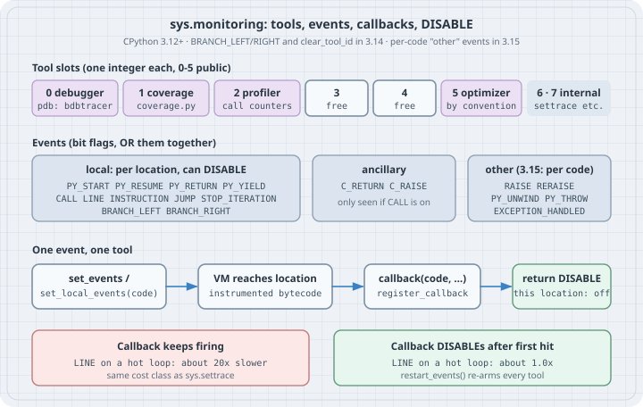

# `sys.monitoring`: Low-Overhead Debuggers and Coverage (PEP 669)

## Thesis

For twenty years every Python debugger and coverage tool was built on `sys.settrace`. You install one function, and the interpreter calls it on every function call and every line in every frame it traces. It can never stop calling that function at a single place, so a breakpoint inside a hot loop slows the entire program down. Python 3.12 added a second mechanism, `sys.monitoring` ([PEP 669](https://peps.python.org/pep-0669/)). A tool picks the **events** it wants and registers a **callback** for each. The interpreter instruments only those places in the bytecode. Most important, a callback can return `sys.monitoring.DISABLE` to say "never call me at this location again." That one return value is where nearly all the speed comes from. A line-coverage tool that disables each line after the first hit runs a hot loop at roughly native speed. The same tool without `DISABLE` is about as slow as `settrace`.

It is not an experimental corner. On 3.14 and 3.15, `breakpoint()` and `python -m pdb` run on it, and so does coverage.py's default measurement core. IDE debuggers are moving to it as well. This chapter builds the same three tools in miniature (a call counter, a line-and-branch coverage tool, and a breakpoint) and measures what each design decision costs.

Version note: every listing was run on **CPython 3.15.0** (released 2026-10-09) and, where the output differs, **CPython 3.14.8**, both from `uv` (python-build-standalone, Linux x86-64). The box was shared with other jobs, so the timings carry about ±20% noise. Read the ratios, not the milliseconds. Coverage.py is **7.16.2**, run through `uvx` without installing it into any project.

## Mental model

{fig-alt="Tool slots 0 to 5: 0 debugger (pdb registers as bdbtracer), 1 coverage (coverage.py), 2 profiler, 3 and 4 free, 5 optimizer; slots 6 and 7 are internal for sys.setprofile and sys.settrace. Events: local events (PY_START, PY_RESUME, PY_RETURN, PY_YIELD, CALL, LINE, INSTRUCTION, JUMP, STOP_ITERATION, BRANCH_LEFT, BRANCH_RIGHT) can be disabled per location; ancillary C_RETURN and C_RAISE are only seen when CALL is on; other events RAISE, RERAISE, PY_UNWIND, PY_THROW, EXCEPTION_HANDLED became per code object in 3.15. Flow: set_events or set_local_events, the VM reaches an instrumented location, the callback runs, and returning DISABLE turns that location off. A callback that keeps firing makes LINE on a hot loop about 20x slower; one that disables after the first hit costs about 1x, and restart_events re-arms every tool."}

- **`sys.monitoring` is a namespace, not a module.** Write `import sys` and use `sys.monitoring`. `import sys.monitoring` fails.
- **A tool is an integer slot, 0 to 5.** Claim one with `use_tool_id(id, name)` and release it with `free_tool_id(id)`. Conventions: `DEBUGGER_ID = 0`, `COVERAGE_ID = 1`, `PROFILER_ID = 2`, `OPTIMIZER_ID = 5`. CPython keeps two more internal slots, 6 and 7, for `sys.setprofile` and `sys.settrace` (`PY_MONITORING_SYS_PROFILE_ID` / `PY_MONITORING_SYS_TRACE_ID` in `Include/internal/pycore_instruments.h`). That is why the old API and the new one can run side by side.
- **Events are bit flags.** OR them together and pass the result to `set_events(tool, mask)` for the whole interpreter, or to `set_local_events(tool, code, mask)` for one code object. Nothing is on by default.
- **Callbacks get the code object, not a frame.** `LINE` callbacks receive `(code, line_number)`. Branch and jump callbacks receive `(code, instruction_offset, destination_offset)`. If you need locals, `sys._getframe(1)` inside the callback is the frame being monitored.
- **`DISABLE` is per location, per tool.** Returning it from a *local* event switches off that event at that one instruction for your tool only. `restart_events()` turns every disabled location back on, **for all tools**.
- **What changed recently.** 3.14 added `BRANCH_LEFT` / `BRANCH_RIGHT` (replacing the now-deprecated `BRANCH`) and `clear_tool_id()`. Also in 3.14, `free_tool_id()` began clearing a tool's events and callbacks; before that it left them registered. 3.15 lets the "other" events (`RAISE`, `RERAISE`, `PY_UNWIND`, `PY_THROW`, `EXCEPTION_HANDLED`) be turned on per code object and accept `DISABLE` (gh-146182). Case 7 shows exactly what that does.

## Worked examples

### Case 1: The smallest tool: count function starts

```python
# hello_monitor.py
import sys
from collections import Counter

mon = sys.monitoring
TOOL = mon.PROFILER_ID          # 2: the slot reserved by convention for profilers
starts = Counter()


def on_start(code, instruction_offset):
    starts[code.co_qualname] += 1


def fib(n):
    return n if n < 2 else fib(n - 1) + fib(n - 2)


def main():
    return [fib(n) for n in range(10)]


mon.use_tool_id(TOOL, "call-counter")
mon.register_callback(TOOL, mon.events.PY_START, on_start)
mon.set_events(TOOL, mon.events.PY_START)
try:
    result = main()
finally:
    mon.set_events(TOOL, mon.events.NO_EVENTS)
    mon.free_tool_id(TOOL)

print(result)
for name, n in starts.most_common():
    print(f"{n:5d}  {name}")
print("tool 2 after free:", mon.get_tool(TOOL))
```

```bash
python3.15 hello_monitor.py
```

Output:

```text
[0, 1, 1, 2, 3, 5, 8, 13, 21, 34]
  276  fib
    1  main
tool 2 after free: None
```

That is the whole lifecycle: claim a slot, register a callback, turn events on, run the code, turn events off, and free the slot. The `try`/`finally` matters, because a tool that dies without freeing its slot blocks the next tool that wants it (see The trap). There is no `<listcomp>` entry: since 3.12 a list comprehension runs inline in its function ([PEP 709](https://peps.python.org/pep-0709/)), so it never starts a code object of its own.

### Case 2: Where the speed actually comes from

One CPU-bound loop, timed four ways (best of five runs): no tool; a classic `sys.settrace` line tracer; a `sys.monitoring` `LINE` callback that keeps firing; and the same callback returning `DISABLE` after it records a line.

```python
# bench_tracers.py
import sys
import time

mon = sys.monitoring
TOOL = mon.COVERAGE_ID          # 1


def workload():
    total = 0
    for i in range(1_000_000):
        if i % 3:
            total += i
        else:
            total -= 1
    return total


def run(label, setup, teardown, baseline=None):
    best = float("inf")
    for _ in range(5):
        setup()
        t0 = time.perf_counter()
        workload()
        best = min(best, time.perf_counter() - t0)
        teardown()
    extra = f"  {best / baseline:5.1f}x" if baseline else ""
    print(f"{label:<34} {best * 1000:7.1f} ms{extra}")
    return best


seen = set()


def settrace_line(frame, event, arg):            # what coverage tools did before 3.12
    if event == "line":
        seen.add((frame.f_code, frame.f_lineno))
    return settrace_line


def mon_line(code, line):                       # sys.monitoring, keep firing
    seen.add((code, line))


def mon_line_once(code, line):                  # sys.monitoring, fire once per line
    seen.add((code, line))
    return mon.DISABLE


def use(cb):
    def setup():
        mon.use_tool_id(TOOL, "bench")
        mon.register_callback(TOOL, mon.events.LINE, cb)
        mon.set_events(TOOL, mon.events.LINE)
    return setup


def off():
    mon.free_tool_id(TOOL)          # 3.14+: also clears events and callbacks
    mon.restart_events()            # re-arm DISABLEd locations for the next run


print(sys.version.split()[0])
base = run("no tool", lambda: None, lambda: None)
run("sys.settrace line tracer", lambda: sys.settrace(settrace_line), lambda: sys.settrace(None), base)
run("sys.monitoring LINE", use(mon_line), off, base)
run("sys.monitoring LINE + DISABLE", use(mon_line_once), off, base)
```

```bash
python3.14 bench_tracers.py
python3.15 bench_tracers.py
```

Output:

```text
3.14.8
no tool                               36.5 ms
sys.settrace line tracer             978.7 ms   26.8x
sys.monitoring LINE                  810.1 ms   22.2x
sys.monitoring LINE + DISABLE         33.8 ms    0.9x
3.15.0
no tool                               36.8 ms
sys.settrace line tracer             907.1 ms   24.7x
sys.monitoring LINE                  824.0 ms   22.4x
sys.monitoring LINE + DISABLE         38.0 ms    1.0x
```

Read the third row before the fourth. Swapping `settrace` for `sys.monitoring` on its own saves only 10–20% (17% on 3.14.8 and 9% on 3.15.0 in this run), because a Python callback on every line costs roughly the same either way. The fourth row is the design change. Once each line has reported itself and returned `DISABLE`, the interpreter removes the instrumentation from that location and the loop runs at native speed. The 0.9× and 1.0× are noise around 1×. In earlier runs on this shared box under heavy load, the same row read up to 1.7× while the other rows swung between 18× and 28×, so compare rows within one run, not across runs. **A `sys.monitoring` tool is fast only if it disables everything it has finished with.**

### Case 3: A line + branch coverage tool in about 65 lines

The program under test and a driver that calls it 2,000 times:

```python
# shipping.py
def shipping_cost(weight_kg, express=False, country="IN"):
    if weight_kg <= 0:
        raise ValueError("weight must be positive")
    cost = 40 + 12 * weight_kg
    if express:
        cost *= 2
    if country != "IN":
        cost += 300
    return round(cost, 2)
```

```python
# minicov.py
"""Line + branch coverage in about 65 lines, on sys.monitoring (Python 3.14+)."""
import sys
from collections import defaultdict

mon = sys.monitoring
E = mon.events
TOOL = mon.COVERAGE_ID

lines_hit = defaultdict(set)        # filename -> {line}
branches_hit = defaultdict(set)     # (filename, line) -> {destination line}
calls = defaultdict(int)            # filename -> how often our callbacks ran there


def _line_of(code, offset):
    for start, end, line in code.co_lines():
        if start <= offset < end:
            return line
    return None


def _on_line(code, line):
    calls[code.co_filename] += 1
    lines_hit[code.co_filename].add(line)
    return mon.DISABLE              # seen once is enough: never call us here again


def _on_branch(code, offset, dest):
    calls[code.co_filename] += 1
    src, dst = _line_of(code, offset), _line_of(code, dest)
    branches_hit[(code.co_filename, src)].add(dst)
    return mon.DISABLE              # disables this direction only; the other stays armed


def start():
    mon.use_tool_id(TOOL, "minicov")
    mon.register_callback(TOOL, E.LINE, _on_line)
    mon.register_callback(TOOL, E.BRANCH_LEFT, _on_branch)
    mon.register_callback(TOOL, E.BRANCH_RIGHT, _on_branch)
    mon.set_events(TOOL, E.LINE | E.BRANCH_LEFT | E.BRANCH_RIGHT)


def stop():
    mon.free_tool_id(TOOL)


def executable_lines(code):
    """Every line a code object (and its nested code objects) can execute."""
    out = {line for _, _, line in code.co_lines() if line}   # None/0: no source line
    for const in code.co_consts:
        if hasattr(const, "co_lines"):
            out |= executable_lines(const)
    return out


def report(module):
    fn = module.__file__
    src = compile(open(fn).read(), fn, "exec")
    want, got = executable_lines(src), lines_hit[fn]
    print(f"{fn.rsplit('/', 1)[-1]}: {len(got & want)}/{len(want)} lines, missed {sorted(want - got)}")
    for (f, line), dests in sorted(branches_hit.items()):
        if f == fn:
            print(f"  branch at line {line}: went to {sorted(dests)} ({len(dests)} of 2 directions)")
    print(f"  callbacks in {fn.rsplit('/', 1)[-1]}: {calls[fn]}; in all files: {sum(calls.values())}")
```

```python
# run_shipping.py
import minicov

minicov.start()
import shipping                     # imported under coverage, like a real test run

for _ in range(1000):               # a hot loop: callbacks must not scale with it
    shipping.shipping_cost(1)
    shipping.shipping_cost(2.5, express=True)
minicov.stop()
minicov.report(shipping)
```

```bash
python3.15 run_shipping.py
```

Output:

```text
shipping.py: 7/9 lines, missed [4, 9]
  branch at line 3: went to [5] (1 of 2 directions)
  branch at line 6: went to [7, 8] (2 of 2 directions)
  branch at line 8: went to [10] (1 of 2 directions)
  callbacks in shipping.py: 11; in all files: 456
```

The loop executed `shipping_cost` 2,000 times. Our callbacks ran **11 times** in `shipping.py`: 7 lines plus 4 branch directions, each once. Every later execution of those instructions paid nothing. The 400-odd callbacks elsewhere are the import system and the standard library seen once each and disabled, because the events were turned on globally. A real tool would filter by filename *and* return `DISABLE` there too, as this one does.

Branches are reported by destination line, not as "left" or "right". The documentation promises only that a given branch's direction stays consistent for the life of the program, not which one is which. `line 3 → [5]` means `weight_kg <= 0` was never true, and `line 8 → [10]` means no order shipped abroad.

### Case 4: Check it against the real tool

coverage.py chooses `sys.monitoring` ("SysMonitor" core) by default on 3.14+. Run it on the same calls without `minicov`:

```python
# test_shipping.py
import shipping

for _ in range(1000):
    shipping.shipping_cost(1)
    shipping.shipping_cost(2.5, express=True)
```

```bash
uvx --python 3.15 --from coverage==7.16.2 coverage run --debug=sys --branch test_shipping.py 2>&1 | grep -E '^ +(coverage_version|core):'
uvx --python 3.15 --from coverage==7.16.2 coverage report -m --include=shipping.py
```

Output:

```text
               coverage_version: 7.16.2
                           core: SysMonitor
Name          Stmts   Miss Branch BrPart  Cover   Missing
---------------------------------------------------------
shipping.py       9      2      6      2    73%   4, 9
---------------------------------------------------------
TOTAL             9      2      6      2    73%
```

The two tools agree: lines 4 and 9 are missed, 9 statements, and two of the three `if`s went only one way (6 branch destinations, 2 partial). coverage.py's [`[run] core`](https://coverage.readthedocs.io/en/latest/config.html#config-run-core) setting documents the choice: `ctrace` was the default until 3.13, and `sysmon` is the default on 3.14+, with some features (plugins, dynamic contexts, some concurrency options) not yet supported on `sysmon`.

### Case 5: A breakpoint that costs nothing until it hits

A debugger needs only one line, so it should watch only one code object. `set_local_events` turns `LINE` on for `orders.price` alone. Every line in that function that is not the breakpoint disables itself the first time it is seen.

```python
# orders.py
def price(item):
    total = item["qty"] * item["unit"]
    if item["qty"] > 900:           # the rare case we want to inspect
        total *= 0.9
    return total


def run(n=200_000):
    items = [{"qty": i % 1000, "unit": 3} for i in range(n)]
    return sum(price(it) for it in items)
```

```python
# tinybp.py
import sys
import time

import orders

mon = sys.monitoring
TOOL = mon.DEBUGGER_ID
stats = {"callbacks": 0, "hits": 0}


def break_at(func, lineno, action):
    """Call action(frame) whenever func reaches lineno. Nothing else is watched."""
    def on_line(code, line):
        stats["callbacks"] += 1
        if line != lineno:
            return mon.DISABLE          # this line is never interesting: stop calling us here
        stats["hits"] += 1
        action(sys._getframe(1))        # the frame that is executing `func`

    mon.use_tool_id(TOOL, "tinybp")
    mon.register_callback(TOOL, mon.events.LINE, on_line)
    mon.set_local_events(TOOL, func.__code__, mon.events.LINE)   # one code object only


def settrace_break_at(func, lineno, action):
    """The pre-3.12 way: a trace function that sees every call and every line."""
    def tracer(frame, event, arg):
        stats["callbacks"] += 1
        if frame.f_code is not func.__code__:
            return None                 # do not trace other functions' lines
        if event == "line" and frame.f_lineno == lineno:
            stats["hits"] += 1
            action(frame)
        return tracer
    sys.settrace(tracer)


first = []
def show(frame):
    if not first:
        first.append(dict(frame.f_locals))


def timed(label):
    t0 = time.perf_counter()
    orders.run()
    print(f"{label:<26} {(time.perf_counter() - t0) * 1000:7.1f} ms  hits={stats['hits']}  callbacks={stats['callbacks']}")


BP = orders.price.__code__.co_firstlineno + 3   # the `total *= 0.9` line
timed("no debugger")

settrace_break_at(orders.price, BP, show)
timed("settrace breakpoint")
sys.settrace(None)
stats.update(callbacks=0, hits=0)

break_at(orders.price, BP, show)
timed("sys.monitoring breakpoint")
mon.free_tool_id(TOOL)

print("first hit locals:", first[0])
```

```bash
python3.15 tinybp.py
python3.15 tinybp.py
```

Output (two runs):

```text
no debugger                   61.8 ms  hits=0  callbacks=0
settrace breakpoint          245.2 ms  hits=19800  callbacks=1219803
sys.monitoring breakpoint     67.5 ms  hits=19800  callbacks=19803
first hit locals: {'item': {'qty': 901, 'unit': 3}, 'total': 2703}
no debugger                   63.5 ms  hits=0  callbacks=0
settrace breakpoint          250.7 ms  hits=19800  callbacks=1219803
sys.monitoring breakpoint     67.9 ms  hits=19800  callbacks=19803
first hit locals: {'item': {'qty': 901, 'unit': 3}, 'total': 2703}
```

Both debuggers stopped 19,800 times and saw the same locals. The `settrace` version was called **1,219,803 times**: once for every new frame in the process, plus every line of `price`, on 200,000 calls. It made the run about 4× slower (245–251 ms against 62–64 ms). The `sys.monitoring` version was called 19,803 times (3 lines disabled at first sight, plus the 19,800 real hits), and its run time is within about 10% of no debugger at all (67–68 ms), which is about the run-to-run noise here. This is the effect the `sys.monitoring` documentation describes: "a program can be run under a debugger with no overhead if the debugger disables all monitoring except for a few breakpoints."

### Case 6: `breakpoint()` already uses it

On 3.14+, `breakpoint()`, `pdb.set_trace()` and the `python -m pdb` CLI always use the `sys.monitoring` backend ([pdb docs](https://docs.python.org/3.15/library/pdb.html#pdb.set_default_backend)). Explicitly constructed `pdb.Pdb()` objects default to `settrace` unless you call `pdb.set_default_backend("monitoring")`. Ask pdb which tool holds slot 0:

```python
# pdb_backend.py
import sys


def handler(x):
    y = x * 2
    breakpoint()
    return y


print(handler(21))
print("after pdb, tool 0 is:", sys.monitoring.get_tool(sys.monitoring.DEBUGGER_ID))
```

```bash
printf 'p sys.monitoring.get_tool(sys.monitoring.DEBUGGER_ID)\np y\nc\n' | python3.15 pdb_backend.py
```

Output:

```text
> /tmp/sysmon/pdb_backend.py(7)handler()
-> breakpoint()
(Pdb) 'bdbtracer'
(Pdb) 42
(Pdb) 42
after pdb, tool 0 is: None
```

pdb's `bdb` layer registers as `bdbtracer` in `DEBUGGER_ID` and frees the slot when you continue. The same script prints identical output on 3.14.8.

### Case 7: 3.15 lets exception events be per code object

`RAISE` is one of the "other" events. Through 3.14 it could only be turned on globally, and returning `DISABLE` from it was an error. 3.15 changes both. Run the same tool four ways:

```python
# raise_local.py
import sys

mon = sys.monitoring
TOOL = 3
seen = []


def on_raise(code, instruction_offset, exc):
    seen.append(type(exc).__name__)
    return mon.DISABLE


def lookup():
    for key in ("a", "b", "c"):
        try:
            {}[key]
        except KeyError:
            pass


mon.use_tool_id(TOOL, "raise-watch")
mon.register_callback(TOOL, mon.events.RAISE, on_raise)
mode = sys.argv[1]
try:
    if mode == "local":
        mon.set_local_events(TOOL, lookup.__code__, mon.events.RAISE)
    else:
        mon.set_events(TOOL, mon.events.RAISE)
    lookup()
    lookup()
except ValueError as e:
    print(f"ValueError: {e}")
print(f"{sys.version.split()[0]} {mode:<6} RAISE callbacks: {len(seen)}")
```

```bash
for v in 3.14 3.15; do for m in global local; do python$v raise_local.py $m; done; done
```

Output:

```text
ValueError: Cannot disable RAISE events. Callback removed.
3.14.8 global RAISE callbacks: 1
ValueError: invalid local event set 0x800
3.14.8 local  RAISE callbacks: 0
3.15.0 global RAISE callbacks: 6
3.15.0 local  RAISE callbacks: 1
```

On 3.14 the global `DISABLE` raises `ValueError` and **unregisters the callback**, so a careless exception tracker silently stops tracking after one event. Turning `RAISE` on locally is rejected outright (`0x800` is the `RAISE` bit). On 3.15.0 the local form works as the What's New entry describes: one callback, then `RAISE` is off for `lookup`'s code object for this tool. With `RAISE` on *globally*, 3.15.0 accepts `DISABLE` without an error, but the callback kept firing for all six exceptions on this build. Watching exceptions in a hot function with almost no cost means `set_local_events` on that function's code object.

## The trap

**`restart_events()` re-arms every tool, not just yours.** It is the obvious call for a debugger that wants to re-check its disabled lines after the user adds a breakpoint. Run the coverage tool from Case 3 while some *other* code calls it once per loop iteration:

```python
# run_shipping_restart.py
import sys

import minicov

minicov.start()
import shipping

for _ in range(1000):
    shipping.shipping_cost(1)
    shipping.shipping_cost(2.5, express=True)
    sys.monitoring.restart_events()     # some *other* tool "re-arming its breakpoints"
minicov.stop()
minicov.report(shipping)
```

```bash
python3.15 run_shipping_restart.py
```

Output:

```text
shipping.py: 7/9 lines, missed [4, 9]
  branch at line 3: went to [5] (1 of 2 directions)
  branch at line 6: went to [7, 8] (2 of 2 directions)
  branch at line 8: went to [10] (1 of 2 directions)
  callbacks in shipping.py: 10001; in all files: 15431
```

The report is still correct, but the coverage tool's callbacks went from 11 to 10,001 in `shipping.py`, and from 456 to over 15,000 overall. Each `restart_events()` undid every `DISABLE` the coverage tool had earned. In a large test suite running under a debugger or a profiler that restarts events often, that is how a coverage run can suddenly get several times slower with no change to the coverage tool. The documentation says it plainly: `restart_events()` enables all disabled events "for all tools". If you write a tool, re-arm your own locations with `set_local_events` on the code objects you care about, and keep `restart_events()` for when you really mean everyone.

**Squatting on someone else's slot.** The slot numbers are conventions, but the debugger relies on its slot:

```python
# squat.py
import sys

mon = sys.monitoring
mon.use_tool_id(mon.DEBUGGER_ID, "my-call-counter")   # wrong slot for a counter

def handler(x):
    y = x * 2
    breakpoint()
    return y

print(handler(21))
```

```bash
printf 'c\n' | python3.15 squat.py 2>&1 | tail -3
```

Output:

```text
  File "/home/box/.local/share/uv/python/cpython-3.15.0-linux-x86_64-gnu/lib/python3.15/bdb.py", line 57, in start_trace
    raise ValueError('Another debugger is using the monitoring tool')
ValueError: Another debugger is using the monitoring tool
```

A call counter that grabbed slot 0 has made `breakpoint()` unusable for the whole process. Use the slot that matches your tool's role (`PROFILER_ID` for counters and profilers, 3 or 4 for anything else), check `get_tool(id)` before `use_tool_id`, and always `free_tool_id` in a `finally`.

## The boring rule

1. Prefer `sys.monitoring` to `sys.settrace` for any new debugger, coverage tool, or profiler on Python 3.12+. On 3.14+, use `BRANCH_LEFT` / `BRANCH_RIGHT`, never the deprecated `BRANCH`.
2. Return `DISABLE` from every local-event callback as soon as that location has told you what you need. A tool that never disables is a slow `settrace`.
3. Scope with `set_local_events(tool, code, mask)` when you know which functions matter; use global `set_events` only for genuinely whole-program questions.
4. Claim the slot that matches your role, check `get_tool()` first, and `free_tool_id()` in `finally`. On 3.14+ that also clears your events and callbacks.
5. Never call `restart_events()` from a library: it re-arms every tool in the process.
6. On 3.15, watch exceptions in hot code with `set_local_events(..., RAISE)` plus `DISABLE`. On 3.14 and earlier, never return `DISABLE` from a `RAISE`-family callback: it raises `ValueError` and removes your callback.

## Try this

1. Add `PY_RETURN` to `hello_monitor.py` and print each function's maximum recursion depth. Which events do you need to keep the depth correct when `fib` raises?
2. Extend `minicov.py` to print a missed branch as `3->4` the way coverage.py does. You know the taken destination; use `dis.get_instructions(code)` to find the other target of the conditional jump.
3. Change `tinybp.py` so that `break_at` can be called *again* for a different line after the first run. Re-arm only `orders.price.__code__`, not every tool.
4. If `sys._jit.is_available()` is true on your 3.15 build, run `bench_tracers.py` with `PYTHON_JIT=1` and with `PYTHON_JIT=0`. Does `DISABLE` still return the loop to native speed with the JIT on?
5. Write a `RAISE` + `EXCEPTION_HANDLED` tool that reports exceptions raised and caught inside the same function, which is a common performance smell. Use local events on 3.15 and make it fall back to global events without `DISABLE` on 3.14.

## Sources

- [PEP 669 — Low Impact Monitoring for CPython](https://peps.python.org/pep-0669/)
- [`sys.monitoring` — Execution event monitoring](https://docs.python.org/3.15/library/sys.monitoring.html) (3.15 documentation; tool IDs, event kinds, `DISABLE`, `restart_events`, callback signatures)
- [What's New in Python 3.14: sys.monitoring, pdb, bdb](https://docs.python.org/3.14/whatsnew/3.14.html) (`BRANCH_LEFT`/`BRANCH_RIGHT`, `clear_tool_id`, `free_tool_id` change, monitoring backends)
- [What's New in Python 3.15: sys.monitoring](https://docs.python.org/3.15/whatsnew/3.15.html) (per-code-object "other" events, gh-146182)
- [`pdb.set_default_backend`](https://docs.python.org/3.15/library/pdb.html#pdb.set_default_backend)
- [PEP 709 — Inlined comprehensions](https://peps.python.org/pep-0709/)
- [coverage.py configuration: `[run] core`](https://coverage.readthedocs.io/en/latest/config.html#config-run-core)
- CPython 3.15.0 source: `Lib/bdb.py` (`_MonitoringTracer`, `DEBUGGER_ID`, `bdbtracer`), `Include/internal/pycore_instruments.h` (slots 6 and 7)
